# Campañas, outbox y recuperación de entregas

**Estado: componentes T-10–T-13 revisados y publicados.** La revisión 13 aprueba
campañas, bajas/supresiones, outbox y consumidor. Sus resultados y la prueba de
baja posterior a publicación AMQP constan en el
[ledger](../roadmap/2026-10-21-plataforma-emailing/tasks.md). Actividad está en
validación T-14; Cronicle T-15 y el QA integral de fase T-16 siguen pendientes.
Consulta [actividad y métricas](actividad-y-metricas.md) para interpretar la
pantalla, los registros históricos y el CSV sin inventar resultados externos.

Esta guía describe el flujo de laboratorio con log privado y Mailpit. Guardar
credenciales SMTP no habilita envío a Internet. Consulta
[entregabilidad](../infraestructura/entregabilidad.md) para las responsabilidades
de dominio, relay e IP antes de plantear una integración externa.

## Qué proceso hace cada trabajo

La aplicación web guarda la campaña y su revisión autorizada. El materializador
crea una entrega por destinatario y un evento outbox en una misma transacción
MySQL. La revisión conserva el contenido y los destinatarios revisados; una
reentrega del broker no vuelve a interpretar la campaña como un envío nuevo.

El dispatcher reserva eventos pendientes y publica sus referencias en RabbitMQ.
La publicación ocurre fuera de la transacción SQL y espera una confirmación del
broker. Si la confirmación se pierde, SQL conserva trabajo reconciliable: puede
publicarse otra copia del mismo evento. Por eso el consumidor debe deduplicar.

El consumidor de dominio reserva la entrega en MySQL, comprueba sus políticas
vigentes y persiste el comienzo del transporte. Después realiza el IO de SMTP o
del artefacto privado. Confirma el mensaje AMQP únicamente después de disponer
de un resultado durable o de una continuación durable. Un duplicado consulta
SQL y no inicia de nuevo una entrega ya terminal.

```mermaid
flowchart LR
    W[Aplicación web] --> M[Campaña y revisión autorizada]
    M --> T[Entrega y outbox en MySQL]
    T --> D[Dispatcher con confirms]
    D --> R[RabbitMQ: eventos JSON]
    R --> C[Consumidor de dominio]
    C --> S[Arranque durable en MySQL]
    S --> E[Log privado o Mailpit]
    E --> O[Resultado durable]
    O --> A[Ack AMQP]
```



El worker ordinario Laravel mantiene su propia cola para los demás jobs. Su
comando `queue:work` no interpreta los eventos JSON de entrega. El comando de
dominio es `deliveries:work`; ambos procesos pertenecen a la aplicación y usan
el broker compartido. La infraestructura no necesita otra instancia RabbitMQ
por aplicación ni un Supervisor central que contenga el código de cada una.

## Estados y decisiones de recuperación

| Estado de entrega | Significado | Recuperación automática |
|---|---|---|
| `pending` | Trabajo durable pendiente de su fecha de disponibilidad. Puede esperar una pausa o una cuota. | El dispatcher publica su evento cuando corresponde. |
| `reserved` | Un worker tiene una reserva temporal; todavía no comenzó el transporte. | Una reserva vencida permite crear una nueva generación. |
| `sending` | El comienzo del transporte ya se confirmó en MySQL. | Si vence su lease, pasa a `ambiguous`. |
| `logged` | Se creó un `.eml` privado. | No se vuelve a enviar al recibir un duplicado. |
| `smtp_accepted` | Se observó la aceptación final del relay SMTP. | No se vuelve a enviar al recibir un duplicado. |
| `failed` | Se agotaron los intentos seguros permitidos. | Se publica un evento de fallo; no hay reenvío automático desde esa cola. |
| `ambiguous` | El sistema no puede descartar aceptación o IO ya iniciado. | Requiere investigación; no se reenvía automáticamente. |
| `suppressed` | La política vigente impide enviar al destinatario. | No se inicia SMTP. |
| `blocked` | La fuente, autorización, remitente o transporte ya no permite iniciar esta entrega. | No se inicia SMTP. |

Los estados de los intentos `MailMessage` son distintos de los de la entrega
lógica. Un rechazo seguro puede dejar un intento `smtp_rejected` mientras la
entrega vuelve a `pending` con otra generación. No se deben contar esos intentos
como varios destinatarios ni presentar `smtp_accepted` como entrega al buzón,
apertura o clic.

Cada reserva lleva token, generación y vencimiento. El comienzo, renovación y
resultado exigen la identidad vigente. Una reserva antigua no puede recuperar
autoridad por actualizar su objeto PHP. El fencing SQL tampoco puede retirar
un mensaje que un relay externo ya haya recibido: un `sending` vencido conserva
esa incertidumbre y no habilita otro envío automático.

El conector observa la etapa SMTP y marca la posible aceptación antes de intentar
el terminador DATA. Un rechazo observado o un fallo demostrado anterior a ese
punto puede seguir la política de reintentos. La ausencia de una observación o
una excepción genérica no demuestra que sea seguro repetir. Si se observó la
aceptación final, un error posterior de limpieza no la convierte en rechazo.

## Consentimiento, pausas y cuotas

Justo antes de comenzar se comprueban la campaña autorizada, su fecha, el
contacto original, su email y consentimiento vigentes, la supresión de la cuenta
y el remitente revisado. Recrear un contacto con el mismo email no sustituye al
contacto original de la revisión. Baja y arranque usan el mismo mutex de cuenta:
una baja ya completada impide un comienzo posterior.

Una campaña pausada o una cuota agotada aplaza la entrega con un evento outbox y
una fecha de disponibilidad. Esa espera no incrementa los intentos SMTP. El
worker vuelve a comprobar las políticas al retomar el trabajo.

[config/delivery.php](../../config/delivery.php) define cuotas por cuenta y un
pool explícito del servidor compartido entre cuentas. Cambiar de cuenta no crea
otro presupuesto de pool. Este identificador expresa la agrupación operativa;
compartir host o usuario SMTP no demuestra compartir una IP pública.

Las ventanas son fijas de minuto y día UTC, basadas en el reloj MySQL. No son un
límite móvil de los últimos sesenta segundos: dos ventanas adyacentes pueden
permitir dos ráfagas de su cupo de minuto junto a la frontera. Un intento ambiguo
conserva su cargo de cuota. La admisión adquiere los locks en un orden estable y
debe revalidar la ventana si una espera la cruza.

## Operación del consumidor

El código y las dependencias deben corresponder a la misma versión. Desde el
perfil nativo preparado con los wrappers del proyecto:

```powershell
powershell -NoProfile -File scripts/php.ps1 artisan deliveries:work
```

Para procesar como máximo un mensaje disponible y terminar:

```powershell
powershell -NoProfile -File scripts/php.ps1 artisan deliveries:work --once
```

`--once` puede terminar sin procesar nada si la cola está vacía; no espera a que
una campaña futura sea elegible. El consumo continuo usa acknowledgements
manuales y prefetch acotado. Aumentar procesos no sustituye la reserva SQL ni
amplía las cuotas. Las pruebas de componente T-13 no sustituyen el QA conjunto
del Compose de T-16 ni el despliegue y la validación operativa de T-20.

No ejecutes estos comandos contra el perfil de pruebas mientras otra suite o
sesión QA tenga la base reservada. `emailing_testing` es una base exclusiva de
pruebas; las migraciones operativas pendientes de `emailing` se resolverán con
su procedimiento de copia y migración incremental, sin `migrate:fresh`.

RabbitMQ Management permite inspeccionar consumidores, mensajes listos y mensajes
sin ack. SQL conserva el estado de negocio. Vaciar una cola o marcar una entrega
como pendiente manualmente no es un procedimiento de recuperación: puede omitir
trabajo o repetir un envío que ya fue aceptado.

## Cómo investigar una incidencia

Correlaciona cuenta, `delivery_id`, generación, evento outbox y estado durable.
Comprueba si el problema es publicación pendiente, reserva vigente, espera de
cuota/pausa, resultado terminal o incertidumbre SMTP. El recibo de publicación y
el ack del consumidor acreditan fases diferentes; ninguno garantiza entrega al
buzón del destinatario.

Para un `ambiguous`, conserva los registros y contrasta cualquier evidencia
disponible del relay antes de decidir una acción humana. La cola de fallos
conserva referencias de entregas agotadas y no tiene un consumidor que las
reenvíe automáticamente. El diagnóstico publicado debe usar códigos depurados:
no copies contraseñas, AUTH, DSN, cuerpo de mensajes ni trazas con argumentos.

Cronicle y la vista de actividad se incorporan en T-15 y T-14 respectivamente.
Esta guía no acredita esos módulos ni propone añadir una segunda programación
en Laravel para el mismo trabajo. La decisión completa y sus pruebas pendientes
figuran en [ADR-003](../knowledge/adr/ADR-003-publicacion-confirmada-y-estado-smtp.md).
