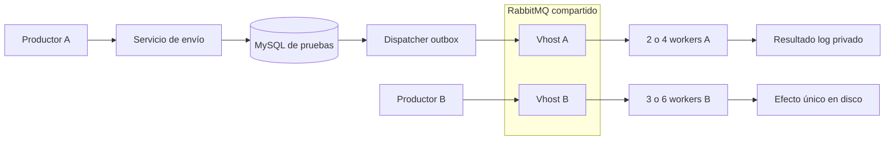

# Pruebas de carga del broker compartido

**Estado: preparación de T-19, 2026-11-03.** Estas herramientas permiten ejecutar
una matriz reproducible con Emailing y una segunda aplicación mínima. Sus
pruebas de contrato están verificadas; la matriz integrada de 52 rondas, los
reinicios y la restauración global todavía no están aceptados. Consulta los
[criterios de T-19](../roadmap/2026-10-21-plataforma-emailing/tasks.md#t-19--pruebas-cruzadas-carga-y-restauración)
y el [plan de pruebas](../roadmap/2026-10-21-plataforma-emailing/test-plan.md).

Esta guía es para quien administra el laboratorio. Para instalar y utilizar el
producto, empieza por el [manual completo](../manual/guia-completa.md). Una
ejecución de carga no instala una cuenta de trabajo persistente.

## Qué se mide

La aplicación A ejecuta la aceptación del servicio de envío de Emailing, su
outbox y sus consumidores reales. Usa una cuenta temporal y transporte `log`;
no envía mensajes a Internet ni acredita entregabilidad. La entrada se realiza
en el servicio de dominio, sin HTTP: las cifras no son capacidad de la API REST
ni de MCP, ni incluyen autenticación HTTP, TLS o límites del servidor web.

La aplicación B sólo implementa el protocolo necesario para competir por el
broker: publicación persistente con confirmación, consumo con ack manual y un
efecto sintético en disco que se deduplica por ejecución y secuencia. No copia
el negocio de otra aplicación ni utiliza MySQL.

Cada ronda crea dos usuarios y dos vhosts con nombres `lab.t19.<UUID>.a` y
`lab.t19.<UUID>.b`. Cada identidad sólo recibe permisos sobre su topología,
sin rol de administración. Los vhosts separan permisos y nombres; comparten la
CPU, memoria y disco del servicio RabbitMQ. El control ejecuta los mismos
workers y ventana, pero publica cero mensajes B, para comparar la interferencia.



## Requisitos y ventana exclusiva

El supervisor y el muestreo de procesos de esta versión requieren Windows,
PowerShell, Python 3.12 o posterior, PHP compatible con `composer.lock`, Composer
y Docker con contenedores Linux. El lock actual exige al menos PHP 8.4.1.
No hay dependencias Python adicionales. La compatibilidad Docker de la
aplicación no implica que este supervisor esté cualificado en Linux.

Prepara el entorno siguiendo [desarrollo](../aplicacion/desarrollo.md) y
[operación de infraestructura](../infraestructura/operacion.md). Desde la raíz
de un checkout completo, los pasos de instalación de dependencias son:

```powershell
powershell -NoProfile -File scripts/composer.ps1 install
npm ci
npm run build
powershell -NoProfile -File scripts/provision-local.ps1
```

El aprovisionamiento normal carga configuración privada sin mostrarla y conserva
los secretos existentes. Estos comandos no deben ejecutarse durante otra suite
que tenga congeladas las fuentes. No copies configuraciones ni credenciales a
la documentación o a los recibos públicos.

Antes de empezar, coordina una ventana exclusiva para `emailing_testing`.
Detén de forma normal los perfiles QA, fixtures y pruebas que utilicen esa base.
No detengas la infraestructura compartida ni los workers de otras aplicaciones.
La suite completa puede limpiar tablas de pruebas; nunca utiliza la base
operativa como destino de carga.

El guard exige MySQL, base **y usuario** `emailing_testing`, `DB_URL` vacío y
ausencia de otras conexiones a esa base antes de operaciones de preparación.
La inicialización de carga rechaza datos de negocio existentes y no ejecuta
`migrate:fresh` para eliminarlos. Si encuentra datos, hay que revisar el estado
y preparar el entorno de pruebas por el procedimiento documentado.

## Comprobaciones sin carga

Los tres comandos siguientes muestran su plan y terminan. Por defecto no
arrancan procesos de aplicación ni acceden a SQL o RabbitMQ:

```powershell
python scripts/broker_lab/regression.py
python scripts/broker_lab/load.py --distribution 10 --scenario steady
python scripts/broker_lab/batch.py
```

Las pruebas de las herramientas no necesitan base de datos ni broker:

```powershell
python -m unittest discover -s tests/broker_lab -p 'test_*.py'
python tests/broker_lab/check_descriptors.py
python tests/broker_lab/check_protocol_parity.py
powershell -NoProfile -File scripts/php.ps1 vendor/bin/phpunit tests/Unit/BrokerProtocolTest.php
```

Los escenarios sintéticos de supervisión utilizan procesos PHP pequeños,
archivos temporales propios y dobles de las dependencias externas. Un resultado
verde aquí verifica contratos y rechazos; no equivale a una ejecución de carga.

El grupo `broker-isolation` selecciona el protocolo B, el rechazo real de acceso
de la aplicación a un vhost ajeno y la prueba existente de dos consumidores
reales frente al mismo evento. Esta última necesita el entorno Linux de pruebas
de recuperación descrito en [QA de entrega](../aplicacion/qa-entrega.md).

```powershell
powershell -NoProfile -File scripts/php.ps1 artisan test --group=broker-isolation
```

Este grupo realiza integración y necesita su propia ventana exclusiva. No
prueba por sí solo todos los permisos negativos entre las dos identidades
temporales, la matriz completa ni la restauración.

## Obtener una regresión válida para la carga

Ejecuta la suite completa antes de la matriz:

```powershell
python scripts/broker_lab/regression.py --execute
```

El programa selecciona todos los archivos `*Test.php` de `tests/Unit` y
`tests/Feature`; no acepta un filtro. Exige Composer instalado, habilita sockets
en un directorio ini propio, comprueba las extensiones necesarias y aplica el
guard SQL. Supervisa los descendientes mediante un Windows Job Object.

Los contenedores creados por los tests pertenecen al daemon Docker, no al Job
Object. El supervisor comprueba primero la ausencia de una etiqueta UUID propia;
los dos launchers de contenedores de la suite reciben esa etiqueta mediante
`docker_scope.php`. Tras cerrar el Job, reconcilia únicamente los contenedores
de esa ejecución, vuelve a comprobar etiqueta, ID y nombre antes de detenerlos
y confirma su ausencia. No inspecciona variables de entorno ni contenedores de
otras aplicaciones. Si el daemon no responde o la atribución no coincide,
`daemon_cleanup_verified` es falso y la carga queda bloqueada.

La [sonda acotada del daemon](evidencias/t19-daemon-20261103/native-result.public.json)
ejecutó únicamente un PHP dormido, sin red ni bootstrap de aplicación: confirmó
que el contenedor sobrevivía al cierre del Job y que la reconciliación nueva lo
eliminaba. Conserva tres recibos literales y la observación de salida terminal.
Un primer intento falló al escribir el índice auxiliar después de limpiar; el
segundo terminó en cero. Esta sonda no acredita la suite completa, sus fixtures
SQL, la carga ni la restauración.

La salida inicial indica `directory`, una ruta bajo
`storage/broker-lab-evidence/t19-regression-<UUID>`. Conserva ese valor. Espera al
resultado terminal: ver una línea de inicio o agotar una espera de observación
no significa que la suite haya finalizado.

El presupuesto de supervisión predeterminado es 28.800 segundos. `--deadline`
admite entre 3.600 y 86.400 segundos para el proceso completo; no modifica los
timeouts ni las aserciones de los tests. Un timeout, JUnit incompleto, salida
distinta de cero, fallo de contención o cambio de fuentes invalida el resultado.

Para admitirlo como prerrequisito, la carga exige recibos terminales de éxito,
selección completa, limpieza de procesos confirmada, identidad SQL de pruebas
y cero errores o fallos. También compara `source-manifest.json` con las fuentes
actuales: una regresión de una revisión anterior no habilita el código nuevo.
La ausencia de un dato obligatorio se rechaza; nunca se crean recibos a mano
para desbloquear una ejecución.

## Una ronda y la matriz completa

Asigna a `$regresion` la ruta real indicada por la ejecución anterior. La ruta
ficticia siguiente sólo muestra la forma del comando:

```powershell
$regresion = 'storage/broker-lab-evidence/t19-regression-<UUID-real>'
python scripts/broker_lab/load.py --execute --prerequisite $regresion --distribution 5 --scenario steady --warmup
```

Una ronda de diagnóstico acepta `--distribution 5|10`,
`--scenario daily100|daily200|steady|burst` y `--round 1|2|3`.
`--control` elimina las publicaciones B; `--warmup` utiliza una preparación de
10 mensajes A y 50 B, o cero B en su control. El identificador interno de esa
preparación es ronda cero. Una ronda suelta no sustituye la matriz.

Para ejecutar todas las combinaciones con ejecuciones nuevas:

```powershell
python scripts/broker_lab/batch.py --execute --prerequisite $regresion
```

La matriz tiene **52 rondas secuenciales**: cuatro de preparación, separadas
de las métricas, y 48 medidas. En cada reparto de workers hay cuatro escenarios,
tres repeticiones y un control emparejado por repetición. La segunda repetición
invierte el orden control/carga. Cada ronda utiliza identidades nuevas.

| Escenario | Mensajes A | Mensajes B | Máximo por segundo de cada productor | Ventana nominal |
|---|---:|---:|---:|---:|
| `daily100` | 100 | 100 | 10 | 10 s |
| `daily200` | 200 | 200 | 10 | 20 s |
| `steady` | 200 | 1.000 | 10 | 100 s |
| `burst` | 500 | 2.000 | 25 | 80 s |

Son muestras comprimidas: `daily100` no espera un día ni acredita un ritmo
sostenido de 24 horas. En el control B publica cero, pero conserva la ventana
nominal del escenario. Los repartos son A/B = 2/3 y 4/6.

Antes de publicar se verifica que todos los workers propios siguen vivos, que
el broker registra el número previsto de consumidores y que las colas están
vacías. A conserva un cuerpo privado de texto de 2 KiB; su sobre real de dominio
se mide sin rellenarlo artificialmente. El mensaje completo B mide exactamente
2 KiB. Las tasas, tamaños, máximo de 300 segundos de drenaje elegible y mínimo
de 256 MiB libres se fijan antes de publicar. Son condiciones del experimento,
no un SLA de rendimiento.

La política real de cuotas se captura al inicializar la cuenta temporal y se
comprueba en productores y workers. No se aumenta ni desactiva para hacer pasar
la prueba. El supervisor comprueba fuentes y parámetros entre rondas, no reintenta
automáticamente y detiene la matriz ante el primer fallo. Una preparación
ejecutada antes del batch no se suma a sus cuatro preparaciones propias.

## Cómo interpretar resultados y recursos

Una publicación confirmada, un ack del consumidor y un efecto durable son
hechos distintos. La reconciliación compara sus identidades y etapas; no basta
con observar una cola vacía. B exige un efecto único por secuencia y detecta
contenido diferente reutilizando la misma identidad.

A diferencia entre mensajes `logged` y pendientes futuros por cuota. Los
pendientes deben conservar un outbox emparejado y no quedar elegibles al corte.
`completion_fraction` indica qué proporción terminó en log. Nunca se presenta
un pendiente futuro como un correo procesado ni se modifica su fecha para
vaciar la cola. Se toma un corte SQL coherente, se detienen los actores propios
y se comprueba el estado asentado del broker.

Las latencias se expresan en milisegundos, con p50, p95, p99 y máximo por el
método de rango más próximo. A separa aceptación hasta ack, publicación hasta
reserva, reserva hasta resultado durable y confirmación del productor. B mide
publicación hasta efecto durable. Una muestra vacía produce `null`, no cero.
Hay que comparar controles y cargas del mismo escenario y reparto; el programa
no convierte una diferencia observada en una garantía de servicio.

El muestreo intenta obtener una observación cada cinco segundos y registra los
intervalos reales. Recoge CPU acumulada, working set y memoria privada sólo de
los workers PHP que creó, estadísticas de los contenedores RabbitMQ/MySQL
seleccionados, espacio libre y Block I/O. Docker informa memoria ajustada por
caché y cifras de I/O redondeadas. Los totales de los servicios compartidos no
se atribuyen exclusivamente a A o B, ni se garantiza capturar picos entre
muestras. El coste del productor, supervisor y observador no está atribuido
como CPU de los workers.

## Archivos, fallos y limpieza

| Ubicación o archivo | Contenido y uso |
|---|---|
| `storage/broker-lab-evidence/` | Ejecuciones de regresión, rondas y batches; evidencia local. |
| `storage/broker-lab-<UUID>/a` y `/b` | Atribución del fixture, observaciones y efectos propios. |
| `manifest.public.json` | Parámetros y política capturada antes del trabajo. |
| `command-receipt.public.json` | Supervisión de la regresión, salida terminal y estabilidad. |
| `test-summary.json` | Casos, aserciones y problemas de la suite; no sustituye JUnit. |
| `result.public.json` | Resultado de una ronda o de la matriz según su directorio. |
| `supervision.public.json`, `cleanup.public.json` | Contención y limpieza atribuida. |
| `daemon-attribution.public.json`, `daemon-cleanup.public.json` | Ausencia previa y reconciliación de contenedores propios de la regresión. |
| `completed-rounds.public.json` | Rondas que el batch terminó; conserva las parciales. |

El sufijo `.public.json` identifica una proyección limitada; no es una
autorización automática para publicar todo el directorio. Logs, JUnit, datos SQL
y configuración siguen siendo privados y pueden contener información sensible.
Para un informe público selecciona archivos concretos, revísalos y conserva sus
hashes; no adjuntes una carpeta completa de `storage`.

Una ronda rechaza un directorio de fixture preexistente. Registra la ausencia
y la propiedad antes de crear recursos. La limpieza sólo elimina los usuarios,
vhosts y filas del fixture atribuido a esa ronda, verifica su ausencia y conserva
la evidencia privada. Un archivo de atribución antiguo por sí solo no autoriza
a borrar SQL. No utiliza `docker compose down -v`, purgas globales ni búsquedas
y terminaciones generales de procesos.

`--worker`, `--run-id` y `--batch-id` son argumentos internos del supervisor;
no son mecanismos de reanudación. Un batch fallido no se completa editando su
contador: hay que diagnosticar la causa, revisar la limpieza y repetir con una
ejecución nueva. Si el entorno necesita proteger PIDs ajenos concretos, puede
proporcionar privadamente `BROKER_LAB_PROTECTED_PIDS` como enteros separados
por comas; el código no incluye PIDs del ordenador del autor.

`BROKER_LAB_REGRESSION_RUN_ID` es una identidad interna que el supervisor pasa
a PHPUnit para atribuir sus contenedores. No debe fijarse manualmente ni usarse
para adoptar una ejecución anterior. La limpieza del árbol de ejecución confirma
procesos nativos y contenedores; una suite interrumpida puede conservar fixtures
SQL o topología de pruebas. Sus recibos no afirman haber borrado esos datos y
una ejecución incompleta nunca habilita la carga. Revisa el estado dentro de la
ventana exclusiva de pruebas antes de volver a preparar fixtures.

El inventario de fuentes excluye los nombres privados antes de leer contenido.
Rechaza enlaces, junctions en directorios antecesores y hardlinks antes del hash;
no utiliza una redirección del sistema de archivos para leer fuera del checkout.

## Qué falta para aceptar T-19

La ejecución real de la matriz, las denegaciones entre ambas identidades
temporales y la revisión/QA independiente siguen siendo necesarias. El campo
de contrato de 60 segundos de reconexión reserva un umbral para el futuro ensayo
de recuperación; estas herramientas de carga todavía no ejecutan reinicios.

La recuperación deberá ensayarse en destino temporal aislado, conservando los
seis volúmenes de infraestructura del alcance aprobado, además del
almacenamiento y la configuración privados necesarios de la aplicación.
Exportar definiciones RabbitMQ no respalda sus
mensajes. También quedan las comprobaciones tras snapshot de API/MCP,
identidades, grants y revocaciones, y la integración con la aceptación de Google
y clientes reales. Google OAuth aún no está configurado en este laboratorio.
Ningún `PASS` de una ronda o de la matriz cierra por sí solo T-19, T-20 o T-14 MCP.
