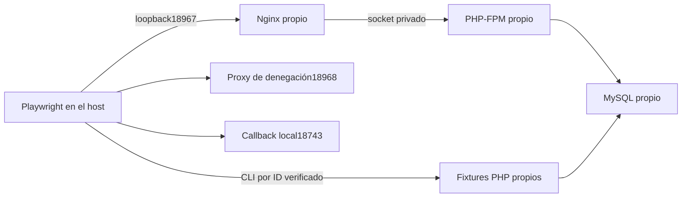

# Preparar las pruebas Google/MCP en Docker

Estado a4 de noviembre de2026: el perfil Compose, la frontera PHP y el
transporte de fixtures y el controlador de ejecución se desarrollaron en
`feature/t12-browser-docker` y se integran en la rama de la aplicación tras
revisión A+B+C+D sin gaps. Pasan49 pruebas locales Python, que incluyen44
comprobaciones PHP, quince checks de barrera/ledger y doce tests Node. No se ha arrancado el perfil, conectado
con MySQL ni ejecutado Playwright con estos cambios. T-12 sigue en progreso.

## Qué problema resuelve

El lanzador existente de navegador sirve la aplicación con `php -S`. Esa ruta
prueba HTTP con el servidor de desarrollo de PHP. Para probar también Docker,
el perfil nuevo prepara Nginx y PHP-FPM reales, con el mismo archivo de nueve
escenarios `tests/e2e/mcp-google.spec.mjs`. No se modifican sus aserciones.

Este perfil usa HTTP en loopback para conservar los orígenes y callbacks de
los escenarios. La cualificación HTTPS de operación sigue siendo la descrita
en [operación MCP](../aplicacion/mcp-operacion.md); ejecutar este perfil no
acredita TLS, Google real ni clientes nativos de agentes.

## Topología y archivos

| Componente | Responsabilidad |
|---|---|
| MySQL propio | Base y usuario `emailing_testing`; no publica puertos. |
| PHP-FPM propio | Usuario33, socket privado, aplicación y fixtures; sin workers ni scheduler. |
| Nginx propio | Publica únicamente `127.0.0.1:18967`; sirve assets y deriva el front controller al adaptador de prueba. |
| Red interna | Los tres servicios no se conectan a la red compartida de infraestructura. |
| Tres volúmenes nuevos | MySQL, storage de aplicación y socket FPM, con nombres/etiquetas del UUID. |
| Proxy host previsto | Puerto18968 para rechazar HTTP externo y túneles HTTPS de los clientes de prueba. |
| Callback host | Puerto18743; lo adquiere el propio escenario de OAuth, con state de un solo uso. |



Nginx usa [`nginx-google-browser.conf`](../../docker/nginx-google-browser.conf)
exclusivamente en este perfil. La configuración productiva no cambia. Los
adaptadores PHP se montan en lectura, sin montar el árbol de aplicación del
host sobre la imagen; los assets y el negocio deben venir de las imágenes
locales inmutables que se prueben.

| Archivo | Función implementada |
|---|---|
| `scripts/browser_lab/contract.py` | UUIDv4, servicios/volúmenes cerrados y plan sin aceptación implícita. |
| `scripts/browser_lab/compose.py` | Documento Compose aislado con tres IDs locales de imagen. |
| `scripts/browser_lab/preview.py` | Vista previa sin escrituras, procesos ni lectura de configuración privada. |
| `scripts/browser_lab/controller.py` | Ejecución con dos fases de contención, selección completa/estabilidad y conciliación de resultados. |
| `scripts/browser_lab/worker_io.py` | Salidas privadas acotadas y recibos públicos sin cuerpos ni argumentos. |
| `scripts/browser_lab/docker_profile.py` | Ausencia previa, atribución, salud, ejecución por ID y parada de todos los IDs propios. |
| `scripts/browser_lab/qualification.py` | Prerrequisito completo existente, código público en imagen y assets PHP/Nginx idénticos. |
| `scripts/browser_lab/results.py` | Reconcilia inventario, configuración y resultados reales del reporter JSON. |
| `tests/support/GoogleBrowserBoundary.php` | Frontera previa a autoload para HTTP y CLI; mantiene la compatibilidad del teardown nativo existente. |
| `tests/support/GoogleBrowserLease.php` | Leases compartidas de peticiones y exclusiva de limpieza; deniega entradas tardías antes de bootstrap. |
| `tests/support/google-browser-runtime.mjs` | Consulta de identidad Docker antes de cualquier fixture por ID; transporte nativo conservado. |
| `tests/support/google-docker-playwright.config.mjs` | Selecciona los nueve escenarios sin lanzar el servidor PHP nativo ni su teardown global. |
| `tests/support/google-docker-helper.mjs` | Configuración sintética exclusiva, proxy de denegación y acciones de fixtures. |

## Cómo inspeccionar la preparación

Desde la raíz del checkout:

```powershell
python -B scripts/browser_lab/preview.py
python -B scripts/browser_lab/controller.py
python -B -m unittest discover -s tests/browser_lab -p 'test_*.py'
node --test tests/browser_lab/node/runtime.test.mjs
php -n tests/browser_lab/php/check_boundary.php
```

La vista previa admite `--run-id` y tres `--image servicio=sha256:<ID>`, uno para
`mysql`, `php` y `web`. Rechaza UUID no canónico, etiquetas como `latest`,
servicios desconocidos o repetidos, imágenes incompletas y otra carpeta de
salida. Mostrar el documento no acredita que existan sus imágenes o que se
hayan adquirido los recursos.

## Fronteras antes de usar SQL o credenciales

HTTP sólo admite el servidor CLI para el perfil nativo y FPM Linux/Docker con
UID33 para Docker. Exige testing, UUID y directorio propios. Docker añade base,
usuario, host y conexión MySQL exactos, DB_URL vacío, mailer log y envío externo
deshabilitado. La entrada CLI rechaza acciones desconocidas antes de cargar
Laravel. Después del bootstrap mantiene `TestingDatabaseGuard`, que comprueba
configuración e identidad SQL reales.

La preparación Docker exige además base vacía, transacción0 y ninguna otra
conexión a esa base antes de migrar. Su healthcheck MySQL ejecuta `SELECT 1`
sin seleccionar base, para no interferir con esa comprobación. Estas condiciones
de SQL están implementadas y aún necesitan ejecución real.

El transporte Node comprueba ID completo, nombre, etiqueta UUID, imagen y estado
running del contenedor antes del exec. Ejecuta sólo ese ID como UID33. Una
consulta fallida o una identidad ajena no provocan fallback al host o a un nombre.
Si hay ID o imagen Docker en el entorno, el perfil debe ser explícitamente
`docker`; omitirlo o indicar `native` se rechaza antes de lanzar procesos.
La operación de expiración recibe únicamente el ID numérico del token propio;
no pasa el bearer entero como argumento.

El DTO de fixtures contiene credenciales negativas sintéticas de los escenarios.
Para Docker, el test lo solicita al helper PHP propio y lo conserva en memoria;
no copia el volumen ni publica el cuerpo. Sólo traduce su directorio de salidas
al UUID del host después de comprobar run y ruta. El agente no debe abrir,
calcular hashes ni publicar cuerpos privados de runtime. La lectura nativa
existente comprueba además enlaces, tamaño y pertenencia antes de usar el archivo.

## Qué falta para ejecutar y aceptar

El controlador ya integra configuración sintética nueva, reserva de puertos,
ausencia previa de nombres/volúmenes, preparación de directorios, arranque y
salud, fixtures, Playwright y limpieza atribuida. Por defecto sólo muestra el
plan. `--execute` exige `--prerequisite` y tres `--image` inmutables; no construye
ni descarga imágenes. La primera fase usa el supervisor nativo existente. Sólo
después de cerrar ese árbol se abre una segunda fase para parar Nginx, comprobar
quietud SQL, limpiar los datos propios y parar todos los servicios adquiridos.
Un fallo de parada no abandona los otros IDs. Volúmenes y red se conservan.

El siguiente comando es una ejecución real y sólo debe usarse con los IDs
locales preparados y el prerrequisito completo del checkout exacto:

```powershell
python -B scripts/browser_lab/controller.py --execute `
  --prerequisite $regresionCompletaAprobada `
  --image "mysql=$imagenMysql" --image "php=$imagenPhp" --image "web=$imagenWeb"
```

`--case-set e2e08` selecciona únicamente el caso de estabilidad y genera otro
UUID por defecto. Las tres repeticiones previstas requieren tres ejecuciones
nuevas, con sus propias preparaciones y limpiezas; no se suman a los nueve casos
de la selección completa ni se reutiliza el directorio anterior.

Antes de los fixtures se comparan los archivos públicos de aplicación con la
imagen PHP. Antes de Playwright se comparan también el manifest Vite y sus
assets públicos referenciados entre PHP y Nginx. El reporter JSON debe contener
los casos originales exactos, una sola ejecución pasada por caso, cero errores,
skips o flaky, un worker y los timeouts/reintentos originales.

Si un arranque remoto queda sin confirmación terminal, la limpieza intenta los
recursos atribuidos pero conserva `remote_mutation_uncertain:true`; observar un
conjunto vacío una vez no acredita que la operación del daemon haya terminado.
Un campo inesperado de un worker se rechaza antes de incorporarlo al recibo
público. Los errores primarios no se sustituyen por fallos de limpieza/recibo.

La sonda siguiente comprueba sólo la entrada con puerta stdin y la contención
nativa; no crea servicios, ejecuta SQL ni cualifica Docker:

```powershell
python -B scripts/browser_lab/controller.py --probe-native
python -B scripts/browser_lab/controller.py --probe-native --execute
```

El controlador exige regresión completa aprobada de las fuentes integradas
exactas. No reemplaza esa puerta por estos49 tests locales. La regresión del
checkout original terminó verde con623 casos,13739 aserciones, cero fallos,
errores y skips,538 fuentes estables y limpieza nativa/daemon verificada. Esa
ejecución no incluía este arnés nuevo: no se adopta su recibo como validación
de las fuentes posteriores.

La igualdad de fuentes es byte a byte, incluidos los finales de línea. Otro
checkout puede representar el mismo commit con bytes distintos. Eso no permite
adoptar su recibo ni normalizar el inventario para hacerlo pasar: construcción,
pruebas y manifiesto deben corresponder al checkout concreto utilizado.

Faltan revisión independiente, regresión del checkout integrado, Playwright real en ambos perfiles,
estabilidad específica prevista en el test-plan y QA independiente. La
configuración Google privada sigue sin preparar; las simulaciones firmadas
locales no cierran las comprobaciones reales de T-14.

## Cómo se evita escribir después de la limpieza

Parar navegador y Nginx no prueba por sí solo que FPM haya acabado una petición.
Por eso HTTP y los helpers de reloj/lectura toman una lease compartida antes de
autoload. Pueden coexistir varias peticiones: no se serializan los escenarios
de concurrencia. Al limpiar, la lease exclusiva espera a los lectores, elimina
el marcador vacío `http-enabled` y se mantiene hasta que termina el CLI.

Una petición que FPM programe tarde obtiene su lease después y encuentra el
marcador deshabilitado: se rechaza antes de Laravel o SQL. La comprobación de
conexiones de MySQL se conserva como guarda adicional. Las quince comprobaciones
de filesystem verifican dos lectores simultáneos, plazo de espera, conservación
del marcador al fallar la exclusión y rechazo de la entrada tardía. No acreditan
todavía su ejecución dentro de FPM Linux, que necesita el ensayo real.

El ledger de filas creadas usa otro lock para fusionar intentos, códigos y
ventanas sin perder IDs de peticiones simultáneas. Su reemplazo es durable antes
de enviar una respuesta Docker exitosa. La limpieza verifica también que no
queden esas filas atribuidas. El lock del ledger sólo protege esa actualización;
no serializa las acciones de negocio de las peticiones.
