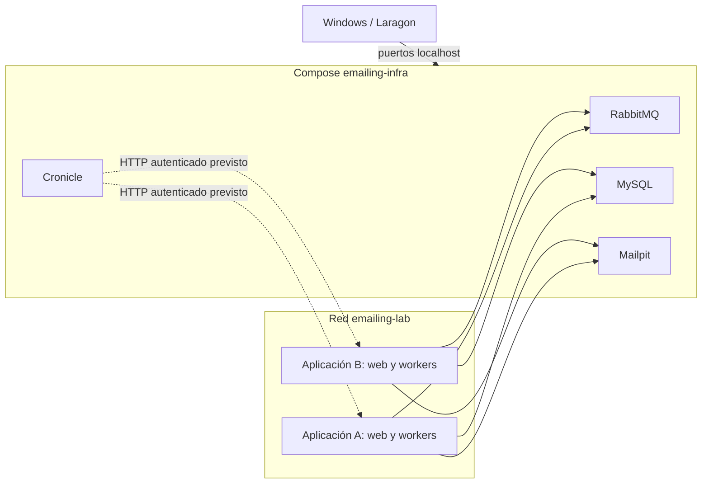

# Cómo se organiza la infraestructura compartida

**Última actualización: 2026-10-22.** Fuente ejecutable: [infra/compose.yaml](../../infra/compose.yaml). Evidencia funcional: [QA del laboratorio](../roadmap/2026-10-21-infra-laboratorio/testing/report.md).

## Qué contiene el laboratorio

Un único host Docker ejecuta cuatro servicios comunes. El proyecto Compose se llama `emailing-infra` y su red bridge se llama `emailing-lab`.

El diagrama muestra el patrón común. Emailing ya tiene su [Compose](../../compose.yaml) de PHP, Nginx y worker y su fase 1 probada. Otras aplicaciones son ejemplos. La integración HTTP de Cronicle y los módulos de envío siguen pendientes.

## Quién administra cada responsabilidad

| Responsabilidad | Propietario |
|---|---|
| Instancia del broker y administración global | Infraestructura. |
| Vhost, usuario y permisos por aplicación | Aprovisionamiento de infraestructura, con necesidades declaradas por la aplicación. |
| Contenido de los trabajos, colas y consumidores | Aplicación correspondiente. |
| Reintentos de negocio, idempotencia y resultados SMTP | Aplicación correspondiente. |
| Programación horaria compartida | Cronicle, cuando se configuren las tareas. |
| Ejecución continua del worker | Contenedor de la aplicación con proceso principal en primer plano. |
| Reinicio del contenedor tras fallo | Docker, según la política de cada servicio. |
| Datos SQL de cada aplicación | Base y permisos asignados a esa aplicación. |

No hay Supervisor común ni Supervisor dentro de los contenedores de infraestructura. Tampoco hay socket Docker montado en Cronicle. Cronicle no necesita controlar otros contenedores para programar acciones.

## Por qué separar los Compose

El Compose de infraestructura crea los servicios compartidos una sola vez. Los Compose de aplicación se conectan a la red existente con `external: true`.

Si cada aplicación declarase su propio servicio `rabbitmq`, Docker crearía otra instancia. Compartir el nombre de un servicio en archivos distintos no comparte automáticamente su contenedor.

Las aplicaciones se despliegan y actualizan por separado. Arrancar o parar una aplicación no debe recrear el broker de todas las demás. La caída del proyecto de infraestructura sí afecta a quienes dependan de él.

## Identidad y almacenamiento

| Elemento | Identidad configurada | Motivo operativo |
|---|---|---|
| Proyecto Compose | `emailing-infra` | Prefijo de los volúmenes del laboratorio. |
| Red | `emailing-lab` | Punto de conexión entre proyectos Compose. |
| RabbitMQ hostname | `lab-rabbitmq` | Conserva la identidad del nodo al recrear el contenedor. |
| Cronicle hostname | `lab-cronicle` | Mantiene la identidad del servidor y del master único. |
| Vhost inicial de RabbitMQ | `emailing-lab` | Pruebas administrativas del laboratorio. |
| Base inicial MySQL | `emailing` | Datos de emailing y marcadores de smoke actuales. |

No cambies hostname, proyecto o nombres de volumen durante un traslado sin planificar sus efectos. Un proyecto nuevo puede crear volúmenes vacíos y aparentar pérdida de datos.

## Qué aislamiento proporciona

Los puertos publicados usan `127.0.0.1`; las interfaces no se publican directamente en todas las tarjetas de red del host. Desde otros contenedores se utilizan los DNS de servicio y sus puertos internos.

La red compartida proporciona conectividad. Las credenciales y permisos proporcionan control de acceso a cada servicio. Un vhost separa topología y permisos de RabbitMQ, pero todos los vhosts comparten CPU, memoria y disco.

Emailing ya utiliza el vhost `emailing` y el usuario `emailing-app`, sin administración global. Las siguientes aplicaciones necesitarán sus propias identidades. El usuario administrativo inicial sirve para administrar y probar.

PHP-FPM no publica TCP 9000. Nginx se conecta por socket Unix sobre un volumen del proyecto, montado únicamente en PHP y Nginx. El servicio web anuncia un alias único por proyecto; consulta [integración](integracion-aplicaciones.md).

## Límites aceptados

Este laboratorio tiene un único host y una instancia por servicio. Los reinicios automáticos y volúmenes persistentes no proporcionan alta disponibilidad ante pérdida del host.

El volumen inicial comunicado para emailing es de 100–200 emails diarios. Los 5–10 workers previstos son procesos repartidos entre aplicaciones; no representan una medida de carga del broker. No se ha ejecutado un benchmark de capacidad máxima.

La infraestructura probó publicación, consumo, SQL, SMTP local y ejecución de jobs. Fase 1 añade publicación AMQP, release, reconexión, consumo y ack del adaptador. Outbox, confirms de negocio, deduplicación y tratamiento de resultados SMTP ambiguos siguen pendientes.

## Decisiones y documentación relacionada

La [ADR-001](../knowledge/adr/ADR-001-rabbitmq-centralizado.md) registra la elección del broker; algunas frases describen el momento de aquella decisión. El estado desplegado actual está en Compose y QA.

La [ADR-002](../knowledge/adr/ADR-002-laravel-mysql-compose.md) y el [diseño de aplicación](../roadmap/2026-10-21-plataforma-emailing/design.md) describen Laravel/Livewire, MySQL y la integración prevista. No convierten los módulos pendientes en funcionalidad ya implementada.

Continúa con [servicios](servicios.md), [configuración](configuracion.md) e [integración de aplicaciones](integracion-aplicaciones.md).
