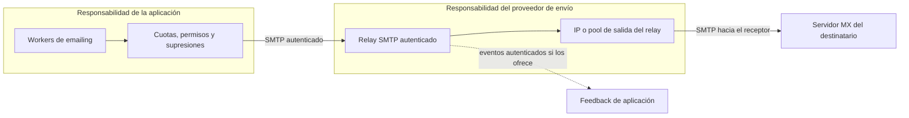

# Cómo reducir el riesgo de bloqueos y proteger la reputación de envío

**Última actualización: 2026-10-23.** Esta guía describe controles previstos para el envío real. La fase 2 ya implementa transporte por cuenta en log privado/Mailpit y pruebas de plantillas. **Todavía no están implementados ni probados** el relay externo, campañas, feedback, supresiones y cuotas de envío.

Actualmente Mailpit captura el correo dentro del laboratorio. No hay un relay externo elegido, un dominio de envío validado ni una IP emisora pública medida. No se ha consultado una lista de bloqueo para una IP concreta.

Guardar credenciales SMTP o autorizar un remitente para laboratorio no habilita Internet ni verifica su dominio. Los estados actuales `logged`, `smtp_accepted` y `smtp_unconfirmed` describen pruebas locales; consulta [plantillas y transporte](../aplicacion/plantillas-y-transporte.md). El conector contempla TLS estricto y existe prueba Feature de rechazo de certificado inválido; eso no acredita una integración externa operativa.

## Qué podemos controlar y qué no se puede garantizar

Podemos reducir el riesgo mediante autenticación de dominio, destinatarios que consientan el envío, límites, supresiones y reacción ante incidencias. No podemos garantizar que una IP nunca aparezca en una blacklist ni que todos los mensajes lleguen a la bandeja de entrada.

Los receptores valoran varios factores: IP, dominio, autenticación, contenido y comportamiento de los destinatarios. Que una consulta a una lista pública no encuentre una IP no equivale a que todos los proveedores acepten sus mensajes.

El propósito de la aplicación será detectar problemas y detener el envío antes de agravarlos. No se contempla rotar IPs para eludir bloqueos.

## Qué IP envía realmente el email

La propuesta para el volumen inicial de 100–200 mensajes diarios es utilizar un relay gestionado. Es una propuesta de arquitectura; todavía no se ha seleccionado ni contratado proveedor.

En este patrón, el servidor destinatario recibe la conexión del relay. La IP pública del servidor que aloja la web o los workers no es necesariamente la IP emisora de ese último salto SMTP.

Si se configurase entrega directa a los MX, el servidor sí actuaría como emisor. Ese MTA propio no forma parte del alcance actual y exigiría otro diseño de operación y reputación.

El relay no elimina la responsabilidad sobre el contenido, dominio y destinatarios. Tampoco impide que otros elementos del mensaje, como sus enlaces, influyan en el tratamiento del correo.

## Quién responde de cada control

| Control | Aplicación / equipo propietario del dominio | Proveedor de envío |
|---|---|---|
| Autorizar un dominio remitente | Acreditar control del dominio y permitir solo identidades aprobadas. | Proporcionar el procedimiento de verificación y los registros necesarios. |
| SPF, DKIM y DMARC | Publicar DNS, comprobar alineación y mantenerlo actualizado. | Firmar y utilizar las identidades configuradas según su servicio. |
| IP de salida y PTR | Verificar qué modalidad se contrata y que existe una configuración válida. | Administrar las IP y DNS inverso que estén bajo su control. |
| TLS hacia el relay | Exigir conexión segura y validar el certificado en producción. | Ofrecer el canal autenticado y gestionar su entrega posterior. |
| Listas de destinatarios | Registrar procedencia/consentimiento y aplicar bajas y supresiones. | Aplicar también sus propias políticas de abuso y supresión. |
| Ritmo de envío | Cuotas por cuenta y límite agregado por relay; pausas y reintentos acotados. | Informar límites, respuestas y restricciones del servicio. |
| Rebotes y quejas | Procesar señales autenticadas, correlacionarlas y detener futuros envíos afectados. | Exponer eventos, feedback o mecanismo equivalente cuando esté disponible. |
| Incidencia de reputación | Pausar, investigar causa y corregir campañas o listas. | Gestionar su infraestructura y las solicitudes que le correspondan. |

Estas responsabilidades necesitan verificarse al seleccionar el proveedor. Un servidor SMTP genérico puede aceptar mensajes sin proporcionar webhooks ni datos completos de quejas o rebotes posteriores.

## Cómo autenticar el dominio antes del envío real

El diseño adoptará SPF, DKIM y DMARC alineados para los dominios de envío autorizados. No bastará con escribir cualquier dirección en `From`.

| Mecanismo | Comprobación prevista |
|---|---|
| SPF | El dominio utilizado para el envelope sender autoriza a los emisores configurados. |
| DKIM | El proveedor firma con el dominio/selector acordados y la firma se valida al recibir. |
| DMARC | El dominio visible de `From` alinea con SPF o DKIM válidos; se revisan los informes y la política. |
| DNS directo/inverso | La IP emisora real y sus registros son coherentes con la configuración del relay. |
| Remitente autorizado | La cuenta puede usar ese dominio y esa identidad; la API y los workers aplican la misma regla. |

Las [directrices de Gmail](https://support.google.com/mail/answer/81126) distinguen requisitos por volumen. Para todos los remitentes exigen SPF o DKIM; para remitentes de más de 5.000 mensajes diarios a Gmail personal añaden ambos, DMARC y condiciones adicionales. Recomiendan los tres mecanismos también con menor volumen.

Adoptar los tres desde el diseño es una elección de este proyecto, no la afirmación de que nuestro volumen inicial active todos los requisitos de remitente masivo. Se revisarán las reglas del receptor y proveedor antes de habilitar producción.

Las campañas deben incluir una baja visible y fácil de usar. Se prevé soporte de baja de un clic cuando corresponda al tipo de mensaje y a las reglas del receptor, sin trasladar ese requisito indiscriminadamente a cualquier notificación transaccional.

## IP compartida o dedicada

| Modalidad | Ventaja | Compromiso |
|---|---|---|
| Pool compartido gestionado | El proveedor mantiene infraestructura y un pool ya operativo. | La reputación puede verse afectada por otros emisores del pool. |
| IP dedicada | Mayor control sobre el tráfico que usa esa IP. | Exige mantener reputación, ritmo adecuado y calentamiento; no garantiza mejor entrega. |

SendGrid explica estas diferencias en su [documentación de IP dedicada](https://www.twilio.com/docs/sendgrid/ui/account-and-settings/dedicated-ip-addresses). También describe el [calentamiento gradual](https://www.twilio.com/docs/sendgrid/concepts/reputation/warm-up-ip-addresses) de IPs nuevas y aclara que no garantiza una reputación perfecta.

Para 100–200 mensajes diarios no asumimos que comprar una IP dedicada sea la mejor opción. La elección dependerá de constancia del tráfico, presupuesto, separación disponible, soporte y política del proveedor. Se validará antes del envío externo.

## Qué debe impedir la aplicación

Los siguientes controles pertenecen a la implementación prevista de campañas, SMTP y actividad/supresiones, especialmente C-05 y C-06 del [roadmap](../roadmap/2026-10-21-plataforma-emailing/spec.md).

| Situación | Comportamiento previsto |
|---|---|
| Cuenta sin remitente autorizado | Bloquear el envío externo hasta validar dominio e identidad. |
| Destinatario dado de baja | Excluirlo de las comunicaciones afectadas, incluso si se vuelve a importar. |
| Rebote permanente confirmado o queja | Registrar evidencia y suprimir futuros envíos según alcance y política definidos. |
| Error temporal del receptor | Reintentar con espera y número máximo de intentos; no crear un bucle de envío. |
| Respuesta de límite del relay | Reducir ritmo o pausar, respetando su semántica y política. |
| Aumento anómalo de rechazos o quejas | Alertar y pausar la cuenta o el transporte afectado. |
| Varias cuentas usando el mismo relay | Aplicar cuotas individuales y un límite agregado; no multiplicar la cuota global por worker. |
| Envío interrumpido con resultado ambiguo | Conservar el estado y reconciliar; no reenviar a ciegas. |

Una cuota por usuario sin coordinación entre workers no controla el agregado. El mecanismo deberá compartir estado y aplicar el límite a la identidad de transporte que corresponda.

Las cuentas internas comparten infraestructura física. Las campañas y las notificaciones de acceso o recuperación de contraseña podrán usar transportes o dominios separados si el proveedor lo permite. Esa separación lógica no demuestra aislamiento de IPs o reputación; debe verificarse con el servicio elegido.

## Cómo recibir rebotes, quejas y confirmaciones

Un `250` del relay confirma que ese relay aceptó el mensaje. No demuestra llegada al servidor final, presencia en bandeja de entrada ni lectura.

La aplicación deberá diferenciar aceptación SMTP, entrega reportada por proveedor, rechazo, aplazamiento, queja y baja. No mostrará como entregado un mensaje del que solo conoce la aceptación inicial.

Algunos proveedores ofrecen eventos de entrega y de quejas. La [referencia de eventos de SendGrid](https://www.twilio.com/docs/sendgrid/for-developers/tracking-events/event) ilustra esa separación y exige proteger el receptor de eventos mediante su mecanismo de autenticación.

La integración prevista validará firma o autenticación equivalente, correlacionará mensaje y cuenta desde datos propios, y deduplicará eventos. También contemplará eventos tardíos o fuera de orden. No confiará en un identificador de cuenta enviado libremente en el cuerpo para aplicar supresiones a otra cuenta.

Si el relay solo ofrece SMTP, habrá que acordar un mecanismo viable para los fallos posteriores: por ejemplo, DSN en un buzón controlado si lo soporta. Una dirección de retorno por sí sola no implementa su lectura, validación ni correlación. Sin feedback suficiente no se podrán presentar tasas completas de entrega o quejas.

## Cómo monitorizar sin inventar garantías

Primero se identificará el relay y las IPs o pools que usa realmente. En pools compartidos las IPs pueden variar, por lo que monitorizar una única IP observada no cubre todas las salidas.

El seguimiento combinará señales del proveedor, rechazos SMTP, dominios receptores y, cuando existan datos suficientes, sus herramientas de reputación. Una consulta DNSBL aislada no resume la reputación del dominio ni los filtros privados de cada receptor.

No se han configurado consultas masivas a DNSBL, credenciales de monitorización ni un proveedor externo. Si se integran, habrá que respetar condiciones de uso, límites y significado de cada respuesta.

Con muestras pequeñas, una sola queja puede alterar mucho un porcentaje. El panel deberá mostrar conteos, intervalo y cobertura de datos. Usará estados como «sin datos» cuando el relay no informe; no mostrará un 0 % ficticio.

Los umbrales de alerta y pausa siguen pendientes de concretar con el proveedor. No se fijará un número universal como garantía de que no habrá bloqueos.

## Qué comprobar antes de permitir correo externo

1. Seleccionar relay, modalidad de IP y límites; documentar condiciones de reputación y feedback disponibles.
2. Verificar dominio, remitente, SPF, DKIM, DMARC y configuración DNS/TLS del relay.
3. Implementar y probar bajas, supresiones, cuotas, pausas y respuesta ante credenciales comprometidas.
4. Validar autenticación, deduplicación y correlación del mecanismo de feedback elegido.
5. Hacer una prueba limitada hacia buzones controlados, inspeccionar cabeceras y revisar el resultado real.
6. Registrar qué señales se pueden medir y qué permanece desconocido antes de aumentar volumen.

Estas comprobaciones son trabajo pendiente del envío real. No modifican el resultado del QA del laboratorio: Mailpit seguirá siendo el destino de prueba mientras no exista una configuración externa validada.
