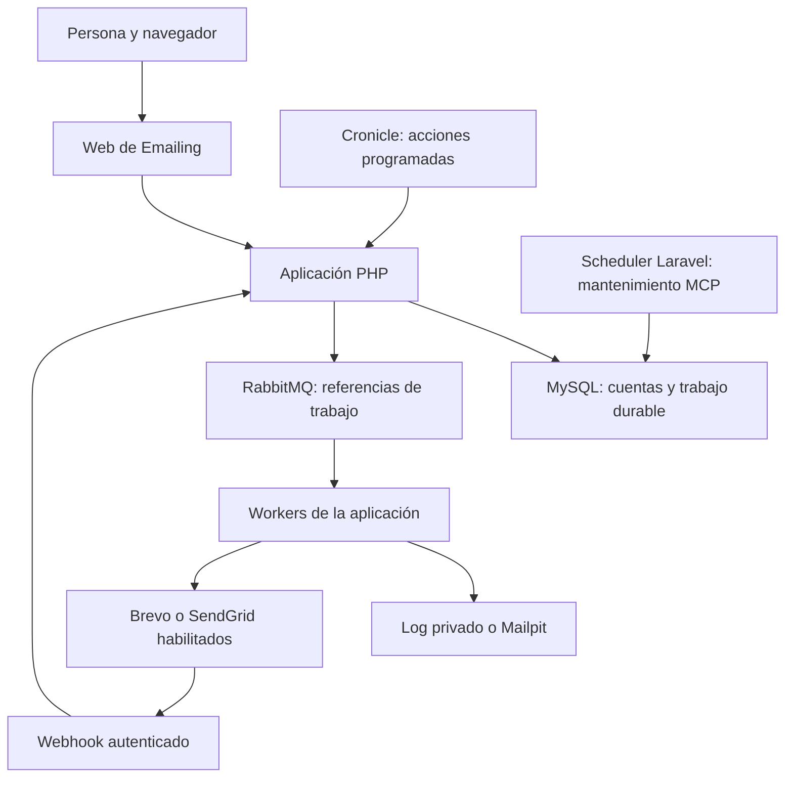
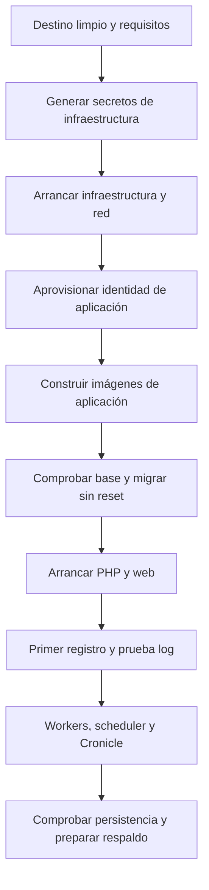
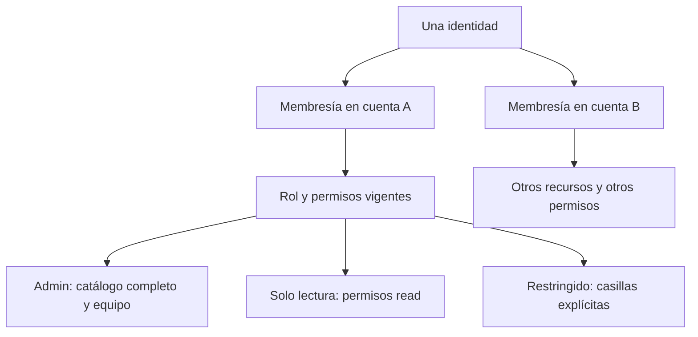
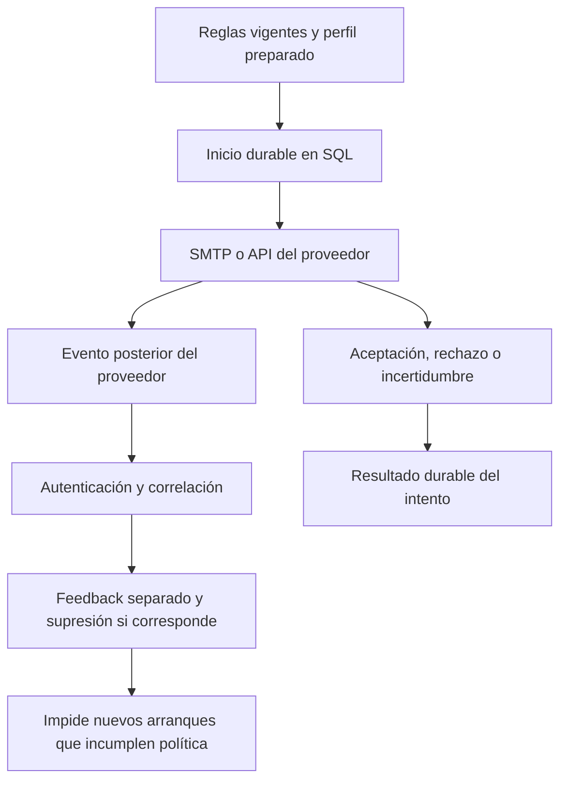
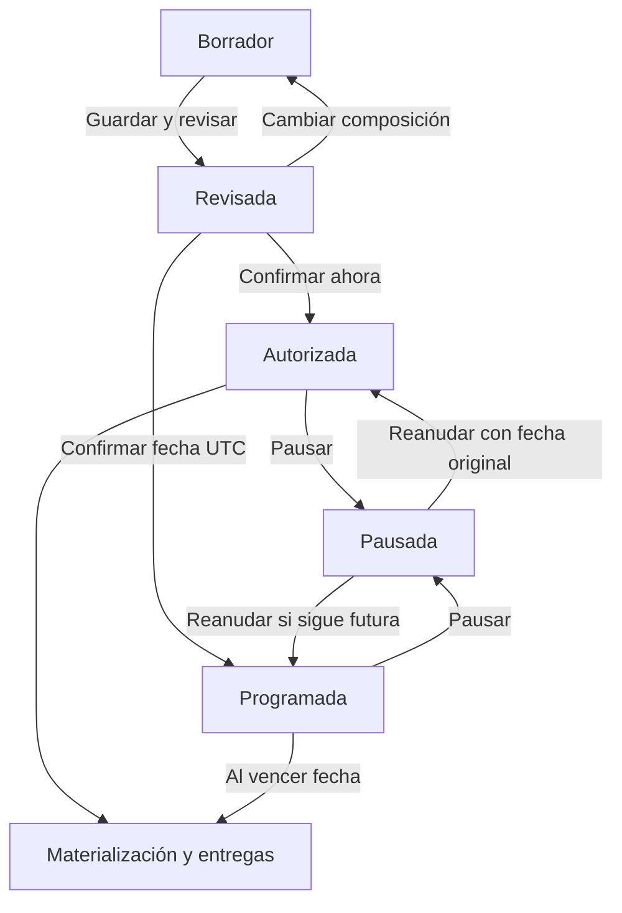
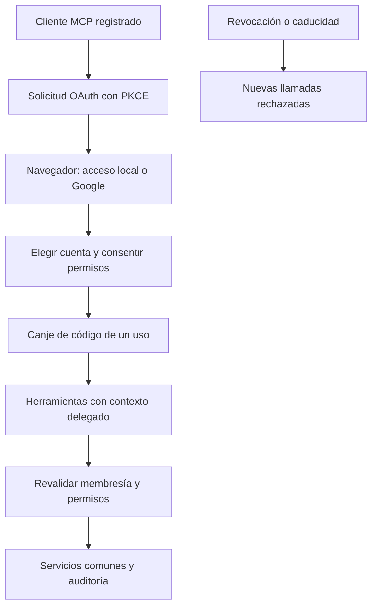
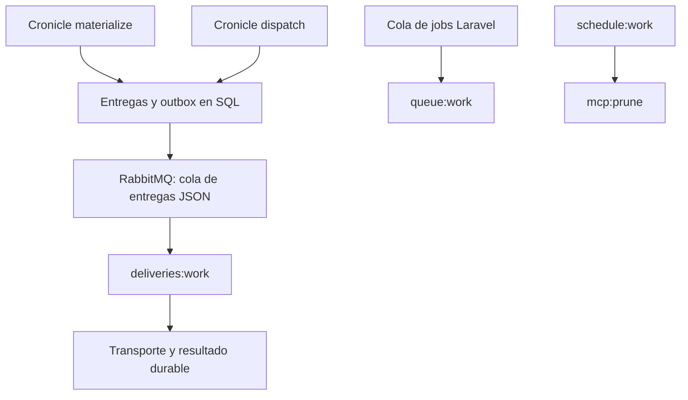
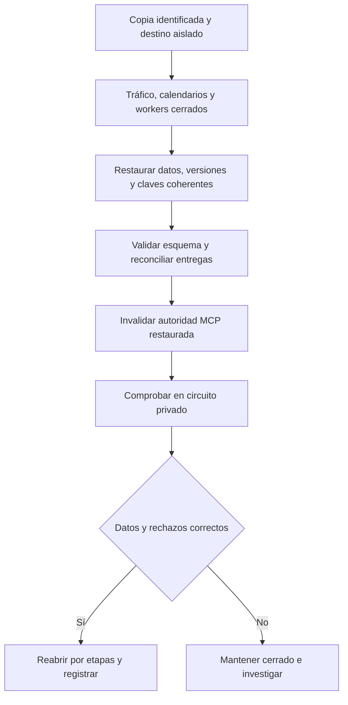

# Manual completo de Emailing

**Última actualización: 2026-10-31.** Manual de uso, instalación y operación para
personas que empiezan desde cero. Los ejemplos son ficticios. Los comandos son
procedimientos documentados a partir de los archivos públicos del proyecto;
redactar este manual no ha ejecutado instalaciones, migraciones ni envíos.

## Cómo leer este manual

Emailing organiza personas, contactos y mensajes dentro de cuentas compartidas.
Puedes preparar mensajes sin enviarlos a Internet, revisar una campaña y seguir
el resultado de sus entregas. Si administras la instalación, también necesitas
mantener la base de datos, las colas y los procesos que trabajan en segundo plano.

Si solo vas a utilizar una instalación que ya existe, empieza por **Primer día**.
Si tienes un equipo vacío, sigue **Instalación Docker desde cero** o
**Instalación nativa en Windows con Laragon**. La primera ruta compila la aplicación
dentro de Docker; la segunda utiliza PHP y herramientas instaladas en Windows.
Las instrucciones de servidor y recuperación vienen después de la instalación.

Este documento explica las tareas sin exigir abrir otros archivos. Los enlaces
permiten ampliar detalles técnicos y comprobar de dónde sale cada comportamiento.
En una copia impresa puedes seguir el procedimiento por los títulos y las tablas.
Los valores entre `<` y `>` representan información privada que aporta el operador;
no son contraseñas listas para utilizar ni texto que deba publicarse.

### Índice

- [Qué está disponible y qué falta por cualificar](#qué-está-disponible-y-qué-falta-por-cualificar)
- [Cómo se organiza la instalación](#cómo-se-organiza-la-instalación)
- [Instalación Docker desde cero](#instalación-docker-desde-cero)
- [Instalación nativa en Windows con Laragon](#instalación-nativa-en-windows-con-laragon)
- [HTTPS, Google, MCP y traslado a Linux](#https-google-mcp-y-traslado-a-linux)
- [Primer día](#primer-día)
- [Acceso, cuentas y equipo](#acceso-cuentas-y-equipo)
- [Contactos, consentimiento y listas](#contactos-consentimiento-y-listas)
- [Importar un CSV y corregir errores](#importar-un-csv-y-corregir-errores)
- [Plantillas y pruebas](#plantillas-y-pruebas)
- [Transporte y proveedores externos](#transporte-y-proveedores-externos)
- [Preparar y seguir una campaña](#preparar-y-seguir-una-campaña)
- [Bajas y supresiones](#bajas-y-supresiones)
- [Actividad, estados y métricas](#actividad-estados-y-métricas)
- [Llaves y API REST](#llaves-y-api-rest)
- [Conexiones MCP y herramientas](#conexiones-mcp-y-herramientas)
- [Colas, workers y calendarios](#colas-workers-y-calendarios)
- [Paneles de infraestructura](#paneles-de-infraestructura)
- [Configuración del despliegue](#configuración-del-despliegue)
- [Operación, actualización y recuperación](#operación-actualización-y-recuperación)
- [Diagnóstico y preguntas frecuentes](#diagnóstico-y-preguntas-frecuentes)
- [Glosario](#glosario)
- [Fuentes y alcance documental](#fuentes-y-alcance-documental)

## Qué está disponible y qué falta por cualificar

La aplicación principal conserva **18 de 20 tareas aceptadas técnicamente**.
Incluye acceso local, cuentas, Teammates, contactos, listas, CSV, plantillas,
campañas, entrega durable, actividad, programación y API de cuenta. La ampliación
Google/MCP conserva **11 de 14 tareas**. Su catálogo de 37 herramientas y sus
perfiles técnicos HTTPS tienen pruebas de laboratorio. Brevo y SendGrid están
integrados por SMTP y API con perfiles por cuenta y feedback autenticado.

La palabra «implementado» significa que existe código y evidencia técnica del
alcance descrito. No significa que cualquier servidor esté instalado ni que se
hayan realizado todas las validaciones humanas. T19/T20 de la plataforma mantienen
carga, restauración global y puesta en operación. T12–T14 de MCP mantienen sus
puertas finales, incluida regresión global y cualificación de Google y clientes
reales. Las pruebas de proveedor son locales y controladas: M-01 de proveedores
requiere los cuatro canales y callbacks reales; M-02 mantiene revisión humana y
retro. Este manual no cambia esos estados.

Por defecto el transporte de una cuenta es **log** y
`EMAIL_EXTERNAL_ENABLED=false`. Guardar credenciales no envía mensajes. El modo
log crea un archivo privado; Mailpit captura correo dentro del laboratorio. Una
prueba con un proveedor habilitado sí puede enviar correo real. Revisa el modo
antes de pulsar cualquier botón de prueba o autorizar una campaña.

La aceptación tiene varios niveles. Un recibo de la API de Emailing significa
que se guardó trabajo. Una confirmación RabbitMQ significa publicación en el
broker. `smtp_accepted` o `api_accepted` significan aceptación del transporte.
Un evento posterior `delivered` es una entrega comunicada por el proveedor.
Ninguno de esos hechos demuestra lectura ni garantiza bandeja principal. No hay
medición de aperturas, clics o presencia en listas de bloqueo.

## Cómo se organiza la instalación

Hay dos proyectos Docker distintos. `emailing-infra` mantiene los servicios
compartidos: MySQL guarda datos, RabbitMQ mantiene las colas, Cronicle programa
acciones y Mailpit captura pruebas. `emailing-app` mantiene la aplicación web,
PHP y sus procesos de trabajo. Ambos usan la red `emailing-lab`.



La web es la puerta de entrada. Los workers hacen trabajo en segundo plano.
Cerrar el navegador no cancela trabajo ya aceptado. Un scheduler es un proceso
que ejecuta un calendario; declararlo en un archivo no lo pone en marcha.
Cronicle inicia acciones finitas de materialización y publicación. El scheduler
Laravel mantiene MCP. No programes dos veces la misma acción en dos calendarios.

Los datos no viven dentro de las imágenes reconstruibles. Los seis volúmenes de
infraestructura conservan MySQL, RabbitMQ, datos/logs/cola de Cronicle y Mailpit.
`app-storage` conserva archivos privados, sesiones y logs de la aplicación.
`app-fpm` contiene un socket de comunicación; se regenera y no es una copia de
los datos. Mantener volúmenes no sustituye guardar una copia recuperable fuera
del equipo.

La cuenta delimita los recursos de negocio. Una persona puede estar en varias
cuentas y tener permisos diferentes. Un proveedor se configura dentro de una
cuenta y lo comparten sus miembros autorizados. Un servidor MySQL compartido no
mezcla por sí mismo esas cuentas; las consultas y permisos aplican ese límite.

## Instalación Docker desde cero

### Qué necesitas antes de empezar

Esta receta prepara un equipo Windows con Docker Desktop en modo contenedores
Linux, Docker Compose y PowerShell. Necesitas una copia del repositorio en una
carpeta con permiso de escritura, conexión a Internet para descargar imágenes y
dependencias, y los puertos locales libres. No necesitas instalar PHP, Composer
ni Node en Windows para construir la aplicación Docker: el Dockerfile utiliza
Node 22 para Vite y PHP 8.4 con Composer dentro de sus etapas.

La plantilla pública es una instalación de un solo host. No configura alta
disponibilidad ni un dominio público. Las interfaces administrativas escuchan
solo en `127.0.0.1`. Si un puerto está ocupado, identifica el servicio existente
y planifica el ajuste; no detengas aplicaciones ajenas por adivinar qué proceso
lo usa. La tabla siguiente permite separar puerto de navegador y puerto técnico.

| Uso local | Dirección predeterminada |
|---|---|
| Aplicación Docker persistente | `http://127.0.0.1:8081` |
| RabbitMQ administrativo | `http://127.0.0.1:15672` |
| Cronicle | `http://127.0.0.1:3012` |
| Mailpit, mensajes de prueba | `http://127.0.0.1:18025` |
| MySQL desde Windows | `127.0.0.1:3308` |
| SMTP Mailpit desde Windows | `127.0.0.1:11025` |

Trabaja desde la raíz del repositorio, donde están `compose.yaml`, `artisan` y
la carpeta `infra`. No ejecutes esta secuencia sobre una instalación con datos
sin leer antes la sección de actualización. «Desde cero» significa que has
elegido un destino nuevo; no significa borrar el anterior.



### Paso 0. Preparar Windows y obtener el código

Si este equipo todavía no tiene las herramientas, empieza aquí. Instalar estos
programas no crea una cuenta de Emailing ni configura Brevo, SendGrid o Google.

1. Instala Git desde la [página oficial de Git para Windows](https://git-scm.com/install/windows).
   Git permite descargar la aplicación y actualizarla después. Cierra y vuelve a
   abrir PowerShell cuando termine el instalador para que reconozca `git`.
2. Instala Docker Desktop siguiendo la [guía oficial para Windows](https://docs.docker.com/desktop/setup/install/windows-install/).
   Utiliza el motor de contenedores Linux. Si el instalador pide preparar WSL 2,
   completar una característica de Windows o reiniciar, termina ese paso antes
   de continuar. Abre Docker Desktop y espera a que su motor esté listo.
3. Abre **Windows PowerShell** desde el menú Inicio. Los scripts del proyecto
   utilizan PowerShell. PHP, Composer y Node se ejecutarán dentro de las imágenes
   Docker en esta ruta; no tienes que instalarlos también en Windows.
4. Comprueba las herramientas con estos comandos:

```powershell
git --version
docker version
docker compose version
```

Git debe mostrar una versión. `docker version` debe mostrar tanto **Client**
como **Server**: ver solo el cliente no demuestra que el motor funcione. Si
aparece un error de conexión, abre Docker Desktop y espera a que arranque.
`docker compose version` debe reconocer Compose. El perfil HTTPS del proyecto
emplea `!override`, que requiere [Compose 2.24.4 o posterior](https://docs.docker.com/reference/compose-file/merge/#replace-value).
Una instalación reciente de Docker Desktop incluye Compose; no es necesario
descargar un segundo Compose para ese mismo equipo.

Elige una carpeta nueva para el código. Este ejemplo utiliza `C:\laboratorio` y
descarga la rama documentada del repositorio:

```powershell
New-Item -ItemType Directory -Path C:\laboratorio -Force
Set-Location C:\laboratorio
git clone --branch feature/plataforma-emailing https://github.com/daycry/emailing.git emailing
Set-Location .\emailing
git branch --show-current
Get-Item compose.yaml,artisan,infra
```

El resultado esperado es la rama `feature/plataforma-emailing` y tres elementos:
el archivo Compose, el comando `artisan` y la carpeta `infra`. La rama corresponde
a esta edición del manual; si el responsable del proyecto te entrega una versión
publicada distinta, utiliza esa versión y su documentación. Si GitHub solicita
autenticación, utiliza el acceso al repositorio que te haya concedido el equipo.
No añadas contraseñas ni tokens a la URL del comando.

Si ya existe una carpeta `emailing` con archivos, Git se detendrá. Elige otro
destino vacío o revisa la instalación existente. Descargar una copia nueva no
exige borrar la anterior. A partir de ahora ejecuta los comandos en la carpeta
que contiene `artisan` y `compose.yaml`; no dentro de `infra`.

Si PowerShell bloquea un `.ps1` por la directiva de ejecución, revisa que procede
de la copia del proyecto que acabas de obtener. Para ejecutar ese script local
puedes especificar `RemoteSigned` solo para el proceso, por ejemplo:

```powershell
powershell -NoProfile -ExecutionPolicy RemoteSigned -File infra/init.ps1
```

Ese parámetro no cambia permanentemente la directiva del equipo. Una directiva
de la organización puede prevalecer; en ese caso debe resolverlo su administrador.
La [documentación de PowerShell](https://learn.microsoft.com/powershell/module/microsoft.powershell.core/about/about_execution_policies)
explica la diferencia entre proceso, usuario y equipo. No necesitas cambiar
globalmente la configuración del sistema para seguir esta guía.

### Paso 1. Generar y arrancar infraestructura

Abre PowerShell en esa carpeta. Los comandos siguientes crean secretos locales,
validan la composición sin mostrarlos y arrancan los cuatro servicios comunes:

```powershell
powershell -NoProfile -File infra/init.ps1
docker compose --env-file infra/.env -f infra/compose.yaml config --quiet
docker compose --env-file infra/.env -f infra/compose.yaml up -d --build --wait --wait-timeout 240
docker compose --env-file infra/.env -f infra/compose.yaml ps
```

`init.ps1` genera contraseñas y clave Cronicle aleatorias y escribe `infra/.env`
fuera de Git. Si el archivo ya existe, lo conserva. No crea otra contraseña
cada vez. Abre ese archivo únicamente en tu editor privado cuando necesites las
credenciales. No publiques su contenido ni una salida completa de
`docker compose config`: puede expandir secretos. `config --quiet` sirve para
validar sin esa impresión.

El resultado esperado es que los servicios terminen saludables. Durante el
primer arranque MySQL o Cronicle pueden aparecer como `starting`. Un fallo de
descarga exige revisar conectividad y logs, no borrar volúmenes. MySQL crea la
base `emailing` y su usuario de aplicación; root tiene otra contraseña. RabbitMQ
crea un administrador inicial y el vhost de laboratorio `emailing-lab`.

Puedes ejecutar `powershell -NoProfile -File infra/smoke.ps1` como comprobación
explícita. Crea una fila, mensaje, email y job nuevos. No es una consulta sin
efectos ni instala las tablas de negocio. Sus marcadores se conservan. No hace
falta repetirlo para volver a leer este manual.

### Paso 2. Preparar la identidad y los secretos de la aplicación

Ejecuta el aprovisionamiento público del proyecto:

```powershell
powershell -NoProfile -File scripts/provision-local.ps1
```

El script genera o completa `.env` de aplicación con una `APP_KEY` persistente,
contraseña SQL y una contraseña AMQP distinta. Crea el vhost `emailing` y usuario
RabbitMQ `emailing-app`, sin administración global. También prepara
`emailing_testing` para pruebas. Esa base adicional no es la base de uso diario.
La instalación persistente utiliza `DB_DATABASE=emailing` y `DB_USERNAME=emailing`.

El script no aplica las migraciones del producto. Tampoco prueba un envío a
Internet ni configura Google. Mantiene secretos ya existentes. Si encuentra una
identidad inesperada se detiene para evitar aprovisionar otro destino. No
reescribas variables para saltar una parada sin entender qué archivo está usando.

Comprueba privadamente que `APP_KEY`, credenciales SQL y AMQP estén presentes,
que `APP_DEBUG=false` y que `EMAIL_EXTERNAL_ENABLED=false`. La plantilla usa
`APP_ENV=local`; para un servidor real se elegirá `production` dentro de su plan.
Conserva `APP_KEY` con los respaldos: protege credenciales cifradas y otros datos.
No la regeneres al reiniciar o actualizar.

### Paso 3. Construir la aplicación

```powershell
docker compose -f compose.yaml config --quiet
docker compose -f compose.yaml build
```

La construcción descarga dependencias fijadas por los lockfiles y compila los
assets. La etapa PHP instala sus extensiones y dependencias de producción; la
etapa web copia los archivos públicos compilados a Nginx. La configuración
privada no se copia a la imagen: `.dockerignore` excluye archivos de entorno,
almacenamiento y dependencias locales.

El resultado esperado son las imágenes de PHP y web de esta aplicación. Una
construcción correcta no crea usuarios de negocio ni tablas. Si falla por una
dependencia o descarga, conserva la salida depurada y corrige esa causa; no
ejecutes un reset de SQL. Repetir el build puede reutilizar capas sin cambios.

### Paso 4. Crear las tablas en la base elegida

En un destino nuevo, inspecciona primero el historial que encuentra la aplicación:

```powershell
docker compose -f compose.yaml run --rm --no-deps emailing-php php artisan migrate:status
docker compose -f compose.yaml run --rm --no-deps emailing-php php artisan migrate --force
```

El primer comando puede indicar que todavía no existe la tabla de migraciones:
es coherente con una base nueva. Si aparecen tablas o datos previos inesperados,
detén el procedimiento y prepara inspección y copia. `migrate --force` aplica
migraciones pendientes sin pedir confirmación interactiva; la selección de base
y la revisión previa son responsabilidad del operador.

No sustituyas ese comando por `migrate:fresh`, `db:wipe` ni por la suite de
pruebas. Esas operaciones pueden destruir tablas. Las cuatro migraciones de
proveedores se incluyen entre las pendientes del producto. Las pruebas de esta
iniciativa no han migrado la base operativa existente; esta receta describe qué
debe hacer un operador en el destino, no afirma que ya se haya hecho.

### Paso 5. Abrir la web y registrar la primera persona

```powershell
docker compose -f compose.yaml up -d --wait emailing-php emailing-web
docker compose -f compose.yaml ps
```

Abre `http://127.0.0.1:8081`. El Compose base fija esa URL aunque `.env.example`
declare 8080. Un origen distinto requiere cambiar conjuntamente la publicación
web y `APP_URL` mediante una configuración adicional revisada. Una modificación
solo de `.env` no sustituye el valor de `environment` del Compose.

Con `REGISTRATION_ENABLED=true`, crea la primera identidad y su cuenta desde el
registro. No existe una contraseña administradora universal del producto. El
registro crea propietario y membresía administradora en una transacción.
Después entra, verifica el nombre de la cuenta y crea una prueba log. Si has
decidido cerrar registro público, hazlo después de asegurar un acceso local
administrativo recuperable; una invitación no inventa una identidad por sí sola.

### Paso 6. Arrancar el trabajo de fondo y programarlo

```powershell
docker compose -f compose.yaml up -d --wait emailing-worker emailing-jobs emailing-scheduler
docker compose -f compose.yaml logs --tail 30 emailing-worker emailing-jobs emailing-scheduler
```

`emailing-worker` ejecuta entregas de dominio; `emailing-jobs` procesa los jobs
Laravel; `emailing-scheduler` ejecuta mantenimiento MCP. Para campañas, completa
además los dos eventos de Cronicle descritos en **Colas, workers y calendarios**.
Una campaña puede quedar autorizada sin procesarse si falta materialización o
publicación. Arrancar el scheduler Laravel no sustituye esos eventos de negocio.

Los cinco servicios de aplicación son PHP, web y esos tres procesos. `stop`
conserva sus volúmenes. Un arranque posterior utiliza `start` o `up -d` según
existan ya los contenedores y haya cambios. Conserva el mismo nombre de proyecto
para recuperar los mismos volúmenes. La receta es trazable a los archivos
públicos; la puesta en operación completa y portabilidad final mantienen T20.

## Instalación nativa en Windows con Laragon

### Preparar las herramientas y la infraestructura

Esta ruta usa PHP instalado en Windows para la aplicación y Docker para MySQL,
RabbitMQ, Cronicle y Mailpit. Necesitas PowerShell, Composer, Node/npm y Laragon
con un servidor web PHP. El manifiesto raíz declara PHP `^8.3`; el lock vigente
incluye Symfony con mínimo **8.4.1**. Utiliza un PHP 8.4 compatible con ese lock
o superior admitido, con sus extensiones. PHP 8.5.12 fue una versión observada
en QA nativo; no es un requisito para todos los equipos.

### Obtener y comprobar las herramientas nativas desde cero

Conserva Git, Docker Desktop, PowerShell y la copia de Emailing preparados en el
paso 0 anterior. Docker seguirá ejecutando los servicios compartidos. Para ejecutar
PHP directamente en Windows necesitas además las herramientas de esta sección.

1. Descarga Laragon desde su [sitio oficial](https://laragon.org/download/) e
   instálalo en una carpeta con permisos de trabajo, por ejemplo `C:\laragon`.
   Abre Laragon. Comprueba qué versiones incluye tu instalación; no des por hecho
   que el PHP o Node seleccionado cumple los requisitos del proyecto.
2. Selecciona un PHP compatible, como una versión actual de la rama 8.4 que sea
   **8.4.1 o superior**, mediante el menú de versión de PHP de Laragon. Si falta,
   [Tools > Quick add](https://laragon.org/docs/quick-add) permite añadir PHP.
   Selecciona la versión incorporada y abre de nuevo su terminal.
3. Abre **Terminal** desde Laragon. Su [entorno aislado](https://laragon.org/docs/isolated)
   incorpora las rutas de sus herramientas. Dentro de esa terminal ejecuta
   `powershell -NoProfile` para escribir los bloques PowerShell de este manual.
   Así se hereda ese entorno sin tener que modificar globalmente el PATH de Windows.
4. Comprueba Composer y Node. Si Laragon ya proporciona Composer 2 y un Node
   compatible, utiliza esos programas. Para añadir Node utiliza Quick add o el
   [instalador oficial](https://nodejs.org/en/download). La línea del proyecto
   utiliza Node 22; selecciona una versión 22.12 o posterior de esa rama para
   cumplir el requisito de Vite 7. npm se instala junto con Node.
5. Si falta Composer, utiliza el [instalador de Composer para Windows](https://getcomposer.org/doc/00-intro.md#installation-windows).
   Selecciona el `php.exe` de la versión de Laragon elegida. Vuelve a abrir la
   terminal cuando finalice para que recoja las rutas actualizadas.

Desde esa PowerShell, entra en la copia descargada y comprueba el entorno:

```powershell
Set-Location C:\laboratorio\emailing
Get-Command php
Get-Command composer
php --version
php --ini
php -m
composer --version
node --version
npm --version
```

Los dos primeros comandos indican qué ejecutables se van a usar. PHP debe ser
compatible con el lock, Composer debe ser de la rama 2 y Node debe mostrar la
versión elegida. Si aparece otro PHP del sistema, vuelve a la terminal de Laragon,
revisa su versión seleccionada y repite estas comprobaciones. Los wrappers del
proyecto invocan `php` y `composer` del PATH; no los instalan ni eligen por ti.

`php --ini` identifica el archivo de configuración realmente cargado por la consola.
`php -m` muestra sus extensiones. Esta aplicación necesita, entre otras capacidades,
MySQL mediante `pdo_mysql`, `mbstring`, `fileinfo`, OpenSSL y las extensiones XML
requeridas por las dependencias. Utiliza las extensiones incluidas para ese mismo
PHP y su arquitectura. Si falta una, revisa el `php.ini` identificado, activa la
extensión correspondiente y abre una terminal nueva. No copies una DLL de otra
versión de PHP. Las extensiones de consola y del servidor web deben corresponder
al PHP que has seleccionado.

El proyecto prepara un ini adicional con `sockets`; la distribución de PHP debe
contener esa extensión. Los procesos nativos descritos más abajo utilizan el
wrapper para cargarla. `pcntl`, instalado en la imagen Linux, no se exige a esta
ruta Windows. Si PHP avisa de un módulo ya cargado, revisa la configuración efectiva
en lugar de añadir otra carga de la misma extensión.

Antes de instalar dependencias, comprueba todos los requisitos del lock.
Esta comprobación no migra ni elimina datos:

```powershell
powershell -NoProfile -File scripts/composer.ps1 check-platform-reqs --lock
```

El resultado esperado es que las comprobaciones de PHP y extensiones terminen
correctamente. Si falla alguna, corrige la versión o la extensión indicada antes
de continuar; no utilices `--ignore-platform-reqs` para ocultarla. Después del
`install` del bloque siguiente puedes repetir `check-platform-reqs` sin `--lock`
para comprobar los paquetes efectivamente instalados. Esta es la puerta observable
que evita iniciar la aplicación con un PHP distinto del requerido.

Arranca infraestructura con los cuatro comandos del paso 1 de Docker. Después,
desde la raíz del proyecto, instala dependencias y prepara la configuración:

```powershell
powershell -NoProfile -File scripts/composer.ps1 install --no-interaction
npm ci
npm run build
powershell -NoProfile -File scripts/provision-local.ps1
powershell -NoProfile -File scripts/php.ps1 artisan migrate:status
powershell -NoProfile -File scripts/php.ps1 artisan migrate --force
```

El wrapper PHP activa `sockets` y el ini del proyecto sin modificar el PHP global.
`prepare-runtime.php` prepara directorios de caché, sesiones, vistas, logs y
almacenamiento privado. El usuario que ejecuta PHP necesita escribir allí y en
`bootstrap/cache`. No concedas acceso web a todo el repositorio para resolver
un problema de permisos. El document root del servidor debe ser `public`.

MySQL nativo conecta a `127.0.0.1:3308`, RabbitMQ a `127.0.0.1:5672` y Mailpit a
`127.0.0.1:11025`. Los nombres `mysql` o `mailpit` son para contenedores en la
red Docker; normalmente no se resuelven como servicios desde Windows. Conserva
el `APP_URL` correspondiente al origen que vas a abrir. Para desarrollo HTTP
local de una persona puedes iniciar el servidor PHP en 8080:

```powershell
powershell -NoProfile -File scripts/php.ps1 artisan serve --host=127.0.0.1 --port=8080
```

El servidor de desarrollo debe permanecer abierto y no es la receta de exposición
pública de producción. Cierra con `Ctrl+C` cuando corresponda. Para un perfil
Laragon HTTPS con Nginx/PHP-CGI usa la configuración de la sección siguiente.
No confundas el servidor normal con `serve-testing.ps1`: ese script genera un
perfil QA 8082 contra `emailing_testing`, cuyos datos pueden limpiar las suites.

### Mantener procesos nativos independientes

En otras terminales del mismo entorno de aplicación, ejecuta los procesos:

```powershell
powershell -NoProfile -File scripts/php.ps1 artisan deliveries:work
powershell -NoProfile -File scripts/php.ps1 artisan queue:work rabbitmq --sleep=2 --tries=3 --timeout=60 --max-time=3600
powershell -NoProfile -File scripts/php.ps1 artisan schedule:work
```

Cada proceso tiene su función. `queue:work` puede terminar al alcanzar su tiempo
máximo; un gestor del entorno debe volver a iniciarlo. Cerrar la terminal detiene
el proceso. La aplicación no instala un servicio Windows ni un Supervisor global.
El operador define cómo arrancarán tras reiniciar el equipo. No uses procesos
de otra aplicación para consumir las colas de Emailing.

Antes de usar campañas, configura Cronicle para alcanzar la web nativa. Dentro
del contenedor Cronicle, `127.0.0.1` es el propio Cronicle. En Docker Desktop
puede usarse `host.docker.internal` si el listener y el origen configurado lo
permiten; hay que comprobar desde ese contenedor la ruta `/up`, el rechazo del
trigger sin Bearer y su llamada autorizada. Que la web abra en Windows no prueba
esa conectividad. No abras indiscriminadamente todos los puertos del equipo.

## HTTPS, Google, MCP y traslado a Linux

### Cuándo necesitas HTTPS y qué cambia

Para una prueba log local puedes usar el HTTP de loopback. MCP exige su origen
HTTPS canónico y los callbacks de proveedores requieren HTTPS. Google necesita
callback exacto y configuración privada propia. Un certificado debe corresponder
al nombre utilizado y ser confiable para cada cliente. Un certificado de
`localhost` no sirve para publicar un dominio real.

El repositorio incluye `compose.tls.yaml`, Nginx TLS y una plantilla nativa.
El perfil de laboratorio usa `https://localhost:18443`. Laragon y Docker se
ejecutan por turnos en ese puerto. El override Docker reemplaza el puerto HTTP,
monta la configuración privada de aplicación como archivo y los certificados
como secretos de fichero. Necesita una versión Compose que entienda `!reset` y
`!override`; la versión 5.6.1 fue observada en los ensayos. Comprueba la
compatibilidad de tu instalación al validar `config --quiet`.

Prepara de forma privada estos archivos del host: entorno en
`storage/app/private/runtime/application.env`, cadena TLS en
`storage/app/private/tls/localhost-chain.pem` y clave privada en
`storage/app/private/tls/localhost-key.pem`. El entorno conserva `APP_KEY` y las
credenciales de la instalación elegida. Una autoridad de laboratorio requiere
confianza explícita de sus clientes; no desactives la verificación para esconder
un error de nombre o caducidad. La guía técnica contiene una receta OpenSSL de
dos días para laboratorio; no es una política de certificados de producción.

```powershell
docker compose -f compose.yaml -f compose.tls.yaml config --quiet
docker compose -f compose.yaml -f compose.tls.yaml build
docker compose -f compose.yaml -f compose.tls.yaml up -d --wait
```

Estos comandos presuponen migraciones revisadas, entorno privado preparado y
certificados existentes. Para ese perfil mantén siempre los dos archivos Compose
en las operaciones posteriores. `APP_URL` y `MCP_ISSUER` serán
`https://localhost:18443`, `MCP_RESOURCE` añade `/mcp` y
`SESSION_SECURE_COOKIE=true`. Habilita `MCP_ENABLED` solo cuando vayas a abrir
el recurso. El correo externo sigue necesitando su flag independiente.

### Perfil Laragon con TLS

La plantilla `docker/laragon-nginx-tls.conf.example` fija la misma autoridad y
PHP-CGI en `127.0.0.1:18112`. Cópiala a una carpeta privada; sustituye
`__PROJECT_ROOT__`, `__NGINX_ROOT__` y `__PRIVATE_TLS_ROOT__` por las rutas del
equipo con barras `/`. Prepara `logs` y `temp` en el prefijo Nginx. No reemplaces
la configuración global de otras aplicaciones de Laragon.

Arranca PHP-CGI con un identificador OPcache propio, valida Nginx y luego abre
su proceso. La plantilla contiene el detalle de rutas; el operador aporta el
prefijo real en estos comandos:

```text
php-cgi -d opcache.cache_id=emailing-lab-tls -b 127.0.0.1:18112
nginx -p <prefijo-privado>/ -c nginx.conf -t
nginx -p <prefijo-privado>/ -c nginx.conf -g "daemon off;"
```

Conserva los workers y scheduler del perfil usando el mismo entorno. No compartas
un ID OPcache con otro proyecto del mismo usuario/SAPI. La prueba técnica
acreditó Nginx/PHP-CGI de laboratorio, no todos los vhosts posibles de Apache.

### Llevarlo a un servidor Linux

El Compose ejecuta contenedores Linux tanto en Docker Desktop como en un servidor
Linux. Eso permite reutilizar las imágenes y los puertos internos. Los scripts
`init.ps1` y `provision-local.ps1` son PowerShell; Linux no los convierte en
scripts Bash. Si quieres utilizarlos allí necesitas PowerShell disponible y
revisar sus supuestos de acceso local. Alternativamente, un administrador prepara
de forma equivalente los archivos secretos, base/usuario SQL, vhost y usuario
RabbitMQ con permisos delimitados. El proyecto no incluye un instalador Bash
general para ese aprovisionamiento.

Con PowerShell 7 instalado en el servidor, su ejecutable es `pwsh`. Desde la
raíz puedes invocar `pwsh -NoProfile -File infra/init.ps1` y, después de arrancar
infraestructura, `pwsh -NoProfile -File scripts/provision-local.ps1`. Los accesos
administrativos que utiliza el script deben estar disponibles en el propio host
Docker por los puertos declarados. Instalar PowerShell y Docker es un requisito
del servidor elegido, no una operación que realice la aplicación.

En un destino limpio puedes generar los secretos en una estación Windows
controlada, aprovisionar antes del traslado y transferir de forma protegida
configuración y copias. Para una instalación Linux nueva sin esa estación,
documenta la generación aleatoria privada y la creación de cada identidad antes
de ejecutar la parte Compose. No uses los marcadores de `.env.example` como
contraseñas. No expongas el administrador RabbitMQ ni root SQL a la aplicación.

El dominio público exige DNS, certificado renovable, autoridad Nginx, firewall,
URLs, callbacks Google y confianza de clientes coherentes. El override incluido
rechaza autoridades ajenas a `localhost`; no basta cambiar una variable para
convertirlo en servidor público. Se necesita adaptar la configuración TLS a tu
dominio y revisar su funcionamiento en el destino. Conserva acceso administrativo
por túnel o red privada para RabbitMQ, Cronicle y MySQL.

La migración de datos necesita respaldo ensayado, versiones, nombres de proyecto,
identidad RabbitMQ y claves persistentes. Prueba primero en un destino aislado.
T20 mantiene la portabilidad/puesta en operación y T19 el restore global: esta
receta especifica trabajos necesarios, sin presentar esa validación pendiente
como realizada. Nunca reemplaces la base operativa por el SQL de QA.

## Primer día

### Un recorrido completo sin enviar a Internet

La situación de ejemplo es una asociación ficticia llamada **Equipo Ejemplo**.
Dos personas prepararán una comunicación para tres contactos. Usan log privado
al empezar y Mailpit al comprobar SMTP. Los correos `example.test` de este
manual son reservados para ejemplos; no los uses para validar entrega real.

1. Crea tu identidad con email, nombre, contraseña de al menos 12 caracteres y
   nombre de cuenta. Entra y comprueba **Equipo Ejemplo** como cuenta activa.
2. Abre **Transporte y remitentes**. Mantén log, crea `avisos@example.test` y
   autorízalo para log/Mailpit. El nombre visible puede ser «Equipo Ejemplo».
3. Crea una plantilla llamada **Bienvenida** con asunto «Hola {{ contact.name }}»
   y texto «Gracias por participar en {{ account.name }}».
4. Escribe nombre de muestra «Ana» y email `ana@example.test`. Actualiza preview,
   guarda y usa **Probar la versión guardada**.
5. En **Actividad**, comprueba `logged`. Descarga el `.eml` si tienes
   `activity.read`. Ese archivo prueba generación local, sin conexión SMTP.
6. Crea contactos con consentimiento trazable, agrúpalos en una lista y prepara
   una campaña. Guarda, revisa el resumen y autoriza su fecha UTC.
7. Comprueba que materialización, publicación y worker estén activos. Sigue una
   entrega lógica en Actividad, sin contar cada intento como otro destinatario.
8. Para probar SMTP local, cambia a Mailpit y repite una prueba explícita con
   asunto distintivo. Abre Mailpit en 18025 y encuentra esa captura.

El resultado esperado del primer día es saber diferenciar contacto, plantilla,
campaña, entrega e intento. No necesitas una cuenta Brevo/SendGrid para completar
este recorrido local. Si falta un botón, revisa permisos antes de asumir que la
función no existe. Si una campaña está pendiente, examina el trabajo de fondo
antes de autorizar otra copia para los mismos destinatarios.

### Cómo trabajar entre varias personas

La persona propietaria invita a la segunda mediante **Teammates**. Puede darle
el preset Marketer y revisar sus permisos. El segundo miembro verá los mismos
contactos, plantillas y campañas de la cuenta. Sus cambios son compartidos.
No debe registrar otra cuenta para intentar acceder a recursos del equipo.

Antes de modificar una campaña, abrid su versión actual. Si otra persona la
guardó mientras editabais, la aplicación muestra un conflicto y exige volver a
abrir. Así evita aplicar una autorización sobre una composición que ya cambió.
No conviene resolver ese aviso recargando repetidamente el botón de envío.

Al terminar, deja por escrito el modo de transporte, responsables, calendario
habilitado y procedimiento de respaldo. Una instalación pequeña también
necesita saber quién conserva `APP_KEY` y quién puede recuperar el acceso. Los
miembros ordinarios no necesitan conocer contraseñas SQL, AMQP ni proveedor.

## Acceso, cuentas y equipo

### Registro, entrada y contraseña olvidada

La raíz redirige al acceso. El registro aparece cuando el operador lo permite.
Introduce email, nombre, cuenta, contraseña y confirmación. Cada registro crea
una cuenta propia con propietario Admin; no añade a otra cuenta por coincidir
su nombre. Para entrar en un equipo existente utiliza su invitación.

En **Contraseña olvidada**, escribe el email local. En la configuración de
laboratorio el mensaje aparece en Mailpit. Abre el enlace del origen configurado
y establece la contraseña. Tras el cambio, las sesiones anteriores dejan de
servir y los otros navegadores deben volver a entrar. Una dirección que no
recibe correo en el transporte de autenticación necesita revisión del operador.
El transporte por cuenta no configura esos mensajes de acceso.

La casilla **Recordarme** solicita conservar el acceso en ese navegador según
la política de autenticación y sus cookies. No cambia la cuenta ni sus permisos.
En un equipo compartido utiliza el acceso sin esa casilla y termina con **Salir**.
Una revocación de permisos sigue aplicándose aunque el navegador te recuerde.

Una sesión iniciada no concede acceso a todas las cuentas. En **Mis cuentas**
elige **Abrir cuenta**. Comprueba el nombre antes de importar, invitar o cambiar
transporte. Si se revoca tu membresía, las siguientes acciones lo detectan aunque
la página siga abierta. Vuelve a Mis cuentas y elige una disponible.

El selector **Cuenta activa** de la cabecera también cambia la cuenta abierta.
El botón **Salir** cierra tu sesión web y vuelve a la pantalla de acceso; no
elimina los contactos, plantillas o campañas de la cuenta.

### Roles y permisos que existen



Admin gestiona recursos y accesos. Solo lectura permite los scopes terminados
en `.read`; no autoriza envíos ni escrituras. Restringido permite únicamente
sus casillas. Los presets rellenan casillas iniciales y pueden ajustarse:
Developer incluye plantillas de lectura, envío, actividad y gestión de llaves;
Marketer incluye contactos, plantillas, campañas, envío, actividad y supresiones;
Accountant incluye actividad y lectura de configuración.

| Familia de permisos | Lectura | Escritura o acción |
|---|---|---|
| Contactos y listas | `contacts.read` | `contacts.write` |
| Plantillas | `templates.read` | `templates.write` |
| Campañas | `campaigns.read` | `campaigns.write` |
| Envío | No tiene lectura propia | `mail.send` |
| Actividad | `activity.read` | Exportación/descarga están incluidas en lectura |
| Supresiones | `suppressions.read` | `suppressions.write` |
| Transporte y remitentes | `settings.read` | `settings.write` |
| Llaves API | `api-keys.read` | `api-keys.write` |

Algunas tareas requieren varios permisos. Componer campaña necesita leer
contactos y plantillas además de gestionar campañas. Autorizar añade `mail.send`.
La prueba de plantilla guardada puede hacerse con `templates.read` y
`mail.send`, sin acceder al listado de contactos ni a configuración. Los datos
de muestra del formulario no consultan contactos.

### Invitar, reenviar y retirar accesos

En **Teammates**, el administrador introduce email, rol y permisos y envía la
invitación. La persona abre el enlace y entra con el mismo email local. Si no
tiene identidad, puede registrarse cuando el registro esté permitido y volver
al enlace. La invitación dura siete días y solo se acepta una vez.

**Reenviar** rota el enlace y da otros siete días; el anterior deja de servir.
Una nueva invitación al mismo email sustituye las pendientes anteriores.
**Revocar** impide aceptar ese enlace. Una invitación aceptada se gestiona como
membresía: edita permisos o retira acceso. El recurso compartido permanece
aunque la persona salga. La lista de equipo puede consultarse sin ser Admin,
pero administrar personas requiere ese rol.

La aplicación protege al propietario y al último administrador. Transferir
propiedad requiere que el propietario elija otro miembro y confirme su
contraseña actual. El nuevo propietario queda Admin y el anterior conserva
Admin. Si falla la contraseña, corrígela en el mismo formulario y confirma;
una transferencia correcta retira el error anterior.

Los administradores ven los últimos 30 eventos de accesos y cambios con hora
UTC. Es útil para comprobar quién invitó, cambió permisos o transfirió propiedad.
No es una consola general para editar auditoría ni recuperar secretos. La
auditoría Google pertenece a la identidad; la auditoría de negocio conserva la
cuenta y el actor real cuando existe.

### Google y vinculación de identidad

Google es opcional y el acceso local permanece disponible. El operador configura
ID, secreto y callback exacto. Entrar con Google no concede una membresía ni un
rol nuevo. La identidad se reconoce por proveedor, emisor y `sub`, un identificador
estable de Google. Coincidir en email no fusiona cuentas.

En **Identidad y acceso**, una persona autenticada puede iniciar el vínculo de
Google. El callback queda ligado a esa sesión y propósito. Desvincular necesita
un método local recuperable y contraseña disponible. Si el alta fue exclusivamente
Google y no se eligió contraseña, primero establece ese método mediante la
recuperación local. No se almacenan tokens Google para Gmail ni se pide acceso
a Drive, SMTP Google o funcionamiento offline.

El registro Google es explícito y muestra confirmación antes de crear identidad
y cuenta. Un error corregible conserva el pendiente durante su caducidad, pero
vacía contraseñas. Si el correo externo de Google no permite acreditar la
verificación exigida, utiliza el registro local y vincula después. La pantalla
explica ese recorrido; el operador no debe arreglarlo fusionando filas SQL.
Los perfiles sintéticos prueban el comportamiento técnico; Google real sigue
requiriendo cualificación en el destino.

## Contactos, consentimiento y listas

### Crear y corregir un contacto

Abre **Contactos y listas** dentro de la cuenta correcta. Con `contacts.read`
puedes consultar y buscar; para crear, editar, asociar y eliminar necesitas
también `contacts.write`. Pulsa **Nuevo contacto**, escribe email y nombre y
elige el consentimiento. Guarda y comprueba que aparece en la lista.

El email se recorta y normaliza a minúsculas. ` ANA@example.test ` coincide con
`ana@example.test` dentro de la cuenta. El nombre admite 150 caracteres y el
email 254. El email identifica al contacto y no se cambia al editar. Si la
persona utiliza otra dirección, crea otro contacto y revisa sus permisos de
comunicación. Otra cuenta puede mantener su propio contacto con la misma
dirección; no comparte automáticamente su consentimiento ni sus datos.

| Consentimiento | Cómo se interpreta | Qué debes registrar |
|---|---|---|
| Desconocido, `unknown` | No hay evidencia vigente para campañas | No inventar fuente o fecha |
| Otorgado, `granted` | Hay una evidencia trazable indicada por el operador | Fuente y fecha UTC válida, no futura |
| Revocado, `revoked` | El consentimiento fue retirado | No reactivarlo mediante el CRUD ordinario |

La fuente admite hasta 255 caracteres. Puede describir un formulario o acto
documentado, por ejemplo «Formulario de alta de la asociación, versión 2».
La fecha usa `YYYY-MM-DDTHH:MM` en UTC. El ejemplo `2026-10-30T10:00` significa
las diez UTC de esa fecha, no las diez locales de cualquier navegador.
Seleccionar Otorgado exige ambos campos; una fecha futura se rechaza.

Una dirección válida no implica consentimiento. Cuando el estado deja de ser
Otorgado, el servicio limpia fuente y fecha de ese estado. Un contacto revocado
no puede activarse de nuevo mediante este formulario. Si necesitas un proceso
de nuevo consentimiento, conserva evidencia y define el procedimiento autorizado;
la aplicación no ofrece un botón general que lo resuelva automáticamente.

**Eliminar** aplica borrado lógico, retira asociaciones y conserva la fila
histórica. El contacto deja de aparecer como activo. No es lo mismo que registrar
una supresión por dirección; para bloquear futuros envíos aunque el contacto se
recree utiliza **Bajas y supresiones**. En el pipeline actual, un contacto conocido
eliminado o no elegible también impide el envío que intenta eludir su historia.

### Buscar, agrupar y mantener listas

Busca por nombre o email. El texto de búsqueda admite 150 caracteres y el panel
pagina 15 contactos. Si no encuentras uno, comprueba la cuenta y los filtros
antes de crearlo otra vez. Un email ya activo produce un error de duplicado,
no una combinación de ambas fichas.

Una lista es una agrupación de contactos, no otra copia. Pulsa **Nueva lista**,
introduce nombre de hasta 150 caracteres y descripción de hasta 500 y guarda.
Selecciona la lista, pulsa **Añadir contactos** y usa **Añadir a lista** en cada
contacto. **Terminar selección** cierra esa selección. Las listas se paginan
de diez en diez. La asociación debe pertenecer a la misma cuenta.

**Editar lista** permite cambiar su nombre y descripción. **Guardar lista**
conserva sus miembros: cambiar el nombre no vuelve a importar contactos ni
modifica su consentimiento. Para cambiar miembros utiliza las acciones de
selección y de incorporación o retirada de contactos.

**Retirar de lista** conserva el contacto y sus otras listas. **Eliminar lista**
retira la agrupación y mantiene contactos. No concede ni revoca consentimiento
por sí mismo. Cuando una campaña utiliza varias listas y contactos individuales,
deduplica las direcciones elegibles de su revisión. Organiza listas por propósito
comprensible para que el revisor pueda evaluar la audiencia.

Ejemplo: Ana y Bruno están en «Socios»; Bruno y Carla están en «Talleres».
Seleccionar las dos listas no debe entenderse como cuatro personas únicas.
La revisión de campaña calcula los elegibles reales y excluye consentimiento
incompleto, revocado o supresión. Consulta ese resumen antes de autorizar.

## Importar un CSV y corregir errores

### Preparar un archivo que la aplicación pueda interpretar

CSV es un archivo de texto con columnas separadas por comas. No basta cambiar
la extensión de un Excel. Exporta como UTF-8 y comprueba el separador. La
aplicación admite BOM UTF-8, finales LF/CRLF y comillas CSV. No dispone de un
asistente para mapear columnas arbitrarias: utiliza estos encabezados exactos.

| Encabezado | Necesidad y formato |
|---|---|
| `email` | Obligatorio y único entre encabezados; dirección válida |
| `name` | Opcional; hasta 150 caracteres |
| `consent_status` | Opcional; vacío pasa a `unknown`; también `granted` o `revoked` |
| `consent_source` | Obligatorio cuando el estado sea `granted` |
| `consented_at` | Con `granted`, fecha UTC exacta `YYYY-MM-DDTHH:MM`, no futura |

Ejemplo de archivo para el laboratorio, con una fila nueva válida, un duplicado
normalizado, una dirección inválida y otra sin consentimiento acreditado:

```csv
email,name,consent_status,consent_source,consented_at
ana@example.test,Ana,granted,Formulario asociación,2026-10-30T10:00
ANA@example.test,Ana repetida,granted,Formulario asociación,2026-10-30T10:00
direccion-sin-formato,Bruno,unknown,,
carla@example.test,Carla,unknown,,
```

Para un nombre con coma usa comillas: `"Ana, coordinadora"`. Una comilla interior
se escapa duplicándola. No añadas encabezados como `phone` o `account_id`: el
parser no los mapea silenciosamente. El archivo puede tener hasta 5 MiB y 10.000
registros de datos con la configuración inicial. Divide cargas mayores con
criterio antes de importar; no presentes el límite como capacidad medida.

### Subir, importar y leer el informe

En **Importar contactos**, elige una lista si quieres asociar los contactos nuevos.
**Usar sin lista** conserva solo contactos. Selecciona el archivo, espera a que
termine la subida y pulsa **Importar y revisar**. No cierres la página mientras
la operación esté en curso. La importación es acotada y transaccional; no es un
job de tamaño ilimitado que puedas abandonar pensando que continuará sin límite.

La aplicación valida primero toda la estructura. UTF-8 inválido, byte nulo,
comillas sin cerrar, encabezados duplicados/no admitidos, columnas incoherentes,
archivo vacío o límites excedidos rechazan el archivo antes de crear contactos.
Corrige la exportación y vuelve a subirlo. Un archivo estructuralmente correcto
puede contener filas con campos inválidos; esas filas aparecen en el informe
y las otras válidas se procesan.

El número de registro empieza en 2 después del encabezado. Una línea vacía se
ignora; un salto dentro de comillas no crea otro registro. El informe muestra
25 filas por página y el historial diez importaciones por página. **Descargar
resultado CSV** entrega registro, email, resultado y detalle. No exporta todo
el directorio de contactos.

| Resultado | Qué ocurrió | Acción posible |
|---|---|---|
| Creado, `imported` | Se creó contacto nuevo; también se asoció si había lista destino | Revisar sus datos |
| Duplicado, `duplicate` | Existía activo o ya había una fila válida equivalente | Mantenerlo o editar desde Contactos |
| Inválido, `invalid` | Falló una regla de esa fila | Corregir fuente y volver a importar |

En el ejemplo, la primera Ana se crea si no existía. La segunda es duplicada.
Bruno queda inválido y Carla puede crearse como consentimiento desconocido;
eso no la hace elegible para campaña. Una fila inválida anterior no bloquea
que otra válida posterior de ese email cree el contacto.

### Resolver duplicados y recuperar una carga

La importación no actualiza contactos activos existentes: no cambia nombre,
consentimiento ni listas. La lista de destino recibe solo los nuevos. Si Ana
ya existía, no se añadirá por esta importación a «Talleres»; usa la asociación
del panel para ese contacto. Esto evita tratar una nueva hoja como autorización
para reescribir datos de otra persona del equipo.

Después de un error de fila, conserva el informe, corrige únicamente las filas
que correspondan y reimporta. Los ya creados saldrán duplicados si los incluyes
otra vez. No borres todos los contactos para «empezar limpio». Si no sabes si
una operación confirmó, consulta su historial y los contactos antes de repetirla.
La descarga neutraliza celdas que podrían convertirse en fórmulas al abrirlas
en una hoja de cálculo; puede aparecer un apóstrofo inicial.

Los originales y temporales están en almacenamiento privado. La subida se liga
a cuenta, actor y sesión durante una hora; otra sesión no puede apropiarse del
handle de carga. Tras éxito se retira el temporal y, si falla la transacción,
se retira el origen creado para ella. Esto no define una retención global de
todos los históricos; la política de respaldo debe contemplar esos archivos.

## Plantillas y pruebas

### Crear contenido y utilizar variables

En **Plantillas**, pulsa **Nueva plantilla**. Introduce nombre, asunto y al
menos cuerpo HTML o texto. El nombre admite 150 caracteres. El asunto admite
200 antes y después de sustituir variables y no admite saltos de línea. Cada
cuerpo fuente admite 100.000 bytes y hasta 200 apariciones de variables; el
resultado se limita a 200.000 bytes por campo.

Solo existen tres variables. Escríbelas con sus llaves completas y respeta su
nombre; la aplicación no ejecuta fórmulas, Blade ni PHP en tu contenido.

| Variable | En una prueba | En una campaña |
|---|---|---|
| `{{ contact.name }}` | Nombre escrito como muestra | Nombre del destinatario revisado |
| `{{ contact.email }}` | Email de muestra | Email de la revisión |
| `{{ account.name }}` | Nombre de la cuenta | Nombre conservado por la revisión |

Ejemplo completo de contenido ficticio:

```html
<h1>Hola {{ contact.name }}</h1>
<p>Gracias por participar en {{ account.name }}.</p>
<p>Esta comunicación se dirige a {{ contact.email }}.</p>
<p><a href="https://example.test/informacion">Información</a></p>
```

Las variables HTML solo pueden estar en nodos de texto del cuerpo. No se admiten
en atributos, CSS, scripts, comentarios o cabecera. Una expresión dentro de
`href` se rechaza. El enlace fijo del ejemplo es válido como contenido, aunque
la preview lo reduzca. Las variables desconocidas o llaves incompletas producen
error. Los valores ausentes se sustituyen por vacío y no se hace una segunda
pasada si un valor contiene otra expresión.

Puedes escribir HTML y texto alternativo. Si solo hay HTML, el servicio deriva
texto quitando etiquetas y decodificando entidades. Si solo hay texto, no
inventa HTML. Ambos vacíos se rechazan. Los valores de variables en HTML se
escapan, de modo que un nombre no se convierta en etiquetas ejecutables.

### Preview del formulario y versión guardada

Completa los datos de muestra y pulsa **Actualizar preview**. Esta operación
utiliza el formulario actual. Cambiar contenido o muestra oculta la preview
anterior hasta actualizarla. La preview se presenta en un marco aislado con
restricciones de seguridad: elimina contenido activo, navegación y recursos
externos. Las imágenes aparecen omitidas y los enlaces conservan texto sin
destino. No reproduce todos los clientes de correo.

El email conserva el HTML original renderizado, con sus enlaces. No interpretes
la eliminación visual de un enlace en preview como su eliminación del correo.
Revisa el contenido antes de guardar. **Guardar plantilla** hace disponibles
los cambios para la cuenta. **Probar la versión guardada** utiliza lo persistido,
no los cambios pendientes del editor. Esta diferencia permite revisar una
versión concreta sin enviar accidentalmente una edición sin guardar.

Una campaña autorizada conserva su contenido revisado. Editar después la
plantilla no reescribe ese envío ni los recibos API ya aceptados. El formulario
de plantillas no ofrece un historial general de restauración de versiones;
conserva tus fuentes si necesitas volver a una edición anterior. **Eliminar**
retira la plantilla y conserva los mensajes anteriores; no cancela lo aceptado.

### Remitentes y prueba explícita

En **Transporte y remitentes**, crea un remitente con email, nombre y Reply-To
opcional. Email y Reply-To admiten 254 caracteres y nombre 150; se rechazan
saltos de línea de cabecera. Autorizar para log/Mailpit es una casilla distinta
de autorizar para Brevo/SendGrid. Ninguna casilla verifica propiedad del dominio.

Selecciona un remitente elegible en la prueba, destinatario y asunto. Para
log/Mailpit usa direcciones ficticias. Para un proveedor real usa un buzón
controlado y autorizado. El botón de ajustes crea un texto fijo de prueba;
el de plantillas crea contenido de la versión guardada. Guardar configuración
o credenciales no crea por sí mismo ninguna prueba.

`logged` permite descargar un `.eml` privado con `activity.read`. Mailpit muestra
la captura en su web si el transporte fue ese. `smtp_accepted` y `api_accepted`
no deben leerse como llegada al buzón. Un resultado incierto exige revisar antes
de volver a enviar. Los archivos privados no necesitan un enlace público de
storage y no debes publicarlos con una captura que contenga datos de destinatarios.

## Transporte y proveedores externos

### Elegir el modo conociendo su efecto

La configuración de cuenta ofrece log, Mailpit y cuatro canales externos. Los
perfiles son compartidos por los Teammates autorizados de esa cuenta, pero otra
cuenta no puede leerlos ni usarlos. Para consultar necesitas `settings.read`;
modificar requiere además `settings.write`. El envío requiere `mail.send`.

| Modo | Destino fijo | Credencial de envío |
|---|---|---|
| `log` | Archivo privado | Sin proveedor |
| `mailpit` | Captura configurada del runtime | SMTP del laboratorio |
| `brevo_smtp` | `smtp-relay.brevo.com` | Usuario SMTP y clave SMTP Brevo |
| `brevo_api` | API transaccional HTTPS de Brevo | Clave API Brevo |
| `sendgrid_smtp` | `smtp.sendgrid.net` | Usuario fijo `apikey` y clave API como contraseña |
| `sendgrid_api` | Mail Send HTTPS de SendGrid | Clave API SendGrid |

La clave SMTP Brevo es diferente de su clave API. En SendGrid los campos SMTP
y API se almacenan separados, aunque el operador use una misma clave autorizada.
No hay servidor externo arbitrario editable ni cambio automático de proveedor
ante fallos. El bloque genérico **Preparar configuración SMTP externa** se
conserva por compatibilidad; no configura esos perfiles ni abre otro relay.

SMTP exige STARTTLS en 587 o TLS implícito en 465, con certificado y nombre
verificados. No ofrece plain externo. La API usa HTTPS, verifica certificados,
no sigue redirecciones ni añade retries ocultos. Reutiliza Symfony Mailer y
el cliente HTTP de Laravel instalados; no añade un SDK por proveedor.

### Preparación SMTP genérica conservada por compatibilidad

En **Destino de los mensajes**, despliega **Preparar configuración SMTP externa
(sin habilitar envío)**. Es un formulario preparatorio que conserva los datos de
SMTP genérico de la primera fase. Guardarlo no conecta con ese servidor ni añade
un nuevo modo de envío seleccionable. Los modos actuales siguen siendo log,
Mailpit y las cuatro combinaciones de Brevo y SendGrid.

| Campo o control | Cómo se utiliza y qué conserva |
|---|---|
| Host SMTP | Nombre o dirección del servidor que se prepara; hasta 253 caracteres. Vaciar este campo limpia ese host guardado. |
| Puerto | Número entre 1 y 65535; el valor inicial es 587. Guardar exige un número válido incluso si la sección está plegada. |
| Seguridad | STARTTLS obligatorio o TLS implícito. El formulario no ofrece una alternativa sin cifrado. |
| Usuario nuevo | Introducir un valor lo sustituye. Dejarlo vacío conserva el usuario cifrado anterior. |
| Contraseña nueva | Introducir un valor la sustituye. Dejarla vacía conserva la contraseña cifrada anterior. |
| Eliminar credenciales guardadas | Borra usuario y contraseña de esta configuración genérica; prevalece sobre los valores nuevos introducidos en ese mismo guardado. |
| Guardar configuración | Guarda el modo elegido y estos campos. Necesita permisos vigentes de lectura y escritura de ajustes de la cuenta. |

Los valores de usuario y contraseña guardados no se vuelven a mostrar. Sus campos
se limpian después de cada intento de guardado. Borrar estas credenciales no borra
las de las tarjetas Brevo o SendGrid. Para utilizar esos proveedores guarda su
tarjeta y selecciona el modo correspondiente. Log y Mailpit utilizan sus destinos
de laboratorio; no convierten este host preparatorio en su relay de salida.

Ejemplo: dejas preparada una referencia de servidor en este formulario y mantienes
**Log** como modo. **Guardar configuración** conserva esos datos; una prueba sigue
creando un archivo privado sin conectar a ese host. Para retirar el usuario y la
contraseña preparatorios marca **Eliminar credenciales guardadas** y guarda.
Comprueba que esa casilla esté desmarcada antes de guardar otras credenciales nuevas.

### Preparativos comunes para las cuatro recetas

El operador inspecciona/aplica las migraciones pendientes en el destino y fija
`APP_URL` HTTPS real. Mantiene primero `EMAIL_EXTERNAL_ENABLED=false` para
preparar perfiles sin salida. Conserva `APP_KEY`; las credenciales se guardan
cifradas y no pueden recuperarse sin las claves correspondientes. Los campos
vacíos conservan lo anterior; la UI no vuelve a mostrar secretos guardados.
Tras cada intento de guardado los vacía en el navegador.

Guarda un perfil deshabilitado para obtener su URL de webhook. Configura la
autenticación del feedback y los eventos reconocidos en el proveedor. Habilita
el perfil cuando al menos un canal y su autenticación estén preparados.
Autoriza por separado el remitente externo y verifica dominio y DNS con el
proveedor. Solo después habilita la salida global privadamente y reinicia
procesos de larga duración; si había caché de configuración, vuelve a generarla
en el destino. Estas son acciones del operador, no cambios ya hechos por QA.

### Receta Brevo SMTP

En el perfil Brevo, introduce usuario SMTP y clave SMTP en **Canal SMTP**.
Elige STARTTLS obligatorio 587 o TLS implícito 465. Añade un Bearer aleatorio
de webhook de al menos 32 caracteres, sin espacios, y guarda deshabilitado.
En Brevo configura la URL HTTPS mostrada y exactamente ese Bearer como
autenticación. No pongas el secreto en la URL.

Habilita el perfil, guarda y selecciona `brevo_smtp` en **Destino de los mensajes**.
Guarda el modo y el remitente externo autorizado. Con salida global permitida,
crea una prueba al buzón controlado. Aceptación SMTP se registra aparte del
evento posterior. Si falta feedback, no asumas que no hubo rebotes.

### Receta Brevo API

En **Canal API**, introduce una clave API autorizada para envío transaccional.
No pegues allí la clave SMTP. Configura el mismo webhook/Bearer del perfil
Brevo, habilita y guarda. Selecciona `brevo_api` y guarda configuración.
La petición utiliza `https://api.brevo.com/v3/smtp/email` con cabecera `api-key`.

El adaptador exige HTTP 201 y `messageId` válido para `api_accepted`. Una
respuesta que no permite confirmar ese recibo conserva incertidumbre. Busca
el feedback posterior en Actividad; no confundas el `201` del proveedor con el
`202` que devuelve la API de Emailing al admitir trabajo durable.

### Receta SendGrid SMTP

En el perfil SendGrid completa **Clave API nueva para autenticar SMTP** con una
clave con permiso de envío. El usuario literal es `apikey`; no se sustituye por
tu email ni por el nombre del proyecto. Elige 587 STARTTLS o 465 TLS implícito.
Activa la firma del Event Webhook en SendGrid y copia su clave pública ECDSA
P-256, PEM o Base64, en el campo del feedback.

Guarda deshabilitado, configura la URL HTTPS y eventos en SendGrid, habilita el
perfil y selecciona `sendgrid_smtp`. La aplicación necesita la clave pública
para verificar eventos, no una clave privada del proveedor. La contraseña SMTP
y esa clave pública tienen propósitos distintos y no son intercambiables.

### Receta SendGrid API

Completa **Clave API nueva de SendGrid** en **Canal API**. Prepara firma y URL
del Event Webhook como en la receta SMTP. Habilita, guarda y selecciona
`sendgrid_api`. La petición utiliza `https://api.sendgrid.com/v3/mail/send` con
Bearer. Aceptación requiere HTTP 202 y una cabecera `X-Message-Id` válida.
Comprueba el resultado y el evento por separado en el buzón de prueba controlado.

### Feedback, reintentos y protección de destinatarios



Brevo compara el Bearer actual. SendGrid verifica firma P-256 SHA-256 del
timestamp concatenado con los bytes originales del cuerpo, con ventana máxima
24 horas y tolerancia futura 300 segundos. El cuerpo se limita a 1 MiB;
SendGrid admite hasta 1.000 eventos por lote y Brevo un objeto. La entrada tiene
límite de 120 peticiones/minuto por IP. El UUID de conexión local no sustituye
la autenticación ni permite al payload elegir una cuenta.

Cada intento tiene referencia opaca `emailing_reference` persistida antes de
abrir red. El receptor exige proveedor, cuenta, destinatario y referencia
coincidentes, y transporte iniciado. Deduplica, conserva recibos mínimos y
no almacena el payload crudo. `204` significa consumo local, duplicación o
evento ignorado; no confirma entrega de correo.

Un rebote permanente, queja o baja crea respectivamente supresión
`provider_bounce`, `provider_complaint` o `provider_unsubscribe`. Un rebote temporal
no suprime permanentemente. Un evento benigno posterior no revierte una queja,
baja o rebote permanente ni retira una supresión manual. Los eventos de
aperturas/clics no forman parte de este seguimiento.

Un negativo SMTP transitorio demostrado puede seguir el reintento seguro.
Un negativo permanente no. API `429` permite como máximo una reprogramación
segura, con `Retry-After` acotado a 24 horas. Un timeout, `408`, `5xx`, redirect
o recibo inválido queda incierto y no se reenvía automáticamente. La petición
API se limita a 4 MiB, la respuesta a 64 KiB y el timeout total a cinco segundos.

El feedback de cualquier intento de una entrega se consulta antes de otro
inicio durable y antes de reprogramar un resultado transitorio. Un `delivered`
entre intentos bloquea ese nuevo inicio y deja `provider_feedback_conflict`.
Si el evento de un intento anterior llega durante el IO actual, impide otra
reprogramación. El mutex ordena callback e inicio; no puede cancelar IO ya
empezado ni garantizar envío externo exactamente una vez.

### Rotar, limpiar y suspender salida

Para rotar, prepara la nueva credencial en el proveedor y guarda el campo
concreto del perfil. El siguiente intento toma la configuración actual; uno
ya iniciado conserva su snapshot solo en memoria. Revisa permisos de la nueva
clave y prueba de forma controlada antes de retirar la anterior cuando el
proveedor permita esa coordinación.

La autenticación de webhook usa solo la clave actual: no hay doble clave
implícita. Coordina la rotación del Bearer o clave pública con el proveedor.
Los callbacks con clave retirada se rechazan. Deshabilitar el perfil bloquea
también sus callbacks; si necesitas seguir recibiendo eventos en vuelo,
deshabilita la salida global y conserva perfiles activos durante conciliación.

**Eliminar todas las credenciales de este proveedor y deshabilitar el perfil**
retira sus campos sin tocar el otro proveedor. Dejar el campo vacío no borra.
La limpieza de campos concretos también existe en el servicio, pero la UI ofrece
el borrado completo del proveedor. Guarda después de marcar la operación.
Revisa Actividad: `provider_not_configured` indica perfil/origen incompleto;
`provider_credentials_unavailable`, problema de descifrado o clave;
`api_authentication_rejected`, rechazo del proveedor. `smtp_tls_required` bloquea
un fallback ESMTP que eludiría la política TLS antes de AUTH/sobre/cuerpo.

## Preparar y seguir una campaña

### Borrador y selección de audiencia

Una campaña es una comunicación preparada para una audiencia. Su estado registra
composición y autorización; no es un contador de mensajes entregados. Abre
**Campañas** con `campaigns.read`. Para crear/componer necesitas también
`campaigns.write`, `contacts.read` y `templates.read`. Elegir remitente y autorizar
requieren `mail.send`. Sin ese permiso otra persona puede completar la tarea.

Pulsa **Nueva campaña**, escribe nombre de hasta 150 caracteres, selecciona
plantilla, remitente elegible, listas y contactos individuales. La selección
se conserva entre páginas; cada selector pagina de diez en diez. El remitente
elegible depende del modo actual. Si una etiqueta histórica menciona laboratorio,
comprueba el modo y la autorización efectiva; no supone un bypass externo.

**Guardar borrador** guarda esa composición e invalida la revisión anterior.
**Vaciar selección de destinatarios** limpia listas/contactos del formulario,
incluidos IDs que ya desaparecieron. No modifica lo guardado hasta guardar otra
vez. Es útil para resolver una selección antigua sin crear datos artificiales.

La audiencia combina listas y contactos, deduplica y admite hasta 10.000
contactos por campaña. Tener una lista grande no garantiza que todos sean
elegibles. El revisor debe examinar consentimiento trazable y supresiones.
Una lista puede seguir conteniendo un contacto cuyo consentimiento cambió.

### Revisión y autorización explícita

Pulsa **Revisar versión guardada** después de guardar. La aplicación fija un
resumen con contenido, remitente, audiencia elegible y exclusiones. Muestra
preview del primer destinatario cuando tus permisos permiten ver esos datos,
texto, asunto y destinatarios paginados. Comprueba cuenta, remitente, variables,
audiencia y origen del consentimiento. No autorices mirando solo el nombre.

Si una plantilla, remitente o audiencia cambió antes de autorizar, la aplicación
exige otra revisión. Si otra persona guardó la campaña, muestra conflicto de
versión. Abre la actual, verifica y repite los pasos necesarios. La aplicación
no adopta silenciosamente cambios concurrentes del editor.

Marca la confirmación explícita, elige **Ahora** o fecha futura y autoriza.
La fecha futura se escribe en UTC con `YYYY-MM-DDTHH:MM`. Por ejemplo, programa
un ensayo local para una hora futura UTC que hayas calculado; no copies una
fecha pasada del manual. La aplicación distingue `authorized` y `scheduled`.
La fecha efectiva permite comenzar, pero cuotas y disponibilidad pueden retrasar
el procesamiento. No promete un envío a todos en el mismo segundo.



### Qué conservan las revisiones y cómo pausar

Una revisión autorizada conserva contenido, destinatarios y fecha efectiva.
Editar una plantilla no cambia ese snapshot. Justo antes del transporte se
comprueban las políticas actuales: contacto original, consentimiento, supresión,
remitente, perfil, cuotas y autorización de campaña. Recrear un contacto con
el mismo email no sustituye al original autorizado.

**Pausar** impide nuevos arranques; un transporte ya iniciado puede terminar.
La pausa no retira un correo aceptado por un proveedor. **Reanudar** conserva
audiencia y fecha originales, después de validar lo necesario. No significa
crear una copia completa ni volver a enviar terminales. Usa Actividad para
entender qué entregas estaban pendientes y cuáles ya tienen resultado.

No existe en esta versión un botón general de cancelar/eliminar una campaña
autorizada. Para detener nuevos arranques usa pausa y conserva sus registros.
Para otro contenido o audiencia, crea una campaña nueva y revisa el riesgo de
repetir destinatarios ya procesados. No cambies estados en SQL ni purgues colas
para simular cancelación: podrías perder la relación con el trabajo durable.

### Ejemplo y resultado esperado

En Equipo Ejemplo crea «Aviso de taller», selecciona Bienvenida y la lista Socios.
Si Ana es elegible, Bruno desconocido y Carla suprimida, el resumen debe reflejar
los elegibles y exclusiones, no presentar tres envíos autorizados por existir
tres contactos. Autoriza con log y comprueba una entrega lógica `logged` por
destinatario elegible después de materializar/publicar/consumir.

Si no avanza, comprueba fecha UTC, pausa, eventos Cronicle, outbox, broker y worker.
Si espera cuota, no lo arregles creando otra campaña. Si queda `ambiguous`,
concilia con el relay antes de una decisión humana. El estado de campaña puede
seguir Autorizada después de procesar sus destinatarios; consulta las entregas
para el resultado real. No existe un estado de campaña «entregado a todos» que
sustituya esa consulta.

## Bajas y supresiones

### Bloquear una dirección en la cuenta

Una supresión impide enviar a una dirección normalizada en la cuenta. Es distinta
del consentimiento de una ficha y sobrevive a borrar/recrear un contacto.
Abre **Bajas y supresiones** con `suppressions.read`. Con escritura puedes
introducir email y **Guardar supresión**. El mensaje confirma que los transportes
todavía no empezados omitirán la dirección. Otro transporte ya iniciado puede
terminar; no se puede recuperar un mensaje que el proveedor ya aceptó.

La lista pagina 15 supresiones y muestra origen y fecha. Los orígenes visibles
son manual, baja pública y los tres de proveedor. Repetir una supresión manual
no crea otra protección duplicada. **Retirar supresión** es una acción explícita
que exige comprobar por qué existía. No concede consentimiento y un enlace de
baja vigente puede volver a aplicarla.

### Crear y revocar un enlace de baja

En **Crear enlace de baja**, escribe la dirección y descarga el texto con la URL.
El enlace se muestra una vez, no puede recuperarse desde el listado y no caduca
automáticamente. Compártelo solo con ese destinatario: es una capacidad que
permite registrar su baja sin login. La página GET permite revisar; la
confirmación POST aplica la supresión. Los enlaces emitidos se muestran en
otra paginación de diez registros.

**Revocar enlace** impide usarlo después, pero conserva cualquier supresión
que ya produjo. Si perdiste la URL, emite otra solo si corresponde; no reconstruyas
el secreto a partir de los datos del panel. El correo de campaña incorpora su
enlace de baja durante el pipeline. La existencia de un enlace no acredita que
el destinatario lo haya utilizado.

Ejemplo: Ana solicita no recibir más comunicaciones. Guarda la supresión o
registra su baja. Después, una importación nueva o una campaña antigua pendiente
no debe iniciar otro transporte que eluda esa protección. Si la persona pide
volver, retirar la supresión y acreditar consentimiento son decisiones distintas;
no marques Otorgado solo porque quitaste una barrera técnica.

## Actividad, estados y métricas

### Buscar la población y el intervalo correctos

Abre **Actividad** con `activity.read`. Puedes consultar detalles, exportar la
selección y descargar archivos privados disponibles sin `settings.read`. El
intervalo inicial es hoy y los 29 días anteriores, en UTC. Filtra por fechas,
población, estado, destinatario/asunto y campaña. El texto admite 200 caracteres
y la tabla pagina 25 registros. Los filtros inválidos ocultan resultados y
contadores hasta corregirlos; no significan cero actividad.

La ventana selecciona fecha de creación de la entrega lógica o registro
independiente. Desde incluye las 00:00 y Hasta todo su último día; excluye las
00:00 del siguiente. Un intento hecho hoy de una entrega creada el mes anterior
no entra por eso en la cohorte de hoy. Amplía la ventana antes de concluir que
ha desaparecido.

| Población | Unidad de recuento |
|---|---|
| Campañas | Una entrega lógica por destinatario de revisión |
| API | Una entrega lógica de petición de cuenta |
| MCP | Una entrega lógica de petición delegada |
| Pruebas explícitas | Un registro pedido desde Plantillas o ajustes |
| Históricos desconocidos | Registro sin procedencia reconstruible |

No sumes esos grupos como personas únicas. Un intento anterior histórico puede
estar relacionado con una entrega ya contada sin que sea posible reconstruirlo.
El detalle muestra todos los intentos vinculados, generación, diagnóstico,
referencias y actor disponible. El actor no es quien abre ahora la pantalla.
Para API se conserva la credencial de cuenta; para MCP, persona y cliente
delegados. Si una identidad histórica desapareció, se indica desconocida.

### Interpretar todos los estados

| Estado lógico | Qué prueba y cómo actuar |
|---|---|
| `pending` | Trabajo durable pendiente, fecha futura o espera de cuota/pausa |
| `reserved` | Un worker tiene una reserva; aún no comenzó transporte |
| `sending` | Inicio durable confirmado; resultado todavía pendiente |
| `logged` | Se escribió archivo privado; no hubo SMTP |
| `smtp_accepted` | Relay aceptó por SMTP; no demuestra buzón o lectura |
| `api_accepted` | API del proveedor aceptó con recibo válido |
| `failed` | Fallo terminal o agotamiento de intentos seguros |
| `ambiguous` | Posible IO/aceptación sin confirmación suficiente; no reenviar automáticamente |
| `suppressed` | La política del destinatario impide iniciar |
| `blocked` | Fuente, permiso, remitente, perfil o transporte impiden iniciar |

Los intentos tienen estados más específicos: `smtp_rejected`, `api_rejected`,
`smtp_unconfirmed`, `api_unconfirmed` y `local_failed`. El panel agrupa rechazo
y fallo local como fallo, e incertidumbre como ambigua. Un intento rechazado
puede pertenecer a una entrega que después vuelve a pendiente de forma segura.
No son nuevos destinatarios. El diagnóstico depurado ayuda a distinguir la causa
sin publicar excepciones, AUTH, cuerpos ni credenciales.

La reserva lleva token, generación y vencimiento. Una reserva vieja no puede
finalizar otra nueva. Si vence antes de comenzar, se puede recuperar; si vence
después de `sending`, queda ambigua. Esta protección SQL evita que dos workers
se atribuyan el mismo intento, pero no revierte efectos externos ya ocurridos.
No interpretes un restart como permiso para repetir todo lo que estaba en curso.

### Porcentajes, feedback y exportación

Las tarjetas separan aceptaciones SMTP y API y calculan su suma sobre todos los
registros de esa población que cumplen filtros. Siete aceptados y tres pendientes
son 70 %. Filtrar solo los siete aceptados convierte esa selección en 100 %;
no mejora por ello la entregabilidad. Sin muestra la pantalla lo dice; no ofrece
una tasa de incidencias del 0 % basada en ausencia de datos.

El feedback posterior puede mostrar procesado, aplazado, entrega comunicada,
bloqueado, rebote permanente, queja o baja. Permanece separado de la aceptación
original. En API/MCP, `delivery_feedback=provider_events` significa que alguna
entrega de esa respuesta tiene eventos, no que todas fueron entregadas.
`provider_feedback` es opcional por entrega. Sin eventos el resultado externo
sigue desconocido, y no se calculan aperturas, clics ni listas de bloqueo.

**Descargar CSV de esta selección** conserva ventana UTC, población, estados,
diagnósticos y referencias sin cuerpos completos ni secretos. Lee lotes de 200
y reautoriza entre lotes. Si cambian permisos puede quedar una descarga parcial;
si cambian datos puede diferir del total que viste. No es un snapshot global
transaccional. Las celdas potencialmente interpretables como fórmulas se protegen.
Los `.eml` disponibles se descargan por una ruta autenticada que revalida cuenta.

## Llaves y API REST

### Crear una llave y limitar su alcance

Una llave API permite a un programa actuar sobre una cuenta sin usar tu cookie
del navegador. Entra, selecciona la cuenta y abre **Llaves API**. Consultar
metadatos exige `api-keys.read`; crear/revocar exige `api-keys.write` y autoridad
vigente de concesión. Nadie puede conceder permisos que no tiene. Solo lectura
no crea llaves. La llave pertenece a la cuenta y puede seguir vigente si se
retira a su creador: revisa expresamente las integraciones al cambiar personal.

Escribe un nombre comprensible, selecciona permisos mínimos y una caducidad UTC
si corresponde. El resultado muestra el secreto una sola vez. Guárdalo en un
gestor privado y pulsa **Ya lo he guardado: ocultar secreto**. Las consultas
posteriores no lo recuperan ni muestran su hash. Si perdiste la respuesta,
consulta la lista y revoca la llave que no puedas utilizar. Repetir crear puede
emitir otra llave; esa operación no tiene la idempotencia del envío.

Los scopes API permitidos son `mail.send`, `templates.read`, `activity.read`,
`api-keys.read` y `api-keys.write`. Para enviar contenido inline basta
`mail.send`; para plantilla guardada añade `templates.read`. Consultar el
resultado necesita `activity.read`, incluso si esa llave creó la solicitud.
Crear llaves descendientes respeta el techo del padre y su caducidad. Revocar
el padre no revoca automáticamente las hijas; cada llave conserva su vigencia.

### Las cinco operaciones publicadas

El prefijo es `/api/v1`. El cliente aporta una única cabecera
`Authorization: Bearer <secreto privado>`. La cuenta la decide ese bearer,
no la cookie, el selector web ni un `account_id` del cuerpo. Guarda secretos
fuera de comandos publicados, repositorios y capturas.

| Método y ruta | Cuándo utilizar | Permiso y resultado |
|---|---|---|
| `POST /mail/send` | Admitir trabajo de envío | `mail.send`; `202` con recibo |
| `GET /mail/requests/{requestId}` | Consultar población y estados de una solicitud | `activity.read`; `200` |
| `GET /keys` | Listar metadatos de llaves | `api-keys.read`; `200` paginado |
| `POST /keys` | Emitir otra credencial delimitada | `api-keys.write`; `201`, secreto único |
| `DELETE /keys/{keyId}` | Revocar una credencial de la cuenta | `api-keys.write`; `204` |

El listado admite `limit` y cursor opaco. No alteres el cursor para cambiar de
cuenta. La auto-revocación devuelve `204` y el siguiente uso falla con `401`.
Un recurso ajeno y uno inexistente reciben `404` dentro de esa frontera.
Una sesión administradora sin bearer recibe `401`; con bearer limitado no
amplía sus permisos y puede recibir `403`.

### Ejemplo de envío y recuperación tras respuesta perdida

El siguiente cuerpo es sintético; sustituye el remitente por uno elegible de
tu cuenta y usa log/Mailpit para estos dominios. Añade
`Content-Type: application/json` e
`Idempotency-Key: manual-ejemplo-000001`:

```json
{
  "sender_id": 1,
  "recipients": [
    {"email": "ana@example.test", "name": "Ana"}
  ],
  "content": {
    "type": "inline",
    "subject": "Prueba de integración",
    "text": "Mensaje de Equipo Ejemplo."
  }
}
```

Un `202` devuelve `request_id`, `delivery_ids`, `accepted_at` y `state: accepted`,
además de `Location`. Es aceptación de trabajo en SQL/outbox, aunque el broker
esté temporalmente caído. No es una llamada síncrona al proveedor. Consulta
esa ubicación para seguirlo. Para una plantilla, usa
`"content":{"type":"template","template_id":2}` y los scopes correspondientes.

La clave idempotente tiene entre 16 y 128 caracteres ASCII del patrón publicado
y distingue mayúsculas. Si se pierde la respuesta o recibes un resultado SQL
incierto, repite **misma cuenta, clave y contenido**. Devuelve el recibo original
con `Idempotency-Replayed: true`, sin otra población de entregas. Otra entrada
con esa clave recibe `409`. No generes una clave nueva para probar si la
primera llegó: podrías crear otro envío.

La titularidad pertenece a la cuenta, también entre llaves autorizadas distintas,
y no caduca automáticamente. Cambiar la plantilla después no reinterpreta un
replay aceptado. El orden de destinatarios y cada carácter de los cuerpos son
significativos. La autenticación, scopes y admisión actuales siguen aplicándose
al replay. No hay un permiso para recuperar recibos de otra cuenta.

### Consentimiento, límites y errores REST

La API admite direcciones explícitas sin crear Contact ni Campaign. La
autorización del programa no prueba consentimiento. Si existe cualquier
contacto coincidente no elegible, incluido uno borrado lógicamente, o una
supresión, rechaza todo el lote con `422`. Antes del inicio durable se revalida
la política; un contacto vinculado no se convierte en directo para eludir una
baja. El cuerpo no permite elegir transporte, fuente, contacto ni bypass.

Los límites iniciales son 100 destinatarios únicos, cuerpo UTF-8 de 2 MiB,
profundidad JSON 32 y 200.000 caracteres por campo inline HTML/texto. No admite
claves JSON duplicadas, campos desconocidos ni tipos coercionados. La admisión
comparte minuto fijo UTC: 60 peticiones/cuenta y 30/llave entre las cinco
operaciones. Los replays y errores autenticados cuentan; `429` no incrementa y
devuelve `Retry-After`. Son límites HTTP distintos de las cuotas de transporte.

| Respuesta | Interpretación y siguiente paso |
|---|---|
| `400 malformed_request` | Corregir estructura JSON o petición |
| `401 unauthenticated` | Revisar ausencia, caducidad o revocación del bearer |
| `403 forbidden` | Revisar scopes actuales; no sustituir cuenta mediante cookie |
| `404 not_found` | Verificar ID dentro de esa cuenta |
| `409 idempotency_conflict` | Recuperar la entrada original de esa clave |
| `413 payload_too_large` | Reducir cuerpo/lote |
| `415 unsupported_media_type` | Usar el media type exigido |
| `422 validation_failed` | Corregir campos, elegibilidad o supresión |
| `429 rate_limited` | Esperar `Retry-After` sin crear otra petición |
| `503 temporarily_unavailable` | Conservar clave idempotente y consultar/repetir de forma segura |

Los errores usan `error.code`, `message` y campos admitidos; las respuestas llevan
`Cache-Control: no-store`. Un proxy puede rechazar antes de llegar al framework
y no devolver ese envelope. La consulta de resultados distingue SMTP/API y
feedback. Revocar una llave corta nuevas llamadas y replays, pero conserva
trabajo ya aceptado y sus recibos. No borres históricos para «limpiar» llaves.

## Conexiones MCP y herramientas

### Autorizar a un cliente sin compartir tu contraseña

MCP permite que un cliente compatible solicite herramientas de Emailing mediante
una conexión delegada. Usa un servidor HTTPS preparado y un cliente registrado.
No pegues una llave REST de cuenta para simular esa delegación. El cliente abre
el navegador, entras localmente o con Google configurado, eliges cuenta y revisas
los scopes solicitados. Puedes denegar. La aplicación limita la selección por
tu membresía vigente y por lo consentido.



La conexión caduca como máximo en una hora y no emite refresh tokens. Para
continuar se vuelve a autorizar. En **Conexiones MCP** ves tus conexiones,
cuentas, permisos y fechas aunque cambies la cuenta activa de la web. Pulsa
**Revocar conexión**, revisa y confirma. Sus tokens y sesiones se cortan;
retirar tu membresía también revoca grants de esa cuenta. El trabajo de correo
ya aceptado conserva su procedencia y las guardas del pipeline.

La actividad reciente indica operación, resultado, cuenta, cliente y correlación,
sin códigos, tokens ni cuerpos de contactos. Denegar antes de elegir una cuenta
queda como «Sin cuenta elegida». No otorgues escritura si solo necesitas un
resumen de actividad. Las anotaciones del catálogo describen efectos posibles;
no sustituyen confirmar la intención antes de una operación destructiva.

### Preparación administrativa y límites de protocolo

El servidor fija `MCP_ISSUER`, `MCP_RESOURCE` y `MCP_ENABLED`. El registro dinámico
está apagado por defecto. El administrador puede prerregistrar un cliente
mediante `php artisan mcp:client-register` con su nombre y redirect exacto. Es
una escritura SQL. El callback de cada producto debe coincidir con lo registrado;
`localhost` y `127.0.0.1` no son intercambiables en una comparación exacta.
Los ejemplos Codex CLI, Claude Code y OpenCode de las guías son ficticios y no
acreditan que esos clientes estén conectados. No se añaden comandos privados de
clientes en este manual.

El servidor admite MCP `2025-11-25` con initialize y
`2026-07-28` con metadatos por petición y descubrimiento. Un número de versión
en una cabecera no sustituye el recorrido del protocolo. La entrada cruda se
limita a 4 MiB/profundidad 32 y la salida completa a 8 MiB. Las páginas son
25 por defecto y hasta 100, también acotadas por bytes; el cursor es opaco,
autenticado y con caducidad. No lo alteres ni reutilices tras cambiar filtros
o autoridad. Una preview tiene techo de documento 1 MiB.

La herramienta devuelve estructura y texto JSON equivalente o un error seguro.
Si una mutación terminó pero se perdió su respuesta, no supongas que no ocurrió.
`mail_send` se recupera con misma cuenta, clave idempotente y mensaje; otras
mutaciones inciertas requieren consultar el recurso o su correlación. No se
anuncia una promesa idempotente general para todas las escrituras.

### Catálogo de las 37 herramientas

Los permisos de esta tabla son scopes MCP mínimos del catálogo 0.2.0. Deben
estar consentidos y vigentes en la membresía. La UI puede exigir lectura
adicional para presentar formularios. Las herramientas no administran Teammates,
llaves API ni transporte; el catálogo no convierte cualquier acción web en MCP.

| Herramienta | Qué hace y cuándo usarla | Autorización mínima |
|---|---|---|
| `connection_info` | Ver cuenta, usuario y conexión; empezar una sesión | Sin scope; pedir remitentes añade `mail.send` |
| `contacts_list` | Buscar/paginar contactos antes de elegir IDs | `contacts.read` |
| `contacts_get` | Consultar un contacto concreto | `contacts.read` |
| `contacts_create` | Crear ficha nueva y evidencia de consentimiento | `contacts.write` |
| `contacts_update` | Corregir campos editables de la ficha | `contacts.write` |
| `contacts_delete` | Borrado lógico y retirada de listas | `contacts.write` |
| `lists_list` | Localizar agrupaciones de la cuenta | `contacts.read` |
| `lists_get` | Consultar una lista y sus datos | `contacts.read` |
| `lists_create` | Crear una agrupación | `contacts.write` |
| `lists_update` | Cambiar nombre/descripción de lista | `contacts.write` |
| `lists_delete` | Retirar lista conservando contactos | `contacts.write` |
| `lists_attach_contact` | Asociar un contacto existente a lista | `contacts.write` |
| `lists_detach_contact` | Retirar asociación conservando ficha | `contacts.write` |
| `imports_list` | Consultar historial de importaciones web | `contacts.read` |
| `imports_get` | Consultar resumen y filas de una importación | `contacts.read` |
| `templates_list` | Buscar plantillas disponibles | `templates.read` |
| `templates_get` | Leer una plantilla guardada | `templates.read` |
| `templates_create` | Guardar contenido nuevo | `templates.read` y `templates.write` |
| `templates_update` | Modificar contenido guardado | `templates.read` y `templates.write` |
| `templates_delete` | Retirar plantilla conservando mensajes previos | `templates.read` y `templates.write` |
| `templates_preview` | Revisar representación con muestras, sin enviar | `templates.read` |
| `campaigns_list` | Localizar campañas y estados | `campaigns.read` |
| `campaigns_get` | Ver campaña; pedir proyecciones según necesidad | `campaigns.read`; condiciones descritas abajo |
| `campaigns_create` | Crear borrador con recursos de cuenta | Grupo Composición descrito abajo |
| `campaigns_update` | Guardar nueva composición y versión | Grupo Composición; remitente explícito añade envío |
| `campaigns_review` | Crear resumen de versión guardada | Grupo Composición; incluir remitente añade envío |
| `campaigns_authorize` | Confirmar revisión y fecha efectiva | Grupo Composición y `mail.send` |
| `campaigns_pause` | Impedir nuevos arranques de campaña | `campaigns.read` y `campaigns.write` |
| `campaigns_resume` | Continuar audiencia y fecha originales | `campaigns.read`, `campaigns.write`, `mail.send` |
| `suppressions_list` | Consultar direcciones bloqueadas | `suppressions.read` |
| `suppressions_add` | Bloquear dirección en la cuenta | `suppressions.read` y `suppressions.write` |
| `suppressions_remove` | Retirada explícita, sin conceder consentimiento | `suppressions.read` y `suppressions.write` |
| `activity_list` | Buscar entregas/pruebas por filtros | `activity.read` |
| `activity_attempts` | Examinar intentos de un registro | `activity.read` |
| `activity_metrics` | Calcular contadores de la selección | `activity.read` |
| `mail_send` | Admitir envío transaccional con clave idempotente | `mail.send`; plantilla añade `templates.read` |
| `mail_request_get` | Seguir solicitud y feedback | `activity.read` |

**Composición** significa `campaigns.read`, `campaigns.write`, `contacts.read`
y `templates.read`. En create/update, proporcionar `sender_id` no nulo añade
`mail.send`. En `campaigns_get`, composición exige contactos/plantillas;
contenido exige plantillas; remitente exige envío; preview exige plantillas y
contactos; destinatarios exige contactos. `campaigns_review` con remitente
incluido exige también envío. No pidas campos adicionales «por si acaso» si
el consentimiento no los permite.

Un recorrido de lectura puede empezar por `connection_info`, seguir con
`contacts_list` y `contacts_get`, y terminar consultando métricas. Crear un
borrador requiere los recursos y versiones reales que devuelven las consultas.
Para enviar, `mail_send` recibe `idempotency_key` y `message` con el contenido
REST equivalente. Comparte recibos y protección por cuenta con la API; un replay
desde MCP no inventa una segunda población ni cambia el origen del primer commit.

### Endpoints de acceso MCP

El cliente utiliza `/mcp` y los metadatos
`/.well-known/oauth-authorization-server` y
`/.well-known/oauth-protected-resource/mcp` (también variante sin `/mcp`).
El navegador usa `/oauth/authorize` y la decisión POST
`/oauth/authorize/decision`; el cliente canjea en `/oauth/token` y revoca en
`/oauth/revoke`. `/oauth/register` solo admite el registro dinámico cuando el
operador lo habilita con sus límites. Son rutas del protocolo, no pantallas
para pegar tokens manualmente. MCP apagado o emisor incoherente puede impedir
descubrimiento; un `401` puede indicar caducidad/revocación.

## Colas, workers y calendarios

### Qué paso hace cada proceso

El materializador crea una entrega por destinatario y un evento outbox en SQL.
El dispatcher publica referencias en RabbitMQ y espera confirmación del broker.
El consumidor reserva la entrega, revalida reglas, persiste inicio y ejecuta
transporte. Solo confirma el mensaje AMQP después de tener resultado o
continuación durables. Si se pierde confirmación de publicación puede haber
otra copia del evento; SQL permite deduplicarla.



`RABBITMQ_QUEUE` es la cola de jobs Laravel. `DELIVERY_QUEUE` y su exchange
son para referencias JSON de dominio. No intercambies los consumidores. El
pool de relay lo define el servidor; compartir host/usuario no demuestra
compartir una IP pública. Las cuotas iniciales son 10/minuto y 200/día por
cuenta, 20/minuto y 500/día por pool, con ventanas fijas UTC. No equivalen a un
benchmark ni a un objetivo de volumen seguro para cualquier dominio.

Una cuota agotada aplaza con fecha y outbox, sin sumar un intento de transporte.
El backoff evita bucles inmediatos de requeue. La configuración inicial limita
intentos seguros a tres; API `429` tiene su límite más estricto de una
reprogramación. La cola de fallos conserva referencias; no tiene un consumidor
que reenvíe automáticamente. Cualquier reparación debe conservar recibos y
evidencia de qué pudo llegar al proveedor.

### Preparar los dos eventos Cronicle

La aplicación publica `POST /internal/cronicle/trigger`, con cuerpo JSON
`{"action":"materialize"}` o `{"action":"dispatch"}`. El cuerpo máximo es
1024 bytes y profundidad 4. No acepta cuenta, comandos o límites del cliente.
La credencial es independiente: 32 bytes aleatorios representados como 64
hexadecimales minúsculos. El mismo valor va en `CRONICLE_TRIGGER_SECRET` de la
aplicación y en el archivo privado de cliente, nunca en el script del evento.

Prepara `infra/.runtime/emailing-cronicle.json` privadamente con dos campos:
`endpoint` y `token`. Para Docker base el endpoint es
`http://emailing-app-web/internal/cronicle/trigger`. El alias cambia si cambias
el proyecto. No añadas usuario, query o fragmento a la URL. El archivo debe
ser legible por el usuario `node` del contenedor (UID/GID 1000 en Linux), con
permisos restringidos y montaje de solo lectura. En Windows restringe su ACL.

Combina el override público con infraestructura para montar cliente y secreto:

```powershell
docker compose --env-file infra/.env -f infra/compose.yaml -f infra/compose.emailing-cronicle.yaml config --quiet
docker compose --env-file infra/.env -f infra/compose.yaml -f infra/compose.emailing-cronicle.yaml up -d --no-deps --wait --wait-timeout 240 cronicle
```

En Cronicle crea primero dos eventos deshabilitados con el plugin **Shell
Script**, `json=0` y `annotate=0`. El primero ejecuta este contenido:

```sh
#!/bin/sh
printf '%s\n' '{"params":{"action":"materialize"}}' | node /opt/cronicle/emailing-trigger.cjs /run/secrets/emailing-cronicle.json
```

El segundo sustituye solo `materialize` por `dispatch`. Configura concurrencia
máxima uno por evento, timeout 45 segundos, catch-up apagado y multiplex apagado.
Ejecuta manualmente cada uno y revisa resultado antes de habilitar una ejecución
por minuto. Conserva sus IDs en el registro privado de operación y reutilízalos
al actualizar; no crees duplicados activos del mismo calendario.

El cliente limita su HTTP a 30 segundos y solo admite 200 con JSON esperado.
Un timeout no prueba que SQL haya revertido ni que el servidor canceló trabajo.
La respuesta distingue `deliveries_created`, `outbox_claims`, `stop_reason` y
`elapsed_ms`; `emails_completed` permanece `null`. `empty` significa sin trabajo
reclamable en esa llamada, no cero trabajo global. `dispatch` reclama hasta 20
por defecto con presupuesto cooperativo 10.000 ms. SQL/AMQP ya iniciado puede
superarlo. Un job verde no significa correo entregado.

### Scheduler y mantenimiento MCP

`routes/console.php` programa `mcp:prune --limit=1000` cada minuto con
`withoutOverlapping`. El proceso `schedule:work` debe estar activo y compartir
caché/prefijo de esta aplicación. No copies ese calendario también a Cronicle.
Una parada forzada puede dejar su mutex. Detén el scheduler, confirma que no hay
pasada activa y recupera solo sus locks con `php artisan schedule:clear-cache`.
Después reinicia y verifica otra pasada. No borres toda la caché como primer
remedio mientras otros procesos puedan trabajar.

La limpieza es finita y respeta referencias SQL. Mantiene retenciones de códigos
caducados, ventanas, tokens y grants, sin borrar recibos de envío para liberar
claves idempotentes. `mcp:prune` no es un comando de limpieza general de correo.
`app:runtime-smoke` prueba adaptador AMQP de aplicación con una sonda; escribe
recursos propios y no sustituye campaña, restore ni envío real.

## Paneles de infraestructura

### RabbitMQ Management

Abre `http://127.0.0.1:15672` con el administrador inicial guardado en
`infra/.env`. Esa cuenta es de infraestructura, no el login de Emailing.
Selecciona el vhost correcto: el smoke usa `emailing-lab` y la aplicación
`emailing`. En las secciones de conexiones, canales, colas y consumidores puedes
examinar si la aplicación se conecta y si crece el backlog.

Una cola con mensajes puede estar esperando consumidor, fecha/recuperación o
publicaciones de otro flujo. Compara nombre de cola, vhost, conexión y estado SQL.
Un consumidor activo no garantiza que todo mensaje haya terminado. No uses
Purge/Delete para «desatascar» sin una decisión de recuperación: podrías borrar
trabajo pendiente o su evidencia. Las definitions exportadas guardan topología
y configuración; no contienen los mensajes de las colas.

El usuario `emailing-app` no tiene administración global. Si necesita permisos,
revisa su vhost y concede lo delimitado, no reemplaces su credencial por la
administrativa de forma permanente. La contraseña inicial de RabbitMQ actúa
sobre almacenamiento nuevo; editar el archivo no rota un usuario ya creado.

### Cronicle

Abre `http://127.0.0.1:3012`, usuario inicial `admin` y contraseña privada de
infraestructura. Revisa el calendario de eventos, ejecuciones activas e historial.
En el detalle de un job consulta código de salida, log, timeout y categoría.
Un script se ejecuta dentro del contenedor Cronicle: no dentro del PHP de
Emailing ni del Windows anfitrión.

El bootstrap identifica `lab-cronicle` como master, conserva cambios posteriores
mediante su marcador y ejecuta como usuario `node`. Un HTTP 200 sin master
correcto no basta para salud. El presupuesto inicial es diez jobs simultáneos,
historial 30 días y logs de job hasta 10 MiB; no confundas jobs Cronicle con el
número de workers RabbitMQ. Si cambias la contraseña desde su UI, sincroniza
el valor privado que usa el smoke, sin borrar el marcador para reinicializar.

Pausa los eventos antes de rotar `CRONICLE_TRIGGER_SECRET`, cambia aplicación y
archivo cliente, verifica una ejecución manual y reactiva. La clave persistente
`CRONICLE_SECRET_KEY` es otra cosa: consérvala con sus datos al trasladar.
Mantén el override de montajes al recrear Cronicle o sus eventos perderán el
acceso al cliente/secreto aunque sigan existiendo en el calendario.

### Mailpit

Abre `http://127.0.0.1:18025`. No necesita autenticación en este laboratorio
local, por lo que no se publica a Internet sin un diseño de acceso propio.
Busca el asunto distintivo de la prueba y abre contenido, cabeceras y adjuntos
que el mensaje contenga. El receptor SMTP es 11025 desde Windows o 1025 desde
la red Docker. Un navegador en 11025 habla el protocolo incorrecto.

Mailpit captura tanto mensajes de acceso/invitación de la configuración de
aplicación como pruebas de cuenta seleccionadas para él. Conserva hasta 1.000
mensajes. Un correo antiguo puede desaparecer por retención o borrado manual;
no uses esa bandeja como respaldo permanente. Un resultado `logged` no aparece
allí porque se escribió como archivo privado sin SMTP.

La captura demuestra recepción por Mailpit, no entrega a un buzón externo.
Puedes usarla para revisar enlaces y contenido en el primer día. No cargues
correos privados en una interfaz que comparte todo el laboratorio sin acordar
quién puede consultarlos. Mantén la separación entre ejemplo y dato operativo.

## Configuración del despliegue

### Archivos, precedencia y secretos

`infra/.env.example` y `.env.example` son plantillas públicas sin claves reales.
`infra/.env` y `.env` son archivos privados del destino. Los ejemplos de esta
sección describen nombres y valores iniciales públicos; no reflejan la
configuración real de una máquina. El perfil TLS usa su archivo privado montado
y el Compose base usa `env_file`. Un `environment` explícito de Compose puede
prevalecer sobre el archivo: el caso visible es `APP_URL` 8081 y hosts internos.

| Grupo de variables | Para qué sirve y valor público inicial |
|---|---|
| `APP_NAME`, `APP_LOCALE`, `APP_FALLBACK_LOCALE` | Nombre mostrado e idioma; Correo y español |
| `APP_ENV`, `APP_DEBUG` | Entorno local inicial; debug apagado, no publicar errores internos |
| `APP_KEY`, `APP_PREVIOUS_KEYS` | Clave persistente de cifrado y anillo anterior; custodia privada |
| `APP_URL` | Origen confiable; plantilla 8080, Compose HTTP 8081 |
| `REGISTRATION_ENABLED` | Permite registro; true inicial |
| `DB_CONNECTION`, `DB_HOST`, `DB_PORT` | MySQL; Windows 127.0.0.1:3308, Docker mysql:3306 |
| `DB_DATABASE`, `DB_USERNAME`, `DB_PASSWORD` | Base/identidad operativa emailing y secreto propio |
| `SESSION_DRIVER`, `SESSION_LIFETIME` | Sesión database y 120 minutos iniciales |
| `CACHE_STORE` | Caché file inicial; coherente entre procesos de la aplicación |
| `QUEUE_CONNECTION` | RabbitMQ para jobs Laravel |
| `RABBITMQ_HOST`, `RABBITMQ_PORT` | Broker, host local o rabbitmq:5672 interno |
| `RABBITMQ_USER`, `RABBITMQ_PASSWORD`, `RABBITMQ_VHOST` | emailing-app, secreto privado y vhost emailing |
| `RABBITMQ_QUEUE` | Cola Laravel emailing.jobs |
| `MAIL_MAILER`, `MAIL_HOST`, `MAIL_PORT` | Correo de acceso/invitación: SMTP Mailpit inicial |
| `MAIL_FROM_ADDRESS`, `MAIL_FROM_NAME` | Remitente del correo de aplicación, separado del de cuenta |
| `MAILPIT_SMTP_HOST`, `MAILPIT_SMTP_PORT`, `MAILPIT_API_URL` | Captura confiable para pruebas por cuenta |
| `EMAIL_EXTERNAL_ENABLED` | False inicial; habilita salida externa solo con demás guardas |
| `LOG_CHANNEL`, `LOG_LEVEL` | Stack e info iniciales; no publicar contenido privado |
| `DELIVERY_EXCHANGE`, `DELIVERY_QUEUE` | Topología de eventos de dominio emailing.deliveries |
| `DELIVERY_ROUTING_KEY`, `DELIVERY_BINDING_KEY` | delivery.ready inicial |
| `DELIVERY_FAILURE_QUEUE` | emailing.deliveries.failed; no reenvío automático |
| `DELIVERY_PREFETCH` | Dos eventos en consumo inicial |
| `DELIVERY_WORKER_LEASE_SECONDS` | Reserva de worker, 30 segundos iniciales |
| `DELIVERY_PAUSE_POLL_SECONDS` | Espera de pausa, 30 segundos iniciales |
| `DELIVERY_MAX_ATTEMPTS` | Tres intentos seguros iniciales; proveedor puede restringir |
| `DELIVERY_BACKOFF_SECONDS`, `DELIVERY_BACKOFF_MAX_SECONDS` | Base 10 y tope inicial 3600 segundos |
| `DELIVERY_RELAY_POOL` | mailpit-lab inicial; identidad de pool elegida por servidor |
| `DELIVERY_ACCOUNT_PER_MINUTE`, `DELIVERY_ACCOUNT_PER_DAY` | Cuotas 10 y 200 por cuenta |
| `DELIVERY_POOL_PER_MINUTE`, `DELIVERY_POOL_PER_DAY` | Cuotas 20 y 500 por pool |
| `CRONICLE_TRIGGER_SECRET` | Secreto dedicado del trigger; vacío lo deshabilita |
| `CRONICLE_DISPATCH_CLAIM_LIMIT`, `CRONICLE_DISPATCH_BUDGET_MS` | Lote 20 y presupuesto cooperativo 10000 ms |
| `GOOGLE_CLIENT_ID`, `GOOGLE_CLIENT_SECRET`, `GOOGLE_REDIRECT_URI` | Identidad Google opcional y callback exacto |
| `GOOGLE_WORKSPACE_DOMAINS` | Dominios exactos del claim firmado hd; vacío admite según política general |
| `MCP_ENABLED`, `MCP_ISSUER`, `MCP_RESOURCE` | Recurso delegado; apagado inicialmente y autoridad explícita |
| `MCP_DYNAMIC_REGISTRATION` | False inicial; prerregistro preferente del laboratorio |
| `MCP_REGISTRATION_HTTPS_HOSTS`, `MCP_REGISTRATION_LOOPBACK_PROFILES` | Listas de admisión si se habilita registro dinámico |

La configuración también contempla `CONTACT_IMPORT_MAX_BYTES` y
`CONTACT_IMPORT_MAX_ROWS`: 5 MiB y 10.000 filas iniciales. Cambiarlos exige
revisar Livewire, PHP (upload 6M/POST 8M) y Nginx (8m), además de memoria y
pruebas. No basta aumentar un número de `.env`. `SESSION_SECURE_COOKIE=true`
corresponde a HTTPS. `CACHE_PREFIX` debe distinguir esta aplicación de otras
que compartan almacén. Estas opciones adicionales se documentan aunque no
aparezcan todas como líneas en la plantilla de entorno.

En `config/mcp.php`, `concurrency_per_account=8` limita la concurrencia local por
cuenta sin ampliar permisos o cuotas. `allowed_origins` comienza como lista
vacía: no concede confianza general a orígenes web arbitrarios. En
`config/delivery.php`, el outbox tiene confirmación AMQP de tres segundos,
reserva de 30 y espera de retry de diez; son controles distintos de la reserva
del consumidor. Estos valores son configuración inicial, sin capacidad medida.

Las seis variables de infraestructura son `RABBITMQ_ADMIN_USER`,
`RABBITMQ_ADMIN_PASSWORD`, `MYSQL_ROOT_PASSWORD`, `MYSQL_EMAILING_PASSWORD`,
`CRONICLE_SECRET_KEY` y `CRONICLE_ADMIN_PASSWORD`. La primera propone `labadmin`;
los secretos se generan. Editarlos no rota cuentas ya inicializadas. La
rotación de usuarios se hace en el servicio y luego se sincronizan clientes.
La clave persistente de Cronicle y `APP_KEY` deben acompañar sus datos.

### Memoria PHP y conservación de registros de infraestructura

`docker/emailing-uploads.ini` fija `upload_max_filesize=6M`, `post_max_size=8M`
y **`memory_limit=256M`**. El último valor limita la memoria que puede consumir
cada proceso PHP; no reserva 256 MiB para toda la aplicación ni cambia la cuota
de mensajes de una cuenta. Lo cargan la imagen PHP y los wrappers nativos del
proyecto. Cambiarlo exige revisar el conjunto de límites y reconstruir o reiniciar
el runtime afectado. Una importación rechazada por tamaño o formato no se resuelve
automáticamente aumentando memoria. Conserva una copia del archivo y verifica
qué ini carga realmente el proceso antes de modificarlo.

En `infra/compose.yaml`, la política de logs Docker de los servicios compartidos
utiliza **`json-file`**, con **`max-size: 10m`** y **`max-file: '3'`**: rota cada
archivo al alcanzar ese tamaño y conserva hasta tres archivos por contenedor.
Es la retención de la salida de esos contenedores. Los logs de aplicación
guardados en `app-storage` y los archivos del volumen de logs de Cronicle tienen
su propia conservación; no quedan limitados por esa rotación Docker. El Compose
de aplicación no hereda automáticamente el bloque de logging de infraestructura.

Para leer una muestra utiliza `docker compose ... logs --tail 50` con el Compose
correspondiente. Si cambias esa política en YAML, recrea de forma planificada los
contenedores afectados; reiniciar un proceso por sí solo no aplica una definición
nueva del contenedor. Vigila el espacio de los volúmenes de datos y sus copias
además de los logs. Una rotación de logs no es un respaldo de SQL, colas o archivos.

### Qué cambio requiere qué acción

Guardar una plantilla, contacto o perfil de cuenta actualiza SQL compartido.
Cambiar variables del despliegue requiere renovar la configuración que cargan
web y procesos de larga duración. Si usas caché Laravel, el operador ejecuta
`config:clear` y, cuando la configuración ya esté preparada, `config:cache` en
el perfil correcto. No publiques su contenido. El build de imágenes incorpora
código, dependencias y assets; modificar PHP del host no cambia un contenedor
ya construido.

Cambiar puertos o montajes Compose suele necesitar recreación con `up -d`, no
solo `restart`. Cambiar nombre de proyecto o volumen puede crear almacenamiento
nuevo y vacío. Cambiar hostname RabbitMQ puede impedir recuperar datos de su
nodo. Conserva una ficha privada con versión, proyectos, red, volúmenes, origen,
calendarios y responsables; no incluyas en ella secretos en claro si se comparte.

## Operación, actualización y recuperación

### Comprobaciones diarias y parada conservando datos

Revisa estado de contenedores, fallos de jobs, backlog, espacio de disco y
entregas ambiguas. No ejecutes suites destructivas contra el perfil persistente
como comprobación diaria. El endpoint `/up` confirma la salud que define el
framework, no valida por sí solo permisos, campañas, proveedor o restauración.
Un servicio `running` tiene un proceso; `healthy` pasó su sonda específica.

```powershell
docker compose -f compose.yaml ps
docker compose -f compose.yaml logs --tail 50 emailing-worker emailing-jobs emailing-scheduler
docker compose --env-file infra/.env -f infra/compose.yaml ps
docker compose --env-file infra/.env -f infra/compose.yaml logs --tail 50 cronicle
```

Si usas TLS u override Cronicle, añade los mismos archivos del perfil. Para
parada diaria utiliza `stop`; `start` reutiliza contenedores existentes. `up -d`
crea o recrea según la configuración. Detén entrada, calendarios y deja terminar
trabajo antes de parar workers en una ventana de mantenimiento. Los 75 segundos
de gracia de los workers Docker permiten salida ordenada, pero no demuestran
que toda operación externa haya quedado confirmada.

`down` elimina contenedores y redes gestionadas; no es necesario para una pausa.
`down -v` pide borrar volúmenes y no forma parte de conservación. `migrate:fresh`
y `db:wipe` destruyen tablas. Purgar una cola borra sus mensajes. Restaurar SQL
sobre una base activa sobrescribe información. Son operaciones que requieren
destino identificado y un procedimiento específico, no remedios generales.

### Actualizar sin confundir código con datos

Antes de cambiar versión, registra revisión e imágenes actuales y prepara una
copia recuperable. Revisa migraciones nuevas y compatibilidad de los procesos
que convivirían. Detén admisión/calendarios y drena o concilia el trabajo en
curso. Construye la versión de destino, aplica migraciones pendientes con el
entorno correcto y abre web/workers compatibles. Comprueba acceso, consulta y
una prueba controlada antes de reabrir volumen normal.

El archivo Composer raíz permite versiones, pero el lock fija lo que instala
una construcción reproducible. No uses `composer update` o `npm update` como
parte rutinaria de desplegar esta revisión. Cronicle puede resolver dependencias
transitivas en una nueva construcción; guardar su imagen conserva el resultado
que ya probaste. Volver a una imagen anterior no revierte una migración SQL ni
resuelve mensajes externos aceptados. Un plan de vuelta debe contemplar ambos.

### Qué debe contener una copia

Una copia útil reúne SQL de negocio, recibos, idempotencia, outbox e intentos;
archivos privados de `app-storage`; `APP_KEY` y claves anteriores necesarias;
configuración de aplicación/proveedores; datos y clave Cronicle; RabbitMQ con
mensajes si la estrategia los necesita; imágenes, código y metadatos de versión.
Las llaves proveedor cifradas en SQL no son utilizables sin la clave Laravel.
Los certificados y claves privadas se custodian fuera de una carpeta pública.

Un dump MySQL no incluye RabbitMQ, Mailpit ni Cronicle. Exportar definitions de
RabbitMQ no copia mensajes. Un archivo de imagen Docker no contiene volúmenes.
Copiar con `tar` un volumen que escribe no demuestra consistencia. La política
debe decidir cuánto dato puede perder y cuánto tardará en recuperar, y ensayar
ese objetivo. El repositorio conserva recetas propuestas; el restore global
sigue en T19. La persistencia tras recrear contenedores no es un restore.

### Copia en frío propuesta

Coordina **todas** las aplicaciones conectadas a infraestructura. Cierra nuevas
entradas, pausa eventos, drena/concilia entregas y detén web, workers y scheduler.
Después detén infraestructura y comprueba que no escribe ningún cliente. Usa
una carpeta externa nueva, protegida y con espacio. El ejemplo PowerShell
archiva volúmenes parados y no debe ejecutarse como sondeo rutinario:

```powershell
$backupDir = 'C:\lab-backups\emailing\copia-nueva'
if (Test-Path -LiteralPath $backupDir) { throw 'Usa una carpeta nueva.' }
New-Item -ItemType Directory -Path $backupDir | Out-Null
$backupDir = (Resolve-Path -LiteralPath $backupDir).Path
$volumeNames = @(
  'emailing-infra_rabbitmq-data', 'emailing-infra_mysql-data',
  'emailing-infra_cronicle-data', 'emailing-infra_cronicle-logs',
  'emailing-infra_cronicle-queue', 'emailing-infra_mailpit-data',
  'emailing-app_app-storage'
)
foreach ($volumeName in $volumeNames) {
  docker volume inspect $volumeName | Out-Null
  if ($LASTEXITCODE -ne 0) { throw "No existe $volumeName" }
  docker run --rm `
    --mount "type=volume,source=$volumeName,target=/source,readonly" `
    --mount "type=bind,source=$backupDir,target=/backup" `
    alpine:3.21 tar -czpf "/backup/$volumeName.tar.gz" -C /source .
  if ($LASTEXITCODE -ne 0) { throw "Fallo copiando $volumeName" }
}
```

Adapta los nombres solo después de verificar el proyecto real. La inspección
evita crear un origen vacío por una errata. Añade la custodia privada de los
archivos de entorno, `APP_KEY`, claves anteriores, configuración TLS e imágenes.
No extraigas datos Linux mediante el explorador Windows para recopiarlos
perdiendo propietarios. Protege y cifra la copia según la política del destino,
y conserva otra fuera del host. Verificar archivos/hashes no prueba que la
aplicación pueda recuperarse.

### Recuperar en un destino aislado



Restaura primero en otro host o entorno con volúmenes nuevos. Si el nombre ya
existe, no lo sobrescribas. Crea cada volumen vacío y extrae su archivo con un
contenedor auxiliar conservando permisos/propietarios. Comprueba la salida de
cada paso antes de arrancar. Mantén proyecto `emailing-infra`, hostname
`lab-rabbitmq` e identidad `rabbit@lab-rabbitmq` al recuperar sus datos en disco.
Conserva el marcador Cronicle y su clave; la contraseña restaurada será la
guardada en la copia, quizá distinta de la inicial.

Arranca bases/broker con acceso de aplicación todavía cerrado. Verifica datos
anteriores, no solo que puedes crear una fila nueva. Restaura `app-storage` y
claves con el mismo corte SQL. Revisa recibos, outbox y entregas que pudieron
producir efectos después de la copia. Un SQL antiguo no demuestra que un relay
no aceptó un correo posterior. Mantén salida externa cerrada durante conciliación
y no reproduzcas automáticamente resultados inciertos.

Una copia antigua también puede preceder a una revocación MCP. Antes de abrir
el recurso, con web pública, workers y scheduler detenidos y modo mantenimiento:

```text
php artisan down
php artisan mcp:invalidate-restored-access
php artisan mcp:invalidate-restored-access --apply
```

El segundo comando previsualiza; el tercero exige mantenimiento real y aplica
una transacción. Invalida clientes/grants/tokens, consume códigos/pendientes y
retira sesiones MCP, conservando referencias de correo y auditoría. Funciona
con MCP deshabilitado. Si cualquier paso falla, conserva todo cerrado. Solo
tras éxito retira mantenimiento en un circuito privado, comprueba `401` con
credenciales antiguas y reabre tráfico por etapas. Los clientes deberán
registrarse/autorizarse de nuevo según el procedimiento.

La invalidación MCP no revoca llaves REST de cuenta, no reescribe recibos y no
resuelve entregas externas: reconcilia cada una con su política. T11 probó el
restore de fixtures MCP; no sustituye el ensayo global T19. Registra fecha,
copia, comprobaciones, incidencias y tiempo real de recuperación.

## Diagnóstico y preguntas frecuentes

### Elegir el primer lugar donde investigar

| Síntoma | Primera comprobación | Evita hacer sin evidencia |
|---|---|---|
| Web no abre | Puerto, servicio web/PHP, `/up` y logs | Borrar base/volúmenes |
| Red externa inexistente | Infraestructura arrancada y nombre emailing-lab | Crear otro broker por aplicación |
| MySQL rechaza | Host/puerto según runtime y usuario/base correctos | Usar root permanentemente |
| No llega reset o invitación | Transporte de autenticación y Mailpit | Cambiar perfil proveedor de cuenta pensando que modifica Fortify |
| Falta botón | Cuenta y permisos actuales | Compartir un login administrador |
| CSV entero rechazado | Encabezados, UTF-8, comillas y límites | Renombrar XLSX a CSV |
| Duplicados no cambian nombres | Importación crea nuevos y omite existentes | Borrar contactos para forzar update |
| Preview difiere del correo | Preview elimina activos/recursos; email conserva fuente | Suponer que el enlace desapareció del envío |
| Campaña no avanza | Fecha UTC, pausa, Cronicle, outbox y worker | Crear otra copia sin consultar recibos |
| Worker sin trabajo | Vhost, cola y dispatcher correctos | Mezclar jobs Laravel con JSON de dominio |
| Proveedor bloqueado | Flag, HTTPS, perfil y autorización externa del remitente | Pegar secretos en logs |
| Webhook 401 | Clave actual y firma/Bearer exactos | Aceptar payload sin autenticar |
| Webhook 413/422 | Tamaño y forma JSON | Aumentar límites sin revisar receptor |
| API 409 | Clave idempotente y entrada original | Generar otra clave para «forzar» |
| MCP no descubre | Habilitación, emisor/recurso y TLS | Desactivar validación de certificado |
| Datos parecen vacíos | Nombre de proyecto y volumen montado | Inicializar o restaurar encima sin identificar destino |

Empieza por una incidencia concreta. Correlaciona cuenta, solicitud o campaña,
entrega, generación y mensaje. Un ID visible ayuda a soporte; una captura con
bearer o enlace de invitación no es necesaria. Comparte diagnósticos depurados
y elimina datos personales antes de enviarlos. Los logs de callback no deben
conservar queries con códigos OAuth.

### Preguntas de uso

**¿Puedo asegurar que nunca iré a spam?** No. SPF, DKIM, DMARC, alineación,
consentimiento y manejo de bajas reducen riesgos, pero cada receptor decide.
Una IP dedicada necesita mantenimiento y calentamiento; una compartida participa
de la reputación del pool. Ninguna consulta DNSBL ni autenticación promete inbox.
No rotes IP para eludir bloqueos. El proveedor gestiona su salida final al MX;
esa IP puede diferir de la del servidor de Emailing.

**¿Por qué hay aceptados si no tengo feedback?** Son observaciones distintas.
El relay/API pudo aceptar y el callback no estar configurado o no haber llegado.
Revisa autenticación, URL, correlación y eventos antes de interpretar ausencia
como cero incidencias. Una captura Mailpit no genera feedback externo real.

**¿Puedo reenviar un ambiguo?** La aplicación no lo hace automáticamente.
Conserva evidencia y consulta al proveedor. Una respuesta perdida puede haber
ocurrido después de aceptación. La decisión humana debe considerar el riesgo
de duplicado y la identidad del trabajo original.

**¿Puedo usar la base de QA para mi trabajo?** No es un espacio persistente de
uso personal. Sus suites pueden limpiar tablas. Usa una instalación operativa
separada con su base y respaldo; no traslades los datos QA como si fueran datos
del producto. Los perfiles 8082/8083 son herramientas de validación.

**¿Los ejemplos de clientes MCP significan que ya están conectados?** No.
Describen configuraciones ficticias y pruebas técnicas de servidor. Cada cliente
real necesita comprobar OAuth, permiso útil/denegado, revocación y caducidad en
el destino. Google real y esos clientes mantienen sus tareas pendientes.

### Comandos de consulta útiles

`docker compose ... ps`, logs acotados y metadatos de volumen ayudan sin borrar.
El smoke de infraestructura y el runtime smoke sí crean sondas. La suite usa
una base exclusiva que puede refrescar. `mcp:client-register` escribe SQL;
`mcp:prune` elimina datos caducados de forma acotada; la invalidación restaurada
revoca autoridad. Lee la finalidad antes de ejecutar. Este manual no ordena
ejecutar todos los comandos de diagnóstico como una única lista de instalación.

## Glosario

| Término | Significado práctico |
|---|---|
| Cuenta | Espacio de recursos compartidos por miembros autorizados |
| Identidad | Persona que accede; puede pertenecer a varias cuentas |
| Membresía / Teammate | Relación de persona con cuenta, rol y permisos |
| Scope | Permiso concreto, por ejemplo activity.read |
| Consentimiento | Evidencia sobre permiso del destinatario para comunicarse |
| Supresión | Bloqueo técnico de una dirección dentro de una cuenta |
| Remitente | Dirección y nombre visibles del emisor, con autorización por canal |
| Plantilla | Contenido reutilizable con variables acotadas |
| Preview | Representación aislada para revisar contenido, sin enviar |
| Campaña | Composición y autorización de una comunicación a audiencia |
| Revisión / snapshot | Datos conservados del contenido y audiencia revisados |
| Entrega lógica | Una unidad de trabajo por destinatario, aunque tenga varios intentos |
| Intento | Una ejecución de transporte vinculada a la entrega |
| Outbox | Registro SQL de trabajo que debe publicarse en el broker |
| Broker | Servicio de colas; aquí RabbitMQ |
| Worker | Proceso que consume y ejecuta trabajo de fondo |
| Scheduler | Proceso que ejecuta un calendario |
| Relay | Servidor externo que acepta y retransmite correo |
| SMTP | Protocolo para transferir correo |
| API | Interfaz HTTP para un programa; aquí REST de Emailing o del proveedor |
| Webhook / feedback | Evento que el proveedor comunica después al receptor |
| Idempotencia | Repetir una operación identificada sin crear otro trabajo equivalente |
| Replay | Recuperar una petición ya aceptada con su misma identidad |
| Lease / reserva | Autoridad temporal de un worker sobre una entrega |
| Fencing | Comprobación que impide escribir con una reserva vieja |
| Mutex | Frontera de exclusión que ordena cambios concurrentes |
| Aceptación ambigua | No puede descartarse efecto externo sin recibo suficiente |
| Bearer | Credencial que presenta quien posee un secreto |
| OAuth / grant | Autorización delegada y su registro de permisos |
| PKCE | Vinculación del canje OAuth al cliente que inició autorización |
| MCP | Protocolo de herramientas para clientes delegados |
| TLS / HTTPS | Cifrado de transporte con autenticación de servidor |
| APP_KEY | Clave persistente Laravel necesaria para datos cifrados |
| Volumen Docker | Almacenamiento persistente separado de la imagen |
| Imagen Docker | Software empaquetado; no contiene por sí misma los datos |
| Migración | Cambio versionado del esquema SQL |
| UTC | Referencia horaria que usa programación/filtros de esta aplicación |
| SPF / DKIM / DMARC | Autenticación y política de dominio del correo |
| DNSBL | Lista de reputación/bloqueo consultable, sin garantía universal |

## Fuentes y alcance documental

La [matriz de cobertura](cobertura-documentacion.md) relaciona funciones,
configuración y endpoints con su guía dueña y esta explicación. Los detalles
técnicos viven en [aplicación](../aplicacion/arquitectura.md),
[desarrollo](../aplicacion/desarrollo.md), [infraestructura](../infraestructura/arquitectura.md),
[API](../api/README.md) y [MCP](../aplicacion/mcp-contrato.md).
Las rutas fuente son [web](../../routes/web.php), [REST](../../routes/api.php),
[MCP](../../routes/ai.php), [OAuth](../../routes/mcp-oauth.php),
[webhooks](../../routes/mail-providers.php) y [trigger interno](../../routes/internal.php).

Instalación y operación se contrastan con [Compose de aplicación](../../compose.yaml),
[Compose de infraestructura](../../infra/compose.yaml),
[Dockerfile](../../docker/Dockerfile), [TLS](../../compose.tls.yaml),
[aprovisionamiento](../../scripts/provision-local.ps1),
[inicialización](../../infra/init.ps1), [entorno público de aplicación](../../.env.example)
y [entorno público de infraestructura](../../infra/.env.example).
Los [permisos](../../app/Services/Permissions.php), [configuraciones](../../config)
y el [catálogo MCP](../api/mcp-tools.json) fijan sus nombres reales.

El [ledger principal](../roadmap/2026-10-21-plataforma-emailing/tasks.md),
el [ledger MCP](../roadmap/2026-10-24-mcp-google/tasks.md) y el
[ledger de proveedores](../roadmap/2026-10-30-proveedores-email/tasks.md)
conservan aceptación y evidencia histórica. La documentación no transforma un
procedimiento propuesto en ensayo realizado ni un resultado simulado en prueba
privada de proveedor. Los diagramas explican esos flujos; no prometen capacidad,
disponibilidad ni entrega no medidas.
