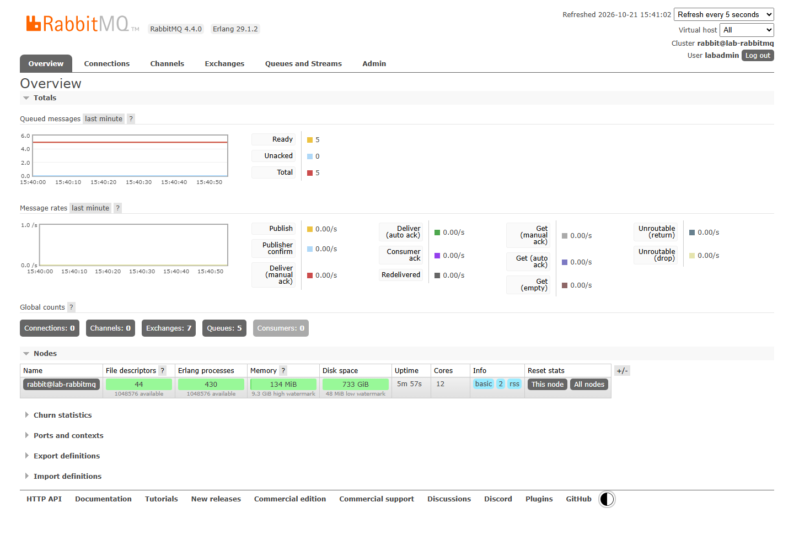
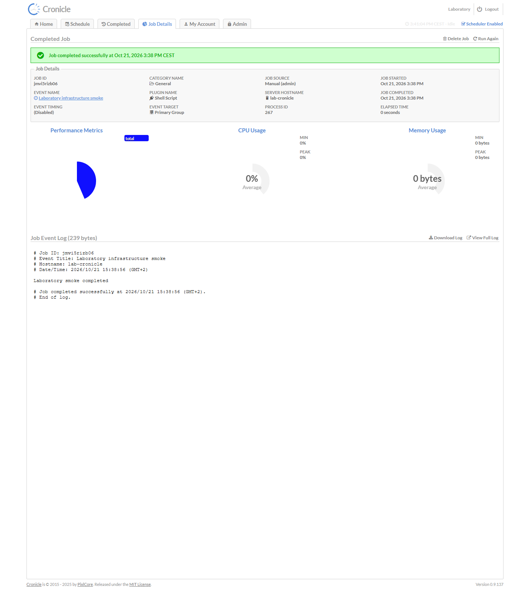
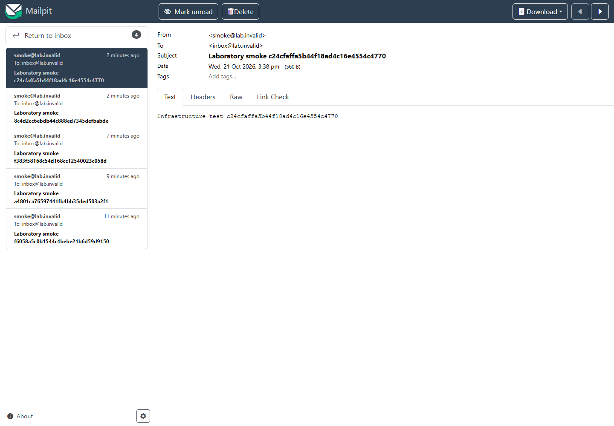

# Informe de QA — Infraestructura del laboratorio

| Campo | Resultado |
|---|---|
| Fecha | 2026-10-21, 15:41 CEST |
| Estado global | **VERDE** — qa-gate exit 0 |
| URLs locales | RabbitMQ `http://127.0.0.1:15672`, Cronicle `http://127.0.0.1:3012`, Mailpit `http://127.0.0.1:18025` |
| Plan | [Plan](../improvement-plan.md) · [Pruebas](../test-plan.md) |

## Veredicto (qa-gate)

```json
{
  "verdict": "VERDE",
  "counts": {
    "passed": 3,
    "failed": 0,
    "flaky": 0,
    "skipped": 0,
    "interrupted": 0
  },
  "flaky_sin_justificar": [],
  "flaky_justificados": {},
  "threshold": "verde ⟺ 0 failed, 0 flaky sin justificar, 0 interrumpidos y ≥1 test ejecutado"
}
```

## Resumen y cobertura

E2E-01 pasó sus tres subcasos en Chromium, a primer intento (15,8 segundos). No hay fallos ni manuales pendientes del alcance. Guardrail oficial ejecutado con exit 0 para los tres destinos locales. Playwright y Chromium ya estaban instalados; no se instalaron dependencias.

`coverage-check.py` exit 0: 0 referencias rotas, 0 tareas sin cobertura y 0 tests sin referencia. `ledger-lint.py` final exit 0: 0 incoherencias y 0 avisos. La ausencia de HEAD impide comparar un diff Git: se revisaron las rutas explícitas, sin atribuir una comprobación de alcance Git que no se ejecutó.

## API y protocolos

| Escenario | Resultado y evidencia |
|---|---|
| API-01 | PASS, ejecución del coordinador: `smoke.ps1` exit 0; publicación/consumo/requeue RabbitMQ, escritura/lectura MySQL como usuario de aplicación, SMTP recibido y encontrado en Mailpit, login y job shell Cronicle con código 0. |
| Persistencia | PASS, ejecución del coordinador: recreación de los cuatro contenedores sin borrar volúmenes y `smoke.ps1 -VerifyPersistence` exit 0; datos anteriores de los cuatro servicios conservados. |
| Regresión B1 | PASS, ejecución del coordinador posterior al fix: dos ejecuciones normales exit 0 generaron marcadores diferentes y operaciones nuevas; verificación de persistencia posterior exit 0. |
| Red compartida | PASS, ejecución del coordinador: contenedor temporal en `emailing-lab` conectó a `rabbitmq:5672`, `cronicle:3012`, `mysql:3306` y `mailpit:1025`. No se duplicó infraestructura. |
| Estado final | QA confirmó con `docker compose ps`: cuatro servicios Healthy, puertos publicados solo en localhost. El coordinador confirmó `sobricontrol-mariadb` ajeno todavía Up. |

La evidencia runtime detallada y la revisión A/B/C/D están en [tasks.md](../tasks.md). QA no repitió escrituras, recreaciones ni smoke innecesariamente. No se prueba alta disponibilidad, carga máxima ni entrega de emails a Internet.

## Resultados automáticos — E2E-01

| Subcaso | Aserciones | Resultado |
|---|---|---|
| RabbitMQ | Login administrativo, Overview y nodo `rabbit@lab-rabbitmq` visibles | PASS |
| Cronicle | Login con secreto generado y detalle del job de smoke completado correctamente | PASS |
| Mailpit | Mensaje SMTP con destinatario, asunto y cuerpo esperados | PASS |







## Checklist manual

- [x] **M-01 — Operación y conexión de aplicaciones:** README contrastado con Compose; instrucciones de arranque/parada, credenciales locales, puertos y red externa coherentes. Ejemplos sin secretos. Contenedor ajeno conservado; puertos existentes no reutilizados. Revisión por coordinador y QA. Cubre T-01/T-03.

## Trazabilidad y evidencias

| Tarea | Escenarios | Resultado |
|---|---|---|
| T-01 | E2E-01, API-01, M-01 | PASS |
| T-02 | E2E-01, API-01 | PASS |
| T-03 | E2E-01, API-01, M-01 | PASS |

Resultados reproducibles: [results.json](raw/results.json), [tests](E2E-01.spec.mjs), [configuración](playwright.config.mjs) y `screenshots/`. Las rutas del runner apuntan a la caché local existente y deben ajustarse en otra máquina. Capturas realizadas solo tras autenticar; sin trazas ni vídeo que almacenen credenciales. Informe solo local; sin publicación a servicios externos.

Salidas de puertas conservadas: [qa-gate](raw/qa-gate.json), [coverage-check](raw/coverage-check.json), [ledger-lint](raw/ledger-lint.txt). No se entrega PDF: el render con la caché existente quedó sin respuesta y se detuvo únicamente su proceso. La infraestructura y las pruebas funcionales quedaron verificadas; el coordinador acotó la entrega al Markdown y las evidencias.
