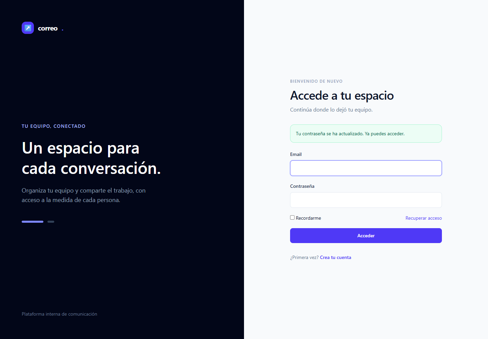
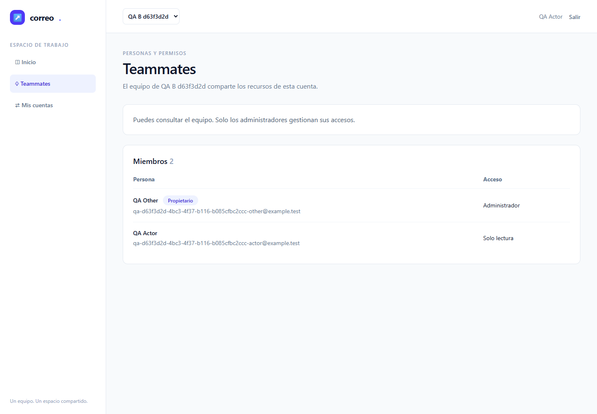
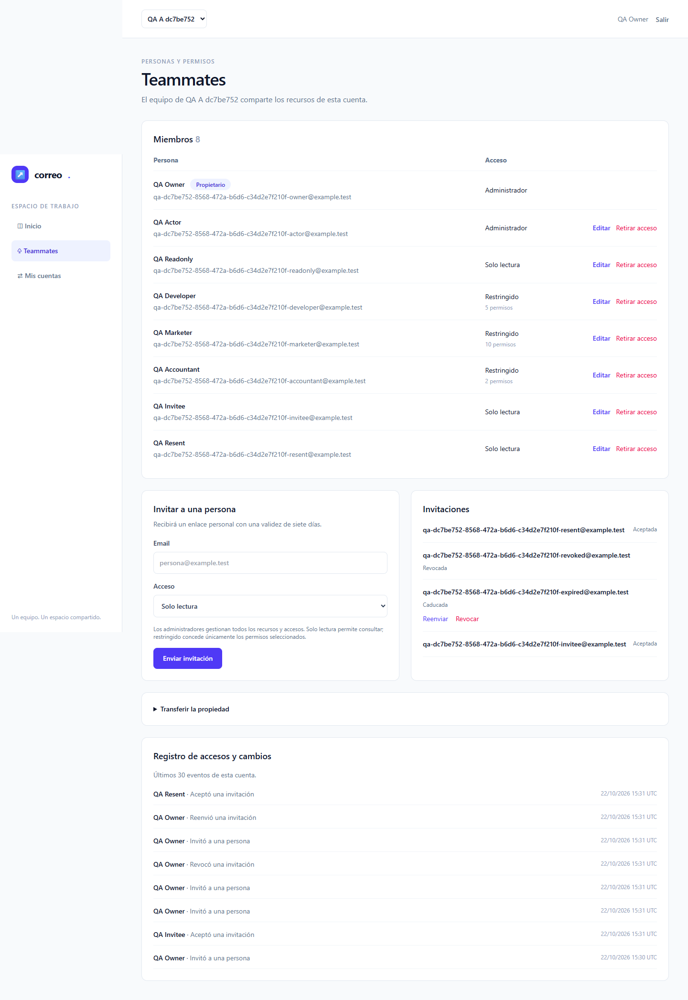
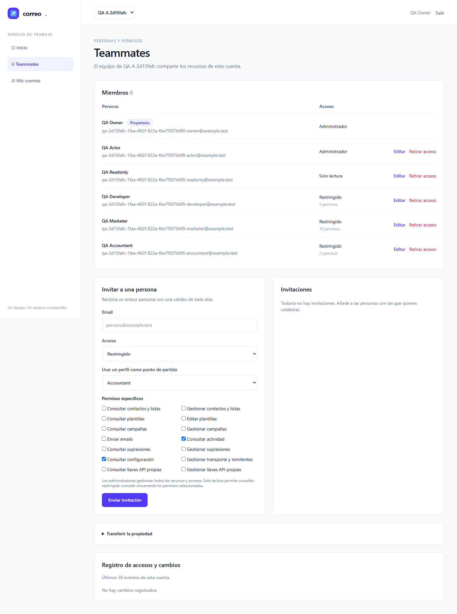
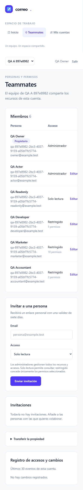
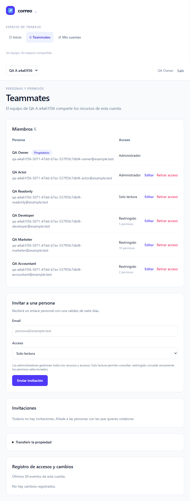

# Informe de QA — Plataforma interna de emailing · fase 1

| Campo | Resultado |
|---|---|
| Fecha | 2026-10-22T15:45:04.807Z |
| Estado automático de fase 1 | NO VERDE según qa-gate; no cierra el roadmap completo |
| URL nativa / Docker | http://127.0.0.1:8082 / http://127.0.0.1:8083 |
| Perfil temporal registro deshabilitado | http://127.0.0.1:8084; conservado para diagnóstico por petición del coordinador |
| Correo | Mailpit local http://127.0.0.1:18025; ningún SMTP externo |
| Alcance | T-01–T-04; E2E-01–04 en Chromium; workers=1, retries=0 |

## Veredicto (qa-gate)

Salida JSON real, sin umbrales modificados, sobre <code>raw/results.json</code>:

```json
{
  "verdict": "NO-VERDE",
  "counts": {
    "passed": 4,
    "failed": 4,
    "flaky": 0,
    "skipped": 0,
    "interrupted": 0
  },
  "flaky_sin_justificar": [],
  "flaky_justificados": {},
  "threshold": "verde ⟺ 0 failed, 0 flaky sin justificar, 0 interrumpidos y ≥1 test ejecutado"
}
```

Automáticos: 4/8 pasan, 4 fallan, 0 flaky, 0 omitidos. Duración total del último intento: 948.38 s. Cada recorrido tiene 360 s de presupuesto y cada acción/navegación 30 s. La configuración no permite retries.

## Puertas y cobertura

| Puerta | Exit | Evidencia |
|---|---:|---|
| Guardrail oficial | 0 | Sólo hosts 127.0.0.1, puertos 8082/8083/8084/18025 |
| ledger-lint | 0 | 0 incoherencias; avisos de Changelog no bloqueantes |
| coverage-check | 0 | 25 GWT trazados; 0 referencias rotas; 0 GWT huérfanos |
| qa-gate | 1 | Recuento real del runner |

Los 25 GWT están **mapeados**, lo que no acredita ejecución futura. E2E-05–11 y M-02 siguen pendientes. No hay configuración tests.coberturaMinima ni TDD; no se calcula ni inventa porcentaje de cobertura de código. Como complemento aportado por implementer: suite Feature final 30 passed / 230 assertions / 174.31 s y regresión HTTP de sesiones de registro/login anteriores a la primera navegación; esta pasada QA no repitió esa suite.

## Resultados automáticos

**Los párrafos siguientes describen las aserciones previstas; sólo se acreditan los casos completos que pasan. Los pasos posteriores al primer fallo de un caso permanecen sin acreditar.**

| Escenario | Perfil | Resultado | Duración |
|---|---|---|---:|
| E2E-01 — Registro, acceso y recuperación | native | unexpected / failed | 136.27 s |
| E2E-01 — Registro, acceso y recuperación | docker | unexpected / failed | 37.78 s |
| E2E-02 — Selector y aislamiento de cuentas | native | expected / passed | 72.00 s |
| E2E-02 — Selector y aislamiento de cuentas | docker | expected / passed | 42.44 s |
| E2E-03 — Invitaciones y validez de identidad/token | native | expected / passed | 163.54 s |
| E2E-03 — Invitaciones y validez de identidad/token | docker | expected / passed | 34.23 s |
| E2E-04 — Roles, propiedad, revocación y auditoría | native | unexpected / failed | 119.00 s |
| E2E-04 — Roles, propiedad, revocación y auditoría | docker | unexpected / failed | 86.02 s |

### Error real E2E-01 · native

```text
Error: expect(received).toBe(expected) // Object.is equality

Expected: 403
Received: 404

  25 |   const offContext=await browser.newContext({baseURL:'http://127.0.0.1:8084'});contexts.push(offContext);const off=await offContext.newPage();await off.goto('/login');await expect(off.getByRole('link',{name:'Crea tu cuenta'})).toHaveCount(0);
  26 |   const token=await off.locator('[name=_token]').inputValue();const disabledEmail=`qa-${f.run}-disabled@example.test`;
> 27 |   const denied=await off.request.post('http://127.0.0.1:8084/register',{form:{_token:token,name:'QA Disabled',account_name:'QA Disabled',email:disabledEmail,password:f.password,password_confirmation:f.password},maxRedirects:0});expect(denied.status()).toBe(403);expect(state(f).users.some(u=>u.email===disabledEmail)).toBe(false);
     |                                                                                                                                                                                                                                                             ^
  28 |  }finally{await cleanup(f,contexts);}
  29 | });
  30 |
    at C:\laragon\www\emailing\docs\roadmap\2026-10-21-plataforma-emailing\testing\specs\E2E-01.spec.mjs:27:253
```

### Error real E2E-01 · docker

```text
TimeoutError: page.goto: Timeout 30000ms exceeded.
Call log:
  - navigating to "http://127.0.0.1:8083/dashboard", waiting until "load"


  3 |  const f=fixture(),contexts=[];const email=`qa-${f.run}-registered@example.test`;
  4 |  try{
> 5 |   await page.goto('/dashboard');await expect(page).toHaveURL(/\/login$/);
    |              ^
  6 |   const csrf=await page.request.post(baseURL+'/login',{form:{email,password:'invalid'},maxRedirects:0});expect(csrf.status()).toBe(419);
  7 |   await page.goto('/register');await shot(page,'01-registration',info.project.name);
  8 |   await page.locator('[name=name]').fill('QA Registered');await page.locator('[name=account_name]').fill('QA Registered '+f.run.slice(0,8));await page.locator('[name=email]').fill(email);await page.locator('[name=password]').fill(f.password);await page.locator('[name=password_confirmation]').fill(f.password);
    at C:\laragon\www\emailing\docs\roadmap\2026-10-21-plataforma-emailing\testing\specs\E2E-01.spec.mjs:5:14
```

### Error real E2E-04 · native

```text
TimeoutError: locator.fill: Timeout 30000ms exceeded.
Call log:
  - waiting for locator('[wire\\:model=transferPassword]')
    - locator resolved to <input required="" type="password" wire:model="transferPassword" autocomplete="current-password"/>
    - fill("[REDACTED-FIXTURE-PASSWORD]")
  - attempting fill action
    2 × waiting for element to be visible, enabled and editable
      - element is not visible
    - retrying fill action
    - waiting 20ms
    2 × waiting for element to be visible, enabled and editable
      - element is not visible
    - retrying fill action
      - waiting 100ms
    58 × waiting for element to be visible, enabled and editable
       - element is not visible
     - retrying fill action
       - waiting 500ms


  35 |   await page.locator('summary').filter({hasText:'Transferir la propiedad'}).click();await page.locator('[wire\\:model=transferMember]').selectOption(String(f.members.developer));await page.locator('[wire\\:model=transferPassword]').fill('Wrong-example-password');
  36 |   await page.getByRole('button',{name:'Transferir propiedad',exact:true}).click();await expect(page.locator('body')).toContainText('La contraseña no es correcta');expect(state(f).accounts.find(a=>a.id===f.accounts.A.id).owner_id).toBe(f.users.owner.id);
> 37 |   await page.locator('[wire\\:model=transferPassword]').fill(f.password);await page.getByRole('button',{name:'Transferir propiedad',exact:true}).click();await expect(page.getByRole('status')).toContainText('Propiedad transferida');
     |                                                         ^
  38 |   let s=state(f);expect(s.accounts.find(a=>a.id===f.accounts.A.id).owner_id).toBe(f.users.developer.id);expect(s.members.find(m=>m.id===f.members.developer).role).toBe('admin');expect(s.members.find(m=>m.id===f.members.owner).role).toBe('admin');
  39 |   for(const action of ['teammate.removed','teammate.permissions_changed','account.ownership_transferred'])expect(s.events.some(e=>e.account_id===f.accounts.A.id&&e.actor_id===f.users.owner.id&&e.action===action)).toBe(true);
  40 |   await expect(page.locator('body')).toContainText('Transfirió la propiedad');await shot(page,'04-audit',info.project.name);
    at C:\laragon\www\emailing\docs\roadmap\2026-10-21-plataforma-emailing\testing\specs\E2E-04.spec.mjs:37:57
```

### Error real E2E-04 · docker

```text
TimeoutError: locator.fill: Timeout 30000ms exceeded.
Call log:
  - waiting for locator('[wire\\:model=transferPassword]')
    - locator resolved to <input required="" type="password" wire:model="transferPassword" autocomplete="current-password"/>
    - fill("[REDACTED-FIXTURE-PASSWORD]")
  - attempting fill action
    2 × waiting for element to be visible, enabled and editable
      - element is not visible
    - retrying fill action
    - waiting 20ms
    2 × waiting for element to be visible, enabled and editable
      - element is not visible
    - retrying fill action
      - waiting 100ms
    58 × waiting for element to be visible, enabled and editable
       - element is not visible
     - retrying fill action
       - waiting 500ms


  35 |   await page.locator('summary').filter({hasText:'Transferir la propiedad'}).click();await page.locator('[wire\\:model=transferMember]').selectOption(String(f.members.developer));await page.locator('[wire\\:model=transferPassword]').fill('Wrong-example-password');
  36 |   await page.getByRole('button',{name:'Transferir propiedad',exact:true}).click();await expect(page.locator('body')).toContainText('La contraseña no es correcta');expect(state(f).accounts.find(a=>a.id===f.accounts.A.id).owner_id).toBe(f.users.owner.id);
> 37 |   await page.locator('[wire\\:model=transferPassword]').fill(f.password);await page.getByRole('button',{name:'Transferir propiedad',exact:true}).click();await expect(page.getByRole('status')).toContainText('Propiedad transferida');
     |                                                         ^
  38 |   let s=state(f);expect(s.accounts.find(a=>a.id===f.accounts.A.id).owner_id).toBe(f.users.developer.id);expect(s.members.find(m=>m.id===f.members.developer).role).toBe('admin');expect(s.members.find(m=>m.id===f.members.owner).role).toBe('admin');
  39 |   for(const action of ['teammate.removed','teammate.permissions_changed','account.ownership_transferred'])expect(s.events.some(e=>e.account_id===f.accounts.A.id&&e.actor_id===f.users.owner.id&&e.action===action)).toBe(true);
  40 |   await expect(page.locator('body')).toContainText('Transfirió la propiedad');await shot(page,'04-audit',info.project.name);
    at C:\laragon\www\emailing\docs\roadmap\2026-10-21-plataforma-emailing\testing\specs\E2E-04.spec.mjs:37:57
```

### E2E-01 — Registro, acceso y recuperación

**Resultado no verde — dos causas distintas:** en el perfil **nativo**, el POST /register del servidor deshabilitado devuelve 404 y el harness esperaba 403. config/fortify.php:9 elimina la feature de registro y vendor/laravel/fortify/routes/routes.php:74 condiciona la publicación de la ruta. La comprobación de ausencia de usuario en DB estaba después del assert de status y **no se ejecutó**; no se acredita retrospectivamente tras limpiar la fixture. En **Docker**, el primer page.goto(/dashboard) agotó 30 s: no llegó al flujo de registro ni al perfil deshabilitado en este tercer intento. Su causa raíz no está demostrada; los pasos posteriores no se acreditan. El coordinador conserva 8084 para diagnóstico; no se cambió el assert ni se lanzó un cuarto intento.

Acceso anónimo y CSRF negativo real (419); alta UI con una cuenta y membresía owner/Admin únicas; login/logout y credencial inválida; email de recuperación recibido por SMTP en Mailpit; consumo y rechazo de reutilización; cookies anteriores al reset rechazadas y acceso nuevo correcto. Perfil temporal con registro deshabilitado rechaza POST real (403) y no crea usuario. Capturas sin token ni contraseña.




### E2E-02 — Selector y aislamiento

Identidad Admin A / Read-only B sólo ve sus dos cuentas. Switch HTTP a C denegado (403), acción de Read-only forjada por Livewire denegada (403), modificación de membresía de C rechazada (404) y DB de C intacta. Revocación de la membresía activa en sesión abierta rechaza la siguiente acción y presenta una denegación legible.



### E2E-03 — Invitaciones

Invitación emitida desde UI y recibida en Mailpit; aceptación por destinatario previsto y una sola membresía. GET/POST rechazados para email incorrecto, token consumido, expirado, revocado y token antiguo tras reenvío; el enlace nuevo sí se acepta. DB comprueba ausencia de membresías negativas y longitud 64 del campo oculto token_hash; esa longitud por sí sola no demuestra el algoritmo. El hash SHA-256 y la concurrencia MySQL pertenecen al complemento Feature aportado; no se simulan con un resultado de fixture.



### E2E-04 — Roles y propiedad

**Resultado no verde:** el error de contraseña incorrecta apareció y el owner permaneció intacto. Al renderizar el error, el elemento details volvió a quedar cerrado; el siguiente fill de la contraseña correcta encontró el input oculto y agotó 30 s. No se reabrió ni se corrigió el harness tras el tercer intento. La transferencia válida, sus cambios de roles, la auditoría final de transferencia y los asserts responsive al final de E2E-04 **no se ejecutaron**. Las capturas M-01 independientes siguientes no los acreditan.

Read-only y Restricted (Developer/Marketer/Accountant) carecen de controles de administración y reciben 403 ante invitación, elevación de rol/scopes, eliminación y transferencia forjadas. Los tres perfiles aplican el catálogo real en UI; scope ajeno rechazado. Owner protegido de eliminación/degradación. Retirada y reducción desde UI se aplican en la siguiente acción de sesiones abiertas, conservando la cuenta. Transferencia exige contraseña correcta, eleva al nuevo propietario a Admin y conserva Admin anterior. Auditoría comprueba actor, cuenta y acción en DB y texto visible.



## Evidencia responsive y checklist manual

Captura independiente y de sólo lectura de /team con fixtures UUID nuevos, después de cerrar el tercer runner. Se usaron viewports de escritorio 1440×1000, móvil 390×844 y tableta 768×1024 en ambos perfiles; las imágenes son de página completa. Las medidas reales de ancho/alto y desbordamiento están en [m01-visual.json](raw/m01-visual.json). No es una cuarta suite ni cambia el resultado de E2E-04. Estas medidas no sustituyen el juicio humano de claridad, contraste y lenguaje.

En móvil la tabla de miembros tiene desplazamiento horizontal **interno** (overflow-x-auto en la vista): las acciones a la derecha requieren desplazarla. Cero desbordamiento de la página no significa que todas las columnas se vean simultáneamente. La revisión del agente observa navegación y formularios legibles; M-01 sigue pendiente de una persona.

| Perfil | Vista | Viewport | Ancho documento | Desbordamiento horizontal |
|---|---|---|---:|---|
| native | desktop | 1440×1000 | 1440 | No |
| native | mobile | 390×844 | 390 | No |
| native | tablet | 768×1024 | 768 | No |
| docker | desktop | 1440×1000 | 1440 | No |
| docker | mobile | 390×844 | 390 | No |
| docker | tablet | 768×1024 | 768 | No |





- [ ] **M-01 — Claridad y adaptación del panel español**: una persona debe aceptar formularios, mensajes, cuenta activa, permisos y legibilidad. Pendiente; capturas preparadas para revisión.
- [ ] **M-02 — Operación y límites**: pendiente de fase futura, fuera de C-01.

## Trazabilidad y límites

| Tareas | Escenarios | Estado de esta pasada |
|---|---|---|
| T-01 | E2E-01, M-01 | Automático fase 1 según tabla; M-01 humano pendiente |
| T-02 | E2E-01/02, M-01 | Automático fase 1 según tabla; M-01 humano pendiente |
| T-03 | E2E-02/03/04, M-01 | Automático fase 1 según tabla; M-01 humano pendiente |
| T-04 | E2E-01–04, M-01 | En progreso: root coordina diagnóstico y siguiente decisión; no cierra el plan |
| T-05–T-20 | E2E-05–11 y complementos globales | No ejecutados ni aprobados en esta fase |

Pruebas aisladas en MySQL **emailing_testing** con usuario exclusivo y TestingDatabaseGuard, sin migrar/refrescar/truncar. Fixtures identificadas por UUID y limpieza limitada a sus usuarios/cuentas. Ningún acceso ni cambio a emailing/lab_smoke. El servidor temporal 8084 queda conservado para diagnóstico (padre PHP 26420 y servidor PHP 32932), junto a los servidores QA 8082/8083 preexistentes; sólo debe detenerse su árbol propio después del diagnóstico. No hay trazas/vídeo con credenciales. JSON conserva estados, conteos y errores materiales; sólo redacta rutas de perfil privado y secretos de enlaces/fixtures si aparecen en errores. Originales privados ignorados.

## Historial de ejecución y del harness

Veredictos reales por intento: [gates-history.json](raw/gates-history.json). Cada entrada conserva stdout completo y exit de qa-gate; los dos primeros fueron NO-VERDE (0/8 y 1/8), sin flaky. El tercero corresponde al veredicto final mostrado arriba.

- results-attempt-1.json: 0 expected, 8 unexpected, 0 skipped, 0 flaky; 239.29 s.
- results-attempt-2.json: 1 expected, 7 unexpected, 0 skipped, 0 flaky; 919.63 s.
- results-attempt-3.json: 4 expected, 4 unexpected, 0 skipped, 0 flaky; 948.38 s.

Se conservaron resultados fallidos. Correcciones del harness: texto de credencial inválida y de error 403 contrastados con vistas; URI Livewire leída de data-update-uri y normalizada; texto de reuso de reset y summary de transferencia exactos; presupuesto global ampliado de 180 a 360 s por duración del recorrido, con operaciones a 30 s. Sin cambios a aplicación, umbrales ni aserciones de autorización/DB. El intento 2 conserva el timeout de recorrido y sus fallos de selector. El tercer intento registra tres causas: status off nativo, timeout inicial de navegación Docker sin causa raíz probada, y segundo fill oculto tras validación de transferencia en ambos perfiles. No se atribuye el timeout Docker a aplicación ni harness sin diagnóstico. No hubo cuarto intento.

## Evidencias y reproducción

- Resultados reales: <code>raw/results.json</code>; gates y stdout completos: <code>raw/gates.json</code> y <code>raw/*.txt</code>.
- Fuentes ejecutables: <code>testing/playwright.config.mjs</code>, <code>testing/specs/E2E-01.spec.mjs</code>–<code>E2E-04.spec.mjs</code>, <code>testing/specs/helpers.mjs</code>, <code>testing/fixture.php</code>.
- Runner instalado en QA_CACHE_DIR o caché de usuario; ejecutar su cli.js con Node22 y --config testing/playwright.config.mjs desde la raíz del proyecto. Chromium local existente, sin descargas.
- Capturas de ambos perfiles: <code>screenshots/</code>; informe de esta fase preservado en <code>testing/fase-1/report.md</code> y <code>report.pdf</code>.
