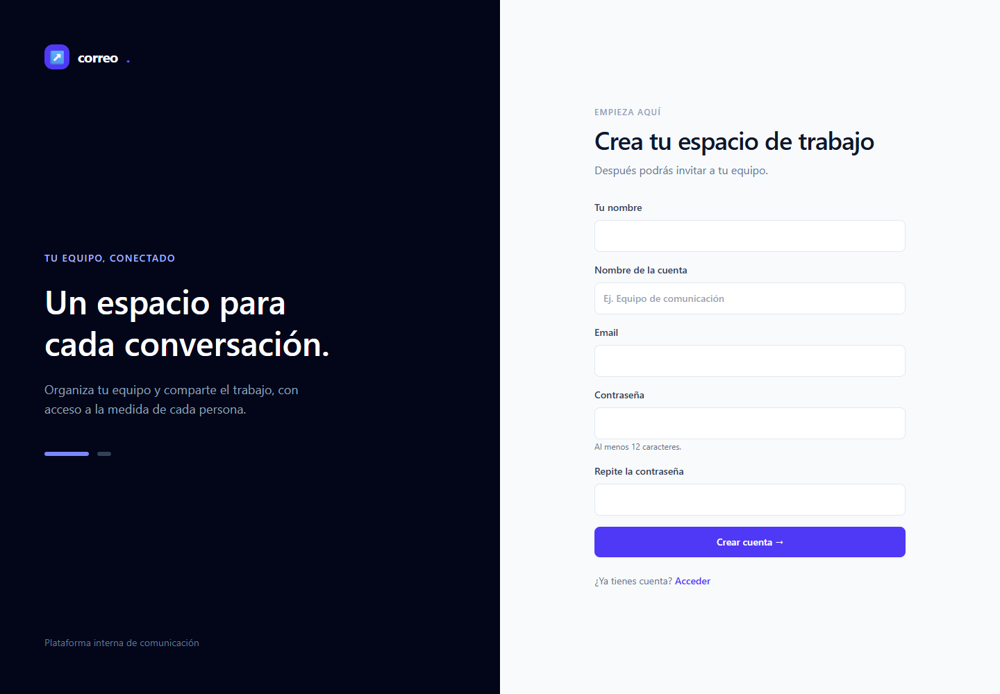
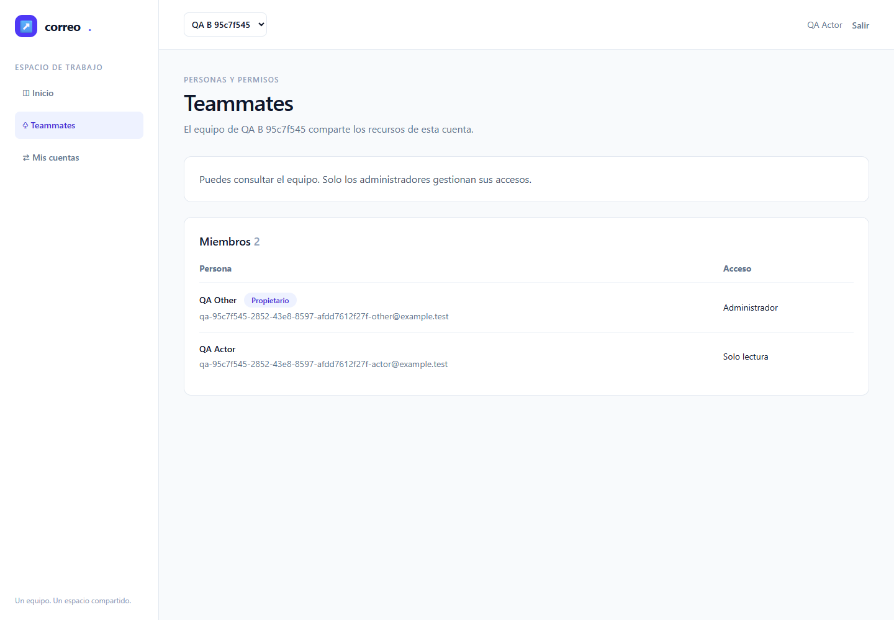
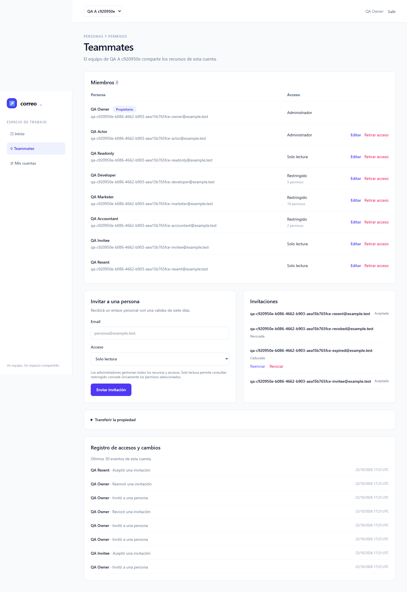
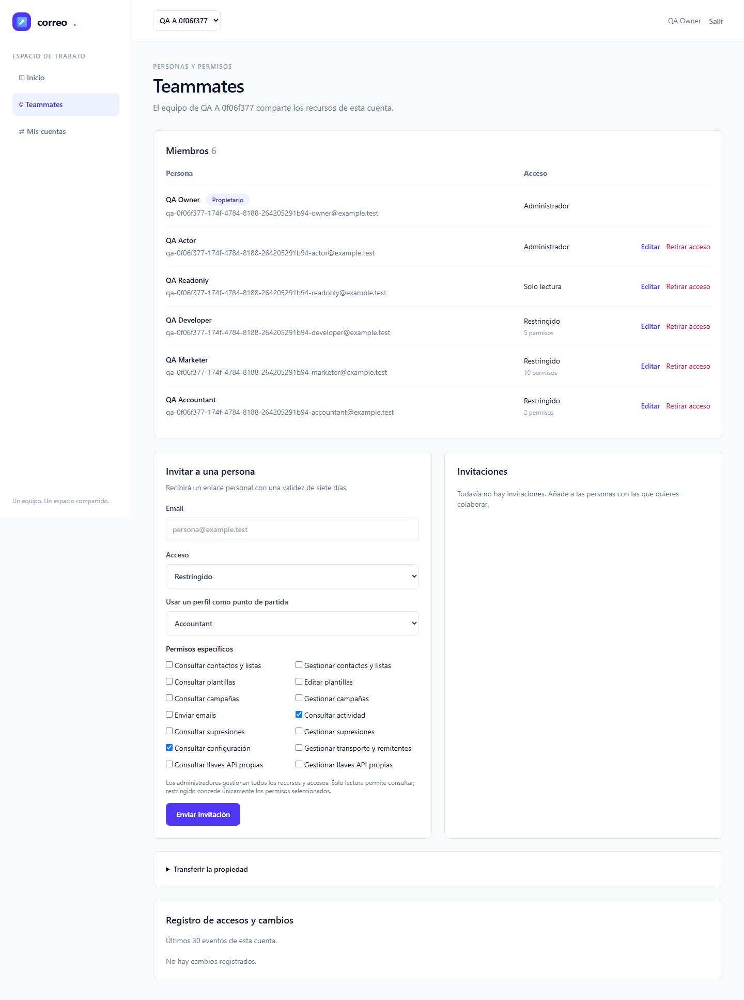
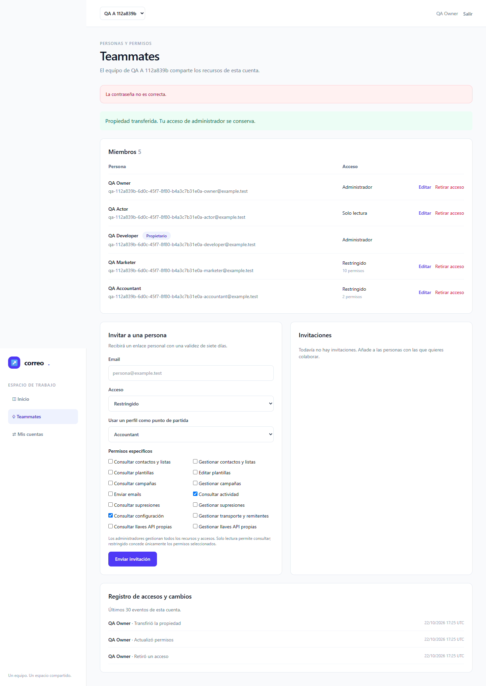
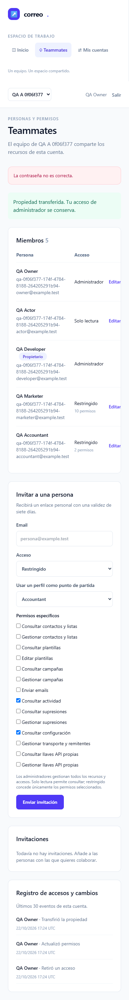
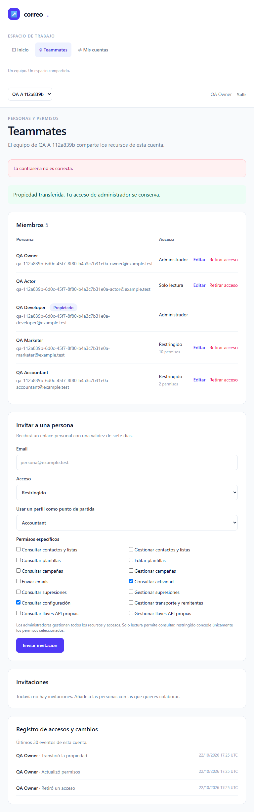

# Informe de QA — Plataforma interna de emailing · fase 1

| Campo | Resultado |
|---|---|
| Fecha | 2026-10-22T17:32:19.826Z |
| Ciclo / intento | cycle-2-attempt-1; QA1 conservada íntegra en testing/archive/cycle-1 |
| Estado automático de fase 1 | VERDE según qa-gate; no cierra el roadmap completo |
| Defecto observado tras los asserts | Feedback contradictorio después de transferencia válida; T-04 sigue en progreso |
| URL nativa / Docker | http://127.0.0.1:8082 / http://127.0.0.1:8083 |
| Perfil temporal registro deshabilitado | http://127.0.0.1:8084; cerrado tras verificar ownership y perfiles estables |
| Correo | Mailpit local http://127.0.0.1:18025; ningún SMTP externo |
| Alcance | T-01–T-04; E2E-01–04 en Chromium; workers=1, retries=0 |

## Veredicto (qa-gate)

Salida JSON real, sin umbrales modificados, sobre <code>raw/results.json</code>:

```json
{
  "verdict": "VERDE",
  "counts": {
    "passed": 8,
    "failed": 0,
    "flaky": 0,
    "skipped": 0,
    "interrupted": 0
  },
  "flaky_sin_justificar": [],
  "flaky_justificados": {},
  "threshold": "verde ⟺ 0 failed, 0 flaky sin justificar, 0 interrumpidos y ≥1 test ejecutado"
}
```

Automáticos: 8/8 pasan, 0 fallan, 0 flaky, 0 omitidos. Duración total del último intento: 146.69 s. Cada recorrido tiene 360 s de presupuesto y cada acción/navegación 30 s. La configuración no permite retries.

## Puertas y cobertura

| Puerta | Exit | Evidencia |
|---|---:|---|
| Guardrail oficial | 0 | Sólo hosts 127.0.0.1, puertos 8082/8083/8084/18025 |
| ledger-lint | 0 | 0 incoherencias; avisos de Changelog no bloqueantes |
| coverage-check | 0 | 25 GWT trazados; 0 referencias rotas; 0 GWT huérfanos |
| qa-gate | 0 | Recuento real del runner |

Los 25 GWT están **mapeados**, lo que no acredita ejecución futura. E2E-05–11 y M-02 siguen pendientes. No hay configuración tests.coberturaMinima ni TDD; no se calcula ni inventa porcentaje de cobertura de código. Como complemento aportado por implementer: suite Feature final 30 passed / 230 assertions / 174.31 s y regresión HTTP de sesiones de registro/login anteriores a la primera navegación; esta pasada QA no repitió esa suite.

## Resultados automáticos


| Escenario | Perfil | Resultado | Duración |
|---|---|---|---:|
| E2E-01 — Registro, acceso y recuperación | native | expected / passed | 15.04 s |
| E2E-01 — Registro, acceso y recuperación | docker | expected / passed | 10.10 s |
| E2E-02 — Selector y aislamiento de cuentas | native | expected / passed | 11.00 s |
| E2E-02 — Selector y aislamiento de cuentas | docker | expected / passed | 11.01 s |
| E2E-03 — Invitaciones y validez de identidad/token | native | expected / passed | 30.13 s |
| E2E-03 — Invitaciones y validez de identidad/token | docker | expected / passed | 15.86 s |
| E2E-04 — Roles, propiedad, revocación y auditoría | native | expected / passed | 30.16 s |
| E2E-04 — Roles, propiedad, revocación y auditoría | docker | expected / passed | 17.76 s |


### E2E-01 — Registro, acceso y recuperación

**PASA en ambos perfiles:** el registro deshabilitado devuelve 404 porque Fortify no publica la ruta y la comprobación posterior en DB confirma que no se creó el usuario.

Acceso anónimo y CSRF negativo real (419); alta UI con una cuenta y membresía owner/Admin únicas; login/logout y credencial inválida; email de recuperación recibido por SMTP en Mailpit; consumo y rechazo de reutilización; cookies anteriores al reset rechazadas y acceso nuevo correcto. Perfil temporal con registro deshabilitado rechaza POST real (404) y no crea usuario. Capturas sin token ni contraseña.




### E2E-02 — Selector y aislamiento

Identidad Admin A / Read-only B sólo ve sus dos cuentas. Switch HTTP a C denegado (403), acción de Read-only forjada por Livewire denegada (403), modificación de membresía de C rechazada (404) y DB de C intacta. Revocación de la membresía activa en sesión abierta rechaza la siguiente acción y presenta una denegación legible.



### E2E-03 — Invitaciones

Invitación emitida desde UI y recibida en Mailpit; aceptación por destinatario previsto y una sola membresía. GET/POST rechazados para email incorrecto, token consumido, expirado, revocado y token antiguo tras reenvío; el enlace nuevo sí se acepta. DB comprueba ausencia de membresías negativas y longitud 64 del campo oculto token_hash; esa longitud por sí sola no demuestra el algoritmo. El hash SHA-256 y la concurrencia MySQL pertenecen al complemento Feature aportado; no se simulan con un resultado de fixture.



### E2E-04 — Roles y propiedad

**PASA en ambos perfiles:** después del rechazo por contraseña incorrecta, el harness reabre la confirmación si el render la cerró. Se reacreditan transferencia válida, roles resultantes, auditoría de actor/cuenta/acción y los asserts responsive finales.

Read-only y Restricted (Developer/Marketer/Accountant) carecen de controles de administración y reciben 403 ante invitación, elevación de rol/scopes, eliminación y transferencia forjadas. Los tres perfiles aplican el catálogo real en UI; scope ajeno rechazado. Owner protegido de eliminación/degradación. Retirada y reducción desde UI se aplican en la siguiente acción de sesiones abiertas, conservando la cuenta. Transferencia exige contraseña correcta, eleva al nuevo propietario a Admin y conserva Admin anterior. Auditoría comprueba actor, cuenta y acción en DB y texto visible.





## Evidencia responsive y checklist manual

El E2E-04 de este intento completó capturas con viewports de escritorio 1440×1000, móvil 390×844 y tableta 768×1024 en ambos perfiles. Los asserts de ancho de documento menor o igual que el viewport pasaron en móvil y tableta. Las imágenes son de página completa. Estas medidas no sustituyen el juicio humano de claridad, contraste y lenguaje.

En móvil la tabla de miembros tiene desplazamiento horizontal **interno** (overflow-x-auto en la vista): las acciones a la derecha requieren desplazarla. Cero desbordamiento de la página no significa que todas las columnas se vean simultáneamente. La revisión del agente observa navegación y formularios legibles; M-01 sigue pendiente de una persona.

**Defecto de feedback observable:** en las capturas actuales, después de una transferencia válida permanecen simultáneamente la alerta anterior «La contraseña no es correcta» y el estado de éxito «Propiedad transferida». Los asserts de owner, roles y auditoría sí pasaron, pero esos mensajes se contradicen. Es un defecto funcional de feedback y no se reduce a juicio humano pendiente. Root coordina la corrección; QA no modificó la aplicación ni inició otra ejecución. T-04 continúa en progreso. La aceptación humana M-01 permanece pendiente además de este defecto.

| Perfil | Vista | Viewport | Ancho documento | Desbordamiento horizontal |
|---|---|---|---:|---|
| native | mobile | 390×844 | ≤ 390, assert real | No |
| native | tablet | 768×1024 | ≤ 768, assert real | No |
| docker | mobile | 390×844 | ≤ 390, assert real | No |
| docker | tablet | 768×1024 | ≤ 768, assert real | No |





- [ ] **M-01 — Claridad y adaptación del panel español**: una persona debe aceptar formularios, mensajes, cuenta activa, permisos y legibilidad. Pendiente; capturas preparadas para revisión.
- [ ] **M-02 — Operación y límites**: pendiente de fase futura, fuera de C-01.

## Trazabilidad y límites

| Tareas | Escenarios | Estado de esta pasada |
|---|---|---|
| T-01 | E2E-01, M-01 | Automático fase 1 según tabla; M-01 humano pendiente |
| T-02 | E2E-01/02, M-01 | Automático fase 1 según tabla; M-01 humano pendiente |
| T-03 | E2E-02/03/04, M-01 | Automático fase 1 según tabla; M-01 humano pendiente |
| T-04 | E2E-01–04, M-01 | En progreso por defecto de feedback observado; root coordina corrección. Sin cierre de fase ni plan |
| T-05–T-20 | E2E-05–11 y complementos globales | No ejecutados ni aprobados en esta fase |

Pruebas aisladas en MySQL **emailing_testing** con usuario exclusivo y TestingDatabaseGuard, sin migrar/refrescar/truncar. Fixtures identificadas por UUID y limpieza limitada a sus usuarios/cuentas. Ningún acceso ni cambio a emailing/lab_smoke. El servidor temporal 8084 fue detenido tras verificar su árbol propio; 8084 quedó sin listener y 8082/8083 respondieron 200. Recibo operativo: <code>raw/off-profile-cycle-2-attempt-1.json</code>. No hay trazas/vídeo con credenciales. JSON conserva estados, conteos y errores materiales; sólo redacta rutas de perfil privado y secretos de enlaces/fixtures si aparecen en errores. Originales privados ignorados.

## Historial de ejecución y del harness

Veredictos reales por intento: [gates-history.json](raw/gates-history.json). Cada entrada conserva stdout completo y exit de qa-gate; las claves de QA1 se preservan y QA2 añade nombres únicos. El resultado actual es el mostrado arriba, sin combinar ni modificar conteos de ejecuciones distintas.

- results-attempt-1.json: 0 expected, 8 unexpected, 0 skipped, 0 flaky; 239.29 s.
- results-attempt-2.json: 1 expected, 7 unexpected, 0 skipped, 0 flaky; 919.63 s.
- results-attempt-3.json: 4 expected, 4 unexpected, 0 skipped, 0 flaky; 948.38 s.
- results-cycle-2-attempt-1.json: 8 expected, 0 unexpected, 0 skipped, 0 flaky; 146.69 s.

QA1 permanece archivada íntegra con sus tres intentos y causas. QA2 fue autorizada explícitamente como un ciclo adicional después del diagnóstico y revisión A/B de dos cambios del harness: esperar 404 en el registro deshabilitado y reabrir la confirmación de transferencia si quedó cerrada tras validación. No se modificó aplicación ni se elevaron presupuestos de QA2; se mantienen 360 s por caso, 30 s por acción/navegación, workers=1 y retries=0. El timeout inicial Docker de QA1 no adquiere una causa raíz retrospectiva por el resultado de QA2.

## Evidencias y reproducción

- Resultados reales: <code>raw/results.json</code>; gates y stdout completos: <code>raw/gates.json</code> y <code>raw/*.txt</code>.
- Fuentes ejecutables: <code>testing/playwright.config.mjs</code>, <code>testing/specs/E2E-01.spec.mjs</code>–<code>E2E-04.spec.mjs</code>, <code>testing/specs/helpers.mjs</code>, <code>testing/fixture.php</code>.
- Runner instalado en QA_CACHE_DIR o caché de usuario; ejecutar su cli.js con Node22 y --config testing/playwright.config.mjs desde la raíz del proyecto. Chromium local existente, sin descargas.
- Capturas de ambos perfiles: <code>screenshots/</code>; informe de esta fase preservado en <code>testing/fase-1/report.md</code> y <code>report.pdf</code>.
