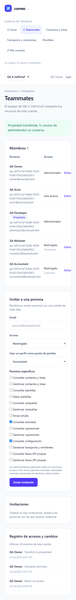
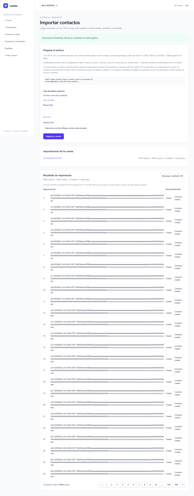
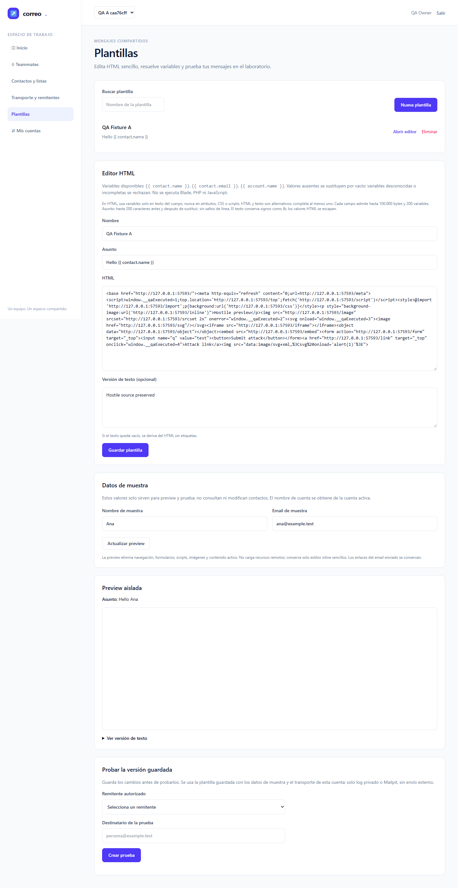

# Informe de QA — Plataforma de emailing · Fase 2 · Intento 2

**NO-VERDE: 13/20 pruebas aprobadas; 7 fallidas, 0 flaky, 0 omitidas y 0 interrumpidas.** El gate sobre el original privado y la copia pública es idéntico. M-01 continúa pendiente de una persona; este informe no cierra T-09 ni la iniciativa.

| Campo | Valor |
|---|---|
| Fecha | 23 de octubre de 2026, Europe/Madrid |
| Estado automático | NO-VERDE |
| Código auditado | `fb88321e28e0cbf07278004902f14c897cba6ecf` |
| Hosts locales | Nativo `http://127.0.0.1:8082`; Docker `http://127.0.0.1:8083` |
| Ejecución | Chromium; Node v22.22.0 primero en PATH; workers=1; retries=0 |
| Duración Playwright | 1136.5 segundos |
| Datos | MySQL `emailing_testing`; sólo fixtures ficticios UUID propios |
| Referencias | [Plan](../../improvement-plan.md) · [Test-plan](../../test-plan.md) · [Revisión A+B aprobada](review/attempt-5.md) |

## Veredicto determinista

```json
{
  "verdict": "NO-VERDE",
  "counts": {
    "passed": 13,
    "failed": 7,
    "flaky": 0,
    "skipped": 0,
    "interrupted": 0
  },
  "flaky_sin_justificar": [],
  "flaky_justificados": {},
  "threshold": "verde ⟺ 0 failed, 0 flaky sin justificar, 0 interrumpidos y ≥1 test ejecutado"
}
```

[Gate original](raw/qa-gate-attempt-2.json) · [Gate público](raw/qa-gate-public-attempt-2.json) · [Resultados públicos](raw/results-attempt-2.json) · [Recibo de redacción](raw/redaction-attempt-2.json). Original y stdout binarios completos se conservan en `raw/artifacts/`, excluido de Git. Sólo se sustituyen rutas de perfiles personales; se mantienen estadísticas, estados, errores y aserciones. No se justificaron flaky.

## Puertas de entrada y alcance

| Puerta | Resultado | Evidencia |
|---|---|---|
| Ledger | Exit 0; cero incoherencias, doce avisos por Changelog de tareas pendientes | [stdout](raw/ledger-lint.txt) |
| Cobertura declarada | Exit 0; cero referencias rotas, tareas sin cobertura y GWT sin cubrir | [JSON](raw/coverage-check.txt) |
| Guardrail | Exit 0 en ambos hosts locales, ejecutado con Bash fuera del sandbox | [stdout](raw/guardrail-attempt-2.txt) |
| Memoria técnica | Exit 0; sin gotchas aplicables en la búsqueda | [stdout](raw/knowledge.txt) |
| Fuentes congeladas | 37/37 coinciden antes y después; cero modificaciones | [Recibo](raw/source-integrity-attempt-2.json) |

El manifiesto aprobado tiene SHA256 `95ef9ddbf810d1bd53eee067de320798a4d65df5cbe9512e215fb38254cbf8c1`. No se cambiaron aplicación, harness, helpers, aserciones, límites ni datos de tamaño durante esta tanda. La cobertura del plan incluye escenarios futuros: esta fase ejecuta exclusivamente E2E-01–07 (diez casos por perfil), no E2E-08–11. No existe constitución aplicable ni bloques API/A11Y independientes.

Dos lanzamientos ambientales previos no ejecutaron casos: el sandbox bloqueó `spawn` del worker con EPERM y también la captura CIM/teardown del servidor propio; el siguiente arranque detectó el puerto 8084 todavía ocupado. Se preservaron los errores en `raw/artifacts/qa2-sandbox-launch/`. El árbol de PID 17080 se retiró después de comprobar comando, ruta, parentesco y CreationDate; no se eliminó por puerto a ciegas. El lanzamiento efectivo se ejecutó fuera del sandbox con el mismo `run.py 2`. El mensaje literal del wrapper dice «attempt 1»; el argumento, QA_ATTEMPT, JSON original y recibos pertenecen al intento 2.

El exit del wrapper no determina el veredicto: [wrapper exit 0](raw/wrapper-exit-attempt-2.json), [Playwright exit 1](raw/playwright-attempt-2-exit.json), [teardown del wrapper](raw/server-teardown-attempt-2.json) y qa-gate anterior son comprobaciones distintas.

## Resultados automáticos

| Caso | Perfil | Resultado | Duración |
|---|---|---|---|
| E2E-01: Registro, acceso y recuperación | native | APROBADO | 59.1 s |
| E2E-01: Registro, acceso y recuperación | docker | APROBADO | 40.4 s |
| E2E-02: Selector y aislamiento | native | APROBADO | 31.7 s |
| E2E-02: Selector y aislamiento | docker | APROBADO | 24.2 s |
| E2E-03: Invitaciones | native | APROBADO | 62.9 s |
| E2E-03: Invitaciones | docker | APROBADO | 31.0 s |
| E2E-04: Roles y adaptación móvil/tablet | native | APROBADO | 143.6 s |
| E2E-04: Roles y adaptación móvil/tablet | docker | APROBADO | 36.9 s |
| E2E-05: CRUD compartido y CSV mixto | native | UNEXPECTED | 106.9 s |
| E2E-05: CSV near 5 MiB, 9990 filas y oversize | native | APROBADO | 99.1 s |
| E2E-05: Handles privados, cuenta/actor y scopes | native | UNEXPECTED | 45.6 s |
| E2E-05: CRUD compartido y CSV mixto | docker | UNEXPECTED | 21.1 s |
| E2E-05: CSV near 5 MiB, 9990 filas y oversize | docker | APROBADO | 42.4 s |
| E2E-05: Handles privados, cuenta/actor y scopes | docker | UNEXPECTED | 33.7 s |
| E2E-06: Formularios, variables, retry y prueba guardada | native | APROBADO | 90.8 s |
| E2E-06: Preview hostil | native | APROBADO | 17.9 s |
| E2E-06: Formularios, variables, retry y prueba guardada | docker | UNEXPECTED | 25.2 s |
| E2E-06: Preview hostil | docker | APROBADO | 28.1 s |
| E2E-07: Transportes, secretos y bloqueo externo | native | UNEXPECTED | 27.2 s |
| E2E-07: Transportes, secretos y bloqueo externo | docker | UNEXPECTED | 21.9 s |

El estado de cada fila acredita sólo las aserciones alcanzadas por ese caso. Las comprobaciones HTTP/Livewire negativas complementan la navegación; no se deduce autorización de la ausencia de botones.

## Escenarios y evidencias

| Escenario | Alcance del caso; sólo lo alcanzado cuenta | Capturas |
|---|---|---|
| E2E-01 | Registro/acceso/logout, recuperación Mailpit de un uso, CSRF negativo y registro desactivado | [Nativo](screenshots/attempt-2/native-01-dashboard.png) · [Docker](screenshots/attempt-2/docker-01-dashboard.png) |
| E2E-02 | Cambio de cuenta, payload HTTP/Livewire ajeno y revocación vigente | [Nativo](screenshots/attempt-2/native-02-selector-admin.png) · [Docker](screenshots/attempt-2/docker-02-selector-admin.png) |
| E2E-03 | Identidad prevista, uso único, caducidad, revocación y reenvío | [Nativo](screenshots/attempt-2/native-03-invitations.png) · [Docker](screenshots/attempt-2/docker-03-invitations.png) |
| E2E-04 | Roles, owner/transferencia, auditoría y geometría móvil/tablet | [Móvil nativo](screenshots/attempt-2/native-04-mobile.png) · [Móvil Docker](screenshots/attempt-2/docker-04-mobile.png) |
| E2E-05 | CRUD y consentimiento compartidos; CSV BOM/campos citados/duplicados/inválidos; descarga neutraliza fórmulas; 9990 filas cerca de 5 MiB y oversize; handles privados por actor/cuenta y permisos vigentes | [Resumen nativo](screenshots/attempt-2/native-05-import-report.png) · [Cerca del límite](screenshots/attempt-2/native-05-near-limit-paginated.png) · [Oversize Docker](screenshots/attempt-2/docker-05-oversize-rejected.png) |
| E2E-06 | HTML-only/text-only/ambos vacíos; variables y no recursión; inválida→válida sin error residual; versión guardada; developer sin settings/contacts; preview hostil sin ejecución, navegación ni peticiones al observador local | [Retry nativo](screenshots/attempt-2/native-06-preview-clean-retry.png) · [Hostil Docker](screenshots/attempt-2/docker-06-hostile-preview-blocked.png) |
| E2E-07 | Log privado y Mailpit por cuenta, descarga autorizada, cifrado/inputs secretos limpios, bloqueo externo incluso con DNS sintético | Log nativo (captura no alcanzada) · Mailpit Docker (captura no alcanzada) |

Las capturas son reales y usan identidades ficticias `example.test`. El inventario completo y sus hashes está en [screenshots-attempt-2.json](raw/screenshots-attempt-2.json).

### Navegación móvil nativa



### CSV cercano al límite y resultados paginados



### Preview hostil en Docker



## Fallos observados

### native · E2E-05 CA-02/03/13 shared CRUD CSV BOM quoted lines duplicate consent account scopes

```
Error: expect(received).toBe(expected) // Object.is equality

Expected: 404
Received: 403

  30 |   await expect(page.locator('tbody tr')).toHaveCount(4);await shot(page,'05-import-report',info.project.name);
  31 |   const dl=await page.request.get(`/contacts/imports/${report.id}/download`);expect(dl.status()).toBe(200);const downloaded=await dl.text();expect(downloaded).toContain("'=sum(1)");
> 32 |   expect((await page.request.get('/storage/'+report.id+'.csv')).status()).toBe(404);
     |                                                                           ^
  33 |   const foreign=await browser.newContext({baseURL});contexts.push(foreign);const fp=await foreign.newPage();await login(fp,f,'other');await fp.goto('/contacts/imports');
  34 |   expect((await fp.request.get(`/contacts/imports/${report.id}/download`)).status()).toBe(404);
  35 |   expect((await lw(fp,'selectReport',[report.id])).status).toBe(404);
    at C:\laragon\www\emailing\docs\roadmap\2026-10-21-plataforma-emailing\testing\fase-2\specs\E2E-05.spec.mjs:32:75
```

### native · E2E-05 CA-12/13 upload requires auth current scopes private handle bound to actor account

```
Error: expect(received).toContain(expected) // indexOf

Expected value: 200
Received array: [403, 404, 422]

  77 |   expect(file).toBeTruthy();
  78 |   const other=await browser.newContext({baseURL});contexts.push(other);const op=await other.newPage();await login(op,f,'other');await op.goto('/contacts/imports');
> 79 |   const before=resources(f);expect([403,404,422]).toContain((await lw(op,'import',[],{file})).status);
     |                                                   ^
  80 |   expect(resources(f).contact_imports).toEqual(before.contact_imports);
  81 |   const anonymous=await browser.newContext({baseURL});contexts.push(anonymous);
  82 |   const unauthed=await anonymous.request.post(uploadURL,{multipart:{'files[]':{name:`unauth-${f.run}.csv`,mimeType:'text/csv',buffer:csv(f)}}});expect([401,403,419]).toContain(unauthed.status());
    at C:\laragon\www\emailing\docs\roadmap\2026-10-21-plataforma-emailing\testing\fase-2\specs\E2E-05.spec.mjs:79:51
```

### docker · E2E-05 CA-02/03/13 shared CRUD CSV BOM quoted lines duplicate consent account scopes

```
Error: expect(received).toBe(expected) // Object.is equality

Expected: 404
Received: 403

  30 |   await expect(page.locator('tbody tr')).toHaveCount(4);await shot(page,'05-import-report',info.project.name);
  31 |   const dl=await page.request.get(`/contacts/imports/${report.id}/download`);expect(dl.status()).toBe(200);const downloaded=await dl.text();expect(downloaded).toContain("'=sum(1)");
> 32 |   expect((await page.request.get('/storage/'+report.id+'.csv')).status()).toBe(404);
     |                                                                           ^
  33 |   const foreign=await browser.newContext({baseURL});contexts.push(foreign);const fp=await foreign.newPage();await login(fp,f,'other');await fp.goto('/contacts/imports');
  34 |   expect((await fp.request.get(`/contacts/imports/${report.id}/download`)).status()).toBe(404);
  35 |   expect((await lw(fp,'selectReport',[report.id])).status).toBe(404);
    at C:\laragon\www\emailing\docs\roadmap\2026-10-21-plataforma-emailing\testing\fase-2\specs\E2E-05.spec.mjs:32:75
```

### docker · E2E-05 CA-12/13 upload requires auth current scopes private handle bound to actor account

```
Error: expect(received).toContain(expected) // indexOf

Expected value: 200
Received array: [403, 404, 422]

  77 |   expect(file).toBeTruthy();
  78 |   const other=await browser.newContext({baseURL});contexts.push(other);const op=await other.newPage();await login(op,f,'other');await op.goto('/contacts/imports');
> 79 |   const before=resources(f);expect([403,404,422]).toContain((await lw(op,'import',[],{file})).status);
     |                                                   ^
  80 |   expect(resources(f).contact_imports).toEqual(before.contact_imports);
  81 |   const anonymous=await browser.newContext({baseURL});contexts.push(anonymous);
  82 |   const unauthed=await anonymous.request.post(uploadURL,{multipart:{'files[]':{name:`unauth-${f.run}.csv`,mimeType:'text/csv',buffer:csv(f)}}});expect([401,403,419]).toContain(unauthed.status());
    at C:\laragon\www\emailing\docs\roadmap\2026-10-21-plataforma-emailing\testing\fase-2\specs\E2E-05.spec.mjs:79:51
```

### docker · E2E-06 CA-04/12/13 browser HTML-only image TEXT-only empty rejected variables retry saved version developer scopes

```
Error: expect(received).toBe(expected) // Object.is equality

Expected: true
Received: false

  20 |   await page.getByRole('button',{name:'Nueva plantilla',exact:true}).click();
  21 |   await field(page,'name').fill('Empty rejected');await field(page,'subject').fill('Empty');await field(page,'html').fill('');await field(page,'text').fill('');
> 22 |   expect(await page.locator('form[wire\\:submit=save]').evaluate(form=>form.checkValidity())).toBe(true);
     |                                                                                               ^
  23 |   await page.getByRole('button',{name:'Guardar plantilla',exact:true}).click();await expect(page.getByRole('alert')).toBeVisible();expect(resources(f).email_templates.some(t=>t.name==='Empty rejected')).toBe(false);
  24 |   await page.reload();await uiCall(page,'open',[f.templates.A]);
  25 |   await field(page,'html').fill('<p>{{ contact.name }} / {{ contact.email }} / {{ account.name }}</p>');await field(page,'text').fill('{{ contact.name }}');
    at C:\laragon\www\emailing\docs\roadmap\2026-10-21-plataforma-emailing\testing\fase-2\specs\E2E-06.spec.mjs:22:95
```

### native · E2E-07 CA-07/08/12/14 account log Mailpit accepted private eml encryption credentials cleared external blocked

```
Error: expect(received).toBe(expected) // Object.is equality

Expected: 404
Received: 403

  20 |   let s=resources(f),message=s.mail_messages.at(-1);expect(message.account_id).toBe(f.accounts.A.id);expect(message.mode).toBe('log');expect(message.status).toBe('logged');expect(await messages(page,logRecipient)).toHaveLength(before.length);
  21 |   const dl=await page.request.get(`/mail-artifacts/${message.id}/download`);expect(dl.status()).toBe(200);expect(dl.headers()['cache-control']).toContain('private');const body=await dl.text();expect(body).toContain('QA log '+f.run);expect(body).not.toContain('replacement-secret-'+f.run);
> 22 |   expect((await page.request.get('/storage/mail-artifacts/'+message.id+'.eml')).status()).toBe(404);
     |                                                                                           ^
  23 |   await shot(page,'07-log-private-settings',info.project.name);
  24 |   const foreign=await browser.newContext({baseURL});contexts.push(foreign);const fp=await foreign.newPage();await login(fp,f,'other');await fp.goto('/settings/mail');expect((await fp.request.get(`/mail-artifacts/${message.id}/download`)).status()).toBe(404);
  25 |   expect((await lw(fp,'editSender',[f.senders.A])).status).toBe(404);await fp.reload();
    at C:\laragon\www\emailing\docs\roadmap\2026-10-21-plataforma-emailing\testing\fase-2\specs\E2E-07.spec.mjs:22:91
```

### docker · E2E-07 CA-07/08/12/14 account log Mailpit accepted private eml encryption credentials cleared external blocked

```
Error: expect(received).toBe(expected) // Object.is equality

Expected: 404
Received: 403

  20 |   let s=resources(f),message=s.mail_messages.at(-1);expect(message.account_id).toBe(f.accounts.A.id);expect(message.mode).toBe('log');expect(message.status).toBe('logged');expect(await messages(page,logRecipient)).toHaveLength(before.length);
  21 |   const dl=await page.request.get(`/mail-artifacts/${message.id}/download`);expect(dl.status()).toBe(200);expect(dl.headers()['cache-control']).toContain('private');const body=await dl.text();expect(body).toContain('QA log '+f.run);expect(body).not.toContain('replacement-secret-'+f.run);
> 22 |   expect((await page.request.get('/storage/mail-artifacts/'+message.id+'.eml')).status()).toBe(404);
     |                                                                                           ^
  23 |   await shot(page,'07-log-private-settings',info.project.name);
  24 |   const foreign=await browser.newContext({baseURL});contexts.push(foreign);const fp=await foreign.newPage();await login(fp,f,'other');await fp.goto('/settings/mail');expect((await fp.request.get(`/mail-artifacts/${message.id}/download`)).status()).toBe(404);
  25 |   expect((await lw(fp,'editSender',[f.senders.A])).status).toBe(404);await fp.reload();
    at C:\laragon\www\emailing\docs\roadmap\2026-10-21-plataforma-emailing\testing\fase-2\specs\E2E-07.spec.mjs:22:91
```

## Alcance de las comprobaciones interrumpidas

E2E-05 CRUD/CSV mixto se interrumpe en la línea 32: el acceso público `/storage/<id>.csv` devuelve 403 y el test exige 404. Antes pasan importación/resumen, consentimiento/deduplicación, paginación y descarga autorizada con fórmula neutralizada. Las comprobaciones posteriores de descarga ajena y scopes no cuentan como ejecutadas en ese caso.

E2E-05 handles se interrumpe en la línea 79: importar con un handle de otra cuenta responde HTTP 200 frente a la expectativa 403/404/422. El estado HTTP por sí solo no demuestra persistencia ni acceso a contenido; la comparación SQL que sigue no llegó a ejecutarse. La causa requiere investigación independiente. Los negativos posteriores de anónimo y permiso revocado tampoco quedan acreditados por este caso.

E2E-07 se interrumpe en la línea 22: el acceso público a `/storage/mail-artifacts/<id>.eml` devuelve 403 frente al 404 esperado. Las comprobaciones previas de cifrado, limpieza de inputs tras éxito/error, log y descarga privada sí se alcanzan. La prueba no alcanza sus pasos posteriores de cuenta ajena, Mailpit, scopes ni bloqueo externo. Se conserva evidencia de integración previa, sin atribuirla a esta corrida.

E2E-06 formularios pasa completo en nativo y falla en Docker en la línea 22: checkValidity() devuelve false antes del caso de ambos cuerpos vacíos. El snapshot existente muestra Nombre vacío y Asunto/HTML/TEXT con valores iniciales, mientras que HTML-only y TEXT-only ya figuran guardadas. El nombre obligatorio vacío es compatible con la invalidez, pero no se capturó validity por campo. La hipótesis de sincronización de Nueva plantilla es provisional: esa pulsación no espera create con el helper utilizado por las dos altas anteriores. No se ha repetido ni demostrado aquí la secuencia temporal exacta. Los pasos posteriores de variables/retry/prueba guardada/developer no quedan acreditados en Docker; el caso hostil independiente sí pasa en ambos perfiles.

## Contraste QA1 / QA2

| Intento | Aprobadas | Fallidas | Flaky | Evidencia |
|---|---|---|---|---|
| QA1 | 8 | 12 | 0 | [Informe histórico](report-attempt-1.md), [gate](raw/qa-gate-attempt-1.json) |
| QA2 | 13 | 7 | 0 | Este informe y gate del intento 2 |

QA1 permanece sin reescribir. Las correcciones de navegación y harness pasaron revisión A+B antes de QA2. Los casos de formularios E2E-06 se vuelven a ejecutar aquí con sincronización aprobada; la evidencia focal B03/B04 no se cuenta entre estos veinte casos.

## Checklist manual y límites

- [ ] **M-01 — Claridad y adaptación del panel español:** una persona revisa formularios, estados vacíos, errores, navegación, contraste y legibilidad móvil/escritorio; cubre T-01–T-05, T-07 y T-09. Las medidas automáticas no sustituyen ese juicio.
- [ ] **M-02 — Operación y límites:** permanece para T-19/T-20, junto con E2E-08–11 de campañas, recuperación, API, carga y restauración.

Mailpit prueba captura/aceptación local, no entrega real, feedback ni reputación saludable. El modo externo sigue bloqueado, también con datos DNS simulados. La suite de navegador no reejecuta TLS inválido ni el socket centinela de no apertura SMTP: esas pruebas de integración previas T-08 se conservan como evidencia separada, sin atribuirlas a esta corrida. No se efectuaron envíos externos ni se eligió proveedor real.

## Trazabilidad

| Tarea | Casos | Estado de evidencia |
|---|---|---|
| T-01–T-04 | E2E-01–04 | Regresión ejecutada en ambos perfiles |
| T-05/T-06 | E2E-05 (tres casos por perfil) | Datos compartidos, importación, límites físicos HTTP y aislamiento |
| T-07 | E2E-06 (dos casos por perfil) | Editor, variables, permisos y preview |
| T-08 | E2E-07 | Transportes locales y secretos |
| T-09 | E2E-05–07 + M-01 | Gate automático en este informe; M-01 humano pendiente |

## Limpieza y estado terminal

Se ejecutaron 20 casos. Se conservan 18 UUID exactos en recibos de cleanup; los dos E2E-02 aprobados limpian directamente su fixture y no retienen el UUID. No generan correo ni uploads. Una consulta SQL sólo lectura de direcciones sintéticas creadas en la ventana exclusiva de QA2 encontró 0 usuarios restantes. Usuarios propios restantes: 0; cuentas propias restantes: 0. La limpieza temporal usa sólo los handles firmados y raíces runtime registrados para esos UUID; los archivos históricos no atribuibles permanecen. No se afirma cero global.

Mailpit: 12 mensajes adicionales propios eliminados por IDs exactos y destinatario UUID; los mensajes ajenos presentes antes de ese paso permanecen (True). Los mensajes propios retirados dentro de E2E-07 constan en sus aserciones y no se suman como eliminados por el finalizador.

[Recibo de limpieza](raw/teardown-attempt-2.json) · [Estado terminal de PID y servicios](raw/terminal-attempt-2.json). El wrapper retiró exclusivamente el árbol temporal 8084 mediante identidad CIM; 8082 y 8083 siguen devolviendo login HTTP 200. Los detalles de procesos y rutas privadas permanecen en `raw/artifacts/`. Sin migraciones, refresh, truncados, borrado de volúmenes ni modificaciones de `emailing`/`lab_smoke`.

Los resultados son entregados al coordinador, que gestiona ledger, contadores y cierre de T-09. No se cambian plan/spec globales ni se despacha documenter desde QA.
