# QA T-09 · Fase 2 · Intento 3 de 3

**VERDE automático: 20 aprobados, 0 fallidos, 0 flaky, 0 omitidos y 0 interrumpidos.** Gate original y público idénticos, ambos exit 0. M-01 continúa pendiente de una persona. Este informe verifica la fase 2; T-10–T-20 y el cierre global de la iniciativa siguen pendientes.

Código publicado auditado: `c24d227adab97a0036e45c1728bd679ac7af7c47`. Una única matriz de veinte casos: diez Laragon (`http://127.0.0.1:8082`) y diez Docker (`http://127.0.0.1:8083`). Chromium, un worker, cero reintentos, timeout 360 s, acciones y navegación 30 s, expectativas 15 s. Duración Playwright: **14.17 minutos**.

Ejecución: `2026-10-23T00:44:03.616600+00:00`–`2026-10-23T00:58:38.831009+00:00`. Invocación real: `python docs/roadmap/2026-10-21-plataforma-emailing/testing/fase-2/run.py 3`, con Node22 explícito en PATH. Playwright exit 0; wrapper exit 0. Los mensajes históricos «attempt 1» del wrapper no cambian argv ni los ficheros de intento 3. [Recibo de ejecución](raw/execution-attempt-3.json).

QA fresco independiente tras [revisión A+B aprobada](review/attempt-6.md). Rol del plugin `qa`, tier resuelto `sonnet/medium`; runtime genérico heredado disponible, sin atribuir ejecución a Claude. Se empleó la skill `to-pdf` para la exportación. Sin modificaciones de aplicación, fuentes de QA, configuración, límites, retries, ledger, medidores ni Git por este QA.

## Veredicto determinista

```json
{
  "verdict": "VERDE",
  "counts": {
    "passed": 20,
    "failed": 0,
    "flaky": 0,
    "skipped": 0,
    "interrupted": 0
  },
  "flaky_sin_justificar": [],
  "flaky_justificados": {},
  "threshold": "verde ⟺ 0 failed, 0 flaky sin justificar, 0 interrumpidos y ≥1 test ejecutado"
}
```

Los veinte tests tienen una sola entrada de resultado. No se han añadido justificaciones de flaky, exclusiones ni un cuarto QA. [Gate original](raw/qa-gate-attempt-3.json) · [gate público](raw/qa-gate-public-attempt-3.json) · [comparación con exits](raw/gate-comparison-attempt-3.json).

## Puertas y entorno

| Puerta | Resultado real | Evidencia |
|---|---|---|
| Ledger | Exit 0, cero incoherencias; 12 avisos Changelog de tareas pendientes | [stdout](raw/ledger-lint-attempt-3.txt) |
| Cobertura del plan | Exit 0, cero referencias rotas, cero tareas sin cobertura declarada y cero GWT sin bloque | [JSON](raw/coverage-check-attempt-3.txt) |
| Guardrail 8082/8083 | Exit 0 al ejecutar con escalación | [stdout](raw/guardrail-escalated-attempt-3.txt) |
| Memoria técnica | Consulta contextual y fallback exit 0; GOT-001/GOT-002 aceptados | [consulta](raw/knowledge-attempt-3.txt) · [fallback](raw/knowledge-fallback-attempt-3.txt) |
| Integridad | 37/37 fuentes QA y 2/2 de producto/test, sin diferencias antes/después | [antes](raw/source-integrity-before-attempt-3.json) · [después](raw/source-integrity-attempt-3.json) |

La cobertura valida referencias del plan, no ejecución de futuros E2E-08–11. No existe constitución ni gate porcentual unitario configurado. El primer launcher Git Bash del guardrail falló por restricción de creación de signal pipe (Win32 error 5, exit 3221225794), antes de pruebas o fixtures. Se conservó el fallo y se repitió únicamente esa puerta con escalación. [Exits reales](raw/entry-gates-attempt-3.json) · [fallo original saneado](raw/guardrail-attempt-3.txt).

La base y usuario aislados son `emailing_testing`: fixture kernel `testing`, Docker runtime `local`; se conserva el APP_ENV efectivo. Los 403 de las URL sin firma corresponden al entorno fuera de producción, sin sustituir los 404 estrictos de recursos de otra cuenta. Preflight: 8082/8083 HTTP 200, cero usuarios/cuentas en la base de pruebas y `emailing.lab_smoke` con cinco filas, leído sin escritura. [Preflight](raw/preflight-attempt-3.json).

## Resultado por caso

| Caso | Perfil | Resultado | Duración | Captura propia |
|---|---|---|---:|---|
| E2E-01 · Registro y recuperación | native | APROBADO | 36.70 s | [captura](screenshots/immutableattempt3/native-01-dashboard.png) |
| E2E-01 · Registro y recuperación | docker | APROBADO | 24.55 s | [captura](screenshots/immutableattempt3/docker-01-dashboard.png) |
| E2E-02 · Selector y revocación | native | APROBADO | 25.34 s | [captura](screenshots/immutableattempt3/native-02-revoked.png) |
| E2E-02 · Selector y revocación | docker | APROBADO | 22.77 s | [captura](screenshots/immutableattempt3/docker-02-revoked.png) |
| E2E-03 · Invitaciones | native | APROBADO | 70.73 s | [captura](screenshots/immutableattempt3/native-03-invitations.png) |
| E2E-03 · Invitaciones | docker | APROBADO | 30.46 s | [captura](screenshots/immutableattempt3/docker-03-invitations.png) |
| E2E-04 · Roles, auditoría y adaptación | native | APROBADO | 65.47 s | [captura](screenshots/immutableattempt3/native-04-audit.png) |
| E2E-04 · Roles, auditoría y adaptación | docker | APROBADO | 44.30 s | [captura](screenshots/immutableattempt3/docker-04-audit.png) |
| E2E-05 · CRUD y CSV mixto | native | APROBADO | 53.94 s | [captura](screenshots/immutableattempt3/native-05-import-report.png) |
| E2E-05 · 9.990 filas y tamaño | native | APROBADO | 76.42 s | [captura](screenshots/immutableattempt3/native-05-near-limit-paginated.png) |
| E2E-05 · Upload ligado a actor/cuenta | native | APROBADO | 34.50 s | [captura](screenshots/immutableattempt3/native-05-other-account-empty.png) |
| E2E-05 · CRUD y CSV mixto | docker | APROBADO | 32.85 s | [captura](screenshots/immutableattempt3/docker-05-import-report.png) |
| E2E-05 · 9.990 filas y tamaño | docker | APROBADO | 28.23 s | [captura](screenshots/immutableattempt3/docker-05-near-limit-paginated.png) |
| E2E-05 · Upload ligado a actor/cuenta | docker | APROBADO | 30.36 s | [captura](screenshots/immutableattempt3/docker-05-other-account-empty.png) |
| E2E-06 · Formularios, variables y scopes | native | APROBADO | 74.68 s | [captura](screenshots/immutableattempt3/native-06-developer-test-without-settings.png) |
| E2E-06 · Preview hostil | native | APROBADO | 44.28 s | [captura](screenshots/immutableattempt3/native-06-hostile-preview-blocked.png) |
| E2E-06 · Formularios, variables y scopes | docker | APROBADO | 33.95 s | [captura](screenshots/immutableattempt3/docker-06-developer-test-without-settings.png) |
| E2E-06 · Preview hostil | docker | APROBADO | 13.25 s | [captura](screenshots/immutableattempt3/docker-06-hostile-preview-blocked.png) |
| E2E-07 · Log, Mailpit y secretos | native | APROBADO | 46.87 s | [captura](screenshots/immutableattempt3/native-07-mailpit-accepted-not-delivered.png) |
| E2E-07 · Log, Mailpit y secretos | docker | APROBADO | 35.55 s | [captura](screenshots/immutableattempt3/docker-07-mailpit-accepted-not-delivered.png) |

Ningún recorrido se detuvo antes de sus aserciones finales. E2E-01–04 regresan autenticación, reset y sesiones, CSRF negativo, invitaciones de uso único/caducadas/revocadas/reenviadas, selector, roles/presets, owner protegido, transferencia/auditoría y geometría móvil 390 px/tablet 768 px.

E2E-05 verifica CRUD compartido, BOM/comillas/saltos, resumen y consentimiento, deduplicación, descarga privada y fórmula neutralizada; 9.990 filas de **5 MiB menos 4.096 bytes**, paginación de 25 y rechazo por exceso. El handle auténtico de otra sesión alcanza el sintetizador `fil`, devuelve 403 y conserva recursos SQL, archivos registrados y hashes. Revalida scopes vigentes y acceso anónimo.

E2E-06 completa HTML-only, TEXT-only, rechazo de ambos cuerpos vacíos con formulario HTML válido, variables/escape sin recursión, inválido→válido, contenido guardado frente al editado, IDs ajenos y developer sin settings.read/contacts.read. El preview hostil comprueba sandbox/CSP y cero ejecución, navegación o peticiones al observador local.

E2E-07 verifica cifrado y campos vacíos tras éxito/error, log privado sin mensaje en Mailpit, descargas protegidas, Mailpit como aceptación SMTP, scopes y rechazo externo aun con DNS sintético. El rechazo exige 200 con el aviso exacto y recursos/fingerprint SQL intactos; un 200 aislado no acredita éxito.

## Trazabilidad y límites

| Tarea / criterios | Evidencia actual |
|---|---|
| T-01–T-04; CA-01/13/15/16/17/18/20 | Regresión E2E-01–04 en ambos perfiles |
| T-05/T-06; CA-02/03/12/13 | Tres E2E-05 por perfil |
| T-07; CA-04/12/13 | Dos E2E-06 por perfil |
| T-08; CA-07/08/12/14 | E2E-07 por perfil; límites de integración indicados debajo |
| T-09 | Matriz veinte casos y gates verde; M-01 humana pendiente |

La comprobación real de TLS inválido y cero aperturas SMTP en log conserva su evidencia Feature de T-08; este navegador no repite esa integración. La suite Feature final previa del incremento pasó 90 pruebas/977 aserciones, exit 0: [recibo previo](raw/qa2-fix/feature-verification.json). No se presenta como ejecutada otra vez durante QA3. Los escenarios de campañas, recuperación de workers, API, carga y restauración pertenecen a las fases siguientes. Mailpit/log no demuestran entrega al buzón, reputación saludable ni relay externo habilitado.

QA1 permanece 8 aprobados/12 fallidos y QA2 13/7; los rojos focales posteriores permanecen con su procedencia. Este resultado no explica causalmente el anterior estado pendiente de la UI nativa ni transforma ese fallo en verde. `helpers.mjs` conserva su hash aprobado; la hipótesis del snapshot antiguo no fue la causa observada demostrada. [Diagnóstico y límites conservados](raw/qa2-fix/report.md).

## Evidencias visuales de esta tanda

Se archivaron y verificaron por SHA256 **44 capturas propias** en `screenshots/immutableattempt3/`; se inspeccionaron en cuatro hojas de contacto. Sólo fixtures ficticios, sin tokens, contraseñas, firmas ni configuración autenticada completa visible. Las siguientes veinte imágenes corresponden una a cada caso/perfil. [Inventario SHA256](raw/screenshots-attempt-3.json).

<section class="qa-evidence"><h3>E2E-01 · Registro y recuperación</h3><div class="qa-pair">
<figure><a href="screenshots/immutableattempt3/native-01-dashboard.png">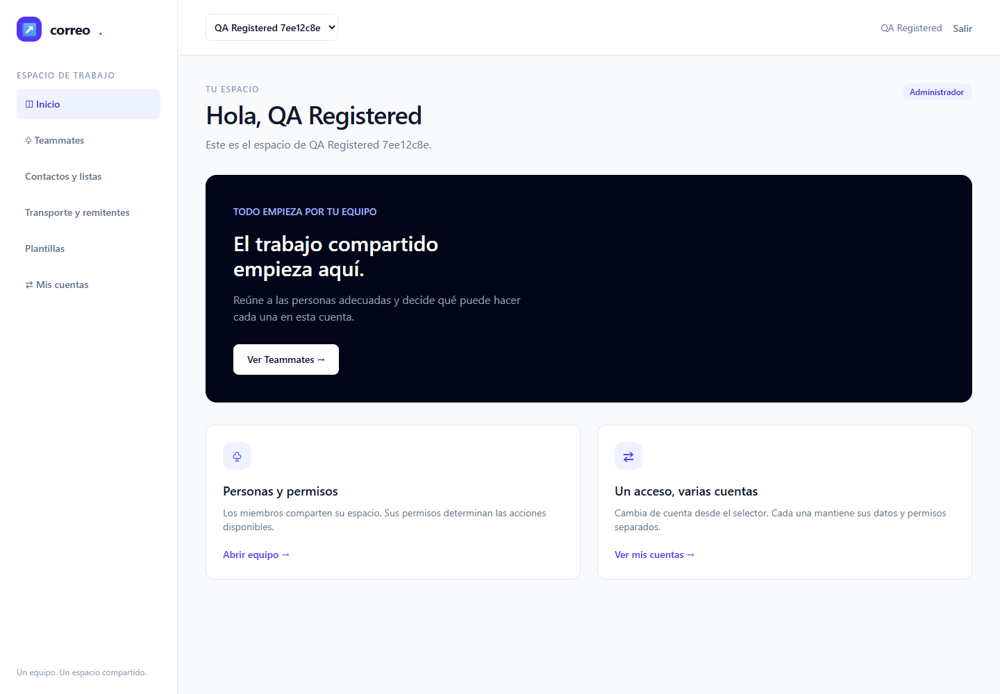</a><figcaption>native · captura de QA3</figcaption></figure>
<figure><a href="screenshots/immutableattempt3/docker-01-dashboard.png"></a><figcaption>docker · captura de QA3</figcaption></figure>
</div></section>

<section class="qa-evidence"><h3>E2E-02 · Selector y revocación</h3><div class="qa-pair">
<figure><a href="screenshots/immutableattempt3/native-02-revoked.png"></a><figcaption>native · captura de QA3</figcaption></figure>
<figure><a href="screenshots/immutableattempt3/docker-02-revoked.png">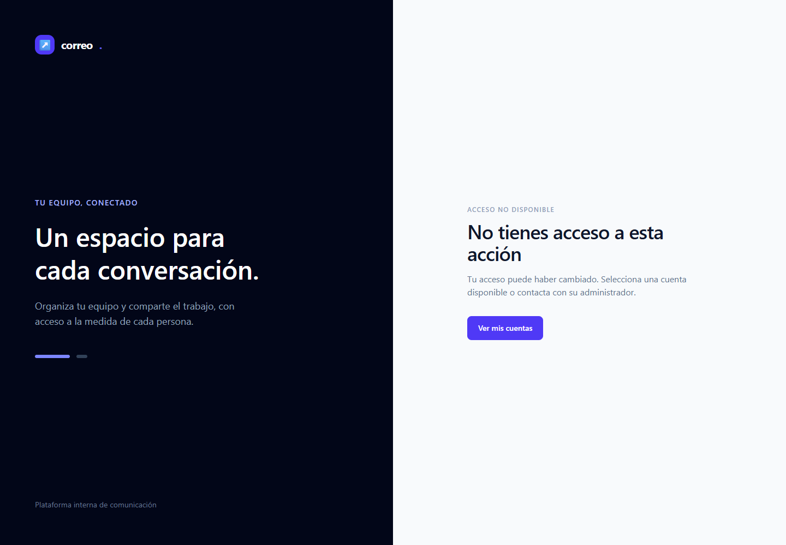</a><figcaption>docker · captura de QA3</figcaption></figure>
</div></section>

<section class="qa-evidence"><h3>E2E-03 · Invitaciones</h3><div class="qa-pair">
<figure><a href="screenshots/immutableattempt3/native-03-invitations.png">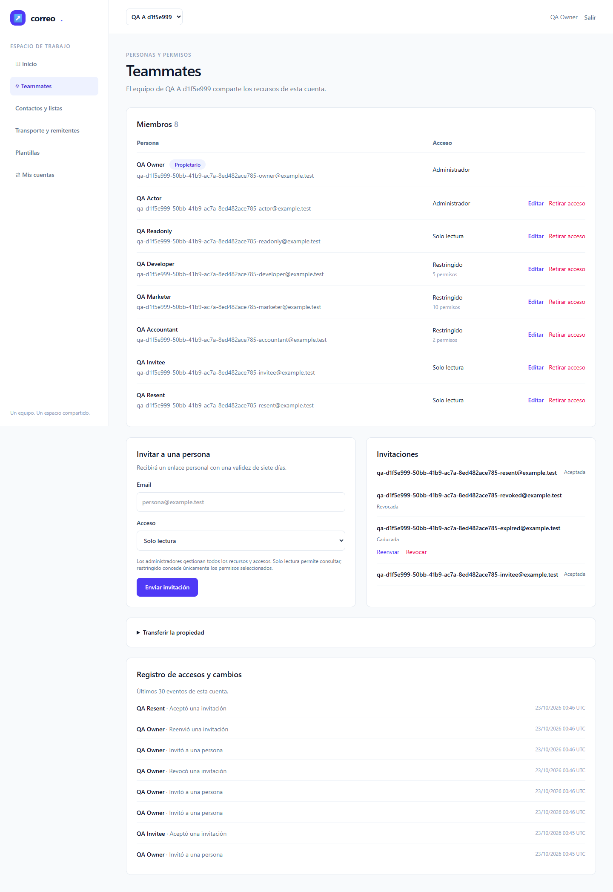</a><figcaption>native · captura de QA3</figcaption></figure>
<figure><a href="screenshots/immutableattempt3/docker-03-invitations.png">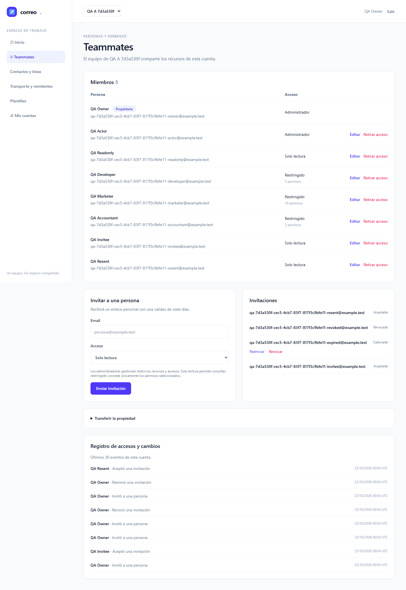</a><figcaption>docker · captura de QA3</figcaption></figure>
</div></section>

<section class="qa-evidence"><h3>E2E-04 · Roles, auditoría y adaptación</h3><div class="qa-pair">
<figure><a href="screenshots/immutableattempt3/native-04-audit.png"></a><figcaption>native · captura de QA3</figcaption></figure>
<figure><a href="screenshots/immutableattempt3/docker-04-audit.png">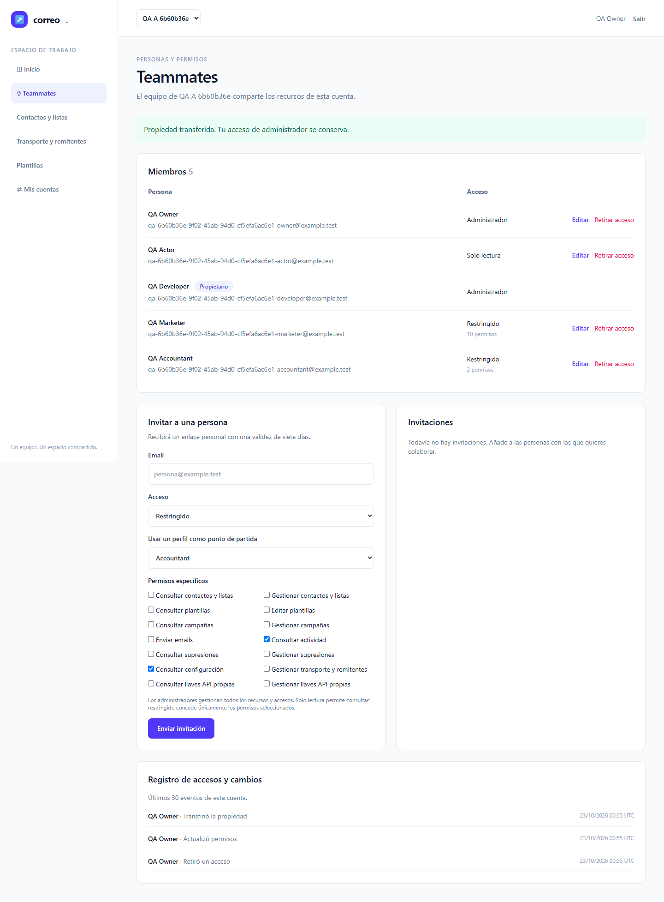</a><figcaption>docker · captura de QA3</figcaption></figure>
</div></section>

<section class="qa-evidence"><h3>E2E-05 · CRUD y CSV mixto</h3><div class="qa-pair">
<figure><a href="screenshots/immutableattempt3/native-05-import-report.png">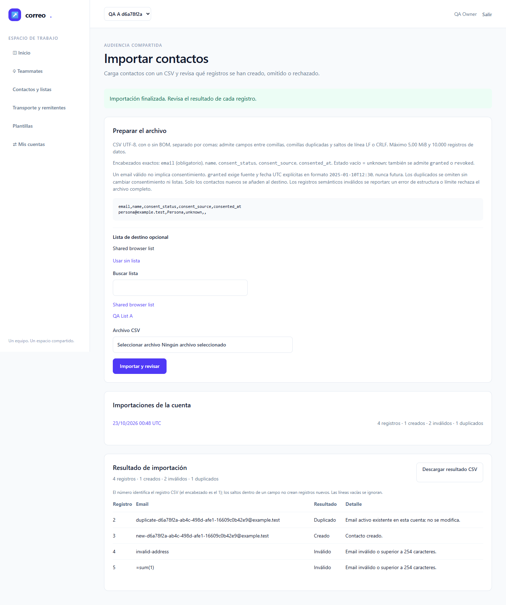</a><figcaption>native · captura de QA3</figcaption></figure>
<figure><a href="screenshots/immutableattempt3/docker-05-import-report.png"></a><figcaption>docker · captura de QA3</figcaption></figure>
</div></section>

<section class="qa-evidence"><h3>E2E-05 · 9.990 filas y tamaño</h3><div class="qa-pair">
<figure><a href="screenshots/immutableattempt3/native-05-near-limit-paginated.png">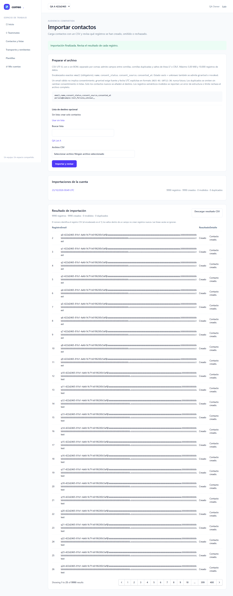</a><figcaption>native · captura de QA3</figcaption></figure>
<figure><a href="screenshots/immutableattempt3/docker-05-near-limit-paginated.png">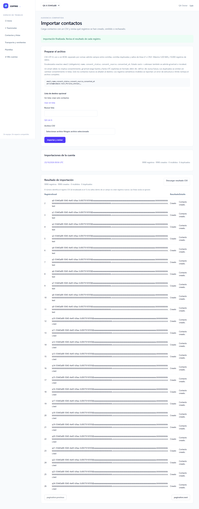</a><figcaption>docker · captura de QA3</figcaption></figure>
</div></section>

<section class="qa-evidence"><h3>E2E-05 · Upload ligado a actor/cuenta</h3><div class="qa-pair">
<figure><a href="screenshots/immutableattempt3/native-05-other-account-empty.png">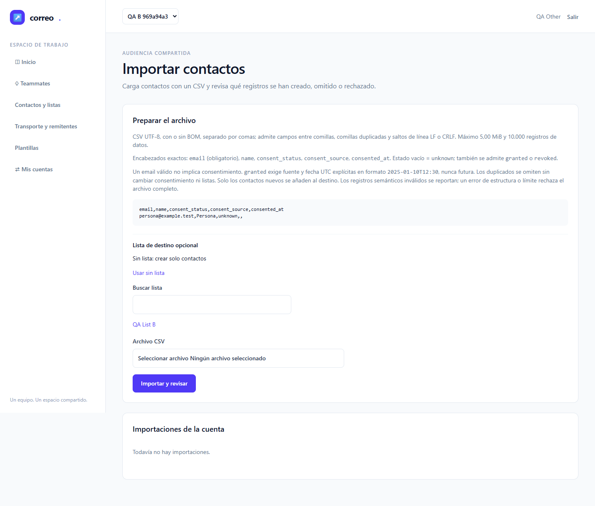</a><figcaption>native · captura de QA3</figcaption></figure>
<figure><a href="screenshots/immutableattempt3/docker-05-other-account-empty.png"></a><figcaption>docker · captura de QA3</figcaption></figure>
</div></section>

<section class="qa-evidence"><h3>E2E-06 · Formularios, variables y scopes</h3><div class="qa-pair">
<figure><a href="screenshots/immutableattempt3/native-06-developer-test-without-settings.png"></a><figcaption>native · captura de QA3</figcaption></figure>
<figure><a href="screenshots/immutableattempt3/docker-06-developer-test-without-settings.png">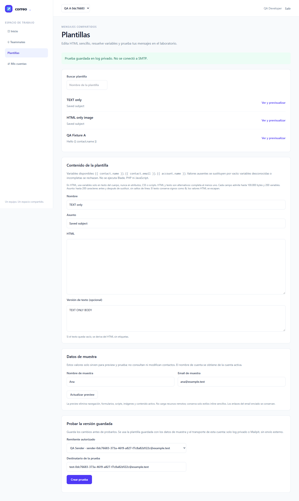</a><figcaption>docker · captura de QA3</figcaption></figure>
</div></section>

<section class="qa-evidence"><h3>E2E-06 · Preview hostil</h3><div class="qa-pair">
<figure><a href="screenshots/immutableattempt3/native-06-hostile-preview-blocked.png"></a><figcaption>native · captura de QA3</figcaption></figure>
<figure><a href="screenshots/immutableattempt3/docker-06-hostile-preview-blocked.png">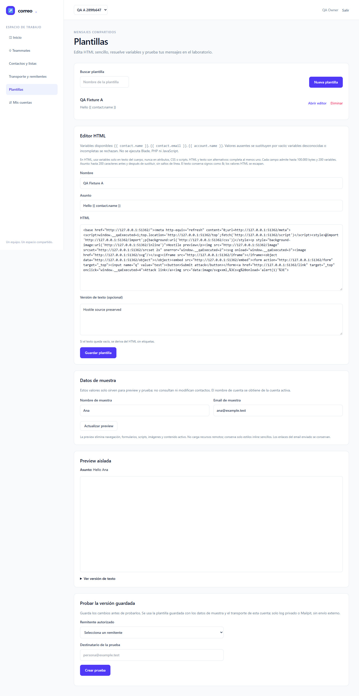</a><figcaption>docker · captura de QA3</figcaption></figure>
</div></section>

<section class="qa-evidence"><h3>E2E-07 · Log, Mailpit y secretos</h3><div class="qa-pair">
<figure><a href="screenshots/immutableattempt3/native-07-mailpit-accepted-not-delivered.png">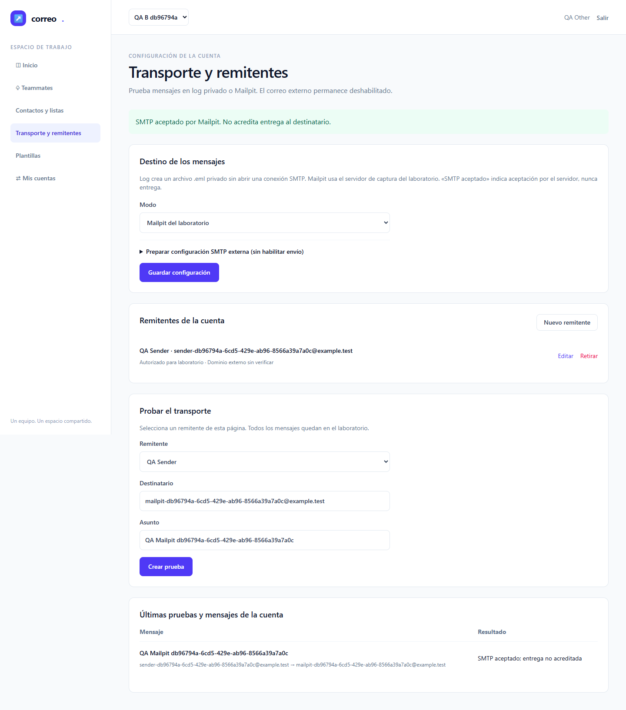</a><figcaption>native · captura de QA3</figcaption></figure>
<figure><a href="screenshots/immutableattempt3/docker-07-mailpit-accepted-not-delivered.png"></a><figcaption>docker · captura de QA3</figcaption></figure>
</div></section>

## Índice de las 44 capturas

| Nativo | Docker |
|---|---|
| [01-dashboard.png](screenshots/immutableattempt3/native-01-dashboard.png) | [01-dashboard.png](screenshots/immutableattempt3/docker-01-dashboard.png) |
| [01-registration.png](screenshots/immutableattempt3/native-01-registration.png) | [01-registration.png](screenshots/immutableattempt3/docker-01-registration.png) |
| [01-reset-confirmation.png](screenshots/immutableattempt3/native-01-reset-confirmation.png) | [01-reset-confirmation.png](screenshots/immutableattempt3/docker-01-reset-confirmation.png) |
| [02-readonly.png](screenshots/immutableattempt3/native-02-readonly.png) | [02-readonly.png](screenshots/immutableattempt3/docker-02-readonly.png) |
| [02-revoked.png](screenshots/immutableattempt3/native-02-revoked.png) | [02-revoked.png](screenshots/immutableattempt3/docker-02-revoked.png) |
| [02-selector-admin.png](screenshots/immutableattempt3/native-02-selector-admin.png) | [02-selector-admin.png](screenshots/immutableattempt3/docker-02-selector-admin.png) |
| [03-accepted.png](screenshots/immutableattempt3/native-03-accepted.png) | [03-accepted.png](screenshots/immutableattempt3/docker-03-accepted.png) |
| [03-invitations.png](screenshots/immutableattempt3/native-03-invitations.png) | [03-invitations.png](screenshots/immutableattempt3/docker-03-invitations.png) |
| [04-audit.png](screenshots/immutableattempt3/native-04-audit.png) | [04-audit.png](screenshots/immutableattempt3/docker-04-audit.png) |
| [04-mobile.png](screenshots/immutableattempt3/native-04-mobile.png) | [04-mobile.png](screenshots/immutableattempt3/docker-04-mobile.png) |
| [04-permissions-desktop.png](screenshots/immutableattempt3/native-04-permissions-desktop.png) | [04-permissions-desktop.png](screenshots/immutableattempt3/docker-04-permissions-desktop.png) |
| [04-tablet.png](screenshots/immutableattempt3/native-04-tablet.png) | [04-tablet.png](screenshots/immutableattempt3/docker-04-tablet.png) |
| [05-contacts-shared.png](screenshots/immutableattempt3/native-05-contacts-shared.png) | [05-contacts-shared.png](screenshots/immutableattempt3/docker-05-contacts-shared.png) |
| [05-import-report.png](screenshots/immutableattempt3/native-05-import-report.png) | [05-import-report.png](screenshots/immutableattempt3/docker-05-import-report.png) |
| [05-near-limit-paginated.png](screenshots/immutableattempt3/native-05-near-limit-paginated.png) | [05-near-limit-paginated.png](screenshots/immutableattempt3/docker-05-near-limit-paginated.png) |
| [05-other-account-empty.png](screenshots/immutableattempt3/native-05-other-account-empty.png) | [05-other-account-empty.png](screenshots/immutableattempt3/docker-05-other-account-empty.png) |
| [05-oversize-rejected.png](screenshots/immutableattempt3/native-05-oversize-rejected.png) | [05-oversize-rejected.png](screenshots/immutableattempt3/docker-05-oversize-rejected.png) |
| [06-developer-test-without-settings.png](screenshots/immutableattempt3/native-06-developer-test-without-settings.png) | [06-developer-test-without-settings.png](screenshots/immutableattempt3/docker-06-developer-test-without-settings.png) |
| [06-hostile-preview-blocked.png](screenshots/immutableattempt3/native-06-hostile-preview-blocked.png) | [06-hostile-preview-blocked.png](screenshots/immutableattempt3/docker-06-hostile-preview-blocked.png) |
| [06-preview-clean-retry.png](screenshots/immutableattempt3/native-06-preview-clean-retry.png) | [06-preview-clean-retry.png](screenshots/immutableattempt3/docker-06-preview-clean-retry.png) |
| [07-log-private-settings.png](screenshots/immutableattempt3/native-07-log-private-settings.png) | [07-log-private-settings.png](screenshots/immutableattempt3/docker-07-log-private-settings.png) |
| [07-mailpit-accepted-not-delivered.png](screenshots/immutableattempt3/native-07-mailpit-accepted-not-delivered.png) | [07-mailpit-accepted-not-delivered.png](screenshots/immutableattempt3/docker-07-mailpit-accepted-not-delivered.png) |

## Limpieza, procesos y privacidad

El observador pasivo conservó copias JSON reales de **los veinte UUID**, incluidos ambos E2E-02, antes de que sus casos borrasen el JSON activo. Tras terminar el observador se validaron UUID, IDs y hashes de las veinte copias. No se afirma un inventario a partir de una lectura concurrente. [Inventario público sin passwords](raw/owned-inventory-attempt-3.json).

Verificación SQL por los veinte UUID/IDs: cero usuarios, cuentas y recursos propios restantes. Consulta suplementaria de sólo lectura de usuarios sintéticos de la ventana exclusiva: cero restantes. Se verificaron seis entradas de uploads registradas: cero archivos registrados restantes; la repetición final por UUID no borró históricos no atribuibles. Las limpiezas independientes de B-03/B-04 conservan sus comprobaciones y errores agregados del harness. [Recibo de cleanup](raw/teardown-attempt-3.json).

Mailpit: doce mensajes propios restantes eliminados por una lista no vacía de IDs exactos, con 404 posterior y mensajes ajenos de la lista inicial preservados. E2E-07 ya elimina su mensaje propio en cada perfil dentro del caso aprobado; esos dos IDs no son retenidos por el harness y no se inventan. La lista final de doce IDs sí queda en el recibo. Nunca hubo borrado global.

Servidor 8084 propio, PID **37844**, y árbol verificado [21024, 376, 16900, 37844]: cero PIDs vivos y cero listener en 8084; wrapper **34396** ausente. Sesiones 76682 (suite) y 17281 (cleanup) terminales. 8082/8083 siguen HTTP 200 y `emailing.lab_smoke` conserva cinco filas. No se tocaron volúmenes, infraestructura compartida ni migraciones. [Terminal/PIDs](raw/terminal-attempt-3.json).

Tres consultas observacionales fallaron y se conservan separadas de Playwright: impresión de un checkmark por stdout cp1252; lectura concurrente vacía del inventario; conversión inicial del array de PIDs. El inventario terminal real y la consulta CIM corregida se comprobaron después. No motivaron cambios de fuentes, reintentos de tests ni una cuarta tanda. [Recibo de errores observacionales](raw/observational-errors-attempt-3.json).

Original JSON privado: `raw/artifacts/results-attempt-3-original.json`, SHA256 `f927ace4020b814ce2467ba313a579dd82ca6db9b52f76713ccfcc5906c19d42`. Copia pública: [results-attempt-3.json](raw/results-attempt-3.json), SHA256 `9f5cbab189cffbbdb39ecfcdab07860e5595f2c82600be9bb5a0e0f842a4bf9a`. Se redactó **una ruta de perfil personal**, preservando estados, cuentas, errores y estadísticas; las credenciales sintéticas de los fixtures no aparecen en el JSON original. Stdout/stderr y copias de fixtures con passwords quedan sólo bajo `raw/artifacts/`. [Recibo de redacción](raw/redaction-attempt-3.json).

El control público final y la inspección del PDF se registran en [validation-attempt-3.json](raw/validation-attempt-3.json) y [pdf-check-attempt-3.json](raw/pdf-check-attempt-3.json). Los JSON originales, stdout/stderr, cuerpos autenticados y registros firmados nunca se publican. No se han reescrito report-attempt-1/2 ni los archivos archivados anteriores.

## Checklist humana y relevo

- [ ] **M-01**: una persona revisa claridad del español, estados vacíos/errores, contraste y legibilidad en móvil/escritorio; distingue cuenta activa, permisos y estados sin explicación técnica.
- [ ] **M-02** y E2E-08–11: pendientes en sus tareas/fases de operación, campañas, recuperación, API, carga y restauración.

Entrega al coordinador con QA3 automática verde. El coordinador conserva la gestión de T-09, ledger, documentación y siguientes fases; este QA no declara implementada la spec ni completado el plan global.
