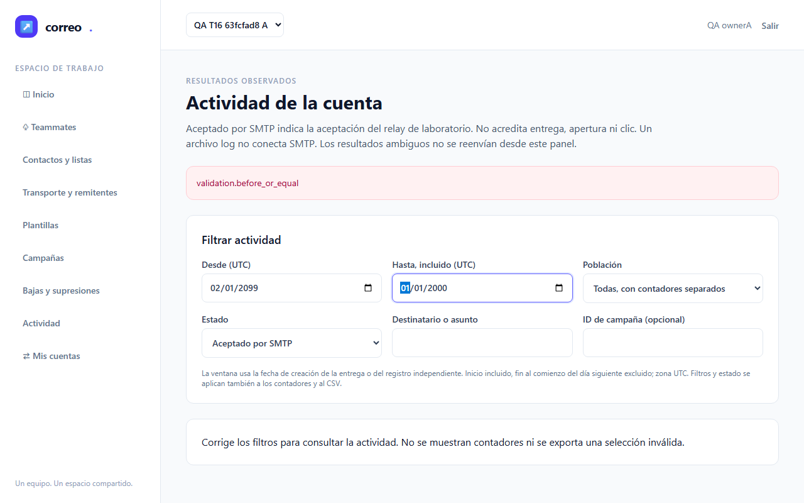
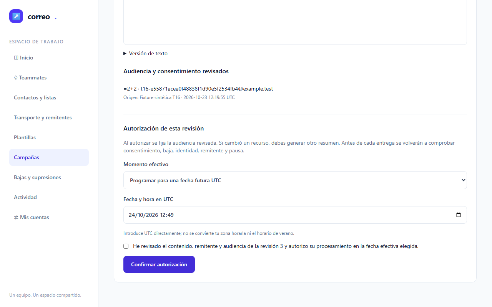
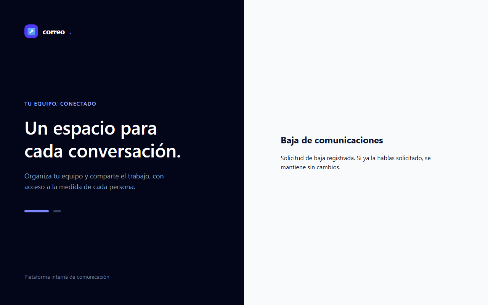
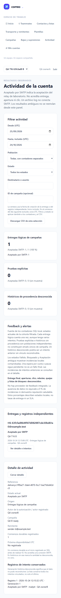
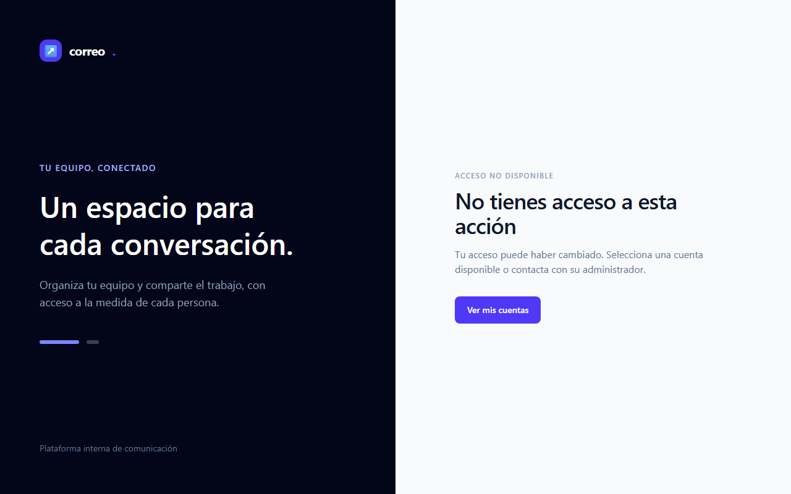
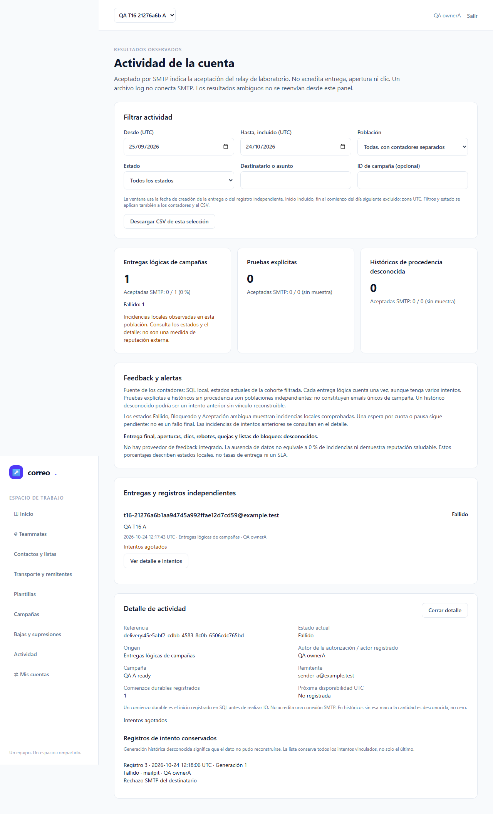

# QA de T-16 — envío y recuperación

**NO-VERDE.** La ejecución de navegador 3/3 terminó con **6 casos pasados, 3 fallidos y 1 flaky**, sin omitidos ni interrumpidos. Hay dos defectos de producto confirmados y una carrera del driver pendiente de corregir. T-16 continúa en progreso; M-01 requiere una persona.

| Dato | Evidencia |
|---|---|
| Fecha | 24-10-2026, UTC |
| Alcance | T-16; E2E-08, E2E-09 y M-01; CA-05/06/08/09/10/11/14/22/23/25 |
| Perfiles auditados | Apache/PHP nativo y cuatro servicios Compose propios, en localhost |
| Ejecución de navegador final | Chromium real; 10 escenarios, 2 reintentos configurados; 1606.896 s de reloj |
| Runtime auditado y cerrado | `browser-20261024T120757009149Z`; recibo de cierre en sección de recursos |
| Plan y pruebas | [Plan](../../../improvement-plan.md), [test-plan](../../../test-plan.md) |

## Veredicto oficial

`qa-gate.py` se ejecutó sobre el JSON original, sin modificar, y terminó con **exit 1**. No se justificó el flaky para obtener un verde.

```json
{
  "verdict": "NO-VERDE",
  "counts": {
    "passed": 6,
    "failed": 3,
    "flaky": 1,
    "skipped": 0,
    "interrupted": 0
  },
  "flaky_sin_justificar": [
    "browser-readonly.spec.mjs::E2E-08 docker: borradores visibles y acciones según permisos"
  ],
  "flaky_justificados": {},
  "threshold": "verde ⟺ 0 failed, 0 flaky sin justificar, 0 interrumpidos y ≥1 test ejecutado"
}
```

El original privado conserva SHA-256 `f56e700d8c54230b593eb4a3d742228269a26fc01a7464294435e7fc5ff8709e`. [results.json](raw/results.json) es una proyección pública que sustituye únicamente rutas personales y credenciales; conserva estados, títulos y contadores. Su derivación y hashes están en [results-projection.json](raw/results-projection.json). Las trazas y el original permanecen en `raw/artifacts/`, excluido de Git.

## Hallazgos que impiden el cierre

**P-01 — errores sin traducir.** Un rango de fechas inválido muestra literalmente `validation.before_or_equal`. La protección de contadores/CSV sí actúa, pero el mensaje no explica el error en español. La autorización fallida muestra también `validation.accepted`. `lang/es/validation.php` carece de esas reglas. [Observación y causa](raw/finding-observations.json).



**P-02 — la programación borra una confirmación marcada.** En el flujo ordinario, se revisó una campaña, se eligió fecha futura UTC, se marcó la confirmación y se envió. La traza registra `authorizeCampaign` con updates en orden `confirmed=true`, `effectiveUtc=2026-10-24T12:49`; la respuesta HTTP 200 contiene `confirmed=false` y `validation.accepted`. El hook `Campaigns::updated(effectiveUtc)` resetea la confirmación en ese mismo batch. No apareció el estado Programada. Esta es una observación del primer envío real; los reintentos posteriores quedaron buscando el nombre antiguo del fixture ya renombrado.



**D-02 — carrera del driver al cambiar de cuenta.** El driver navega inmediatamente después de seleccionar B. La red registra POST `/accounts/switch` sin respuesta, status -1, seguido 15 ms después por GET `/campaigns`; el snapshot mantiene A seleccionada. Esto explica el caso nativo de permisos fallido, el flaky de Docker y el bloqueo del detalle ambiguo. No se interpreta como autorización indebida de B. Hay una propuesta separada, sin aplicar, que espera POST y navegación antes del siguiente acceso.

**Procedencia incompleta de traducciones.** Las comparaciones de 232 entradas y los mapas runtime no incluyen `lang/`. Su coincidencia es válida para el alcance declarado y no acredita esas tres traducciones. Una [comparación posterior adicional](raw/lang-current-comparison.json) observó los tres archivos actuales idénticos en nativo y los tres contenedores PHP propios; no sustituye su futura inclusión en los snapshots e inventarios congelados.

## Resultado de cada escenario de navegador

| Escenario | Resultado | Ejecuciones |
|---|---|---:|
| E2E-09 native: cuenta, estados durables, filtros, detalle y muestra ausente | PASA | 1 |
| E2E-08 native: borradores visibles y acciones según permisos | FALLA | 3 |
| E2E-09 native: restricted no accede a contactos ni envía | PASA | 1 |
| E2E-09 docker: cuenta, estados durables, filtros, detalle y muestra ausente | PASA | 1 |
| E2E-08 docker: borradores visibles y acciones según permisos | FLAKY | 3 |
| E2E-09 docker: restricted no accede a contactos ni envía | PASA | 1 |
| E2E-09 native: rechazo real, DATA sin respuesta, cola de fallos y ambiguo sin reenvío | FALLA | 3 |
| E2E-08 native: baja encolada, token alterado, replay y cuenta B independiente | PASA | 1 |
| E2E-08 native: programación UI UTC real, borrador sin envío y CSV seguro | FALLA | 3 |
| E2E-09 native: revocación inmediata y navegación de teclado | PASA | 1 |

**E2E-08 — cobertura alcanzada.** La baja pública se realizó después de publicar dos mensajes reales y antes del consumidor. El token alterado devolvió **404**, sin cambiar los pendientes. POST de baja y replay fueron idempotentes: A quedó suprimida con cero intentos y B aceptada por SMTP con un intento. El fixture comparte dirección sintética entre ambas cuentas. Se comprobó en UI que Mailpit no integra rebotes/quejas autenticados y que el correo externo sigue bloqueado. [HTTP observado](raw/unsubscribe-tamper-observation.json).



El borrador no materializó entregas. La programación ordinaria quedó bloqueada por P-02: **no se alcanzaron en esta pasada la espera hasta fecha efectiva, la materialización posterior ni el CSV con nombre de campaña fórmula**. Su evidencia de backend conserva su identidad histórica; no se presenta como nueva prueba de navegador.

**E2E-09 — cobertura alcanzada.** Pasaron cuenta/origen, filtros, ventana UTC, estados vacío/error, detalle con foco, poblaciones separadas, datos externos desconocidos, móvil sin desbordamiento, lectura restringida y respuestas 403 reales. La revocación del lector tuvo efecto en el siguiente acceso y se ejerció teclado. La carrera D-02 impidió completar en navegador el detalle ambiguo y los filtros/CSV posteriores de ese caso.





## Protocolos e integración real

El grupo literal final ya aceptado `delivery-group-policy-final-20261024T104809322939Z` pasó **137 pruebas, 1972 aserciones, 2038,66 s**, exit 0. No se repitió ese grupo en esta QA. Sus 232 entradas coinciden con las del nuevo productor y los archivos actuales del mismo alcance. Las dos tandas históricas fallidas conservan sus resultados.

[backend-conformance.json](raw/backend-conformance.json) mapea 17 ventanas concretas a métodos ejecutados de OutboxIntegrationTest/WorkerRecoveryTest: conexión previa a publicación, mandatory return seguido de ACK, confirm perdido tras routing, crash tras confirm antes de SQL, pérdida SQL, fencing de generación/token, dos consumidores Linux, backoff y agotamiento, pérdida de respuesta final DATA, crash SMTP/persistencia/ACK, pausa/reentrega, baja encolada y cuotas compartidas con ventanas SQL UTC reales. Las capturas no se utilizan para probar orden de ACK o fencing.

Además, **esta QA produjo nuevos estados durables por protocolos reales**, con UUID independiente: rechazo 450 de RCPT → fallido tras un intento; DATA recibido y conexión cerrada sin respuesta final → ambiguo tras un intento. No se insertaron outcomes ni se atrasaron timestamps. Los dos consumidores y el relay terminaron con exit 0. Se publicó explícitamente el outbox `delivery.failed`: la cola de fallos conservó un evento, la cola de entrega quedó vacía. [Recibo depurado](raw/integration-evidence.json).



Se ejecutaron **tres trabajos nuevos en el daemon Cronicle real**: petición sin autorización rechazada con 401, petición válida y repetición válida con cero entregas creadas. Fueron acciones finitas; se retiraron los eventos disabled y su configuración privada propios. Las definiciones ajenas conservaron sus hashes. La prueba de daemon se distingue de los probes HTTP finitos del harness y de la historia T-15.

Los seis inventarios comparados coincidieron con mapas derivados independientemente: 11.589 entradas para CLI/consumidores nativos y 9.226 para los servicios PHP Docker. Los assets del cuarto servicio web se contrastaron con el artefacto de build y la configuración nginx. Los builds nativo y Docker conservan sus diferencias; los dos casos de fallo de esta QA son nativos y no se etiquetan como ejecuciones Docker.

Esta evidencia no acredita exactly-once SMTP, entrega externa, reputación, capacidad ni una aceptación global de reinicio/restauración del broker. La validación operativa amplia de CA-25/E2E-11 continúa en T-19/T-20.

## Puertas de entrada y entorno

- [ledger-lint](raw/ledger-lint.txt): exit 0, cero incoherencias; cinco avisos de Changelog de tareas aún abiertas.
- [coverage-check](raw/coverage-check.json): exit 0, cero referencias rotas, cero tareas sin cobertura declarada y cero GWT huérfanos. Es cobertura declarada, no prueba de que todos los escenarios hayan pasado.
- Guardrail del kit ejecutado con Git Bash: origen nativo, Docker y Cronicle en `127.0.0.1`; exit 0. No se usó SMTP externo.
- Sin constitución local; consulta de knowledge con fallback y lectura selectiva de GOT-006. No se instaló navegador ni dependencia.
- Chromium real: 1280×800 de escritorio y 390×844 de móvil; trazas activas y capturas reales. Presupuesto operativo 120 s por caso, 240 s para el caso con espera UTC; no se alteraron leases ni timeouts SMTP.

## Historial de las tres ejecuciones

1. Ejecución inicial: interrumpida tras timeout de 30 s; artifacts originales privados conservados. Gate real NO-VERDE por ausencia de results terminal. El arranque consumió 18,375 s, pero esa hipótesis no explicaba el selector con cero coincidencias.
2. Ejecución con 120 s: interrumpida en el mismo selector. Gate real NO-VERDE por ausencia de results terminal. Queda descartado que solo ampliar el presupuesto resolviera la causa.
3. Tras diagnóstico Chromium mínimo: Estado y Población dieron label exacto 0 / combobox por rol 1; la selección por rol produjo el vacío real. Se corrigieron los tres selects envolventes antes de la ejecución 3. Esta ejecución completa conserva sus fallos/flaky y el gate anterior.

No se ha iniciado una cuarta ejecución. La corrección propuesta de navegación y los fixes de producto requieren la decisión de la puerta acotada. No se han aplicado cambios al producto desde QA.

## M-01 — checklist para una persona

M-01 permanece **PENDIENTE**. [Vistas y checklist concretas](manual-review.md) cubren formularios, vacío, error, baja exitosa, permisos, escritorio y móvil. Sus capturas permiten revisar la claridad; no equivalen a una aprobación humana.

- [ ] Distingo cuenta activa, permisos y estados sin explicación técnica ni métricas ficticias.
- [ ] Los formularios y los mensajes españoles son claros tras corregir P-01/P-02.
- [ ] Contraste, legibilidad y navegación resultan adecuados en móvil y escritorio.

El bundle aún no contiene la vista de detalle ambiguo completada por navegador; queda pendiente tras corregir D-02. La observación sobre un indicador persistente de permisos en la cabecera se conserva como cuestión visual independiente, sin implementar ni aprobar automáticamente.

## Trazabilidad y recursos

| Alcance | Estado real |
|---|---|
| T-16 / E2E-08 | Parcial: baja/tamper/replay/aislamiento pasan; programación y CSV pendientes por P-02 |
| T-16 / E2E-09 | Backend final aceptado y nuevos protocolos/daemon demostrados; detalle ambiguo de navegador incompleto por D-02 |
| M-01 | Pendiente de persona, con defectos objetivos observados |
| Roadmap global | Sigue abierto: T-17–T-20 y ampliación MCP/Google conservan su alcance |

**Recursos cerrados y propiedad devuelta a root.** El mismo handle 13938 terminó con exit 0, sin cambios en las 232 entradas ni errores de limpieza. Se verificaron cuatro namespaces con recuentos SQL de cero, doce colas y cuatro exchanges ausentes y sus journals retirados; cinco contenedores propios ausentes, dos etiquetas de imagen UUID retiradas y cero mensajes Mailpit atribuidos restantes. El Apache nativo terminó con exit 1 tras el cierre intencional de su handle propio; ese valor real se conserva. Los consumidores/relay del protocolo de fallo fueron terminales exit 0. Los eventos Cronicle propios se retiraron y las definiciones ajenas conservaron sus hashes. Véase el [recibo de recursos](raw/resource-settlement.json). Las URLs del laboratorio ya no están activas; las capturas quedan disponibles para M-01.

No procede handoff a documenter ni cierre de plan/spec con este NO-VERDE. Las fuentes de producto y tests no fueron modificadas por QA.
