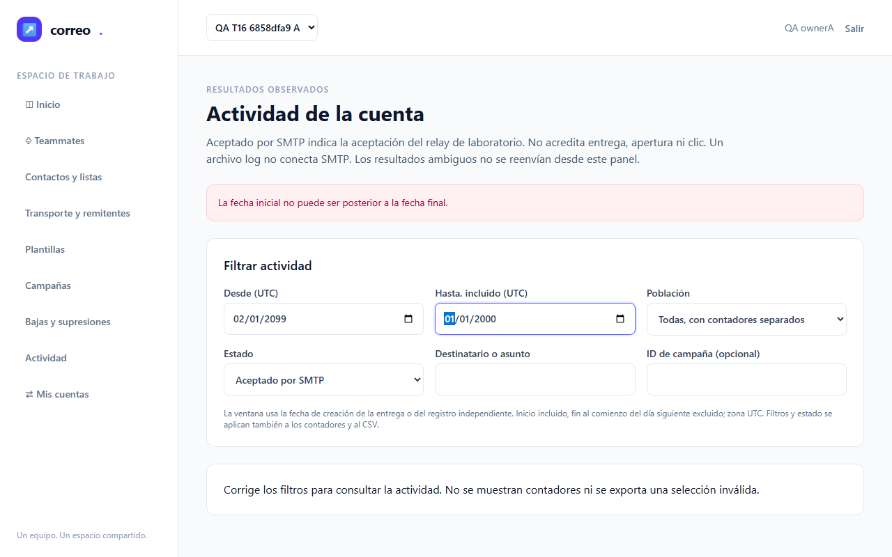
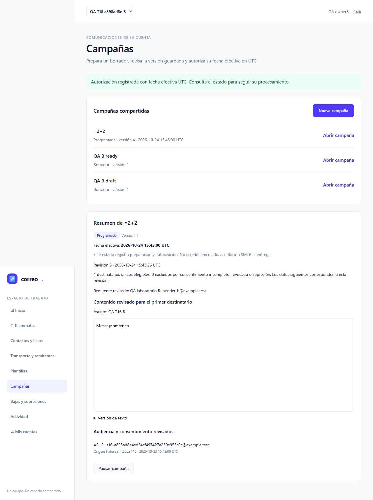
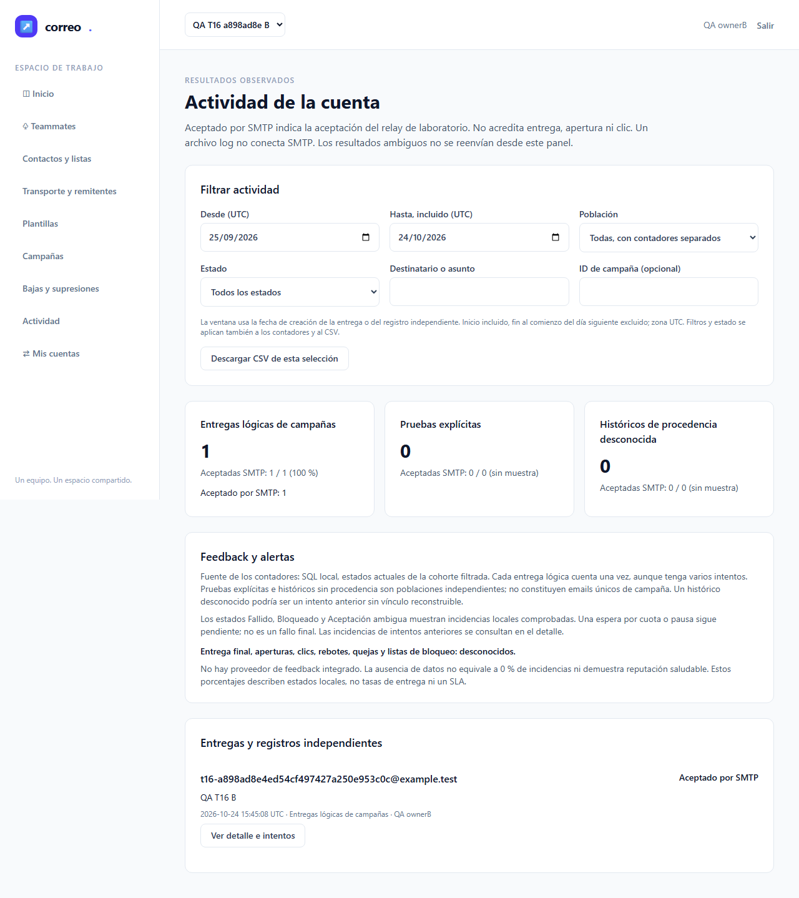
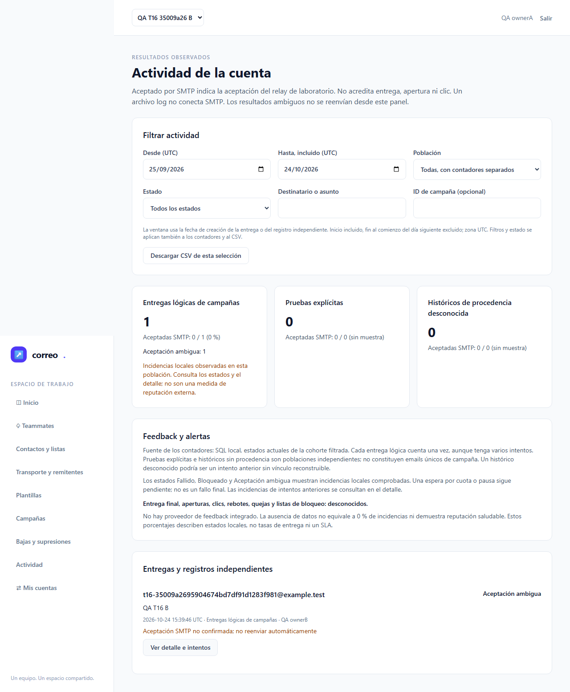
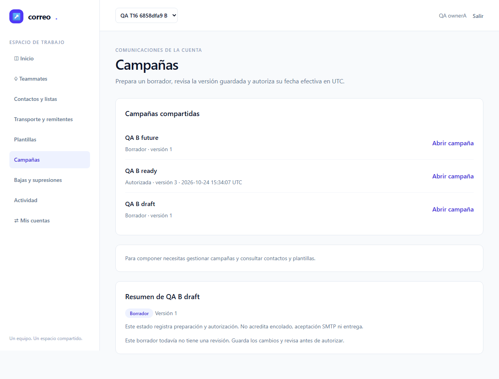
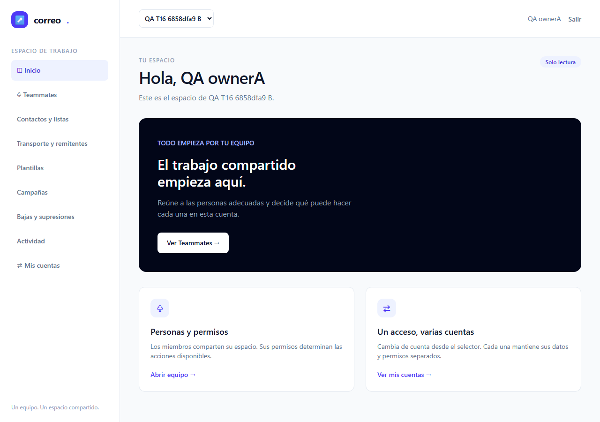
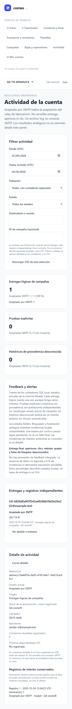

# T-16 · QA formal · ciclo 2, intento 1 de 3

**VERDE técnico: 10/10 escenarios Chromium aprobados a la primera. M-01 pendiente de una persona.** Ejecución del 24 de octubre de 2026, exclusivamente local, con SMTP de laboratorio/Mailpit y datos sintéticos example.test. No hubo correo externo.

## Resultado oficial y procedencia

La ejecución nueva comenzó a las `2026-10-24T15:37:50.087Z` y duró 551.92 s, incluida la preparación y limpieza de fixtures. Chromium terminó con exit 0; los siete helpers congelados no cambiaron. Retries configurados: 2; usados: 0. Cero fallos, flaky, omitidos o interrumpidos, sin justificaciones ni umbrales modificados.

Salida exacta de `qa-gate.py`, ejecutado sobre el JSON original inalterado:

```json
{
  "verdict": "VERDE",
  "counts": {
    "passed": 10,
    "failed": 0,
    "flaky": 0,
    "skipped": 0,
    "interrupted": 0
  },
  "flaky_sin_justificar": [],
  "flaky_justificados": {},
  "threshold": "verde ⟺ 0 failed, 0 flaky sin justificar, 0 interrumpidos y ≥1 test ejecutado"
}
```

[Gate y recibo](execution-1/raw/qa-gate.json), [recibo del gate](execution-1/raw/qa-gate-receipt.json), [resultados públicos](execution-1/raw/results.json) y [derivación de privacidad](execution-1/raw/results-projection.json). El original y las trazas permanecen privados e ignorados. La proyección sustituye exclusivamente rutas y valores privados; conserva exactamente títulos, estados, retries, duraciones y contadores.

- SHA256 original: `172733ed04fa9a1ec6d5313c969ab0060afc1229b00fd326b06ac6bab6e03a98`.
- SHA256 proyección pública: `39efcaab3aae649653717421e718a2205d0ffb717f2d30e89cdae1c987a7c66e`.
- Grupo backend final admitido: 139 pruebas / 2.009 aserciones / 4.056,19 s, no repetido en este QA. Sus 235 fuentes coinciden con las ejecutadas ahora, incluidas las traducciones. Manifest SHA256: `10128ad501b6c3f0266896c23b4b87a76f405b284de2a37d6c6a4ec79f242120`.
- Revisión independiente 19: A+B+C+D, 87/87 archivos, 7.365 líneas, cero hallazgos. [Informe](../review/attempt-19.md).

La autorización «adelante» abrió este segundo ciclo después de los tres resultados no verdes del [ciclo anterior](../t16-attempt-1/report.md), que se conservan íntegros. Este verde pertenece únicamente al primer intento del ciclo 2. El runtime real del agente y las métricas IA no disponibles permanecen desconocidos; no se abrió medidor propio de QA.

## Escenarios ejecutados

| Escenario | Resultado |
|---|---|
| E2E-09 native: cuenta, estados durables, filtros, detalle y muestra ausente | Aprobado, r0 |
| E2E-08 native: borradores visibles y acciones según permisos | Aprobado, r0 |
| E2E-09 native: restricted no accede a contactos ni envía | Aprobado, r0 |
| E2E-09 docker: cuenta, estados durables, filtros, detalle y muestra ausente | Aprobado, r0 |
| E2E-08 docker: borradores visibles y acciones según permisos | Aprobado, r0 |
| E2E-09 docker: restricted no accede a contactos ni envía | Aprobado, r0 |
| E2E-09 native: rechazo real, DATA sin respuesta, cola de fallos y ambiguo sin reenvío | Aprobado, r0 |
| E2E-08 native: baja encolada, token alterado, replay y cuenta B independiente | Aprobado, r0 |
| E2E-08 native: programación UI UTC real, borrador sin envío y CSV seguro | Aprobado, r0 |
| E2E-09 native: revocación inmediata y navegación de teclado | Aprobado, r0 |

E2E-08 y E2E-09 cubren CA-05/06/08/09/10/11/14/22/23/25 mediante navegador y la integración complementaria identificada abajo. La revocación siguiente devuelve 403 real; restricted no puede consultar contactos ni enviar. Se comprobaron teclado, escritorio/móvil, cuenta/origen, vacío/error/éxito, denominadores, muestra pequeña y datos desconocidos.

## Evidencia de los comportamientos corregidos

El error de fechas aparece en español: «La fecha inicial no puede ser posterior a la fecha final», sin claves `validation.*`. La programación ordinaria conserva en el primer y único submit del mismo batch `confirmed=true` y `effectiveUtc=2026-10-24T15:45`; respuesta HTTP 200, orden observado `[confirmed,effectiveUtc]`. La navegación entre cuentas espera el POST302 y la navegación resultante antes de comprobar la cuenta.

El borrador produjo cero entregas. La campaña futura se observó sin entrega a las 15:43:36 UTC; tras la fecha efectiva real 15:45:00 UTC se materializó una entrega pending a las 15:45:08 UTC, y el consumidor real la dejó accepted con un intento. No se atrasaron timestamps. El CSV de campaña `=2+2` devolvió 200, `formula_prefixed=true` y `unescaped_formula=false`. [Observaciones exactas](execution-1/raw/case-observations/).

**Error de filtros en español**



**Campaña programada mediante UI, UTC real**



**Campaña elegible y aceptación SMTP posterior**



## Protocolos, baja e integración complementaria

Los estados failed y ambiguous se produjeron con un relay real: RCPT450 y cierre después del terminador DATA, respectivamente. Hubo un rechazo, un DATA aceptado por el relay y una respuesta final perdida. Cada entrega conservó un intento; ready quedó en 0 y failure_queue en 1. El relay terminó con exit 0. La UI conservó los estados durables y el ambiguo no ofreció reenvío; los probes antes/después permanecieron iguales.

La baja se realizó tras encolar y antes del transporte, con POST público y replay. El token alterado devolvió exactamente 404 sin modificar pendientes. El consumo posterior dejó A suppressed con cero intentos y B accepted con un intento. La ausencia de feedback en Mailpit/log se explicó como dato desconocido y se comprobó la política que bloquea habilitar envío externo sin la capacidad acordada. [Probes y protocolos](execution-1/raw/mutable-protocols.json).

**Aceptación ambigua durable, sin reenvío automático**



**Baja pública confirmada y repetible**


El [mapa de integración](execution-1/raw/backend-conformance.json) contrasta 17 ventanas con las fuentes y la salida del grupo final: fallo antes de publicar; retorno mandatory/ACK; confirmación perdida; crash y SQL después de confirmación; fencing de token/generación; dos consumidores Linux; rechazo/backoff/exhaustión; respuesta DATA perdida; crashes SMTP/persistencia/ACK; SQL tras 250; pausa/reentrega; baja encolada; cupos por cuenta/pool y cruce real UTC; cuota compartida con envío legacy; elegibilidad de borrador/futura/pausa. Es evidencia real del grupo final aceptado, sin reetiquetar ejecuciones previas ni atribuir estos fallos al run nuevo de navegador.

Cronicle ejecutó tres jobs nuevos de daemon real antes de las fixtures mutables: auth ausente → 401; auth válida y repetida → created=0. Los tres terminaron correctamente, fueron finitos, se eliminaron únicamente sus eventos/configuración propios y las definiciones ajenas quedaron idénticas. [Recibo](execution-1/raw/cronicle-daemon.json).

## Runtime, puertas y limpieza

P1: ledger-lint exit0, cero incoherencias y cinco avisos de tareas abiertas; coverage-check exit0, cero referencias rotas y CA-01–25 mapeados. Conocimiento consultado selectivamente; GOT-006 y GOT-007 aceptadas se aplicaron. No existe constitución ni configuración `tests.coberturaMinima`; no se inventó porcentaje unitario. Los guardrails reales admitieron ambos orígenes loopback y Cronicle antes de HTTP/navegador.

El laboratorio nuevo `browser-20261024T152814747793Z` comparó expectativas independientes y fuentes observadas: nativo 11.592 entradas; PHP, worker y jobs Docker 9.229 cada uno; assets web correctos. Las diferencias entre builds son intencionales. Los consumidores nuevos del caso SMTP fueron nativos; las ventanas Linux pertenecen al grupo complementario explícito. [Inventarios](execution-1/raw/runtime-conformance.json).

Cada uno de los cuatro casos mutables recibió un UUID nuevo; el fixture de alcance test también lo haría en cada retry. Se atribuyeron antes de crearlos y sus finally verificaron SQL, broker, journal y Mailpit propios. El hold terminó con exit0, 235 fuentes sin cambios y cero errores de cleanup. Se verificaron seis namespaces en total, cinco contenedores propios ausentes y se eliminaron sus dos tags de imagen. Los dos tags de fix1 retenidos como artefactos son ajenos a esta limpieza. El Apache propio terminó intencionadamente al cerrar el hold; su exit1 se conserva como parada solicitada, sin presentarlo como exit0. [Asentamiento final](execution-1/raw/resource-settlement.json).

## M-01 · revisión humana pendiente

Las 33 capturas incluyen los estados del run y cuatro vistas suplementarias de sólo lectura ya asentadas, tomadas después del terminal del run. No sustituyen el juicio humano ni cambian sus diez resultados. La captura inicial con «Actualizando campaña…» se conserva; se añade el resumen ya cargado y el dashboard con el rol visible. [Recibo suplementario](execution-1/raw/m01-supplemental-capture.json).

El criterio exacto está en [test-plan.md, M-01](../../../test-plan.md): una persona debe distinguir cuenta activa, permisos y estados sin explicación técnica ni métricas ficticias. El alcance manual compartido T04/T09/T16/T20 y demás tareas del plan sigue pendiente. La cabecera muestra cuenta y usuario; «Solo lectura» se ve en Inicio y el resumen explica el permiso requerido. Corresponde a la persona juzgar su claridad al navegar.

- [ ] Formularios, confirmación, estados vacíos, errores y éxito claros en español.
- [ ] Cuenta activa, rol y acciones permitidas distinguibles al navegar.
- [ ] SMTP aceptado, fallo, supresión y ambigüedad comprensibles sin confundirlos con entrega.
- [ ] Contraste, legibilidad, navegación y foco en escritorio/móvil suficientes.

[Todas las capturas, resolución original](execution-1/screenshots/). El móvil conserva la página completa; ampliar su PNG para juzgar texto y contraste.

**Resumen asentado en cuenta B con permisos de sólo lectura**



**Rol vigente visible en Inicio**



**Actividad móvil con fuentes, límites y muestra**



## Límites y cierre de este QA

Este QA acredita los casos descritos en laboratorio local y su integración complementaria. No acredita entrega externa, reputación, capacidad ni exactly-once SMTP. Reinicio/restauración operativa amplia, carga T19/T20, E2E-10/11 y las 14 verificaciones MCP pendientes no quedan cerrados por este informe. M-01 no tiene aprobación humana. No se declara completo el plan ni la spec; root decide el cierre técnico de T-16 después del handoff y de admitir estos artefactos.
