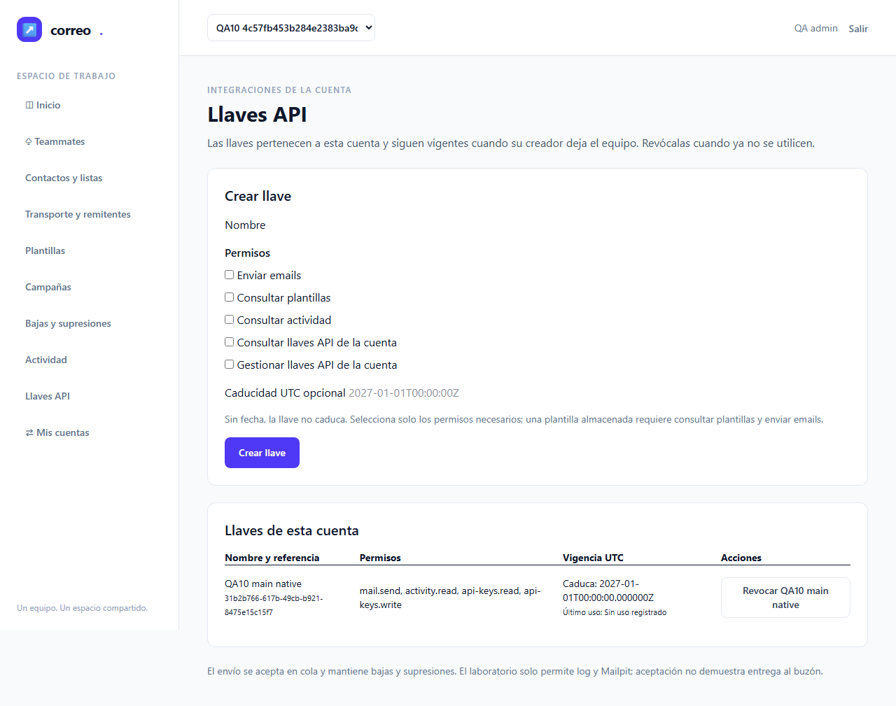
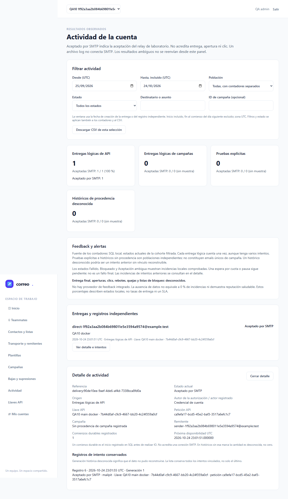

# Informe de QA — T18 / E2E-10

| Campo | Resultado |
|---|---|
| Fecha | 25-10-2026 · sellos UTC |
| Estado de fase | VERDE, qa-gate exit 0; Laragon 1/1 y Docker 1/1 |
| URLs locales | http://127.0.0.1:60273 · http://127.0.0.1:60274 |
| Alcance | T18 y E2E-10; CA01/12/13/19/20. Revisión23 limpia. |
| Plan | [Plan](../../../improvement-plan.md) · [Test-plan](../../../test-plan.md) |

## Veredicto determinista

```json
{
  "verdict": "VERDE",
  "counts": {
    "passed": 2,
    "failed": 0,
    "flaky": 0,
    "skipped": 0,
    "interrupted": 0
  },
  "flaky_sin_justificar": [],
  "flaky_justificados": {},
  "threshold": "verde ⟺ 0 failed, 0 flaky sin justificar, 0 interrumpidos y ≥1 test ejecutado"
}
```

## Resumen y límites

Dos recorridos E2E completos, secuenciales, sin retries internos, sin flaky y sin omisiones. La evidencia final es exclusivamente qa10-run5: discovery previo de 2 tests/1 fichero, 12 capturas y fuente de harness sin cambios durante la ejecución.

La aceptación202 confirma trabajo en cola. El worker real conservó origen API y llegó a smtp_accepted en Mailpit; esto no acredita entrega al buzón, aperturas, clics ni reputación. No hubo correo externo.

Esta es QA de fase. T19, T20, E2E-11 y el objetivo Google/MCP siguen abiertos; principal17/20 y Google/MCP0/14 son el estado de entrada. M01/M02 permanecen pendientes humanas. El rol QA no cambia ledger/spec/plan ni concede cierre global.

## Cobertura y puertas de entrada

ledger-lint exit 0:0 incoherencias y4 avisos históricos (Changelog T19/T20 y dos cabeceras antiguas). coverage-check exit 0:0 referencias rotas,0 tareas sin cobertura y CA01..25 con referencias GWT. Estas referencias declaradas no equivalen a ejecutar toda la iniciativa. No hay dev.json ni cobertura porcentual unitaria configurada.

Guardrail oficial lib-guardrail.sh exit 0 para las dos URLs127.0.0.1; Playwright 1.62.1 y Chromium existentes, sin instalaciones. Sin traces, vídeo ni volcados de red. El secreto solo se leyó en memoria desde la respuesta de creación; todas las capturas proceden de GETs genuinos ya comprobados sin secreto, sin máscaras ni DOM manipulado.

## Matriz de ejecución

| Caso | Resultado y evidencia | Laragon | Docker |
|---|---|---|---|
| Q10-01 | Creación UI, secreto inicial en memoria, nombre/scopes/caducidad; no-store/no-referrer. | PASA | PASA |
| Q10-02 | GET auténtico y recarga: secreto y textarea ausentes, metadatos presentes. | PASA | PASA |
| Q10-03 | Cookie sin bearer e inválido:401. | PASA | PASA |
| Q10-04 | 202, replay del objeto completo y Location/headers consistentes; payload distinto409; SQL1/1/1/1. | PASA | PASA |
| Q10-05 | Location/status200, counts y feedback; credencial de otra cuenta404. | PASA | PASA |
| Q10-06 | Revocación UI y siguiente uso401; trabajo aceptado conservado. | PASA | PASA |
| Q10-07 | Reader sin controles; creación/revocación forzadas403. | PASA | PASA |
| Q10-08 | Restricted crea dentro de techo; scope ausente403; escalada403 sin llave nueva. | PASA | PASA |
| Q10-09 | CSRF real419 y membresía retirada403, sin llave creada. | PASA | PASA |
| Q10-10 | Creador abandona equipo y se elimina; otro Admin consulta/revoca. | PASA | PASA |
| Q10-11 | SMTP Mailpit de origen API; actividad/detalle/CSV, sin contactos/campañas ficticios. | PASA | PASA |
| Q10-12 | Fuentes idénticas y focales actuales hash-verificados; complemento backend. | Backend actual | Backend actual |

## Fuentes y complemento backend

262 fuentes runtime y ZIP verificados; manifiesto `6ecda20e3bc2055f7a101ec981d64c08fe4555c3159b95f28edc094ea297b2fc`. Las comparaciones reales de inventario nativo, PHP/worker/jobs Docker y recursos web pasaron. Se construyeron imágenes nuevas a partir de la fuente congelada; no se reutilizaron imágenes antiguas como prueba.

Q10-12 se apoya en los focales ya admitidos posteriores a fix1: SendingApiTest 28 pruebas/767 aserciones, ApiJsonNumberTest 3/244 y ContactList/históricas 19/282, todos exit 0. Se verificaron de nuevo 15 hashes de métricas y 70 de runtime, junto al sello de fix1. Incluyen negativos y límites, números exactos, concurrencia, revocación, deadlock/recuperación y ventanas históricas. La UI no pretende cubrir procesos ni lexer. Delivery24 es anterior al fix y queda fuera de esta prueba actual.

## Intentos conservados y diagnóstico

| Intento | Resultado | Causa y disposición |
|---|---|---|
| Runtime inicial | exit 1 antes de ownership | ACL del archivo privado propio. Sin fixtures/contenedores creados. Nuevo runtime elevado independiente:exit 0. |
| Runner1 | Sin browser | Git Bash no pudo crear signal pipe (Win32 error5); guardrail elevado aislado pasó. |
| Runner2 | Gate NO-VERDE,0/2 | Aserción privada Referrer-Policy no definida por contrato API. Se conserva; las aserciones UI no-store/no-referrer permanecen. |
| Runner3 | Gate NO-VERDE,0/6 | Oráculo stringify dependía de orden JSON y se descubrieron copias históricas mjs. Se conservan6 resultados; sus capturas reutilizadas no son evidencia final. |
| Runner4 | Gate NO-VERDE,0/2 | El locator exacto apuntaba a option API oculta. Call log demuestra causa; se acotó al heading visible. |
| Runner5 | Gate VERDE,2/2 | Discovery2, objeto JSON completo con arrays/IDs intactos, 12 capturas,0 retries. Sin defectos de aplicación acreditados. |

Se guardaron fuentes, manifiestos, stdout/stderr, exits, diagnósticos y settlements privados. Los resultados originales de los runners2..5 se conservan byte a byte en storage privado; results.public.json sustituye solo rutas del caché personal y conserva todos los conteos/estados. El gate se ejecutó sobre el original; el mapa de privacidad liga ambos hashes. El diagnóstico inicial de signal pipe conserva su hash y salida en el historial de herramientas; su archivo de diagnóstico fue sustituido por la comprobación elevada y se declara esa limitación. No se usa ese archivo como stream original del rojo.

Una publicación provisional leyó el JSON UTF-8 con la codificación Windows cp1252 y alteró acentos en errores/snippets de los rojos; su primer audit repitió ese error. Se conservaron esa publicación y su auditoría rechazadas. La corrección usa UTF-8 explícito y una copia completa del objeto: en los cuatro runs solo cambia `/config/argv/1`. Una verificación independiente confirmó igualdad íntegra del resto de campos, incluidos errores, pasos, expectativas, retries y estadísticas; los gates de originales y copias son byte a byte idénticos. Los originales nunca se modificaron.

## Recursos y privacidad

Los procesos/browser propios son terminales. El runtime finalizó exit 0, sin cleanup_errors. Proyecto y contenedores UUID ausentes; dos volúmenes retirados individualmente tras validar labels y ausencia de attachments. No hubo down-v, limpieza global, cambios de privilegios ni operaciones sobre datos operativos o lab_smoke.

Las fixtures SQL de todos los intentos quedaron retiradas. Se comprobó vacío el esquema exclusivo de pruebas y se restauró en orden con migrate:reset guardado: solo migrations,0 migraciones aplicadas; tablas de aplicación ausentes, sin atribuirles cero filas después de retirarlas. Ocho sondas pasivas acreditan ausencia de seis colas y dos exchanges UUID. Mensajes Mailpit se eliminaron solo por destinatario UUID atribuido. Se retienen las imágenes propias y sus recibos.

El control oficial de privacidad detectó rutas personales de caché en los JSON de configuración Playwright. Los originales privados quedan intactos; las copias públicas sustituyen exclusivamente esas rutas, sin alterar conteos, estados ni el veredicto. El mapa results-privacy-map.json registra los hashes. El control final y la verificación visual del PDF se documentan en raw/delivery-verification.json antes de la entrega. Ningún secreto, cookie o archivo env/request se incorpora al sello seguro.

## Resultados E2E y capturas

### E2E-10 — Laragon — PASA

Cubre T18 y la integración del contrato T17; la aceptación de T20 sigue pendiente. La captura muestra el listado tras GET/reload reales, sin textarea ni bearer.



### E2E-10 — Docker — PASA

Cubre los mismos recorridos y negativos sobre PHP/nginx Docker y worker real. Detalle API con una entrega lógica y aceptación SMTP de laboratorio; sin campaña/contacto artificial.



Las12 capturas originales están en [screenshots](qa10-run5/screenshots/): metadatos, detalle API, revocación, reader, Restricted y gestión tras salida/eliminación del creador, para cada perfil.

## Checklist manual pendiente

- [ ] **M-01 — Claridad y adaptación del panel español**: una persona revisa navegación de cuentas, estados, formularios, lenguaje y legibilidad móvil/escritorio. Pendiente, no aprobado por QA automática.
- [ ] **M-02 — Revisión operativa y límites**: una persona revisa Laragon/Compose, backup/restore, aceptación SMTP y límites de laboratorio. Pendiente; T19/T20 siguen abiertos.

## Trazabilidad y evidencia

| Tarea/criterio | Evidencia | Estado |
|---|---|---|
| T17/T18; CA01/12/13/19/20 | E2E-10 ambos perfiles, Q10-01..12 | QA de fase verde; cierre corresponde a raíz |
| T19/T20 y Google/MCP | Fuera de esta ejecución | Pendientes |
| M01/M02 | Checklist anterior | Pendientes humanas |

- [Copia pública Playwright, rutas saneadas](qa10-run5/raw/results.public.json) y [qa-gate](qa10-run5/raw/qa-gate.json).
- [Matriz](qa10-run5/raw/matrix.json), [discovery](qa10-run5/raw/discovery.json), [guardrail](qa10-run5/raw/guardrail.json).
- [Fuentes](qa10-run5/raw/source-continuity.json), [harness](qa10-run5/raw/harness-manifest.json), [recursos](qa10-run5/raw/resource-settlement.json).
- [Ledger](qa10-run5/raw/ledger.stdout.txt), [cobertura](qa10-run5/raw/coverage.stdout.txt).
