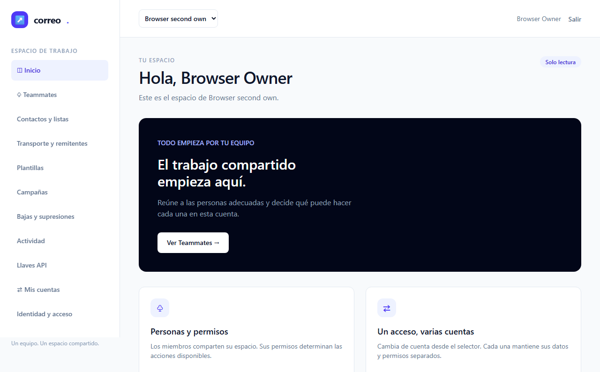
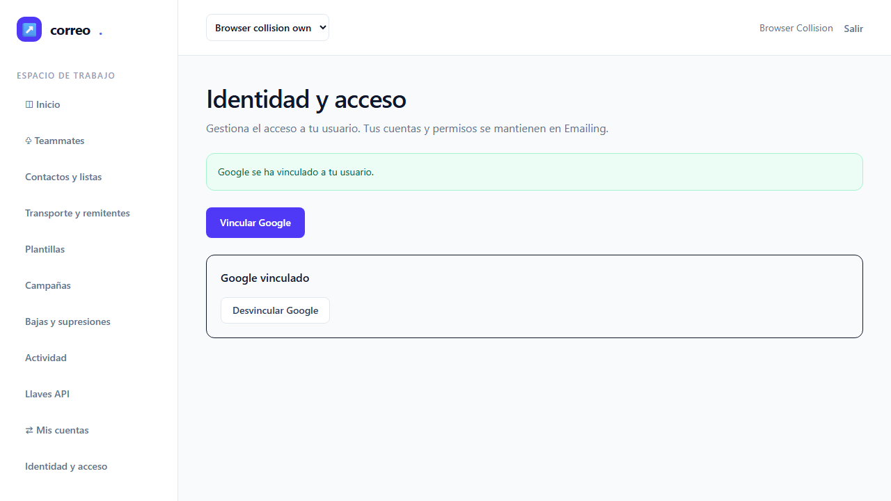
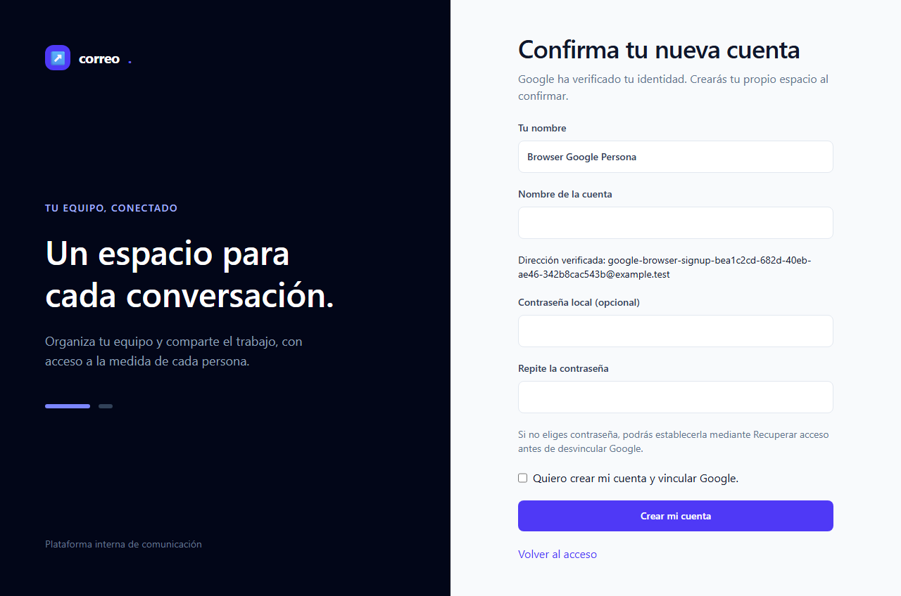
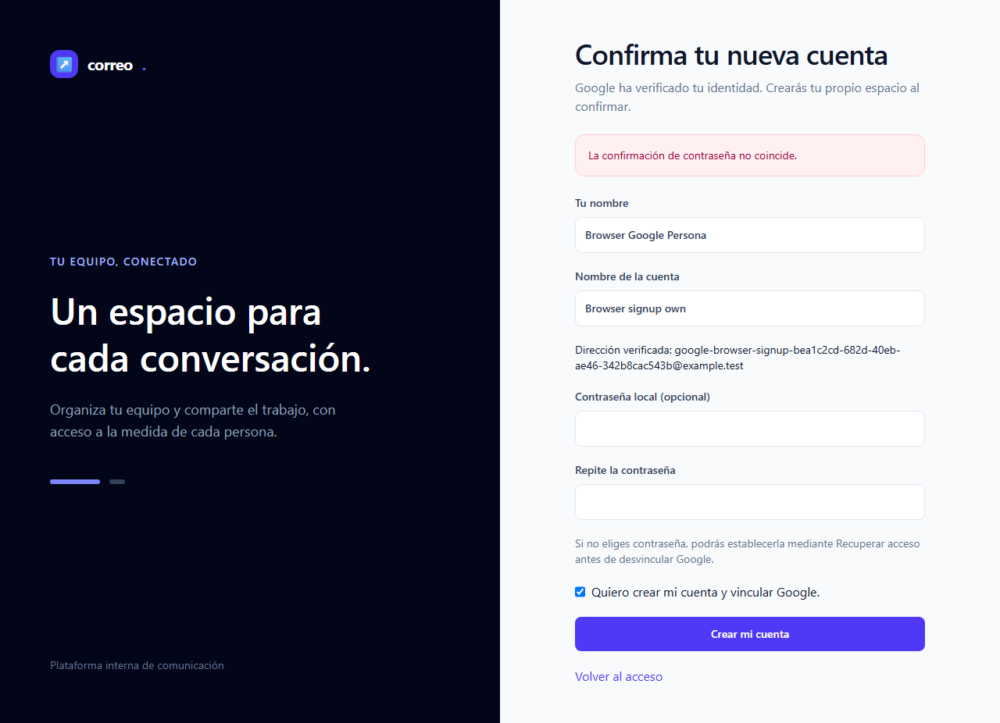

# Informe de QA — Identidad Google, fase 2

| Dato | Resultado |
|---|---|
| Fecha | 2026-10-25 02:34 UTC |
| Puerta automatizada de fase | **VERDE**, 3/3 E2E; 0 fallos, 0 flaky, 0 omitidos |
| Aceptación global del plan | **Pendiente**; E2E-04–06, consentimiento real de E2E-01 y M-01–04 sin ejecutar |
| Origen auditado | `http://127.0.0.1:18967` |
| Plan y escenarios | [Plan](../../../improvement-plan.md) · [Test-plan](../../../test-plan.md) |
| Rol | QA independiente; fallback genérico heredado, sin override ni atribución de ejecución Sonnet |

## Veredicto determinista

Salida íntegra UTF-8 de `qa-gate.py` sobre el **JSON original** del reintento, exit 0:

```json
{
  "verdict": "VERDE",
  "counts": {
    "passed": 3,
    "failed": 0,
    "flaky": 0,
    "skipped": 0,
    "interrupted": 0
  },
  "flaky_sin_justificar": [],
  "flaky_justificados": {},
  "threshold": "verde ⟺ 0 failed, 0 flaky sin justificar, 0 interrumpidos y ≥1 test ejecutado"
}
```

Este verde acredita el subconjunto automatizado T-02/T-03 en este perfil. No acepta
el plan completo, tareas futuras ni manuales. T-02/T-03 siguen en-progreso hasta
admisión de root; contadores MCP 1/14 y principal 18/20 sin cambio por QA.

## Ejecución y procedencia

Chromium 156.0.8078.4 (v1248), Playwright 1.64.1 y PHP 8.4.18 cli-server nativo
Laragon. Aplicación, SQL `emailing_testing`, cookies, CSRF y JWT RS256 reales;
sólo el límite HTTP del proveedor es simulado. Mailer de laboratorio `log`.
No acredita Apache, Nginx, Docker, TLS de despliegue, Google real, transporte MCP
ni clientes reales. El consentimiento MCP completo pertenece a T-05/T-07/T-12.

El comando independiente fue `npx.cmd playwright test tests/e2e/mcp-google.spec.mjs
--grep Google --reporter=json --output=<salida privada>`, con
`PLAYWRIGHT_JSON_OUTPUT_FILE` y navegadores ya instalados. Configuración y testcaller
permanecieron intactos. Duración declarada por Playwright: 51.254 s.
No hubo reintentos de tests: cada resultado conserva `retry: 0`.

El primer arranque sandboxado falló con `spawn EPERM`, sin tests ni nuevos recursos
de launcher/SQL/PHP. Su JSON original y su gate **NO-VERDE**, exit 1, se conservan
por separado. Se probó ausencia de nuevos directorios y binds exclusivos cerrados
antes de repetir el mismo testcaller fuera del sandbox. El reintento pasó; no se
desactivó el sandbox de Chromium ni el límite de red.

Pin de cápsula review2: `4c1722bd21f177ba16a7f772977136a735984b97ebd952f715eb3a33e73ff412`.
Pin de las 289 fuentes de implementación: `0669a041696f9b1cd28f8c5fa541509e323f3d268e14a0a4a17ecc551c129f81`.
Cada recibo independiente conserva esas 289 fuentes más 6 controles, archivo ZIP,
hashes y comparación posterior sin cambios. Los cambios editoriales de root posteriores
a review2 no se presentan como cambios de código. Originales completos privados;
[proyección pública](raw/results.json) derivada con sólo metadata de rutas sanitizada.
Stats, errores, estados, duraciones y retries permanecen idénticos.

## Puertas de entrada y cobertura

| Puerta oficial | Resultado independiente |
|---|---|
| ledger-lint | Exit 0; 0 incoherencias, 11 avisos Changelog de T-04–T-14 futuras |
| coverage-check | Exit 0; 0 referencias rotas, 0 tests sin referencia, 0 GWT sin cubrir por referencias |
| Guardrail | Origen local permitido, exit 0; primer Bash falló por signal pipe del sandbox y queda conservado |
| qa-gate | Original final exit 0; original de error de arranque exit 1 |

Los avisos de cobertura son T-01/T-02/T-04/T-05/T-06/T-08/T-09/T-10/T-13:
contrato, backend o revisión sin pantalla propia; no son tareas de UI huérfanas.
La ausencia de referencias rotas sólo comprueba la matriz declarada; los escenarios
de fases futuras no han sido ejecutados. No hay bloques API/A11Y en este test-plan.
No existe configuración `tests.coberturaMinima`: no se mide ni inventa porcentaje unitario.

En cada uno de los tres E2E, antes del flujo, un navegador real obtuvo HTTP 502
para el host reservado externo, rechazó HTTPS CONNECT y volvió correctamente al login
local. Proxy propio sin forwarding ni DNS, service workers bloqueados y bypass loopback.
Los tres mensajes de frontera constan en el reporter original. GOT-012 aceptado se
aplicó para evitar redirects seguidos por `route.fetch` y carreras de la página de error.

## Resultados automáticos

### E2E-01 — Usuario, cuentas y retorno de servidor — PASA parcial de fase

Usuario local estable tras Google con email cambiado; selector contiene la segunda
membresía propia y excluye la cuenta ajena. Cambiar a la segunda cuenta muestra
«Solo lectura». Tras salir y entrar mediante Google, el retorno coincide exactamente
con el UUID pendiente guardado por servidor. Capturas reales del login y panel:




El punto de entrada al retorno es una **ruta fixture**: no es una solicitud OAuth
MCP validada ni una pantalla de consentimiento ejecutada. Cliente/recurso, PKCE,
canje, scopes y consentimiento completo quedan pendientes T-05/T-07/T-12/T-14.
Host/return_url alterados y ausencia de altas colaterales tienen aserciones PHP;
no se atribuyen a acciones de este navegador. No hay captura de consentimiento.
Tareas trazadas: T-03 acreditada en este subconjunto; T-11/T-12/T-14 pendientes.

### E2E-02 — Negativos y vínculo explícito — PASA en el alcance ejecutado

Navegador rechaza state alterado, callback reutilizado, emisor inválido, sub vacío
y bad-code; verifica retorno al login y errores genéricos en los casos explícitamente
asertados. Email coincidente sin vínculo no inicia acceso. Después, acceso local,
vínculo desde perfil con CSRF real, salida, nuevo Google con mismo sub/email cambiado,
mismo usuario visible y desvínculo autorizado. Captura tras vínculo:



No se capturó una pantalla por cada negativo. Conteos SQL durante cada rechazo y
conflicto de identidad ya perteneciente a otra persona son pruebas PHP, sin atribuirlos
a pasos ausentes del navegador. T-03 cubierta en fase; consolidación T-12 pendiente.

### E2E-03 — Admisión, registro corregible e invitación — PASA en fase

Workspace sin `hd` permitido se rechaza; con `hd` firmado por proveedor simulado
se abre confirmación. El formulario envía contraseñas distintas: conserva nombre
de cuenta y casilla, muestra error y devuelve ambos campos de contraseña vacíos.
Sin otro OAuth, reenviar el formulario vacío de contraseñas crea acceso Google-only;
el perfil exige recuperación local antes de permitir desvínculo. Evidencia B-01:





También se ejecutó registro deshabilitado, invitación ajena HTTP 403, retorno del
destinatario Google a la invitación exacta y aceptación hasta `/team`, estado Google
sin configurar y acceso local del owner. No hay captura de invitación/desvínculo ni
aserción de rol en el navegador; el rol y conteos se verifican en PHP. Restablecimiento
completo de contraseña por email no es un paso de este E2E. T-03 acreditada en fase;
T-11/T-12/T-14 conservan sus obligaciones.

### Integración PHP independiente

Comando `php artisan test --filter=GoogleIdentityTest|GoogleLoginTest`, exit 0:

```text
Tests:    20 passed (510 assertions)
Duration: 343.03s
```

Incluye la regresión B-01: error de contraseña y cuenta vacía conservan exactamente
la identidad verificada y su caducidad original; no dejan usuarios, cuentas,
membresías, identidades ni auditoría de negocio. El POST corregido crea una sola
cuenta/identidad, consume el pendiente y un reenvío no duplica. Sólo dos requests
HTTP de proveedor durante todo ese flujo. Las suites también prueban claves exactas,
conflictos/concurrencia, JWT, admisión, invitaciones, recuperación y retornos.
Estas aserciones de integración complementan las evidencias de UI; no son acciones
de navegador adicionales ni aceptación de proveedor real.

## Checklist manual pendiente

- [ ] **M-01**: Google real en Laragon y Docker, identidad autorizada, vínculo/desvínculo, admisión y retorno. T-03/T-11/T-14.
- [ ] **M-02**: claridad humana, teclado, cuenta/scopes y revocación del consentimiento. T-07/T-14.
- [ ] **M-03**: Codex, Claude Code y OpenCode reales, versiones, expiración, reautorización, denegación y revocación. T-11/T-14.
- [ ] **M-04**: ambos perfiles, reinicio/restauración, TLS/origen y persistencia sin duplicar infraestructura. T-11/T-14.

E2E-04/05/06 permanecen sin ejecutar: consentimiento por cuenta/scopes, frontera MCP,
revocación y reautorización conservan T-07/T-11/T-12/T-14. No se cierra ningún criterio
global CA-05–CA-16 por el verde de identidad; CA-01–CA-04 tienen evidencia acotada a fase.

## Evidencias, privacidad y cierre de recursos

Cinco PNG originales inspeccionados visualmente: sólo UI local y datos ficticios
`example.test`, sin contraseñas visibles ni callback con códigos/tokens. Capturas
copiadas byte a byte; originales privados, traces desactivadas. La proyección de
JSON/recibos sólo sustituye rutas privadas: [prueba estructural](raw/projection-proof.json).
No se publican logs crudos, cookies, entornos, claves, requests ni querystrings de callback.
La comprobación de privacidad se limita al árbol actual, sin afirmar saneamiento histórico.

Playwright globalTeardown confirmó limpieza atribuida. El launcher no produjo su
settlement automático; se conserva esa ausencia. Después de terminar las suites
PHP con `DatabaseMigrations`, se verifican SQL guardada y tablas propias ausentes:
no pueden quedar filas del UUID en tablas que no existen. El primer checker intentó
contar tablas ausentes y falló aunque PHP standalone devolvió 0; sus streams se
conservan y no se admiten como settlement. El checker corregido registra existencia
de tablas e identidad sin recrear esquema. No se atribuye el cero a DELETE selectivo:
el teardown de migraciones retiró las tablas. El recibo final
prueba procesos propios cero, binds exclusivos de ambos puertos cerrados y handles
terminales. No hubo inspección/señales a procesos ajenos ni limpieza global.

El PDF deriva de este Markdown mediante la skill to-pdf, adaptación privada del
motor que conserva el sandbox e incrusta las cinco capturas. El manifiesto y recibo
visual finales consignan sus páginas reales y hashes. No hay coste, tokens ni horas
IA reales medidos; los tiempos de runner son sólo duración de ejecución.

Root conserva la aceptación de fase y commits. No se despacha documenter ni se
modifican estados del plan/spec en esta entrega. Jira/Confluence sin opt-in.
