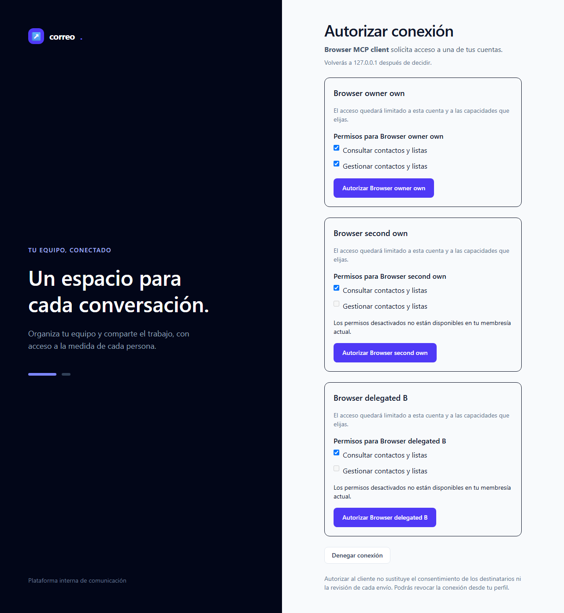
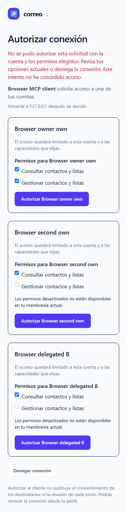
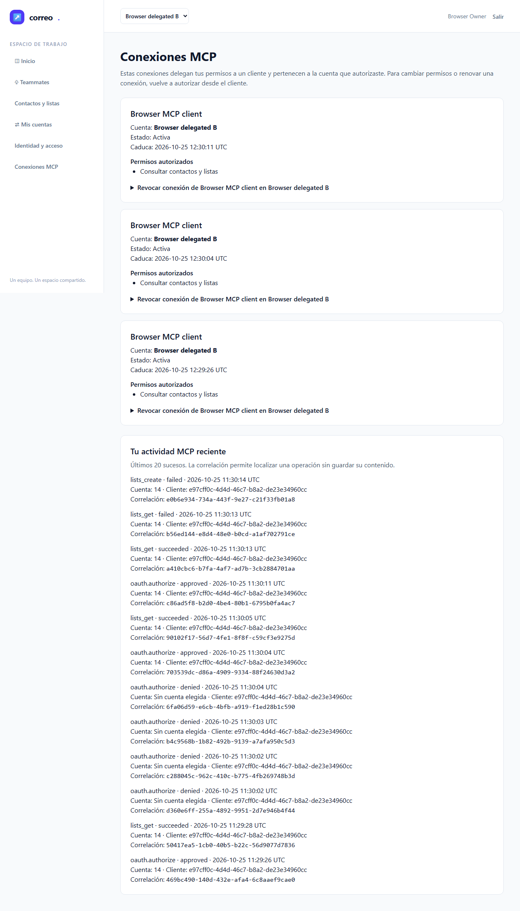
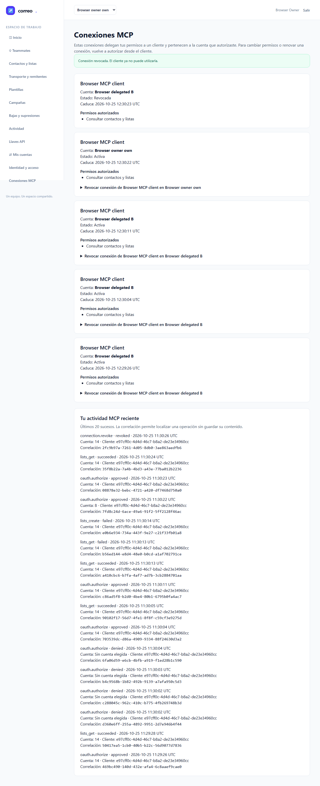

# Fase 3: evidencia de implementación

T-04–T-07 están implementadas y pendientes de revisión fresca y QA independiente.
MCP conserva **3/14** tareas aceptadas; la plataforma principal conserva **18/20**.
Este informe acredita verificaciones de desarrollo con fuentes congeladas, sin
dar por superadas las puertas posteriores ni las pruebas manuales.

## Comportamiento verificado

La cuenta MCP procede del grant verificado y permanece independiente de la cuenta
activa en la web. Scopes, token, membresía y operación se intersectan; las
mutaciones revalidan esa autoridad con locks SQL en orden común. OAuth usa códigos
opacos de un solo uso, PKCE S256 y tokens MCP propios; no emite refresh. El SDK
Laravel MCP 1.1.1 sirve ambos perfiles contratados, con validación antes del
primer decode, límites, sesiones y errores seguros.

El consentimiento real persiste durante el login local o Google, presenta las
cuentas y capacidades vigentes y exige POST+CSRF. Un cliente HTTP local de prueba
valida issuer y state, canjea automáticamente el código y mantiene el bearer sólo
en memoria. La página de retorno no presenta códigos, state, verifier ni tokens.
La gestión de conexiones permite revocar una conexión propia sin cortar otra.
La auditoría enlaza actor, cuenta autorizada, cliente, operación y correlación;
los eventos anteriores a elegir una cuenta conservan cuenta nula.

Sólo **lists_get** y **lists_create** se adelantan como prerrequisito productivo
de estos escenarios: usan los servicios y contexto explícito existentes. T-08
conserva las veinte operaciones y verificará también estas dos; las otras tareas
del catálogo no se dan por implementadas. Una excepción tras un commit incierto
no declara que la escritura no ocurrió: devuelve outcome unknown y no permite
repetirla automáticamente. La regresión distingue el rollback confirmado.

## Ejecuciones y alcance

Cada fila conserva su propio ZIP, manifiesto y streams; no se suman repeticiones
ni se atribuyen resultados antiguos a fuentes posteriores. Los pins y originales
de navegador se relacionan en [evidence.json](evidence.json).

| Ejecución | Resultado | Alcance |
| --- | --- | --- |
| T04 autoridad inicial / regresión | 7/73 y 8/111 pruebas/aserciones, exit0 | SQL, carreras en procesos separados y regresión web/API; focales de rol y portabilidad en handoff T04 |
| T05 OAuth | 11/245, combinado12/258, focal HTTP3/72, exit0 | PKCE, replay, reautorización, cuotas/canje concurrentes, retención y errores de autenticación; snapshots distintos |
| T06 focal final | 4/65, exit0; negativa API key1/15 | Sesiones, límites, fábrica y outcome con SDK real; probes de mecanismo no equivalen a negocio de envío |
| T07 inicial | 5/82, exit0 | DTO cerrado, tenant, scopes, IDs ajenos, revocación y auditoría |
| Google y transporte | 35/680, exit0 | Regresión nativa previa a ajustes finales de presentación y commit; cursor entre HTTP con correlaciones distintas |
| Consentimiento y regresión SQL/web/API | 40/595, exit0 | Snapshot previo a ajustes HTML/commit; contactos, equipo, OAuth, revocación concurrente y bearer |
| HTML/commit corregidos | 6/103, exit0 | Contrato HTML/JSON, CSRF, rollback, commit incierto, referencias, retención y entero seguro |
| Feedback de revocación | 1/15, exit0 | Mensaje renderizado, corte de sesión y aislamiento |
| Navegador final | 6/6, exit0 | E2E-01–06, Chromium real con sandbox, PHP cli-server, SQL/CSRF reales y proveedor Google simulado |

E2E-01 sustituye el antiguo retorno fixture por una solicitud OAuth validada y
persistida, consentimiento real y llamada permitida. E2E-04 comprueba teclado,
vista móvil, scopes deshabilitados, rechazo de cuenta ajena, CSRF, feedback seguro,
denegación y canje. E2E-05 cambia el selector web y conserva la autoridad B; rechaza
el ID de A, la mutación sin scope, la API key, un token Google y la cookie web.
E2E-06 verifica GET y POST sin CSRF sin cambios, revoca una sesión legacy abierta,
mantiene la otra conexión, rechaza refresh, expira sólo el token manteniendo el
grant vigente y vuelve a autorizar. Tras retirar la membresía, corta la llamada
y ya no ofrece esa cuenta al volver a consentir.

## Rojos conservados y correcciones

Se preservan todos los intentos fallidos. El arranque EPERM no ejecutó escenarios.
El primer navegador ejecutado pasó2/falló4: el arnés dependía de page.route para
interceptar el destino de un302. Un probe aislado probó que la navegación302 llega
al servidor HTTP sin esa interceptación; el callback HTTP real resolvió ese borde.
El siguiente intento pasó5/falló1: revocaba pero no mostraba feedback porque el
controlador usaba flash success y la vista leía status. La regresión y el ajuste
de esa clave corrigen el defecto de producto. Otro focal llegó a expiración y
reautorización pero su cambio de cuenta se cancelaba con un goto prematuro; ahora
el arnés espera la navegación del formulario nativo antes de continuar.

El rojo HTML/commit inicial alcanzó el tipo de respuesta y un outcome incorrecto
tras un INSERT durable; no se le atribuyen las aserciones posteriores no alcanzadas.
El verde prueba respuesta200HTML sólo para feedback del formulario autenticado,
manteniendo errores JSON protocolarios y419CSRF, y distingue rollback de commit
incierto. Los rojos históricos de T04–T06 siguen en sus cápsulas privadas.

## Controles de cierre

Contrato704casos, privacidad1705archivos/0hallazgos, scope98/98 sin avisos ni
criterios alterados, diff--check y Composer validate--strict terminaron con exit0.
Ledger-lint no encuentra incoherencias; conserva siete avisos de Changelog de
T-08–T-14, aún futuras. El build final de la UI pasó antes del navegador.

Pint global conserva exit1 con25hallazgos fuera del diff:16fuentes tracked y nueve
archivos históricos ignorados de evidencias anteriores. Para cada tracked se
contrasta el contenido del base:14coinciden byte a byte y dos difieren sólo por
CRLF; no se modificaron. Los ignorados sólo se identifican por ruta/hash, sin
atribuirles contenido del base. Pint dirigido a las73rutas PHP cambiadas pasó
con exit0. Dos intentos de ese helper fallaron antes de ejecutar Pint por una
aserción CRLF y un archivo histórico no tracked; se conservan como errores de
instrumentación. El primer launcher de Composer no arrancó(exit127); el comando
dirigido cmd.exe ejecutó validate--strict con exit0. Ninguno de esos resultados
se convierte en un verde global ni en prueba funcional.

## Capturas seleccionadas

Las imágenes son copias exactas de originales del navegador final, con identidades
sintéticas reservadas. Se revisaron desbordamiento móvil, foco y estados visibles.
Esta inspección del agente no sustituye el juicio humano de M-02.

## Límites de esta evidencia

Google y el cliente OAuth son fixtures locales: no acreditan Google real ni
Codex/Claude/OpenCode externos. El build Docker y su probe acreditan empaquetado,
SDK y contrato incluidos; no HTTP/TLS de despliegue. No se acredita carga real,
pipeline de negocio de envío, ni T-08–T-14 o principal T-19/T-20. M-01–M-04 siguen
pendientes; M-02 requiere expresamente confirmación de una persona. La revisión
fresca y QA formal las realiza root después de liberar la fase.

Los procesos y fixtures propios se cierran con comprobaciones específicas; el
manifiesto privado final relaciona los recibos de settlement. El SMTP externo
permanece apagado. Sin telemetría atribuible, tokens, coste y horas reales se
mantienen desconocidos: las duraciones de pruebas son tiempo de reloj.
