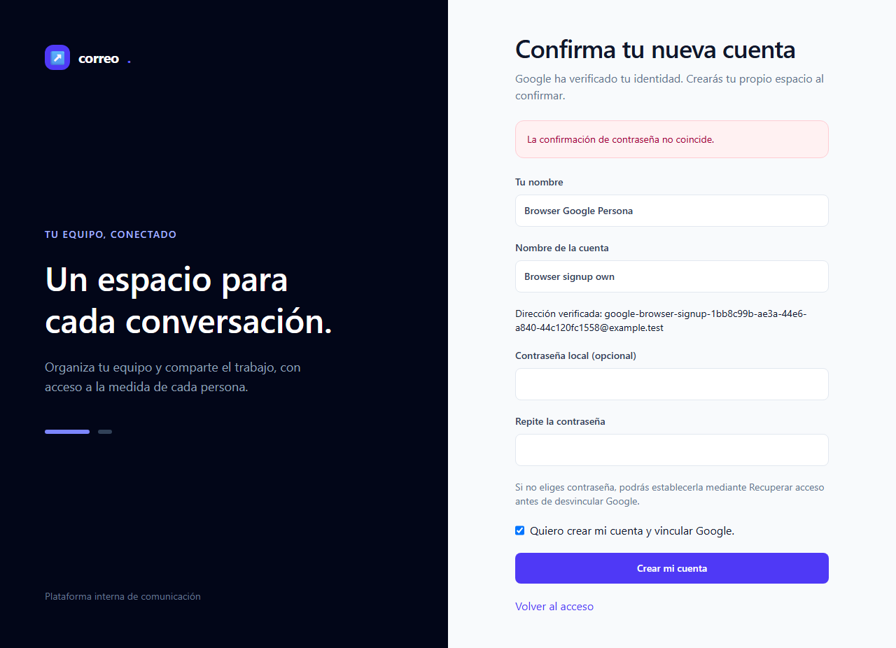
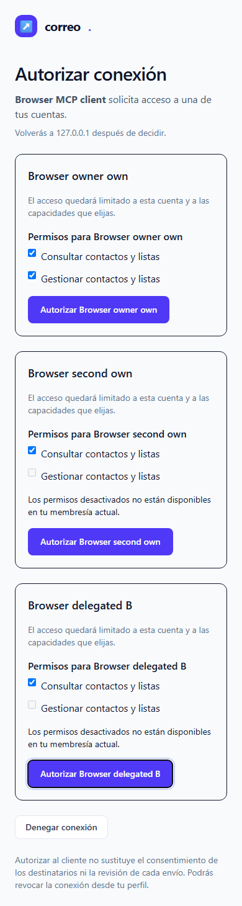
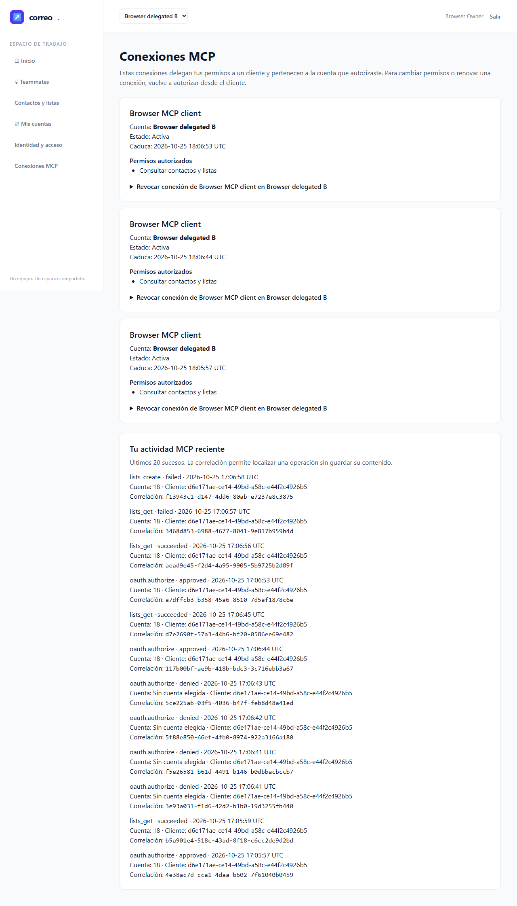
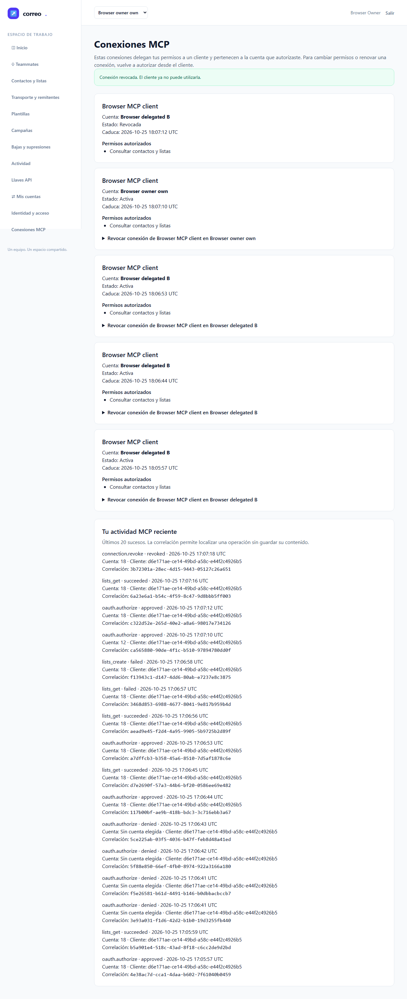

# Informe de QA — MCP y Google, fase 3 · QA2

| | |
|---|---|
| Fecha | 2026-10-25 · intento 2 de 3 |
| Gate automático | **VERDE: 6/6 E2E pasan a la primera; 0 fallos, flaky, omitidos o interrumpidos** |
| Aceptación completa | Pendiente de root y de las verificaciones humanas/externas correspondientes |
| URL delimitada | `http://127.0.0.1:18967` |
| Ejecutor | Agente QA genérico fresco respecto de la implementación, modelo heredado; ninguna aceptación humana atribuida |
| Plan | [Plan](../../../improvement-plan.md) · [Test-plan](../../../test-plan.md) · [Ledger](../../../tasks.md) |

## Veredicto determinista

Salida **exacta** de `qa-gate.py` aplicada al JSON original del reporter, exit 0:

```json
{
  "verdict": "VERDE",
  "counts": {
    "passed": 6,
    "failed": 0,
    "flaky": 0,
    "skipped": 0,
    "interrupted": 0
  },
  "flaky_sin_justificar": [],
  "flaky_justificados": {},
  "threshold": "verde ⟺ 0 failed, 0 flaky sin justificar, 0 interrumpidos y ≥1 test ejecutado"
}
```

Playwright registra seis resultados `expected`, cada uno con un único intento `passed`, sin errores superiores. Duración del reporter: **125.90 s**; el valor original es 125897.972 ms. No hubo reintentos ni justificaciones de flaky. [JSON original](raw/playwright-results.json) · [gate](raw/qa-gate.json) · [resumen por test](raw/e2e-summary.json).

## Alcance y relación con QA1

QA2 ejecuta los seis E2E existentes de la aplicación real con Google simulado y un cliente protocolario de laboratorio. Se ejercitan Streamable HTTP, protocolo 2026-07-28 y una sesión persistente legacy 2025-11-25. Playwright 1.64.1 utiliza el bundle Chromium autorizado de revisión 1248; no se instrumentó aquí una lectura de la versión interna del browser.

El entorno es Windows, PHP cli-server y MySQL real de testing. No acredita Apache/Nginx, despliegue TLS, Docker, Google real ni Codex/Claude/OpenCode reales. Las doce capturas contienen fixtures ficticios; fueron inspeccionadas por el agente QA, sin convertir esa inspección en M-02 humana.

El backend **77 passed / 1.808 assertions / 2048.91 s**, exit 0, pertenece a **QA1** y no se repitió ni se vuelve a contar como ejecución de QA2. Sus 352 fuentes coinciden exactamente con las actuales y revisadas. [Origen QA1](../qa-1/raw/backend-summary.json) · [recibo original QA1](../qa-1/raw/qa1-backend-receipt.json).

QA1 permanece **NO-VERDE**: su intento browser terminó con `spawn EPERM`, suites vacías y cero E2E ejecutados. QA2 cambió únicamente el contexto autorizado de ejecución fuera del sandbox de herramientas, conservando el sandbox de Chromium, el proxy, el reporter y todos los tests/asserts. No reemplaza los originales de QA1. [Informe QA1](../qa-1/report.md).

## Puertas de entrada y cobertura

- `ledger-lint.py`: exit 0, **0 incoherencias y 7 avisos** de Changelog futuro, T-08–T-14.
- `coverage-check.py`: exit 0, **0 referencias rotas**, 0 tests sin referencia y 0 GWT sin ID o sin cubrir documentalmente. Esa correspondencia no acredita por sí sola su ejecución.
- Nueve tareas sin `Cubre (tests)`: T-01 es contrato/plan; T-02, T-04, T-05 y T-06 son backend; T-08–T-10 son catálogo backend pendiente; T-13 es revisión. La lista no identifica una tarea UI huérfana. T-07 se enlaza con E2E-04–06 y M-02.
- No hay bloques API-xx/A11Y-xx en el test-plan. No se instalaron dependencias ni se ejecutaron smokes/axe nuevos.
- No existe `.claude/dev.json`: no se activó TDD ni cobertura porcentual opt-in y no se inventa porcentaje de cobertura del código.

Guardrail: se revalidó el literal HTTP, host IPv4 loopback y puerto exactos, sin usuario, contraseña, ruta, query o fragmento. Root había contrastado esta alternativa nativa con la función del kit; su Bash fallido en QA1 sigue preservado y no se declara exitoso. Los binds previos de 18967/18968/18743 se cerraron en contexto. Cada E2E comprobó realmente HTTP externo→502, CONNECT HTTPS rechazado y navegación local correcta. ChromiumSandbox=true, deny-proxy y service workers bloqueados permanecieron intactos. [Preflight](raw/preflight.json) · [decisión nativa root](raw/root-guardrail-decision.json).

## Resultados E2E y capturas

Las imágenes del PDF se presentan como vistas de apoyo. Los PNG originales completos conservan su resolución y sus bytes; las vistas superiores de E2E-05/06 no sustituyen esos archivos. Se inspeccionaron las doce capturas, sin observar secretos ni datos reales. No se generaron traces: la configuración revisada mantiene `trace: off`.

### E2E-01 — Usuario local estable y retorno al consentimiento — PASA

CA-01/CA-05; T-03/T-11/T-12/T-14. Acceso con proveedor simulado, cuentas propias y retorno a la solicitud OAuth validada; no aparece la cuenta ajena. El nombre de archivo `google-real-consent.png` describe la pantalla real de la aplicación, no Google real.


Otras capturas: [login](screenshots/google-login.png) · [consentimiento recuperado](screenshots/google-real-consent.png).

### E2E-02 — Callback y vínculo explícito — PASA

CA-02/CA-03; T-03/T-12. Los negativos de identidad/callback no crean autoridad; no se fusiona por email. La vinculación se realiza desde el perfil autenticado y el sub estable conserva su usuario.


### E2E-03 — Admisión, registro, invitación y recuperación — PASA

CA-03/CA-04; T-03/T-12. Se conserva el flujo explícito y sus reglas; el error corregible mantiene confirmación/datos y permite continuar. Se verifican desvínculo, alternativas locales y Google sin configurar.



Otra captura: [confirmación explícita](screenshots/google-confirmation.png).

### E2E-04 — Cuenta/scopes, CSRF y canje automático — PASA

CA-05/CA-07; T-07/T-11/T-12/T-14. B limita scopes a membresía vigente; C y elevación son rechazados, al igual que el POST sin CSRF. Denegar no emite credencial y el cliente de laboratorio canjea mediante PKCE sin copiar una API key. Se ejercitan Space/Tab, foco y viewport de 390×844 sin desbordamiento.

<figure style="margin:0;break-inside:avoid"><figcaption>Captura móvil completa; foco visible en la autorización de B.</figcaption></figure>

Otras capturas: [error seguro](screenshots/mcp-consent-safe-error.png) · [denegación](screenshots/mcp-denied.png) · [canje en el cliente de laboratorio](screenshots/mcp-client-connected.png).

### E2E-05 — Frontera de cuenta y credenciales — PASA

CA-06/CA-07 y alcance parcial de CA-09; T-07/T-12. La selección web de A no mueve el grant de B. Lectura propia permitida, ID ajeno y mutación sin scope rechazados; cookie web, API key y bearer Google simulado no ejecutan herramientas. Se comprueban conexiones y auditoría.

<figure style="margin:0;break-inside:avoid"><div style="height:85mm;overflow:hidden"></div><figcaption>Vista superior en PDF. <a href="screenshots/mcp-connections-and-audit.png">PNG completo de conexiones y auditoría</a>.</figcaption></figure>

### E2E-06 — Revocación, expiración y retirada de membresía — PASA

CA-08; T-07/T-11/T-12/T-14. La revocación corta la sesión legacy abierta; otra conexión permanece válida. GET y POST sin CSRF no revocan; teclado confirma la acción. Refresh se rechaza. Un fixture de reloj expira sólo el bearer propio, se reautoriza y después la retirada de membresía impide continuar/reautorizar B. No se esperó una hora real ni se cambió el reloj del sistema.

<figure style="margin:0;break-inside:avoid"><div style="height:85mm;overflow:hidden"></div><figcaption>Vista superior en PDF. <a href="screenshots/mcp-revoked.png">PNG completo de revocación y auditoría</a>.</figcaption></figure>

## Checklist manual para una persona

- [ ] **M-01 — Google real en Laragon y Docker:** acceso, vínculo/desvínculo, admisión y retorno OAuth con cuentas/callbacks privados. Pendiente; el proveedor simulado no la completa. T-03/T-11/T-14.
- [ ] **M-02 — Claridad del consentimiento y conexiones:** cliente, cuenta, capacidades, efectos, estados, errores y teclado comprensibles. **Una persona debe confirmar**; capturas y aserciones del agente no la sustituyen. T-07/T-14.
- [ ] **M-03 — Clientes reales, expiración y revocación:** Codex, Claude Code y OpenCode con producto/versión, transporte, registro, callback y red; Claude Desktop conserva fila separada. Pendiente. T-11/T-14.
- [ ] **M-04 — Reinicio, restauración y configuración:** ambos perfiles, persistencia/revocación y restauración aislada, con Mailpit/log. Pendiente; esta ejecución no reinició servicios ni restauró una base. T-11/T-14.

## Trazabilidad y cierre atribuido

| Tarea | Evidencia vigente | Límite |
|---|---|---|
| T-04 | Backend QA1 de autoridad, permisos y revocación, con fuentes idénticas | No reejecutado ni sumado como QA2 |
| T-05 | Backend QA1 OAuth/registro/poda; E2E-01/04/06 QA2 | No acredita scheduler operativo o SLA |
| T-06 | Backend QA1 de transporte/metadatos; E2E-05/06 QA2 | No acredita despliegue TLS/Docker o clientes reales |
| T-07 | Backend QA1 y E2E-04–06 QA2, con doce capturas revisadas | M-02 humana pendiente |
| T-03 | E2E-01–03 QA2 y regresión GoogleLoginTest QA1 | Google real pendiente |

El catálogo completo de 37 operaciones de T-08–T-10 no se acredita por esta fase. `lists_get` y `lists_create` son el alcance adelantado ya revisado. Tampoco se declara ejecutada toda la suite del proyecto ni el QA cruzado global T-12/T-19.

Setup, clock propio y teardown global terminaron exit 0; el callback 18743 está cerrado. No aparece recibo de cleanup del launcher y no se inventa su existencia. El comprobador SQL de sólo lectura validó guard/configuración/conexión real `emailing_testing`, tx0 y **cero filas propias en las doce categorías del manifiesto cleanup**. No borró datos ni exigió que desapareciese el esquema. Los binds posteriores de 18967/18968/18743 pasaron y se cerraron. No se buscó ningún proceso/PID ni se intervino en infraestructura ajena. [Recibos seguros](raw/safe-runtime-receipts.json) · [cierre SQL](raw/sql-closure.json) · [binds posteriores](raw/post-browser-ports.json).

El antiguo checker QA1 que exigía cero tablas conserva su exit 1; su supuesto era incompatible con RefreshDatabase de TeammateTest. QA2 no lo repitió ni borró esquema para satisfacerlo. La limpieza atribuida se apoya en manifiesto de fixtures, teardown, conteos y binds, sin presentar rollback/migración como un borrado selectivo.

## Procedencia y entrega

Cápsula revisada `ac48477292f63d6055b30b9d767a2d5a662970629e1d79986871a30e787c70a1`; cuatro lentes de revisión 2 limpias. La captura QA2 contiene las mismas **352 fuentes**, manifest `276f853d903367ff2150e2f84807dba153743cdfa71bfb1f36940a8da1ade10e`, contrastadas contra ZIP, checkout y tree revisado. `source_changed_during_run=[]`. El reporter original, los productores exactos y cada PNG conservan hashes verificables. [Procedencia](raw/provenance.json) · [fuentes](raw/source-manifest.json) · [capturas](raw/screenshots.json).

No se cambió producto, tests, selectores, configuración, contratos, migraciones, ledger, conocimiento ni Git. No se instalaron paquetes, publicaron resultados o delegaron agentes. GOT-012 legacy aceptada orientó el límite de red existente; no hubo flaky que justificar ni conocimiento nuevo aprobado. No se ejecutó una auditoría global de seguridad.

Se entrega a root un **gate automático verde de fase 3**, con backend QA1 vigente y E2E QA2. Root conserva la decisión de aceptación/documentación de T-04–T-07 y el estado del ledger. Este informe no cierra T-11/T-14, los manuales, los perfiles/clientes externos ni la iniciativa completa.
