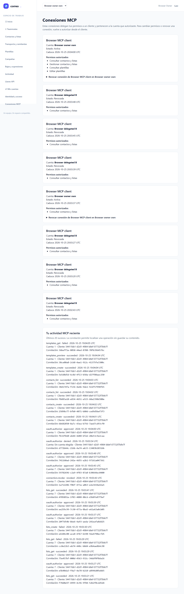

# T-08 — Implementación de herramientas de datos

Estado: implementación preparada para revisión y QA independiente. No es aceptación
formal de T-08 ni cierre global; el contador sigue en **7/14**.

Se implementan las veinte operaciones de contactos, listas, reportes de importación
y plantillas con los mismos servicios de web/REST y un contexto delegado explícito.
El catálogo y las llamadas directas aplican permisos actuales. Los DTOs son listas
explícitas de campos, los esquemas se verifican sobre JSON tipado y el preview no
envía correo. No se añaden cargas de archivos por MCP ni rutas del host.

## Resultados de desarrollo

| Comprobación | Resultado atribuido |
|---|---|
| Recorrido positivo de las veinte operaciones | 1 passed /375 assertions tras corregir la proyección de listas; no se suma a las tandas posteriores. |
| Datos, permisos, IDs ajenos y cursores | 9 passed /1102 assertions en su snapshot; después se amplió la prueba de payload de cursor y expiración del token. |
| Regresión conjunta de datos, consentimiento y esquemas | Consola original: 59 passed /1410 assertions, exit0, 520.24 s. Sus 380 fuentes permanecieron estables durante la captura. |
| Unidades con nombres de datasets estables | 41 passed /51 assertions, exit0. El JUnit nativo anterior también acredita 41 casos/51 aserciones sin fallos, errores ni omisiones; la consola bonita anterior contaba40 por los nombres numéricos. No se sustituyen los originales ni se suman tandas repetidas. |
| Navegador E2E-01–E2E-07 | 7/7 al primer intento; cero fallos, flaky, omitidos e interrumpidos. JSON original: 123808.231 ms. |
| Cierre SQL propio | Guard de testing aprobado, tx0; las 21 categorías de recursos del manifiesto tienen cero filas. Sólo lectura, sin base operativa ni borrados ajenos. |

El lote backend precede sólo a la ampliación de pruebas de navegador y al prefijo
de los nombres de datasets. Ningún PHP de producción cambió después de ese lote.
La posterior unidad con nombres estables y los siete E2E conservan sus cápsulas
propias; la revisión y QA volverán a cualificar las fuentes finales. Los recibos,
hashes y alcance están en [evidence.json](evidence.json).

La integración verifica positivos y rechazo de argumentos desconocidos para las
veinte operaciones, llamadas directas sin scopes, IDs de otra cuenta, consentimiento
revocado, email inmutable, fechas/pruebas de consentimiento y el renderer común.
Los cursores prueban continuidad con distintos límites, cambios de filtros,
operación, grant, cuenta o rol, caducidad, rotación con claves anteriores de confianza,
payload autenticado inválido, límite del token y paginación cortada por bytes sin
perder filas. Se cuenta el sobre real del SDK, con texto y contenido estructurado.

Los fallos de desarrollo permanecen conservados: primero sólo se anunciaban dos
herramientas; el primer recorrido detectó que una colección pasaba el índice a un
parámetro opcional de proyección. Se corrigió la llamada unaria, sin debilitar el
contador requerido por el DTO. Una colisión del nombre de un helper de test con
el método HTTP del framework se corrigió antes de ejecutar la batería ampliada.

## Evidencia visual del nuevo flujo

El usuario sintético consiente cuatro capacidades concretas y el cliente de
laboratorio canjea PKCE automáticamente. El token nunca se muestra en la página.

Se observa la conexión propia y auditoría de creación, consulta y preview, con
correlaciones sintéticas. Root inspeccionó los dos PNG originales completos: no
se observan credenciales ni datos reales. Esto no equivale a M-02 humana.

## Entorno y límites

PHP cli-server nativo de Windows, MySQL de testing, SDK real y Chromium con sandbox
habilitado. Google está simulado y el cliente es de laboratorio. No acredita
Apache/Nginx, despliegue MCP/TLS en Docker, Google real ni Codex/Claude Code/OpenCode
reales. Los recorridos manuales M-01–M-04, las herramientas restantes T-09/T-10 y
la QA global permanecen pendientes. Mailpit/log continúan como transportes y el
envío externo sigue deshabilitado.

Setup, teardown SQL y callback propios terminaron correctamente. Los puertos
18967, 18968 y 18743 se reservaron y cerraron después del cierre. No apareció el
recibo natural de cleanup del launcher: no se inventa su existencia ni se usa
inventario de procesos/PID. El cierre se atribuye a los recibos seguros, las
consultas SQL propias y las reservas observadas, sin tocar infraestructura ajena.

Las tres dependencias Opis están bloqueadas y no alteraron los 138 paquetes que
ya existían. Tokens, coste y horas reales siguen desconocidos por ausencia de
transcripciones; tiempo de reloj no equivale a consumo de IA.
