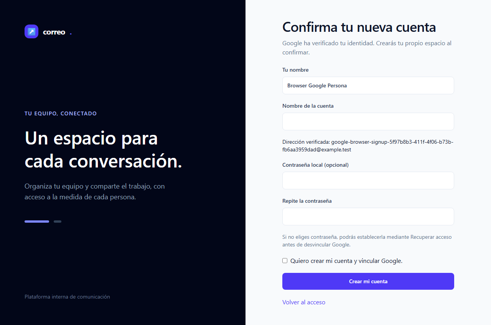
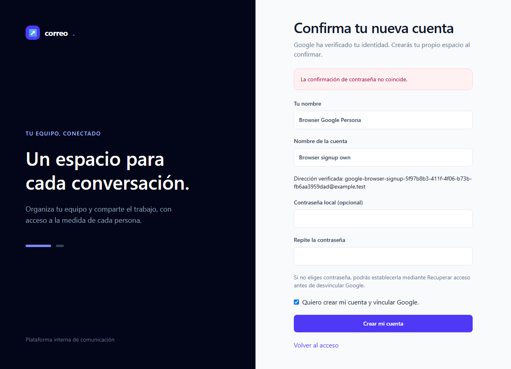
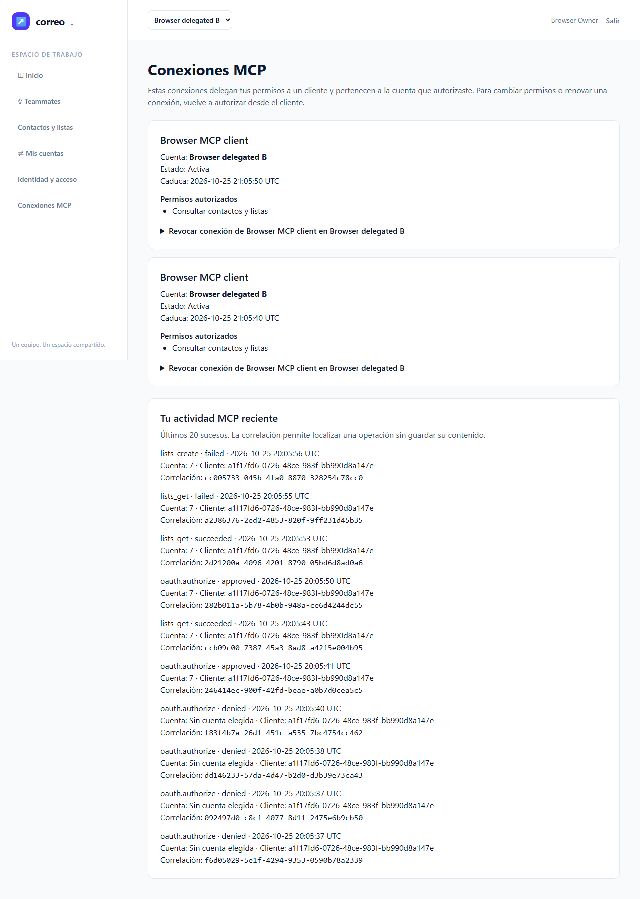
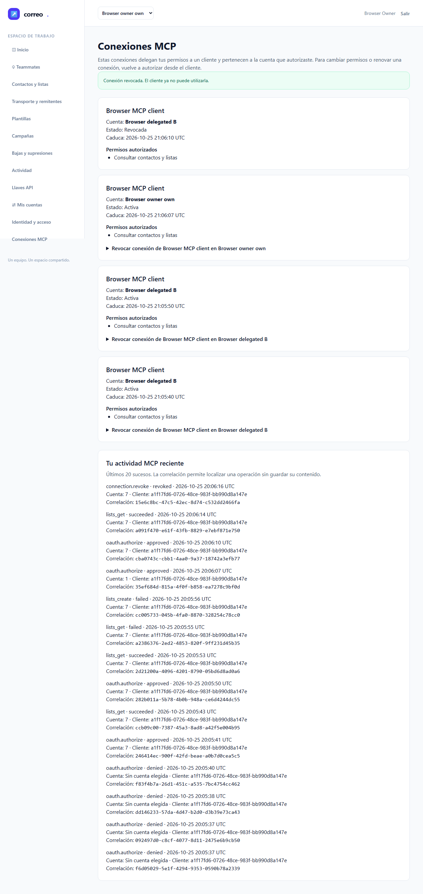
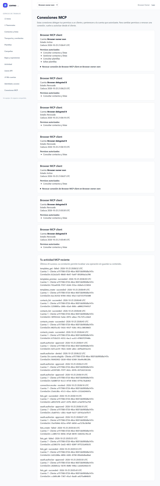

# Informe QA independiente — MCP T-08

| Dato | Evidencia |
|---|---|
| Fecha | 2026-10-25, UTC |
| Estado | **NO-VERDE**: 6/7 E2E; fallo de guardrail/infra con causa concreta no confirmada |
| URL | http://127.0.0.1:18967 |
| Perfil | PHP cli-server nativo, Chromium real, MySQL de testing; Google simulado sólo en el proveedor |
| Plan | [Test-plan](../../../../test-plan.md) · [Ledger](../../../../tasks.md) · [Spec](../../../../spec.md) |

## Veredicto determinista

Salida exacta de qa-gate sobre el JSON original de los siete E2E, exit 1:

```json
{
  "verdict": "NO-VERDE",
  "counts": {
    "passed": 6,
    "failed": 1,
    "flaky": 0,
    "skipped": 0,
    "interrupted": 0
  },
  "flaky_sin_justificar": [],
  "flaky_justificados": {},
  "threshold": "verde ⟺ 0 failed, 0 flaky sin justificar, 0 interrumpidos y ≥1 test ejecutado"
}
```

Salida exacta de qa-gate sobre la tanda separada de estabilidad de E2E-07, exit 0:

```json
{
  "verdict": "VERDE",
  "counts": {
    "passed": 3,
    "failed": 0,
    "flaky": 0,
    "skipped": 0,
    "interrupted": 0
  },
  "flaky_sin_justificar": [],
  "flaky_justificados": {},
  "threshold": "verde ⟺ 0 failed, 0 flaky sin justificar, 0 interrumpidos y ≥1 test ejecutado"
}
```

## Alcance y resultados

Seis escenarios pasan y E2E-01 falla, sin reintentos, flaky ni omitidos. E2E-07 pasa además tres repeticiones separadas mediante `--grep=E2E-07 --repeat-each=3`: son estabilidad de un escenario, no tres escenarios nuevos, y no convierten en verde la tanda fallida. Se conservaron ambos reporters JSON originales sin síntesis ni reserialización. No se reutilizaron pruebas ni capturas de desarrollo.

### Fallo E2E-01: evidencia y clasificación

El primer `page.goto('http://blocked.example.test/proxy-check')` del beforeEach falló con `net::ERR_TIMED_OUT` en `tests/e2e/mcp-google.spec.mjs:159:31`, antes de comprobar HTTP502 y antes de `page.goto('/login')`. Su flujo de identidad/aislamiento/retorno no se ejecutó. JUnit backend y los otros seis E2E no convierten ese recorrido en aprobado.

Clasificación por la ubicación del fallo: **guardrail/infra del arnés, causa concreta no confirmada**. El launcher liga denyProxy antes del setup SQL y arranca PHP después; el handler HTTP devuelve 502 sin resolver ni reenviar destinos y CONNECT se rechaza. Esa fuente exacta se extrajo del ZIP de fuentes ejecutado. No hay evidencia de request/counters del proxy que permita atribuir el timeout a una carrera, DNS, bypass, sandbox o producto; no se inventa una causa raíz ni se aumenta timeout/sleep ni se relaja el 502. Los seis beforeEach posteriores registraron HTTP502, HTTPS CONNECT rechazado y navegación local válida.

El reporter registra para E2E-01 inicio `2026-10-25T20:03:18.432Z` y duración 21178 ms; E2E-02 empezó a `20:04:45.471Z`. La tanda original tiene duración 284085.748 ms y 0 errores globales; esos tiempos no prueban la causa. Se conservan stack, call log, contexto original y dos capturas blancas idénticas. La configuración original tenía `trace:'off'`: no existe una traza Playwright y no se ha fabricado. [Error y fuente del test](raw/browser/E2E-01-error-context.md), [launcher ejecutado](raw/browser/runtime-source/google-browser-launch.mjs) y [configuración ejecutada](raw/browser/runtime-source/playwright.config.mjs).

| Tanda independiente | Casos | Aserciones | Fallos / errores / omitidos |
|---|---:|---:|---|
| McpContractArgumentsTest | 24 | Incluidas en JUnit de la tanda | 0 / 0 / 0 |
| McpWireInputsTest | 17 | Incluidas en JUnit de la tanda | 0 / 0 / 0 |
| McpConsentToolsTest | 9 | Incluidas en JUnit de la tanda | 0 / 0 / 0 |
| McpDataToolsTest | 10 | Incluidas en JUnit de la tanda | 0 / 0 / 0 |
| Total backend principal | **60** | **1410** | **0 / 0 / 0** |
| McpProtocolMetadataRegressionTest, tanda adicional | **2** | **215** | **0 / 0 / 0** |

Los conteos proceden de los elementos testcase del JUnit nativo, sin sumar ejecuciones de desarrollo. La regresión adicional se justifica por los cambios en controller/transporte y la preservación de metadata moderna frente a sesiones legacy. No se amplió a otras suites una vez cubierto ese riesgo.

Las veinte operaciones se verifican con servicios y transporte reales: contactos (5), listas (7), reportes de importación (2), plantillas (6). La integración cubre DTO cerrado, campos desconocidos, scopes y llamadas directas, IDs de otra cuenta, validación de dominio, retirada de consentimiento, cursor ligado a autoridad/filtros/operación, cambios del tamaño de página y presupuestos de respuesta. E2E-07 acredita el consentimiento de cuatro capacidades, descubrimiento de veinte herramientas, dos contactos sin duplicados en la continuación, preview con escape/sanitización, rechazo de account_id extra y auditoría web. La pantalla no sustituye los positivos/negativos de cada operación del backend.

Pirámide observada: 41 casos unitarios, 19 de integración en la tanda principal y 2 de regresión protocolaria; siete escenarios E2E (seis pasan, uno falla). No hay gate de porcentaje configurado y no se ha medido ni inventado cobertura de líneas.

## Puertas de entrada y guardas

Ledger-lint: exit 0, **0 incoherencias y 7 avisos** por Changelog futuro (T-08–T-14). Coverage-check: exit 0, **0 referencias rotas y 0 GWT sin cubrir**. Sus avisos T-01/T-02/T-09/T-10/T-13 corresponden a contrato, backend o revisión, fuera de la UI T-08; T-08 referencia E2E-07. La cobertura declarada de CA-10/11 incluye pruebas futuras y M-01–M-04 siguen pendientes: esta puerta estática no acredita su ejecución. No hay bloques API-xx/A11Y-xx en el test-plan, por lo que no se inventan smokes ni una auditoría WCAG.

Se aplicó capability-check para QA (API, datos, frontend, MCP y testing), con seis capacidades seleccionadas. No se halló constitución, AGENTS.md aplicable ni configuración dev.json. El inventario de extensiones no aportó una pieza pertinente disponible para sustituir QA. Se consultó GOT-012, estado legacy aceptada, para conservar bloqueo HTTP/HTTPS y bypass loopback. No hubo flakies que requirieran justificar o proponer memoria.

Git Bash no pudo inicializar su signal pipe (Win32 error 5). Se conservó ese límite y se validó nativamente el destino literal exacto, esquema HTTP, puerto, loopback y ausencia de credenciales/path/query/fragment; no se afirma éxito del shell. El spec exige HTTP externo 502, CONNECT HTTPS rechazado y navegación local válida; sólo seis escenarios acreditaron esa frontera en la tanda original. Chromium mantuvo `chromiumSandbox:true`, service workers bloqueados y el proxy que deniega salida. La creación de procesos del navegador se ejecutó con la elevación autorizada en el brief, sin relajar sandbox. No se descargó ni instaló nada.

El harness fijó APP_ENV testing, DB_DATABASE y DB_USERNAME emailing_testing, DB_URL vacío, sockets disponibles y Xdebug apagado. No se leyó configuración privada ni metadatos de proceso; no se consultó la base operativa, no se ejecutó Docker y el correo permaneció en log/array. Los nuevos helpers mantienen las mismas guardas de DB. La preparación tuvo un intento fallido por salida CP1252; se repitió con PYTHONUTF8=1, antes de iniciar pruebas. El fallo E2E-01 queda preservado; no se alteró producto ni tests para obtener verde.

## Resultados automáticos y capturas originales

Se inspeccionaron visualmente las 13 capturas finales existentes (11 de estados y dos blancos de fallo). Faltan las tres previstas de E2E-01 — login, dashboard y consentimiento — porque su flujo no se ejecutó; no se sustituyen por desarrollo ni se fabrican. En las capturas de estados: interfaz legible, errores seguros y datos ficticios de Browser; no se observaron secretos, códigos OAuth, verifiers, bearer, cursores, cuerpos privados ni rutas personales. Se muestran los estados capturados, sin atribuir juicio humano de M-02. E2E-04 ejercita foco de teclado y viewport estrecho; E2E-06 confirma el foco al revocar. Esto no acredita accesibilidad completa ni rendimiento medido. Las capturas públicas son copias byte a byte; originales y hashes constan en evidence.json.

### E2E-01 — Guardrail previo con timeout; flujo de producto no ejecutado — FALLA

Cubre T-03, T-11, T-12, T-14. Fallo en el guardrail previo; aserciones de producto no ejecutadas.


### E2E-02 — Callbacks inválidos y ciclo explícito de vínculo — PASA

Cubre T-03, T-12. Aserciones del escenario en verde a la primera.


### E2E-03 — Admisión, registro, invitación y alternativa local — PASA

Cubre T-03, T-12. Aserciones del escenario en verde a la primera.





### E2E-04 — Consentimiento, cuentas, scopes y CSRF — PASA

Cubre T-07, T-11, T-12, T-14. Aserciones del escenario en verde a la primera.


### E2E-05 — Bearer MCP y autoridad independientes de la selección web — PASA

Cubre T-07, T-12. Aserciones del escenario en verde a la primera.



### E2E-06 — Revocación, expiración y retirada de membresía — PASA

Cubre T-07, T-11, T-12, T-14. Aserciones del escenario en verde a la primera.



### E2E-07 — Veinte herramientas, keyset y preview seguro — PASA

Cubre T-08, T-12. Aserciones del escenario en verde a la primera.




## Limpieza atribuida

Tras PHPUnit se comprobó DB guardada, nivel transaccional cero y ausencia de seis tablas de dominio tras DatabaseMigrations. Después de cada tanda de navegador se identificó sólo el nuevo directorio de fixtures mediante comparación con una lista previa de nombres, sin leer owner/process/settlement. El chequeo SQL de sus manifiestos safe cleanup comprobó cero filas propias restantes en identidades, cuentas, grants, tokens, sesiones, códigos, admisión y datos de negocio; no mezcló runs ni modificó datos.

Siete E2E: recibo natural de cleanup del launcher **ausente; no se fabricó**. El globalTeardown tiene recibo exit 0 y el callback confirma su cierre; se verificó además bind exclusivo a 18967/18968/18743 tras terminar la tanda. Se acredita cierre de esos sockets y limpieza SQL propia; no se infiere ausencia de procesos a partir de ello.

Estabilidad E2E-07: recibo natural de cleanup del launcher **ausente; no se fabricó**. El globalTeardown tiene recibo exit 0 y el callback confirma su cierre; se verificó además bind exclusivo a 18967/18968/18743 tras terminar la tanda. Se acredita cierre de esos sockets y limpieza SQL propia; no se infiere ausencia de procesos a partir de ello.

## Checklist manual pendiente

- [ ] **M-01 — Google real en Laragon y Docker**: acceso, vínculo, admisión y retorno con credenciales del operador; proveedor simulado no lo sustituye.
- [ ] **M-02 — Claridad del consentimiento y conexiones**: aceptación humana de cliente, cuenta, capacidades, errores y teclado.
- [ ] **M-03 — Clientes reales, expiración y revocación**: Codex, Claude Code y OpenCode por versión; Claude Desktop separado. El cliente protocolario sintético no prueba esos productos.
- [ ] **M-04 — Reinicio, restauración y configuración**: perfiles reales, persistencia/revocación, recuperación y Mailpit/log.

## Trazabilidad y límites de aceptación

| Tarea | Evidencia de esta QA | Estado de cierre |
|---|---|---|
| T-08 | Backend principal y E2E-07, con estabilidad 3/3 | NO-VERDE global de QA1; aceptación pendiente |
| T-03 | E2E-01 falla antes del producto; E2E-02–03 pasan | Sin aceptar E2E-01; M-01 pendiente |
| T-07 | Regresión Consent y E2E-04–06 | M-02 pendiente |
| T-11/T-12/T-14 | Recorridos relacionados ya existentes | No equivale a cerrar esas tareas ni la iniciativa |

T-08 permanece en-progreso en el ledger. Este informe no cambia contadores ni estados, no declara verde global del roadmap y no acredita Google, clientes, Docker, TLS público, SMTP externo o restauración reales. No se envían mensajes externos ni se invoca documenter: la documentación final corresponde a una pasada al cierre de la iniciativa.

## Procedencia y evidencia

Cápsula de entrada: manifest SHA-256 `3dd94f1f020e06e0e64427f1ee8b622e5007c85ead0778d762711b517acfbf52`, base `08d51f9725ecbbdcf158d1ee18c82e18a35b40b4`. Coincidieron 1822 hashes y todas sus fuentes actuales; patch, base.zip y preflight registrado también se verificaron. No se leyeron los razonamientos de las lentes para formar este veredicto. El scope de desarrollo congelado no incluye todavía los nuevos entregables qa1; éstos están autorizados por el brief y el orquestador reconciliará su metadata después de recibir QA terminal.

Las ejecuciones conservaron 380 fuentes, manifiesto común SHA-256 `fe68bde6b717186554fbc546758a11792222d8508d96ae0a47e284d10371e28f`; cada recibo verifica streams, zip, command, guardas y ausencia de cambios. Los ZIP de fuentes quedan privados con sus hashes registrados. Los helpers y la adaptación privada de to-pdf están identificados por hash; la adaptación conserva sandbox, deniega cargas de red y embebe las copias originales. El PDF se renderiza y se verifica visualmente; no basta su existencia.

- [Evidencia consolidada y hashes](evidence.json).
- [JUnit backend original](raw/backend/backend-junit.xml) y [regresión metadata original](raw/protocol-regression/backend-junit.xml).
- [Reporter original siete E2E](raw/browser/playwright-results.json), [gate exacto](raw/browser/qa-gate.stdout.json).
- [Reporter original estabilidad](raw/stability/playwright-results.json), [gate exacto](raw/stability/qa-gate.stdout.json).
- [Ledger-lint exacto](raw/ledger-lint.stdout.txt), [coverage-check exacto](raw/coverage-check.stdout.txt), [guardrail](raw/guardrail.json).
- [Verificación visual del PDF](raw/pdf-visual-review.json) y [PDF](report.pdf).

Handoff NO-VERDE: el orquestador conserva esta tanda y coordina una reproducción mínima del guardrail antes de decidir una corrección o nueva QA. La causa concreta del timeout no está confirmada; no se ha identificado un defecto de producto a partir de ese síntoma ni se autoriza aceptación con un escenario fallido. Los cuatro manuales continúan pendientes humanos.
