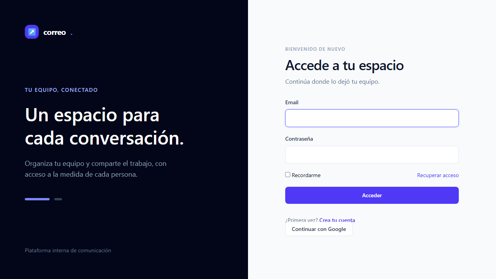
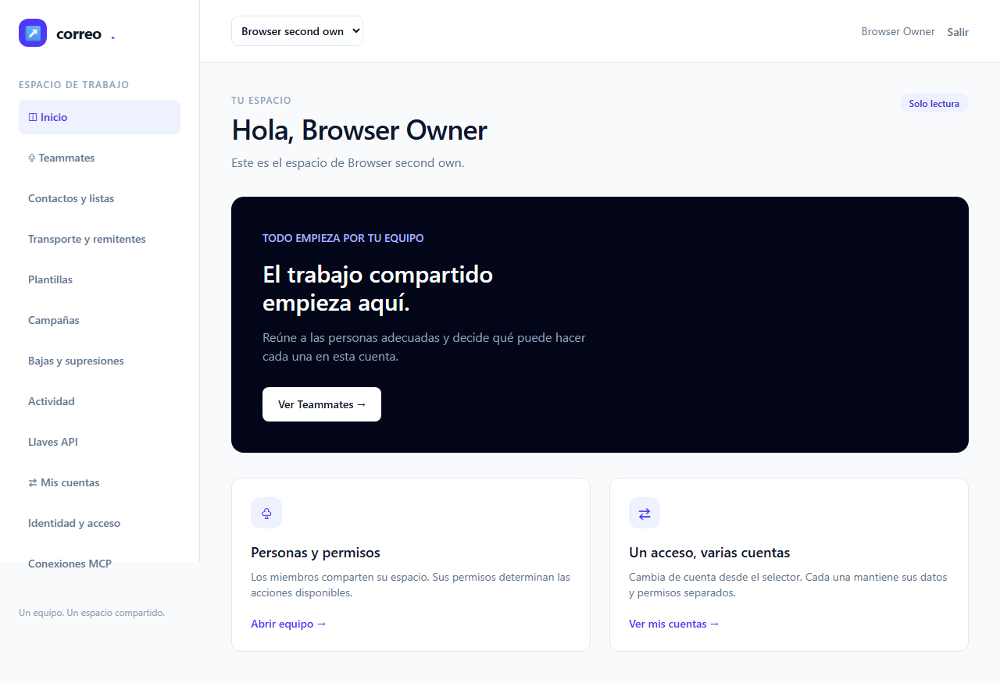
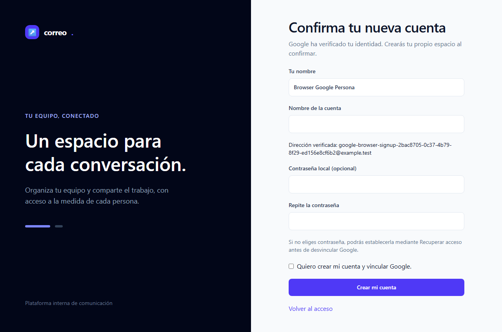
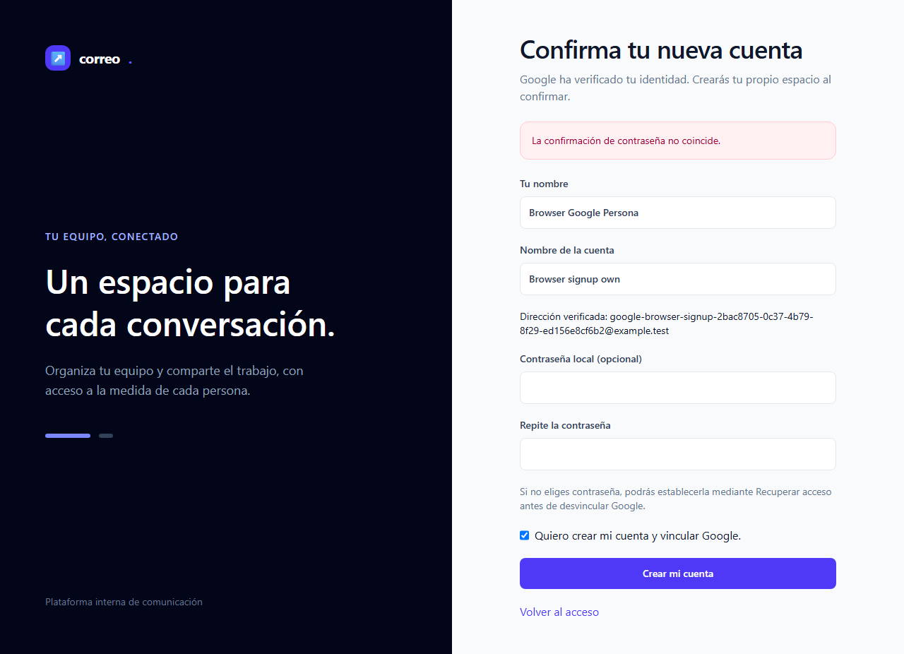
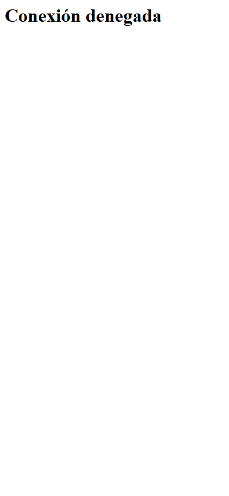
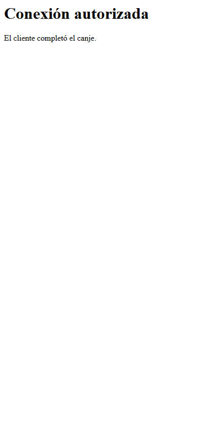
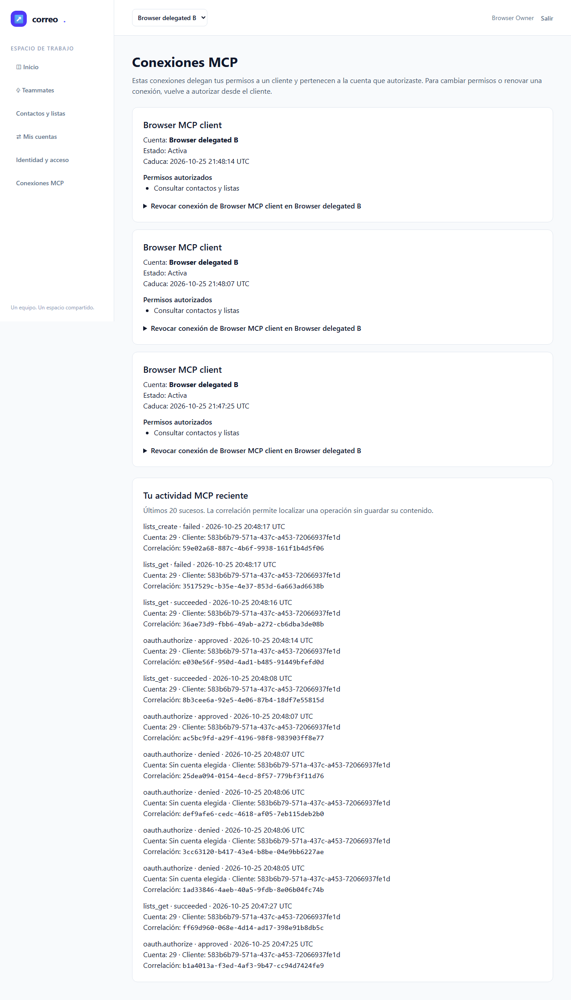
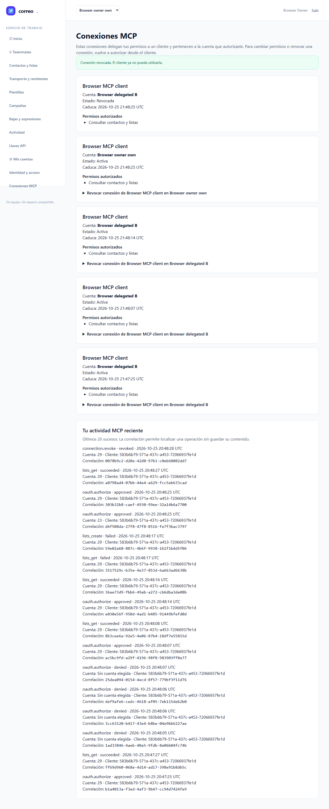
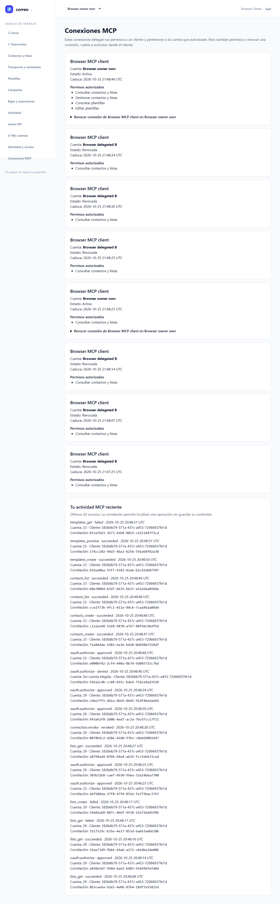

# QA2 independiente — T-08 MCP y Google

**VERDE de esta tanda: 7/7 E2E originales, al primer intento; 0 fallos, flaky, omitidos e interrupciones.** El resultado no cierra T-08 ni cambia el contador 7/14.

| Dato | Evidencia |
|---|---|
| Fecha | 2026-10-25 UTC |
| Perfil | PHP cli-server nativo, MySQL testing y Chromium real; Google simulado en el límite de proveedor |
| URL | http://127.0.0.1:18967 |
| Plan | [Test-plan](../../../../test-plan.md), [ledger](../../../../tasks.md), [spec](../../../../spec.md) |
| Fuentes | 380 idénticas a QA1 y cápsula; 1822 hashes congelados verificados |

## Veredicto determinista

Comando: `python <qa-kit>/qa-gate.py raw/browser/playwright-results.json`; exit **0**, sin justificaciones ni retry añadido. JSON exacto de la herramienta:

```json
{
  "verdict": "VERDE",
  "counts": {
    "passed": 7,
    "failed": 0,
    "flaky": 0,
    "skipped": 0,
    "interrupted": 0
  },
  "flaky_sin_justificar": [],
  "flaky_justificados": {},
  "threshold": "verde ⟺ 0 failed, 0 flaky sin justificar, 0 interrumpidos y ≥1 test ejecutado"
}
```

[Reporter JSON original](raw/browser/playwright-results.json) · [recibo original](raw/browser/playwright-json-receipt.json) · [recibo terminal](raw/browser/receipt.json). No se reconstruyeron resultados. Launcher, test y config originales sin modificar.

## Resultado por escenario

| Escenario | Resultado | Trazabilidad | Capturas originales |
|---|---|---|---|
| E2E-01 — Google: mismo usuario y retorno a consentimiento | PASS | T-03/T-11/T-12/T-14 | [google-login.png](screenshots/google-login.png), [google-dashboard.png](screenshots/google-dashboard.png), [google-real-consent.png](screenshots/google-real-consent.png) |
| E2E-02 — Callbacks negativos y vínculo explícito | PASS | T-03/T-12 | [google-profile.png](screenshots/google-profile.png) |
| E2E-03 — Admisión, registro, invitación y acceso local | PASS | T-03/T-12 | [google-confirmation.png](screenshots/google-confirmation.png), [google-correctable-registration.png](screenshots/google-correctable-registration.png) |
| E2E-04 — Cuenta/scopes y canje PKCE automático | PASS | T-07/T-11/T-12/T-14 | [mcp-limited-consent.png](screenshots/mcp-limited-consent.png), [mcp-consent-safe-error.png](screenshots/mcp-consent-safe-error.png), [mcp-denied.png](screenshots/mcp-denied.png), [mcp-client-connected.png](screenshots/mcp-client-connected.png) |
| E2E-05 — Frontera de cuenta y credenciales MCP | PASS | T-07/T-12 | [mcp-connections-and-audit.png](screenshots/mcp-connections-and-audit.png) |
| E2E-06 — Revocación, membresía, expiración y reautorización | PASS | T-07/T-11/T-12/T-14 | [mcp-revoked.png](screenshots/mcp-revoked.png) |
| E2E-07 — Veinte herramientas, continuidad y preview seguro | PASS | T-08/T-12 | [mcp-data-consent.png](screenshots/mcp-data-consent.png), [mcp-data-audit.png](screenshots/mcp-data-audit.png) |

Las aserciones del escenario E2E-07 verifican la enumeración de veinte operaciones, contactos paginados cambiando tamaño de página sin pérdidas/repeticiones, preview escapado/sanitizado, rechazo de account_id extra, auditoría y eliminación de recursos propios. Las capturas muestran consentimiento y auditoría; el resultado del reporter acredita las aserciones del test original. No se agregó smoke API-xx ni axe-core: el test-plan no los exige.

## Puertas, procedencia y límites

- ledger-lint: exit0, 0 incoherencias y 7 avisos de Changelog futuro. coverage-check(tasks,test-plan,spec): exit0, 0 referencias rotas y 0 GWT sin cubrir; avisa de cobertura declarada ausente en T-01/T-02/T-09/T-10/T-13, tareas de contrato, backend o revisión sin UI en el ledger, no escenarios UI omitidos. Salidas originales en [raw](raw/). La cobertura es trazabilidad de criterios, no cobertura de líneas.
- Guardrail local validado por comparación literal IPv4 loopback, esquema y puerto; no se atribuye ejecución Bash. Config conserva `chromiumSandbox:true`, denyProxy18968, callback18743 y trace off.
- La cápsula original tiene SHA-256 `3dd94f1f020e06e0e64427f1ee8b622e5007c85ead0778d762711b517acfbf52`; base `08d51f9725ecbbdcf158d1ee18c82e18a35b40b4`. [Verificación de entrada](raw/entry-verification.json).
- Las 380 fuentes no cambiaron durante la tanda ni respecto al manifiesto QA1 SHA-256 `fe68bde6b717186554fbc546758a11792222d8508d96ae0a47e284d10371e28f`. Backend **60/1410**, regresión protocolaria **2/215** y estabilidad separada E2E-07 **3/3** pertenecen a **QA1**, sobre estas mismas fuentes; QA2 no los repitió ni los suma a sus siete escenarios. [JUnit backend QA1](../qa1/raw/backend/backend-junit.xml), [JUnit protocolo QA1](../qa1/raw/protocol-regression/backend-junit.xml), [reporter estabilidad QA1](../qa1/raw/stability/playwright-results.json); [hashes y atribución](raw/reused-qa1-evidence.json).
- QA1 conserva **NO-VERDE 6/7** por timeout al comprobar HTTP502 del proxy antes del flujo de producto de E2E-01. La reproducción posterior no confirmó causa. QA2 pasa sin fix productivo, cambios de tests o relajación de seguridad; esto no demuestra que la causa histórica se haya corregido. [Informe QA1](../qa1/report.md).
- Sólo se ejercitó el perfil local nativo. Google real, Docker operativo, clientes reales, SMTP externo y cobertura de líneas no se acreditan. Mailpit/log y envío externo apagado. No se leyó configuración privada ni metadatos de procesos.

## Limpieza y terminal

La sesión87816 terminó naturalmente con exit0; el wrapper registró fuentes estables. El directorio propio se atribuyó mediante un único nombre UUID nuevo respecto al snapshot previo. GlobalTeardown y callback tienen recibos originales. **No existe recibo natural de cleanup del launcher**; no se inventa ni se afirma ausencia de procesos.

[Own SQL guardada](raw/browser-sql/stdout.txt): guard de testing aprobado, 21 categorías propias con cero filas y nivel transaccional0. [Binds exclusivos](raw/browser-sockets/stdout.txt): 18967/18968/18743 disponibles tras terminal. Sólo se consultaron manifiestos seguros del UUID propio; no hubo limpieza global.

## Checklist humana pendiente

- [ ] M-01: Google real en Laragon y Docker; identidad, vínculo, admisión y retorno.
- [ ] M-02: claridad del consentimiento/conexiones y aceptación humana con teclado.
- [ ] M-03: Codex, Claude Code y OpenCode reales; producto/versión, OAuth, expiración y revocación.
- [ ] M-04: reinicio/restauración aislada y configuración operativa de ambos perfiles.

El orquestador admite la evidencia y decide estados. QA2 no delega a documenter, no cierra T-08 ni publica en servicios externos.

## Capturas de esta tanda

Las 14 copias son idénticas por SHA-256 a los originales del run. Todas se inspeccionaron visualmente; los identificadores y example.test son sintéticos. En PDF son miniaturas orientativas; el PNG enlazado conserva resolución completa.

### E2E-01 — Google: mismo usuario y retorno a consentimiento






### E2E-02 — Callbacks negativos y vínculo explícito


### E2E-03 — Admisión, registro, invitación y acceso local






### E2E-04 — Cuenta/scopes y canje PKCE automático







### E2E-05 — Frontera de cuenta y credenciales MCP




### E2E-06 — Revocación, membresía, expiración y reautorización




### E2E-07 — Veinte herramientas, continuidad y preview seguro




