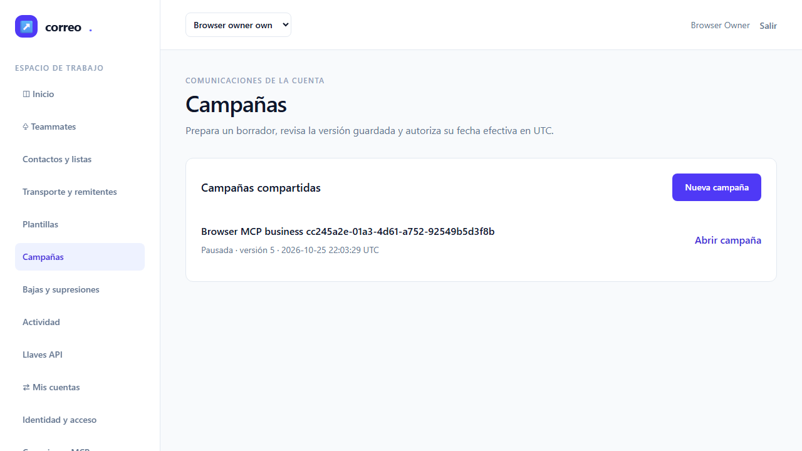
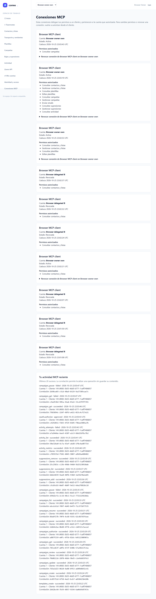

# T-09 — Implementación preparada, sin aceptación independiente

Fecha: 2026-10-25 UTC. La tarea permanece **en-progreso** y el contador MCP/Google sigue **8/14**. Este informe describe verificaciones del implementador; no es QA independiente ni cierra criterios o la iniciativa.

Se incorporan catorce operaciones: ocho de campañas, tres de actividad y tres de supresiones. El catálogo implementado alcanza 34 operaciones. Las tres de conexión/envío/estado de T-10 siguen pendientes; el contrato fijado de 37 no equivale a 37 implementadas.

| Verificación de desarrollo | Resultado | Alcance |
|---|---|---|
| Catálogo | 1 caso / 44 aserciones, exit0 | Las catorce operaciones publican el esquema y las anotaciones fijadas. |
| Backend ampliado, anterior al ajuste de fixture | 17 casos / 955 aserciones, exit0 | Flujo positivo de las catorce operaciones, cuentas y referencias ajenas, permisos mínimos/condicionales, versiones/estados, supresiones y consentimiento, rechazo de campos, UTC, continuidad de páginas y bytes. Sin fallos, errores u omitidos. |
| Revocación por MCP sobre el fixture admitido | 1 caso / 25 aserciones, exit0 | Sustituye el estado SQL artificial withdrawn por la operación contacts_update con revoked y comprueba que la supresión no restablece consentimiento. |
| Navegador original | 8/8, un intento por escenario, exit0 | Cero fallos, flaky, omitidos o interrupciones. E2E-08 crea un remitente desde la web, consiente capacidades, gestiona una campaña por MCP y verifica la misma campaña en la web. Una segunda conexión de lectura no obtiene contenido ni puede pausar. |
| qa-gate sobre el reporter original | VERDE, exit0 | Gate aplicado por el coordinador para la verificación de desarrollo; no atribuye QA independiente. |
| Cierre SQL propio | 28 categorías cero, tx0, exit0 | Guard exclusivo de testing; consulta de lectura del UUID propio. Incluye remitentes, configuración, campañas, revisiones, destinatarios y supresiones. |
| Puertos | 18967/18968/18743 disponibles | Bind exclusivo y cierre de cada socket; no infiere ausencia de procesos. |

Las tandas de catálogo, primera funcional de 12/688, ampliada de 17/955 y focal corregido de 1/25 se conservan separadas y no se suman. Después de las 17 pruebas y el navegador se corrigió únicamente el fixture de revocación en tests/Feature/McpBusinessToolsTest.php: usaba un estado SQL ajeno al catálogo; ahora revoca mediante contacts_update con revoked, el estado admitido. La nueva prueba focal pasa sobre las 398 fuentes actuales. Producto y E2E no cambiaron; la cápsula anterior de 17 casos y navegador difiere del árbol actual sólo en ese fichero de test. La QA independiente deberá ejecutar de nuevo la clase completa y las regresiones sobre las fuentes finales. Los hashes y procedencias están en [evidence.json](evidence.json).

Las herramientas reutilizan CampaignService, ActivityService y SuppressionService con contexto delegado explícito. Los conflictos de campaña conservan HTTP409 y sus mensajes para la web; MCP obtiene códigos tipados sin interpretar texto traducido. Las consultas de destinatarios, intentos y supresiones se comparten con sus pantallas. Los DTOs seleccionan campos públicos; no serializan modelos completos, rutas de artefactos ni credenciales.

Los cursores mantienen autoridad vigente, filtros normalizados y proyección paginada. Los destinatarios se ligan a una revisión inmutable; la continuación de review usa campaigns_get. Actividad usa orden SQL por fecha y clave opaca, conserva el intervalo UTC resuelto y escapa búsquedas literales. El límite se comprueba sobre el resultado SDK completo, incluidas ambas representaciones y el cursor real: las páginas cortadas conservan todas las filas y una revisión que no cabe se revierte antes de commit.

La negativa de broker reserva una dirección local sin listener y verifica el outbox pendiente sin envío alternativo, duplicar materialización o crear mensajes SMTP. La campaña sigue usando el pipeline común. Las métricas añaden la población MCP con cero registros mientras T-10 no introduzca su procedencia real; no se fabrican contactos, campañas ni llaves API para fingir envíos transaccionales.

La primera regresión común de 67/746 tuvo exit0 nativo pero el wrapper rechazó su captura porque Pint seguía activo en dos archivos. Se conserva como diagnóstico, no como prueba válida de las fuentes finales. Las regresiones comunes y MCP anteriores deben ejecutarse sobre el árbol final durante la QA independiente.

El navegador y sus callbacks terminaron naturalmente. Hay recibos de GlobalTeardown y callback, SQL propia y binds; no existe recibo natural de cleanup del launcher y no se inventa. No se leen metadatos de procesos ni configuración privada. El perfil es nativo local, Google simulado y cliente de laboratorio; no acredita Google real, Docker operativo, Codex, Claude Code, OpenCode ni M-01–M-04. SMTP externo permanece deshabilitado, con Mailpit/log. Tokens, coste y horas reales son desconocidos.

## Evidencia visual de E2E-08

