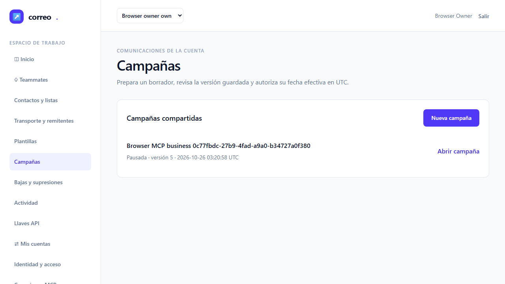

# QA2 independiente de MCP T-09

**NO-VERDE: falla la estabilidad de E2E-08.** Entrega a root para diagnóstico y corrección; no acepta T-09 ni cierra la iniciativa. QA1 conserva su propio resultado NO-VERDE.

| Ejecución separada | Productor | Casos | Aserciones | Fallos / errores / omitidos |
|---|---|---:|---:|---|
| Unit + Feature completos, sin filtro | Root, admisión independiente QA2 | 412 | 7967 | 0 / 0 / 0 |
| Subconjunto T-09 dentro de esa suite | Root, inventario QA2 | 151 | 3175 | 0 / 0 / 0 |
| Regresión dirigida corregida | QA2 | 8 | 85 | 0 / 0 / 0 |
| Ocho E2E originales | QA2 | 8 pasan | n/a | 0 / 0 / 0 |
| Estabilidad E2E-08 separada | QA2 | 1 pasa, 2 fallan | n/a | 2 / 0 / 0 |

El subconjunto **no se suma** a la suite completa. Tampoco se suman la regresión dirigida, los E2E y la estabilidad. No se atribuye cobertura de código porcentual: no hay dev.json con gate configurado. Fecha: 2026-10-26 UTC; fallback genérico fresco con modelo heredado, sin afirmar runtime Sonnet.

## Veredicto determinista y puertas

qa-gate oficial sobre el reporter JSON original de los ocho E2E, salida exacta:

```json
{
  "verdict": "VERDE",
  "counts": {
    "passed": 8,
    "failed": 0,
    "flaky": 0,
    "skipped": 0,
    "interrupted": 0
  },
  "flaky_sin_justificar": [],
  "flaky_justificados": {},
  "threshold": "verde ⟺ 0 failed, 0 flaky sin justificar, 0 interrumpidos y ≥1 test ejecutado"
}
```

qa-gate oficial sobre el reporter JSON original de estabilidad, salida exacta:

```json
{
  "verdict": "NO-VERDE",
  "counts": {
    "passed": 1,
    "failed": 2,
    "flaky": 0,
    "skipped": 0,
    "interrupted": 0
  },
  "flaky_sin_justificar": [],
  "flaky_justificados": {},
  "threshold": "verde ⟺ 0 failed, 0 flaky sin justificar, 0 interrumpidos y ≥1 test ejecutado"
}
```

Los ocho casos originales pasaron al primer intento. En estabilidad, la primera repetición pasó y la segunda y tercera fallaron, todas con retry0; no se reejecutó ningún caso tras el fallo. Antes de la tanda válida hubo un intento del adaptador que seleccionó cero casos y salió1: su ancla inicial no coincidía con el título compuesto de Playwright. Se conserva íntegro en raw/stability-selection, con gate NO-VERDE, sin contarlo como estabilidad ni fallo de producto. El listado nativo posterior acreditó exactamente tres repeticiones de un único título original antes de ejecutarlas. Se conservan ambos adaptadores y hashes; sólo se corrigió esa selección del arnés. No se alteraron producto, tests, baseline, timeout, reintentos, configuración, contratos o criterios. Los reporters no son síntesis. La adaptación privada de estabilidad sólo añade el sufijo del título exacto actual de E2E-08 y `--repeat-each=3` al helper original; diff y hashes quedan en raw/stability.

### Fallo observado de estabilidad

Las dos repeticiones fallidas reciben HTTP200 en `contacts_create`, pero `result.isError` es true frente al false esperado en tests/e2e/mcp-google.spec.mjs:516, invocación de línea522. El reporter no conserva la respuesta de negocio: **el código cerrado del error no está disponible**. No se vuelca un payload privado ni se inventa un código.

La fuente de línea522 construye `business-recipient-${data.run}@example.test`; fixture() relee un fixture común (línea50), y finally562–565 dispone clientes sin eliminar el contacto. Para el UUID atribuido a la tanda válida, la identidad calculada de esa expresión es `business-recipient-abf0c416-af72-42a8-8065-17830b19a8e5@example.test`. Es una derivación de fuente y manifiesto propio, no un payload runtime registrado. La posible reutilización entre repeticiones es una **hipótesis de aislamiento**, pendiente de probar; no se atribuye todavía una causa de producto. El reporter original conserva los tres startTime distintos y ambos errores exactos. Root hará la corrección bajo un ciclo nuevo de fix/revisión/QA; QA2 no aplica cambios ni nuevos focos de diagnóstico.

Ledger-lint exit0: cero incoherencias y seis avisos de Changelog pendientes T-09–14. Coverage-check exit0: cero referencias rotas y cero GWT sin cubrir; avisos T-01/02/10/13 corresponden a tareas de contrato/backend/revisión, no nuevas tareas de UI huérfanas. T-09 enlaza E2E-08. Scope-check exit0, sin rutas fuera de alcance, criterios alterados ni exclusiones; contrato MCP exit0: 37 operaciones fijadas, 34 implementadas hasta T-09. Las tres de T-10 siguen pendientes. No hay bloques API-xx/A11Y-xx adicionales en el plan.

Root identificó una errata documental pendiente en Archivos de T-09: la ruta de McpTransportTest empieza con tabulador y `ests/` en vez de `tests/`. QA2 no modifica el ledger. El archivo real sí forma parte de las399 fuentes y sus pruebas fueron ejecutadas y admitidas; la corrección de metadata y revalidación final corresponden a root tras liberar runtime.

## Admisión del backend completo

La ejecución completa sigue siendo de **root**. QA2 verificó independientemente el recibo terminal/exit0, streams originales, manifiesto y cada miembro del ZIP, JUnit, helpers ejecutados y el inventario de métodos con sus traits y data providers. Sus 399 fuentes coinciden con el árbol vigente y la cápsula revisada. La cápsula se verifica con exclusión por nombre de los artefactos prohibidos; sus cuerpos no se abrieron. Las diferencias posteriores admitidas son metadata documental.

Inventario T-09 entero dentro del JUnit completo (11 clases):

| Clase | Casos | Aserciones | Fallos / errores / omitidos |
|---|---:|---:|---|
| McpContractArgumentsTest | 24 | 24 | 0 / 0 / 0 |
| McpWireInputsTest | 17 | 27 | 0 / 0 / 0 |
| ActivityTest | 20 | 247 | 0 / 0 / 0 |
| CampaignTest | 26 | 302 | 0 / 0 / 0 |
| ConcurrentCampaignTest | 5 | 32 | 0 / 0 / 0 |
| McpBusinessToolsTest | 17 | 959 | 0 / 0 / 0 |
| McpConsentToolsTest | 9 | 146 | 0 / 0 / 0 |
| McpDataToolsTest | 10 | 1213 | 0 / 0 / 0 |
| McpTransportTest | 1 | 12 | 0 / 0 / 0 |
| MigrationReplayTest | 6 | 48 | 0 / 0 / 0 |
| SuppressionTest | 16 | 165 | 0 / 0 / 0 |

McpBusinessToolsTest conserva sus 17 casos finales y 959 aserciones. McpTransportTest aporta aquí únicamente el focal moderno/legacy/revocación; sus 15 casos completos están en el total de 412. El inventario de 41 clases y todos los nombres de casos/datasets se conservan en [admisión del backend completo](raw/full-backend-admission.json), junto al JUnit y streams originales en raw/full-backend.

## Regresión propia y restauración histórica

| Grupo dirigido QA2 | Casos | Aserciones |
|---|---:|---:|
| MigrationReplayTest completo, incluidos tres datasets | 6 | 48 |
| Histórico ActivityTest que falló en QA1 | 1 | 25 |
| Discovery moderno, inicialización legacy y revocación | 1 | 12 |

JUnit propio: ocho casos, tres clases, 85 aserciones, cero fallos/errores/omitidos. La guarda verifica DATABASE()/CURRENT_USER() como emailing_testing antes de migrar; APP_ENV=testing, DB_URL vacío, sockets habilitados y Xdebug apagado. El wrapper copia/hash de sus fuentes y fija T16_EVIDENCE_DIRECTORY al run propio.

La ventana histórica propia `a6281c64-a797-4db0-877f-8484aadae377` conserva **20 snapshots de progreso inmutables más el final**: diez down descendentes y diez up ascendentes, fuentes de cada migración verificadas, pasos completados y restored=true sin error primario. Los snapshots de progreso no tienen flag restored final. Los tests de writer inyectado conservan sus aserciones y no escriben todos los snapshots en disco; el caso de publicación inmutable limpia sus cinco archivos. Tx0 y teardown se distinguen de esta restauración acreditada. [JUnit y ventana propios](raw/backend/admission.json).

QA1 mantiene 144 casos/3092 aserciones, un error y ningún navegador/estabilidad. Su resultado no se convierte en aceptación. Las tandas de desarrollo anteriores y la diagnóstica 67/746 descartada no se usan para esta calificación.

## Navegador, aislamiento y limpieza

Chromium existente con sandbox, PHP cli-server nativo y MySQL exclusiva de testing; destino http://127.0.0.1:18967, callback18743 y denyProxy18968. El guardrail valida el literal IPv4 loopback. Cada escenario prueba bloqueo HTTP502 y HTTPS CONNECT, y navegación local real; se bloquean service workers. Google es simulado sólo en el límite del proveedor. Cliente MCP protocolario real del laboratorio, no Codex/Claude Code/OpenCode reales. Envío exclusivo Mailpit/log; SMTP externo apagado; sin cambios operativos de Docker o volúmenes.

Cada tanda se atribuye por un único UUID nuevo frente a un inventario previo sólo de nombres de directorio. Tras su terminal natural, la SQL de lectura con guarda verificó **28 categorías propias en cero y tx0**, con IDs de sus propios manifiestos de recursos. Los tres puertos admiten bind exclusivo después de cada tanda. Callback cerrado y teardown SQL nativo exit0 en ambas tandas. No se infiere ausencia global de procesos.

- browser: `storage/mcp-google-phase3/browser-0c77fbdc-27b9-4fad-a9a0-b34727a0f380`. Recibo natural de cleanup del launcher presente: **no**.
- stability: `storage/mcp-google-phase3/browser-abf0c416-af72-42a8-8065-17830b19a8e5`. Recibo natural de cleanup del launcher presente: **no**.

Si falta ese recibo del launcher, se declara ausente: el recibo terminal del harness, el callback cerrado, teardown SQL, comprobación SQL propia y binds son evidencias distintas y no lo sustituyen ni lo inventan.

## Escenarios y evidencia visual

Se inspeccionaron las 17 capturas originales de la tanda completa y las siete de estabilidad (incluidas dos capturas automáticas del fallo), con originales largos de auditoría revisados a resolución original. No se observan credenciales visibles ni superposiciones en el flujo de negocio. Algunas capturas de formularios/consentimientos largos conservan una posición parcial del scroll: documentan ese estado y no acreditan toda la pantalla en una imagen. Son datos sintéticos. Esta inspección no reemplaza M-02 ni acredita accesibilidad completa. No se realizó comparación contra una baseline visual.

| Escenario | Resultado | Capturas originales inspeccionadas |
|---|---|---|
| E2E-01 | Pasa al primer intento | [01-google-dashboard.png](screenshots/browser/01-google-dashboard.png) · [02-google-login.png](screenshots/browser/02-google-login.png) · [03-google-real-consent.png](screenshots/browser/03-google-real-consent.png) |
| E2E-02 | Pasa al primer intento | [04-google-profile.png](screenshots/browser/04-google-profile.png) |
| E2E-03 | Pasa al primer intento | [05-google-confirmation.png](screenshots/browser/05-google-confirmation.png) · [06-google-correctable-registration.png](screenshots/browser/06-google-correctable-registration.png) |
| E2E-04 | Pasa al primer intento | [07-mcp-client-connected.png](screenshots/browser/07-mcp-client-connected.png) · [08-mcp-consent-safe-error.png](screenshots/browser/08-mcp-consent-safe-error.png) · [09-mcp-denied.png](screenshots/browser/09-mcp-denied.png) · [10-mcp-limited-consent.png](screenshots/browser/10-mcp-limited-consent.png) |
| E2E-05 | Pasa al primer intento | [11-mcp-connections-and-audit.png](screenshots/browser/11-mcp-connections-and-audit.png) |
| E2E-06 | Pasa al primer intento | [12-mcp-revoked.png](screenshots/browser/12-mcp-revoked.png) |
| E2E-07 | Pasa al primer intento | [13-mcp-data-audit.png](screenshots/browser/13-mcp-data-audit.png) · [14-mcp-data-consent.png](screenshots/browser/14-mcp-data-consent.png) |
| E2E-08 | Pasa al primer intento | [15-mcp-business-audit.png](screenshots/browser/15-mcp-business-audit.png) · [16-mcp-business-campaigns.png](screenshots/browser/16-mcp-business-campaigns.png) · [17-mcp-business-consent.png](screenshots/browser/17-mcp-business-consent.png) |

Estabilidad E2E-08: tres resultados nativos con startTime distintos, retry0; uno pasa y dos fallan. El reporter no expone repeatEachIndex; no se sintetiza un índice. Siete capturas originales en [su inventario](raw/stability/admission.json).





## Manuales y puertas pendientes

- [ ] **M-01:** Google real en Laragon y Docker, con identidad autorizada y evidencia sanitizada por perfil.
- [ ] **M-02:** una persona confirma claridad de consentimiento, estados, teclado y gestión de conexiones.
- [ ] **M-03:** Codex, Claude Code y OpenCode reales con versión, registro, llamadas permitidas/denegadas, expiración y revocación; Claude Desktop en fila separada.
- [ ] **M-04:** reinicio/restauración aislada y configuración operativa de ambos perfiles, sin reactivar credenciales.

T-10–14 y las puertas globales de T-19/T-20 conservan su alcance. QA2 NO-VERDE no acredita Google real, clientes reales, perfiles completos Docker/Laragon, restauración global, auditoría completa de seguridad ni cierre de la iniciativa. Root conserva aceptación técnica, ledger, commits y publicación; no se ha llamado a documenter, Curator, Jira o Confluence.

## Integridad, privacidad y métricas

La revisión de privacidad usa exclusivamente `privacy-selection.py` y sus reglas públicas para las copias concretas. Excluye por nombre los artefactos prohibidos sin leer cuerpos y rechaza cambios en ellos. No compara valores secretos privados ni certifica el historial Git. No se abrieron configuraciones privadas, request/owner/process/settlement ni los dos artefactos prohibidos, tampoco dentro de cápsulas. Fuentes ZIP y helpers completos quedan privados con hashes; sólo se copian originales permitidos e idénticos por SHA256. El manifiesto de evidencia distingue los diagnósticos derivados de los resultados nativos.

Capability-check aplicó api-contract, backend-practices, delivery-practices, frontend-quality, stack-practices y unit-tests. Memoria consultada por el servicio: GOT-011 y GOT-012, legado aceptado, aplicados a orden de migración y frontera de red; sin escritura de memoria. No hay Constitución local. El PDF se obtiene con to-pdf existente, adaptación privada que conserva sandbox, deniega red y embebe tres imágenes sin editarlas; se renderiza e inspecciona cada página antes de entrega.

Se perdió el handle de observación del preparador **estático**; su entry-gates.json terminal natural conserva todos los exits y hashes. No ejecutaba app/DB/browser ni fue reiniciado. Los handles nativos de backend, navegador y demás ejecuciones propias se conservan hasta terminal; no se inventan IDs de procesos ni recibos ausentes.

El medidor abierto por root sigue bajo su propiedad y no se ha cerrado ni duplicado. Tokens, coste y horas IA reales son desconocidos; no se leen transcripciones ajenas. Las duraciones observadas de los runs son tiempo de pared, no horas de trabajo IA. [Plan de pruebas](../../../../test-plan.md) y [ledger](../../../../tasks.md) permanecen bajo control de root.

## Puntos de verificación

- Backend completo (root): `storage/mcp-google-phase3-fix1-root/runs/t09-full-regression-20261025T234223798960Z`; recibo SHA256 `006c0a2f5a3f3daa97053edd6fad8ce14d8a6f8b67ec144d3ce11e8254fe17d3`.
- Backend propio: `storage/mcp-google-phase3-fix1-root/runs/t09-qa2-backend-20261026T030958456205Z`; recibo SHA256 `3a5fdbf1db6582bc163c2312f5cb8267a27128adeae21f6f2d9fa9365f768a40`.
- E2E originales: `storage/mcp-google-phase3-fix1-root/runs/t09-qa2-browser-20261026T031426438728Z`; recibo SHA256 `559afd4622a7c8b2b6504528cf432437557b1bb9acb951c8e54fa00b592bb218`.
- Estabilidad separada: `storage/mcp-google-phase3-fix1-root/runs/t09-qa2-stability-valid-20261026T032909364070Z`; recibo SHA256 `53468dc95d201bde44a853f16ac0efd1c59b8181ff3fc240bb49b2663765e57a`.

Los hashes de report.md, report.pdf y evidence.json se entregan en raw/final-hashes.json. El detalle nativo, fuentes, gates, capturas y procedencia se conserva en evidence.json y raw/. Root cerrará el medidor tras admitir esta entrega.
