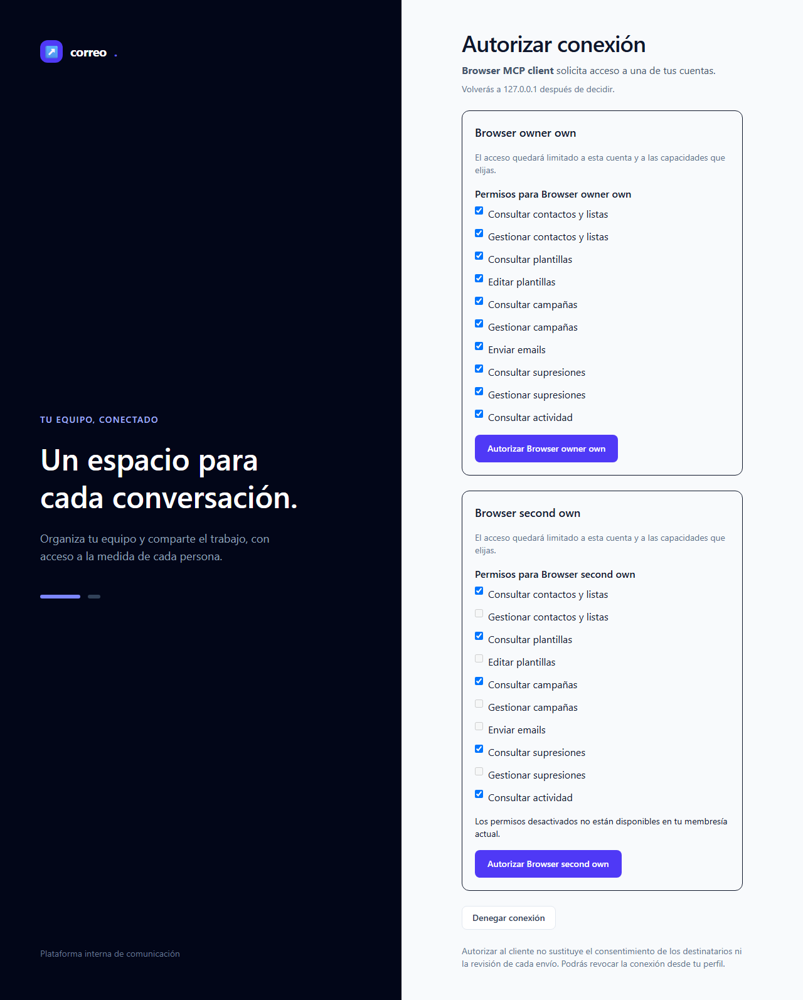
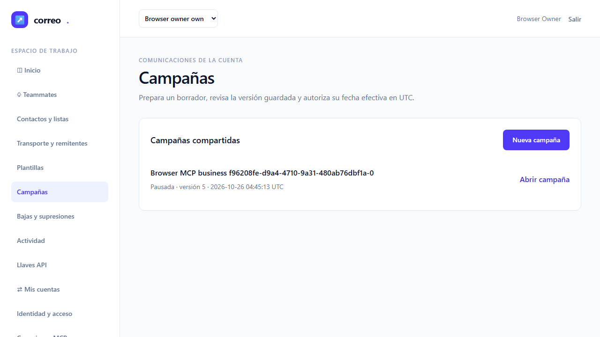

# QA3 independiente de MCP T-09

**VERDE incremental:** los dos qa-gates oficiales pasan. Esta entrega aporta evidencia del incremento T-09 dentro del laboratorio local; root conserva la aceptación técnica y el cierre del ledger. QA1 y QA2 conservan sus resultados NO-VERDE. Fecha: 2026-10-26 UTC. Rol qa del paquete custom-agents 2.0.0, fallback genérico fresco con modelo heredado; no se afirma ejecución de Sonnet.

| Evidencia separada | Productor | Casos | Aserciones | Fallos / errores / omitidos |
|---|---|---:|---:|---|
| Unit + Feature completos, sin filtro | Root; admisión independiente QA3 | 412 | 7967 | 0 / 0 / 0 |
| Subconjunto T-09 incluido en esa suite | Root; inventario QA3 | 151 | 3175 | 0 / 0 / 0 |
| Regresión dirigida histórica | QA2; admisión independiente QA3 | 8 | 85 | 0 / 0 / 0 |
| Ocho E2E originales | QA3, ejecución propia | 8 pasan | n/a | 0 / 0 / 0 |
| Estabilidad separada E2E-08 | QA3, ejecución propia | 3 pasan | n/a | 0 / 0 / 0 |

Los resultados solapados no se suman. No hay porcentaje de cobertura de código configurado; no se inventa. No se volvió a ejecutar PHP: sus 398 fuentes pertinentes son idénticas y la única diferencia entre las 399 entradas del backend anterior y el árbol actual es el E2E aprobado. Los tres casos de T-10 siguen pendientes: el catálogo actual es 34 de 37 operaciones, incluidas las 14 de negocio de T-09.

## Veredicto determinista

qa-gate oficial sobre el reporter JSON original de los ocho E2E; salida exacta, exit0:

```json
{
  "verdict": "VERDE",
  "counts": {
    "passed": 8,
    "failed": 0,
    "flaky": 0,
    "skipped": 0,
    "interrupted": 0
  },
  "flaky_sin_justificar": [],
  "flaky_justificados": {},
  "threshold": "verde ⟺ 0 failed, 0 flaky sin justificar, 0 interrumpidos y ≥1 test ejecutado"
}
```

qa-gate oficial sobre el reporter JSON original de la tanda separada de estabilidad; salida exacta, exit0:

```json
{
  "verdict": "VERDE",
  "counts": {
    "passed": 3,
    "failed": 0,
    "flaky": 0,
    "skipped": 0,
    "interrupted": 0
  },
  "flaky_sin_justificar": [],
  "flaky_justificados": {},
  "threshold": "verde ⟺ 0 failed, 0 flaky sin justificar, 0 interrumpidos y ≥1 test ejecutado"
}
```

Todos pasan al primer intento, retry0; sin omisiones, flaky ni justificaciones. El listado nativo previo seleccionó exactamente tres repeticiones del único título E2E-08 usando sufijo de título y repeat-each3; no se cuenta como ejecución funcional. Se conservan comando, streams, diff y hashes del adaptador privado. No se modificaron tests, producto, timeouts, retries, configuración, criterios ni baselines durante QA3.

## Puertas y alcance

Ledger-lint exit0: cero incoherencias y seis avisos de Changelog en T-09–14. Coverage-check exit0: cero referencias rotas, cero GWT sin cubrir y cero tests sin referencia; sus avisos T-01/02/10/13 son contrato, backend y revisión, sin nueva UI huérfana. T-09 enlaza E2E-08. No hay bloques API-xx/A11Y-xx en el plan ni gate porcentual configurado. Las ocho puertas estáticas de entrada de root se admiten por su recibo; QA3 ejecutó sus propios ledger-lint, coverage-check y privacidad antes del runtime y los repite al cierre.

Capability-check seleccionó api-contract, backend-practices, delivery-practices, frontend-quality, stack-practices y unit-tests para mcp/api/data/frontend/testing. Se aplicaron las referencias pertinentes y la disciplina de lectura. No hay Constitución local. El inventario de extensiones no acredita herramientas activas. **Desviación de alcance de lectura:** el preparador ejecutó project-pieces sin limitarlo al proyecto; el helper leyó indirectamente configuración de usuario completa antes de proyectar la salida a metadatos. La salida y las rutas personales permanecen privadas. No se inspeccionaron manualmente los archivos de configuración; se desconoce si el helper cargó internamente valores privados, y no se reabrirán para comprobarlo. Esta desviación y su helper/comando/hash exactos se entregan privadamente a root para admisión.

Memoria consultada exclusivamente mediante vista local, sin índice ni red: GOT-012 aceptado sobre frontera de red, recuperación **parcial**, complete=false/unknown_state. Un primer comando incompatible con --view terminó2 y se conserva en privado; se corrigió la consulta, no la memoria. No se escribió ni promovió memoria ni se atribuye una búsqueda exhaustiva.

## Backend admitido independientemente

QA3 verificó originales completos: recibo terminal0, streams, cada miembro del ZIP privado y su inventario sources.json, helpers capturados y JUnit con métodos/data providers. Se contrastó el inventario de 41 clases y los métodos públicos, incluidos traits. Los originales mantienen 412 casos/7967 aserciones, cero fallos/errores/omitidos. El ZIP de fuentes permanece privado, con su SHA256 en el recibo público.

Se verificaron los 2249 miembros de la cápsula de revisión3 y sus hashes. Las fuentes actuales coinciden con la cápsula revisada; la diferencia posterior es metadata del ledger admitida por root. Frente al backend anterior, se admiten exactamente 398 entradas idénticas y el único E2E distinto: el patch fix2 se reconstruyó byte a byte. Sólo añade scenarioRun con UUID+repeatEachIndex a cuatro etiquetas; normalizar esas etiquetas recupera íntegramente el original. Permanecen 138 expresiones expect y ocho declaraciones test. No se detectó preocupación nueva que justificase rerun PHP.

| Subconjunto T-09 incluido | Casos | Aserciones |
|---|---:|---:|
| McpContractArgumentsTest | 24 | 24 |
| McpWireInputsTest | 17 | 27 |
| ActivityTest | 20 | 247 |
| CampaignTest | 26 | 302 |
| ConcurrentCampaignTest | 5 | 32 |
| McpBusinessToolsTest | 17 | 959 |
| McpConsentToolsTest | 9 | 146 |
| McpDataToolsTest | 10 | 1213 |
| McpTransportTest | 1 | 12 |
| MigrationReplayTest | 6 | 48 |
| SuppressionTest | 16 | 165 |

McpTransportTest aporta aquí sólo el focal moderno/legacy/revocación; sus 15 casos completos permanecen dentro de los 412. McpBusinessToolsTest conserva 17/959. [Inventario íntegro, originales y admisión](raw/full-backend/admission.json).

La regresión QA2 8/85 se admite separadamente desde su recibo, ZIP, streams y JUnit, no sólo desde su resumen. Incluye MigrationReplayTest6/48, histórico ActivityTest1/25 y transporte1/12. Sus 20 snapshots de progreso inmutables más final acreditan diez down descendentes y diez up ascendentes, fuentes de migración verificadas, pasos completos, restored=true y sin error primario. Los snapshots de progreso no se presentan como finales. [Admisión y originales QA2](raw/qa2-backend/admission.json). Esta evidencia es de QA2; no es una ejecución nueva QA3.

QA1 sigue NO-VERDE144/3092 por el error histórico de snapshots, sin navegador. QA2 sigue NO-VERDE: originales8/8, estabilidad válida1/3; su intento previo de selección0 casos fue error privado del adaptador, separado del producto. El código cerrado de los dos errores históricos no estaba en su reporter. El experimento causal2/25 y las tandas de desarrollo de fix2 son de root, y no sustituyen las ejecuciones propias de QA3.

## Runtime y limpieza atribuida

Destino http://127.0.0.1:18967; callback18743 y denyProxy18968. Chromium existente, sandbox=true, service workers bloqueados, un worker y timeout60000. Guardrail estricto de loopback antes de ambas tandas; los escenarios verifican bloqueo HTTP/HTTPS y acceso local efectivo. MySQL real exclusiva emailing_testing, APP_ENV=testing, DB_URL vacío, Xdebug apagado y TestingDatabaseGuard verifica DATABASE()/CURRENT_USER() antes de migrar. Sólo Mailpit/log; sin SMTP externo, Docker, base operativa o limpieza global.

Cada tanda se atribuye por un único directorio browser-UUID nuevo frente a inventario previo sólo de nombres; se leen exclusivamente sus manifiestos de recursos permitidos. Después de cada terminal, una SQL propia de sólo lectura verificó **28 categorías propias en cero y tx0**. Los tres puertos admiten bind exclusivo tras cada tanda. Callback cerrado y teardown SQL nativo exit0 en ambas.

- browser: `storage/mcp-google-phase3/browser-f96208fe-d9a4-4710-9a31-480ab76dbf1a`. Recibo natural cleanup del launcher presente: **no**.
- stability: `storage/mcp-google-phase3/browser-e9006081-e89f-4497-a04e-fadfb32e06c4`. Recibo natural cleanup del launcher presente: **no**.

La ausencia de recibo natural del launcher se declara ausente. El recibo terminal del harness, callback cerrado, SQL0 y binds son evidencias distintas; no prueban ausencia global de procesos. Se conservaron y pollearon los mismos handles nativos hasta terminal, sin reinicios por timeout ni IDs inventados.

## Resultados y capturas inspeccionadas

QA3 inspeccionó realmente las 17 capturas originales de la tanda completa y las nueve de estabilidad, incluidas auditorías largas a resolución original. No se observaron credenciales, texto ilegible, solapamientos o errores visuales en los estados capturados. Los formularios largos pueden mostrar una posición parcial del scroll: no acreditan toda la página, accesibilidad completa o claridad humana. Sin comparación de baseline ni actualización de snapshots.

| Escenario | Resultado | Evidencia original inspeccionada |
|---|---|---|
| E2E-01 | Pasa al primer intento | [01-google-dashboard.png](screenshots/browser/01-google-dashboard.png) · [02-google-login.png](screenshots/browser/02-google-login.png) · [03-google-real-consent.png](screenshots/browser/03-google-real-consent.png) |
| E2E-02 | Pasa al primer intento | [04-google-profile.png](screenshots/browser/04-google-profile.png) |
| E2E-03 | Pasa al primer intento | [05-google-confirmation.png](screenshots/browser/05-google-confirmation.png) · [06-google-correctable-registration.png](screenshots/browser/06-google-correctable-registration.png) |
| E2E-04 | Pasa al primer intento | [07-mcp-client-connected.png](screenshots/browser/07-mcp-client-connected.png) · [08-mcp-consent-safe-error.png](screenshots/browser/08-mcp-consent-safe-error.png) · [09-mcp-denied.png](screenshots/browser/09-mcp-denied.png) · [10-mcp-limited-consent.png](screenshots/browser/10-mcp-limited-consent.png) |
| E2E-05 | Pasa al primer intento | [11-mcp-connections-and-audit.png](screenshots/browser/11-mcp-connections-and-audit.png) |
| E2E-06 | Pasa al primer intento | [12-mcp-revoked.png](screenshots/browser/12-mcp-revoked.png) |
| E2E-07 | Pasa al primer intento | [13-mcp-data-audit.png](screenshots/browser/13-mcp-data-audit.png) · [14-mcp-data-consent.png](screenshots/browser/14-mcp-data-consent.png) |
| E2E-08 | Pasa al primer intento | [15-mcp-business-audit.png](screenshots/browser/15-mcp-business-audit.png) · [16-mcp-business-campaigns.png](screenshots/browser/16-mcp-business-campaigns.png) · [17-mcp-business-consent.png](screenshots/browser/17-mcp-business-consent.png) |

Las tres repeticiones E2E-08 tienen resultados nativos separados y retry0; las campañas observadas contienen sufijos0/1/2. [Inventario de las nueve capturas](raw/stability/admission.json).






## Manuales y cierre pendientes

- [ ] **M-01:** Google real en Laragon y Docker: login, vínculo/desvínculo, admisión y retorno OAuth con identidad autorizada y evidencia segura por perfil.
- [ ] **M-02:** una persona confirma claridad del consentimiento, estados, teclado, foco y gestión de conexiones.
- [ ] **M-03:** Codex, Claude Code y OpenCode reales con producto/versión, transporte, registro, callbacks, permitido/denegado, expiración y revocación; Claude Desktop en fila separada.
- [ ] **M-04:** reinicio/restauración aislada y configuración de ambos perfiles, sin reactivar grants revocados ni afectar recursos operativos.

T-09 se traza a E2E-08 y al subconjunto backend; E2E-01–07 conservan las regresiones de T-03/07/08. T-10–14, perfiles completos Docker/Laragon y principal T-19/T-20 permanecen pendientes. Google simulado y el cliente protocolario del laboratorio no acreditan Google ni clientes reales. QA3 no acepta la iniciativa, no cierra ledger, no aprueba memoria ni publica a servicios externos; root decide el siguiente handoff/documentación y la aceptación técnica.

## Privacidad e integridad

La revisión de privacidad usa exclusivamente el helper seguro check-public-selection.py --source worktree, capturado y hasheado, con sus exclusiones por nombre antes de leer cuerpos. No se ejecutó el main del checker general ni se abrieron request/owner/process/settlement, los dos artefactos vetados o los PIDs vetados. La lectura indirecta de configuración por el inventario de extensiones se declara arriba; no se atribuye private_configurations_loaded=false a toda QA3: ese campo pertenece sólo al checker acotado. La revisión cubre patrones públicos del worktree; no compara secretos privados ni certifica historia Git/excluidos. Los originales permitidos publicados conservan bytes y SHA256; fuentes ZIP y auxiliares privados permanecen privados. Los comandos derivados públicos usan alias simbólicos de rutas personales y conservan el hash del original privado; no se presentan como originales. Las capturas contienen fixtures sintéticos.

El informe se cierra antes de convertirlo. PDF con to-pdf existente mediante copia privada: sandbox conservado, red denegada, tres imágenes embebidas sin editar y sin instalar paquetes ni tocar caché global. Se renderiza e inspecciona cada página antes de entregar; la constancia posterior queda en raw/pdf-visual-review.json.

El medidor pertenece a root; no se cerró ni duplicó. Tokens, coste y horas IA reales son desconocidos. Las duraciones de recibos son tiempo de pared, no horas IA. Los manifiestos distinguen resultados nativos, admisiones derivadas y hashing: evidence.json se excluye de su propio inventario y raw/final-hashes.json incluye sus hashes finales sin ciclo.
