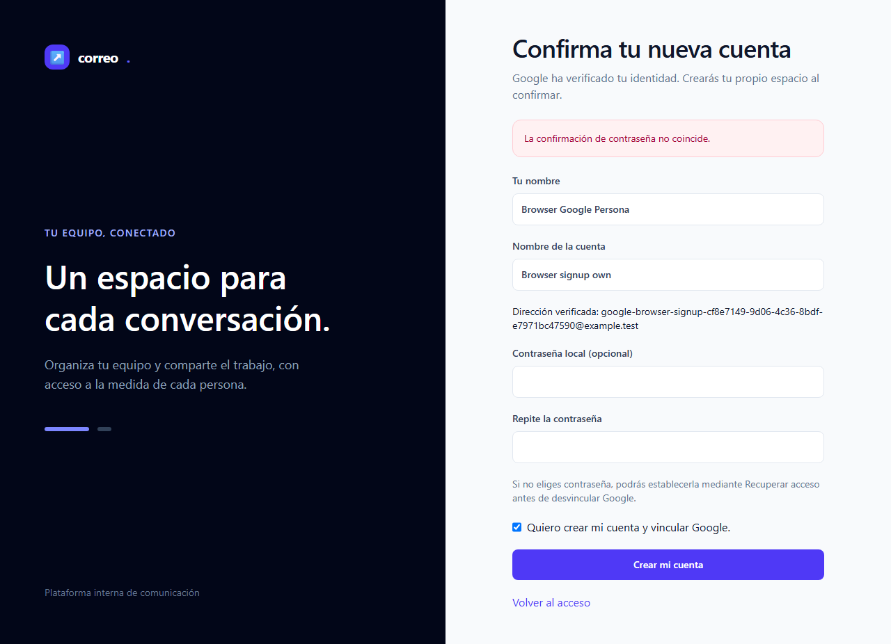
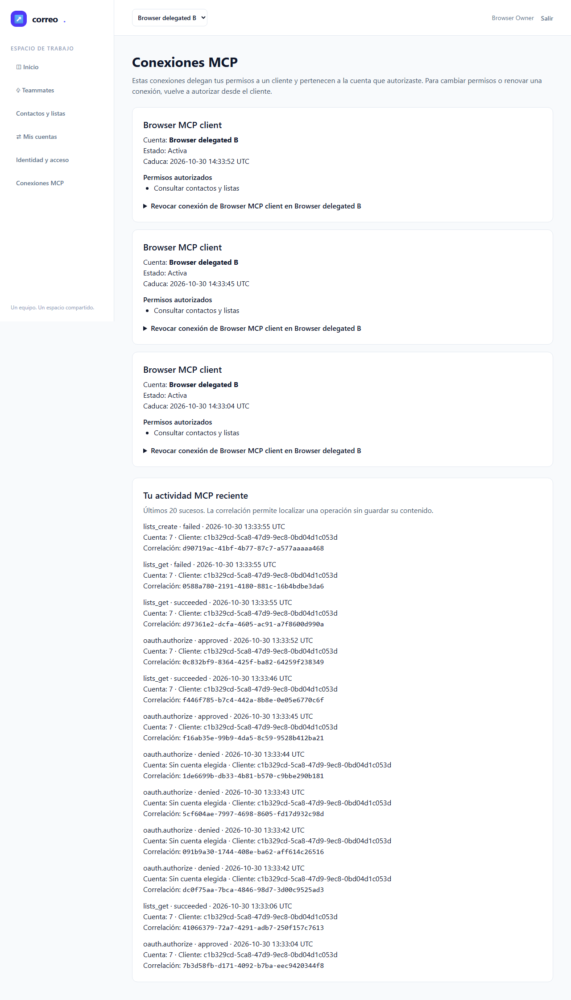
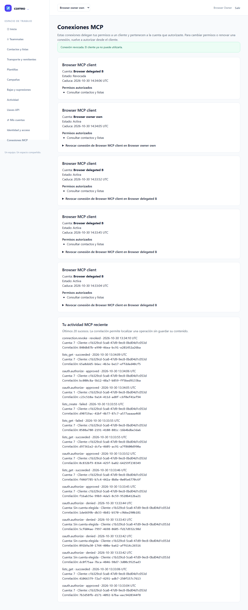
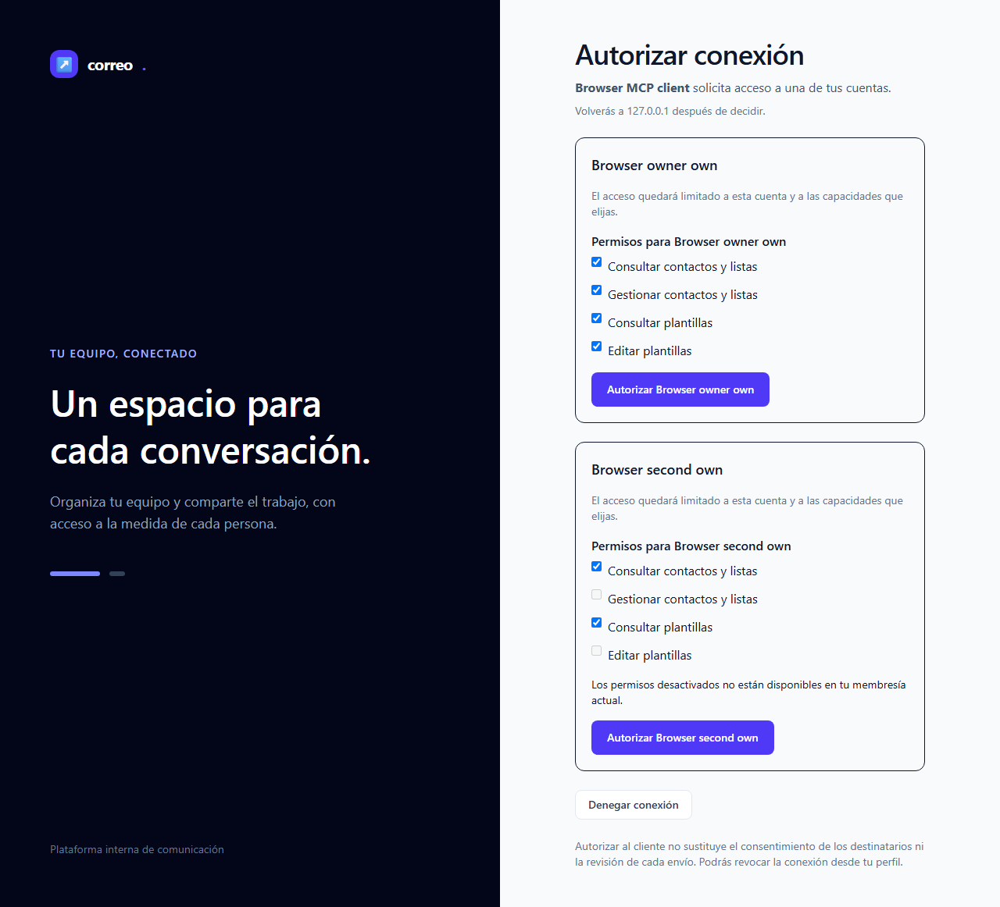
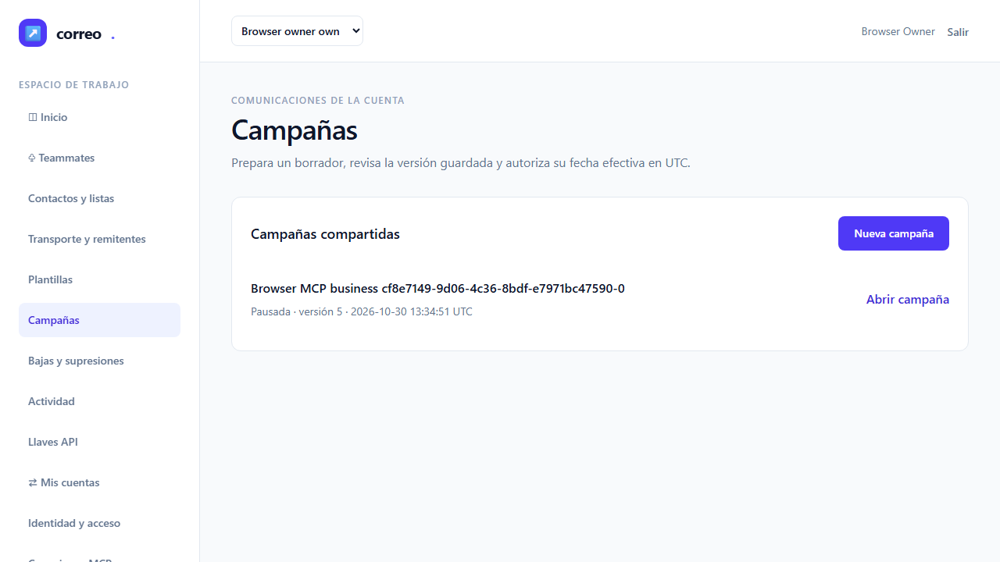
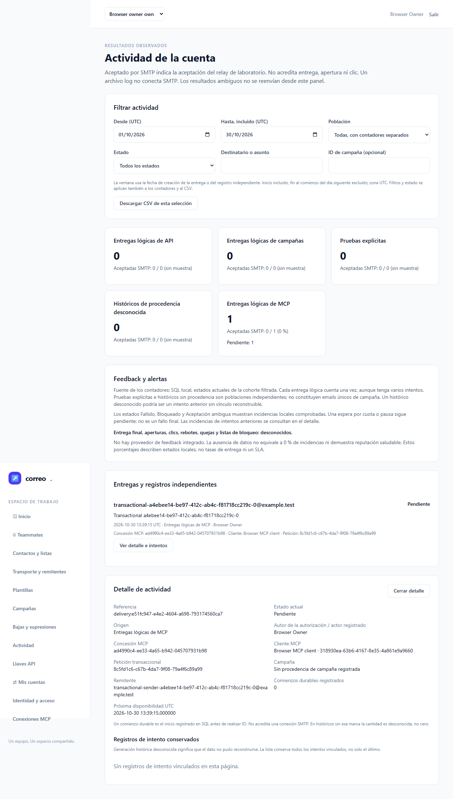
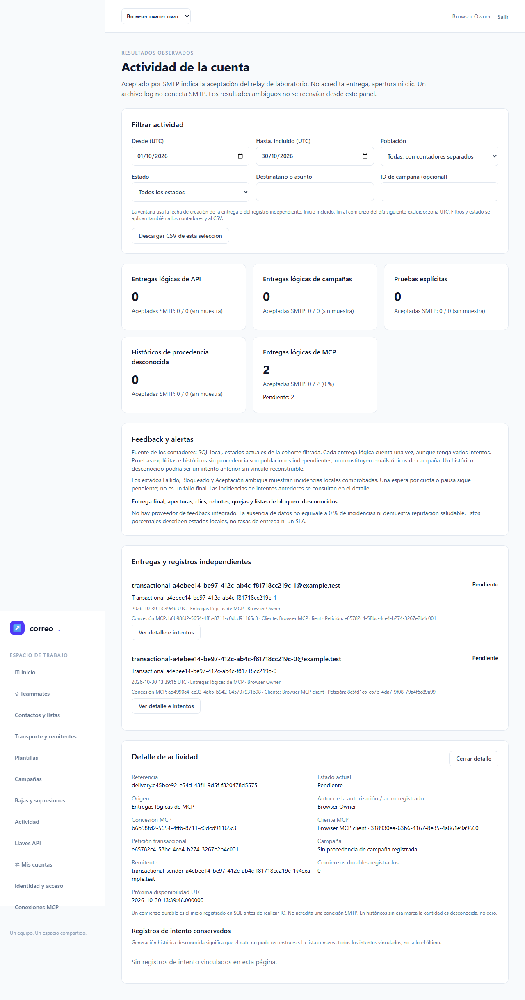
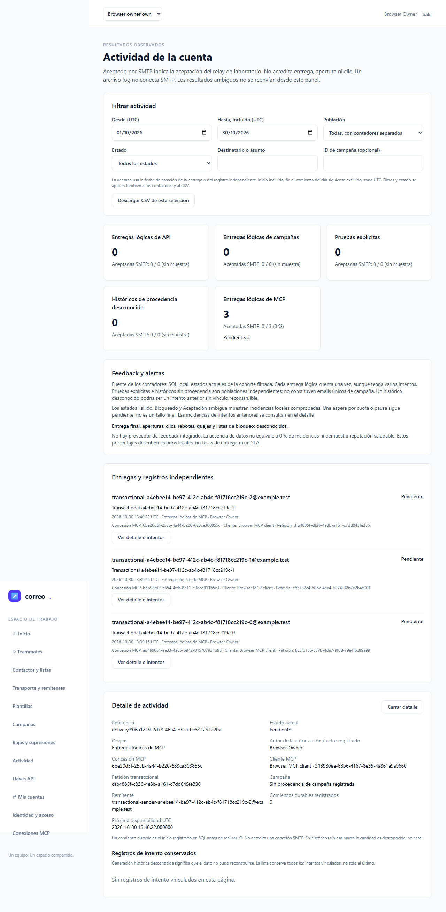

# Informe de QA — Google y MCP, T-10

| Dato | Resultado |
| --- | --- |
| Fecha | 30 de octubre de 2026 |
| Estado automático | **VERDE: 9/9 originales y E2E-09 ×3 separado** |
| Fallos / flaky / omitidos / interrumpidos | 0 en ambas tandas |
| URL auditada | http://127.0.0.1:18967 |
| HEAD congelado | `2a0ba1b9a6953c294908656f9114c72286f99089` |
| Plan | `docs/roadmap/2026-10-24-mcp-google/` |
| Aceptación | T-10 pendiente de root; iniciativa sin cierre global |

Los dos gates oficiales deciden el verde automático. Google simulado está en el límite del proveedor; aplicación, navegador, consentimiento, SQL y transporte MCP/HTTP son reales. Google real, clientes reales, perfiles y M-01–M-04 conservan sus verificaciones pendientes. El envío usa exclusivamente log/Mailpit; E2E-09 comprueba aceptación pendiente y cero intentos, sin iniciar scheduler ni worker.

## Veredicto oficial: nueve originales

`qa-gate.py` del bundle custom-agents 2.1.0, exit 0. Salida original completa:

```json
{
  "verdict": "VERDE",
  "counts": {
    "passed": 9,
    "failed": 0,
    "flaky": 0,
    "skipped": 0,
    "interrupted": 0
  },
  "flaky_sin_justificar": [],
  "flaky_justificados": {},
  "threshold": "verde ⟺ 0 failed, 0 flaky sin justificar, 0 interrumpidos y ≥1 test ejecutado"
}
```

## Veredicto oficial: estabilidad E2E-09 ×3

Invocación separada, después del terminal y la limpieza admitida de originales. Gate oficial exit 0; salida original completa:

```json
{
  "verdict": "VERDE",
  "counts": {
    "passed": 3,
    "failed": 0,
    "flaky": 0,
    "skipped": 0,
    "interrupted": 0
  },
  "flaky_sin_justificar": [],
  "flaky_justificados": {},
  "threshold": "verde ⟺ 0 failed, 0 flaky sin justificar, 0 interrumpidos y ≥1 test ejecutado"
}
```

Sin reintentos, justificaciones de flaky, cuarentenas o repeticiones hasta verde. No se suman tandas parciales/históricas para acreditar la regresión completa. Los nueve escenarios y las tres repeticiones se informan por separado.

## Entorno, fuentes y admisión previa

Windows/Laragon, PHP nativo 8.5.12 y Chromium real gestionado por Playwright 1.64.1. El cache declara revisión Chromium1248; no se atribuye otro perfil de aplicación. El backend completo original terminó con exit0: **485 IDs únicos exactos / 13.537 aserciones**, sin fallos, errores, skips, deprecations, warnings o notices. QA verificó su recibo, dos streams, JUnit, inventario y los415 miembros de la cápsula pública; no repitió el backend ni polleó su sesión terminal.

Las415 fuentes del backend coinciden byte por byte con el working tree y ambas cápsulas E2E. El conjunto actual contiene416: sólo se añadió el test Python de empaquetado. Su original HEAD3/3 está admitido. La corrección de atributos conserva los ocho contratos/fixtures fijados por SHA; no cambia sus bytes runtime ni relaja el guard. La revisión3 A+B+C publicada tiene0 gaps; las revisiones anteriores conservan su alcance histórico.

Método QA de custom-agents2.1.0, con fallback genérico y modelo heredado: el runtime no expone el tipo nativo `qa` ni Sonnet. No se inventan esos identificadores. El preflight estático histórico del30 se conserva intacto. La primera admisión funcional se detuvo ante dos paths documentales pendientes de conocimiento no incluidos en su allowlist; se conservaron el fallo y su resolución por nombres, sin leer/aplicar la candidata ni atribuirle aprobación. Fue un fallo de preflight, sin ejecución funcional ni rojo de producto.

## Cobertura y puertas vigentes

Sobre HEAD2a0ba1b: ledger-lint exit0,0 incoherencias y5 avisos de Changelog T10–14. Coverage-check exit0: **0 referencias rotas,0 GWT sin cubrir,0 tests sin referencia**. T01/T02/T13 carecen de cobertura declarada: son contrato, persistencia y revisión; sus verificaciones backend/estáticas están trazadas, sin una UI nueva huérfana. Cobertura estática no acredita la ejecución de los manuales CA12/CA13.

No hay Constitución ni dev.json en los ámbitos de proyecto comprobados. No se activa el gate porcentual unitario y no se inventa ese porcentaje. E2E propios:9/9; estabilidad aparte:3/3. No existen bloques API-xx/A11Y-xx en el test-plan; no se añadieron smokes ni axe sin contrato.

El contrato estático del preflight conservado verifica37 operaciones,76 schemas y596 casos de herramientas, sin fallos; sus fuentes no cambiaron. OpenAPI conserva el resultado estructural y el diff sin rompedores. La privacidad segura vigente revisa **2460 archivos públicos / 0 hallazgos** con el wrapper SHA autorizado, excluyendo por nombre antes de cualquier cuerpo. No certifica el historial Git. Whitespace exit0 y árbol público limpio. Memoria: GOT-012 legacy aceptada exige probar bloqueo HTTP/HTTPS y bypass local; cada resultado E2E propio registra que sus aserciones de frontera pasaron. La recuperación previa fue parcial, sin presumir cobertura exhaustiva.

## Resultados automáticos originales

Cada escenario tiene un único resultado nativo passed, retry0, sin errores. Las duraciones pertenecen al reporter; no equivalen a horas IA. Las capturas enlazadas son copias exactas de los PNG originales, con SHA en `../screenshot-manifest.json`.

### E2E-01 — Mismo usuario, aislamiento y retorno al consentimiento — PASA

**Cubre tareas:** T-03, T-11, T-12, T-14. **Duración:** 11.79s.

Usuario local estable, cuenta autorizada y retorno validado a consentimiento MCP.


Todas sus capturas: [original9-E2E-01-google-dashboard.png](screenshots/original9-E2E-01-google-dashboard.png), [original9-E2E-01-google-login.png](screenshots/original9-E2E-01-google-login.png), [original9-E2E-01-google-real-consent.png](screenshots/original9-E2E-01-google-real-consent.png).

### E2E-02 — Callbacks y vinculación explícita — PASA

**Cubre tareas:** T-03, T-12. **Duración:** 14.67s.

Callbacks inválidos rechazados, sin autoenlace por email; perfil conserva el vínculo explícito.


Todas sus capturas: [original9-E2E-02-google-profile.png](screenshots/original9-E2E-02-google-profile.png).

### E2E-03 — Admisión, registro e invitación — PASA

**Cubre tareas:** T-03, T-12. **Duración:** 15.37s.

Registro explícito, política Workspace, invitación y acceso local conservan sus fronteras.



Todas sus capturas: [original9-E2E-03-google-confirmation.png](screenshots/original9-E2E-03-google-confirmation.png), [original9-E2E-03-google-correctable-registration.png](screenshots/original9-E2E-03-google-correctable-registration.png).

### E2E-04 — Consentimiento real y scopes vigentes — PASA

**Cubre tareas:** T-07, T-11, T-12, T-14. **Duración:** 9.68s.

Cuenta/scopes y CSRF revalidados; cliente canjea PKCE y el rechazo no concede acceso.


Todas sus capturas: [original9-E2E-04-mcp-client-connected.png](screenshots/original9-E2E-04-mcp-client-connected.png), [original9-E2E-04-mcp-consent-safe-error.png](screenshots/original9-E2E-04-mcp-consent-safe-error.png), [original9-E2E-04-mcp-denied.png](screenshots/original9-E2E-04-mcp-denied.png), [original9-E2E-04-mcp-limited-consent.png](screenshots/original9-E2E-04-mcp-limited-consent.png).

### E2E-05 — Bearer, cuentas y credenciales ajenas — PASA

**Cubre tareas:** T-07, T-12. **Duración:** 11.85s.

Cliente sin cookies mantiene la autoridad de B al cambiar la cuenta web; rechaza otras credenciales y lectura cruzada.



Todas sus capturas: [original9-E2E-05-mcp-connections-and-audit.png](screenshots/original9-E2E-05-mcp-connections-and-audit.png).

### E2E-06 — Revocación y retirada de membresía — PASA

**Cubre tareas:** T-07, T-11, T-12, T-14. **Duración:** 24.06s.

Revocación propia corta la conexión abierta; retirada de membresía impide reautorizar.



Todas sus capturas: [original9-E2E-06-mcp-revoked.png](screenshots/original9-E2E-06-mcp-revoked.png).

### E2E-07 — Herramientas de datos y paginación — PASA

**Cubre tareas:** T-08, T-12. **Duración:** 14.43s.

Consentimiento de datos, lecturas keyset y previsualización segura con permisos de cuenta.



Todas sus capturas: [original9-E2E-07-mcp-data-audit.png](screenshots/original9-E2E-07-mcp-data-audit.png), [original9-E2E-07-mcp-data-consent.png](screenshots/original9-E2E-07-mcp-data-consent.png).

### E2E-08 — Negocio, campañas revisadas y actividad — PASA

**Cubre tareas:** T-09, T-12. **Duración:** 25.05s.

Herramientas de negocio comparten la autoridad web, revisiones y proyecciones acotadas.



Todas sus capturas: [original9-E2E-08-mcp-business-audit.png](screenshots/original9-E2E-08-mcp-business-audit.png), [original9-E2E-08-mcp-business-campaigns.png](screenshots/original9-E2E-08-mcp-business-campaigns.png), [original9-E2E-08-mcp-business-consent.png](screenshots/original9-E2E-08-mcp-business-consent.png).

### E2E-09 — Envío delegado y solicitudes compartidas — PASA

**Cubre tareas:** T-10, T-12. **Duración:** 25.96s.

MCP/REST comparten aceptación y replay; conflicto de payload, origen/actor/cliente/grant en web/CSV, aislamiento y revocación. Estado pendiente y cero intentos; no prueba entrega SMTP.


Todas sus capturas: [original9-E2E-09-mcp-mail-activity-detail.png](screenshots/original9-E2E-09-mcp-mail-activity-detail.png), [original9-E2E-09-mcp-mail-consent.png](screenshots/original9-E2E-09-mcp-mail-consent.png).

## Estabilidad separada — E2E-09 ×3

Título exacto y grep escapado con sufijo `$`; `--repeat-each=3`. Los IDs de los resultados completados coinciden exactamente con los TestCase IDs nativos del listado previo que fija repeatEachIndex0/1/2. El listado sólo identifica esa correspondencia; cada uno tiene ahora su resultado real passed/retry0.

### E2E-09 — repetición nativa 0 — PASA

ID `096c972046f3caadfce8-b869739138c917fcf633`; duración 27.69s; un resultado, retry0.



### E2E-09 — repetición nativa 1 — PASA

ID `096c972046f3caadfce8-39b2500d7687f52d6d60`; duración 29.14s; un resultado, retry0.



### E2E-09 — repetición nativa 2 — PASA

ID `096c972046f3caadfce8-b11573c153408b790016`; duración 29.66s; un resultado, retry0.



## Limpieza y frontera de red

Antes del arranque: guarda real de base y usuario `emailing_testing`, DB_URL vacío,0 conexiones ajenas y transacción0. Los tres puertos locales estaban libres; el launcher original vinculó denyProxy antes de fixtures/PHP. Cada test exige HTTP502, rechazo HTTPS CONNECT y navegación loopback correcta. Nunca se habilitó SMTP externo ni se modificó la infraestructura compartida.

Tras **cada tanda**, el terminal nativo del wrapper y el de la selección tienen exit0; hay callback18743 cerrado y recibo oficial del global teardown exit0. Se verificaron por separado los recursos reservados por el UUID del fixture: usuarios, cuentas, claves, grants, tokens, peticiones, códigos, sesiones, auditoría, intentos/códigos Google y ventanas, todos a cero. Los agregados adicionales del pipeline por cuentas propias también dan0. La guarda posterior encuentra0 conexiones ajenas/transacción0; los puertos18743/18967/18968 permiten bind exclusivo y se cierran al terminar el probe.

Estos son conteos agregados con guarda, sin SQL crudo ni volcado de filas. No se fabricó ni se leyó un settlement del launcher. Se conservaron las ausencias de evidencia natural que pudiera tener ese proceso; el teardown real y las verificaciones agregadas/puertos acreditan la limpieza propia. No se detuvo ningún proceso ajeno, ni se inventariaron procesos globales ni se inspeccionaron los PIDs vetados.

| Tanda | Fixture propio | Resultado |
| --- | --- | --- |
| Originales9 | `cf8e7149-9d06-4c36-8bdf-e7971bc47590` | Cleanup admitido antes de estabilidad |
| E2E09×3 | `a4ebee14-be97-412c-ab4c-f81718cc219c` | Cleanup admitido al terminar |

## Capturas y revisión visual

Se inspeccionaron las25 capturas originales:19 de originales y6 de estabilidad, mediante siete hojas de contacto y ampliación del detalle transaccional. Las copias conservan todos los bytes/SHA. Se observan pantallas completas de acceso, perfil, consentimiento, denegación, conexiones, revocación, campañas y actividad; no aparecen bearer, códigos OAuth, verifiers o secretos SMTP. Los identificadores/usuarios/dominios son de fixtures ficticios. No se actualizó ninguna baseline visual ni se atribuye a esta inspección la aceptación humana M02.

Las imágenes de auditoría altas se conservan en resolución original aunque el PDF las reduzca. No se alteraron código, tests, selectores, criterios, timeouts o retries. Un aviso de Node sobre NO_COLOR/FORCE_COLOR figura en stderr original; no es un fallo funcional ni se oculta de la evidencia privada.

## Checklist manual pendiente

- [ ] **M-01 — Google real en Laragon y Docker:** configurar privadamente y comprobar login, vínculo/desvínculo, admisión y retorno OAuth. Google real sigue sin configurar según el operador28oct. T03/T11/T14.
- [ ] **M-02 — Claridad del consentimiento y conexiones:** aceptación humana de comprensión, errores, estados vacíos, teclado y revocación. T07/T14.
- [ ] **M-03 — Clientes reales:** registrar producto/versión/transporte/callback y conexión, permitido/denegado, expiración y revocación en los clientes objetivo. T11/T14.
- [ ] **M-04 — Perfiles y restauración:** reinicio, configuración privada, persistencia y restauración aislada sin reactivar grants, conservando servicios compartidos y log/Mailpit. T11/T14.

No se solicitan secretos en chat; simulación y documentación no acreditan esas verificaciones externas.

## Trazabilidad y siguiente puerta

| Tarea | Evidencia automática propia | Pendiente |
| --- | --- | --- |
| T03 | E2E01–03 | M01 y alcance externo |
| T07 | E2E04–06 | M02 |
| T08 | E2E07 | Sin reapertura de su aceptación histórica |
| T09 | E2E08 | Sin reapertura de su aceptación histórica |
| T10 | E2E09 y09×3; backend485 admitido; packaging3 | Aceptación de root y documentación |
| T11 | E2E01/04/06 como regresión de laboratorio | Perfiles/clientes/M01/M03/M04 |
| T12 | E2E01–09, suite backend completa admitida | Integración global trazada según plan |
| T13 | Revisiones históricas y revisión3 publicadas | Cierre del ciclo por root |
| T14 | Recorridos de laboratorio | M01–04 y aceptación global |

Se entrega handoff a root para la documentación obligatoria al cerrar el ciclo; root coordinará el agente documenter y su publicación. QA no modifica el ledger, no declara T10 aceptada, no cierra la iniciativa ni el objetivo y no ejecuta commits/push/Jira/Confluence. Tokens, coste y horasIA permanecen desconocidos, sin lectura de transcripciones ni estimación por reloj.

## Evidencia original conservada

- `../input-admission.json`: backend485/13537, cápsula415 y delta Python416.
- `../runtime/original9/playwright-results.json` y `../runtime/stability09/playwright-results.json`: reporteros nativos originales, sin resultados sintéticos.
- En cada carpeta de tanda: `terminal.json`, `functional-admission.json`, `qa-gate.stdout.json`, `cleanup-admission.json` y streams originales. Los raw de teardown no se abrieron/hasharon ni forman parte de la selección de entrega.
- `../statics/`: ledger/coverage/privacidad/whitespace actuales; preflight histórico del30 intacto en carpeta hermana.
- `screenshots/` y `../screenshot-manifest.json`:25 PNGs exactos y trazabilidad a originales. Sin trazas de fallos porque no hubo fallos y el config original las desactiva.
- `../final-hashes.json`: manifiesto final privado con exclusiones por nombre previas a lectura; no se certifica el historial público.

El PDF acompaña este Markdown, generado con la skill to-pdf instalada sin descargas ni cambios globales, con imágenes incrustadas sólo para render offline. La revisión del PDF queda en el recibo visual separado.
