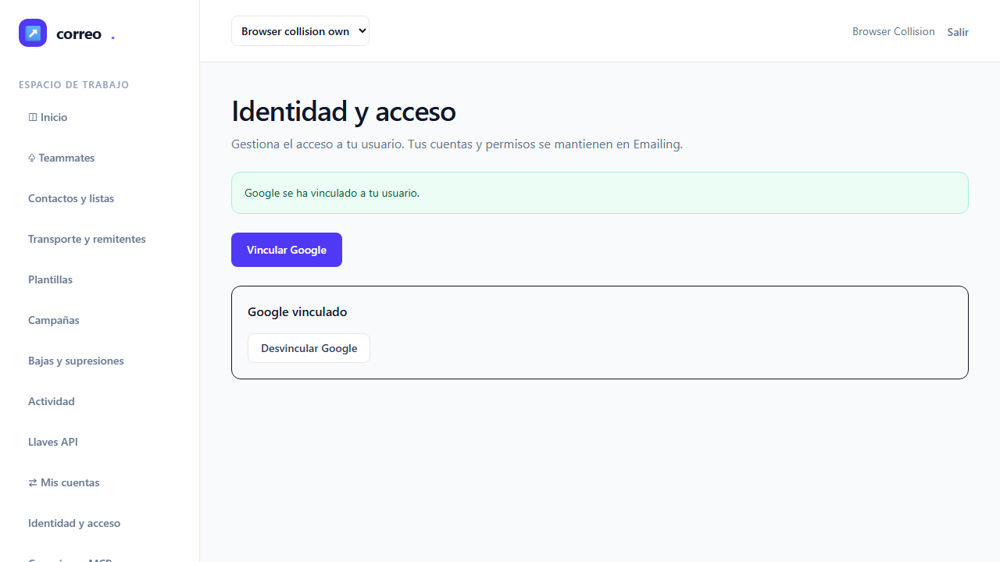
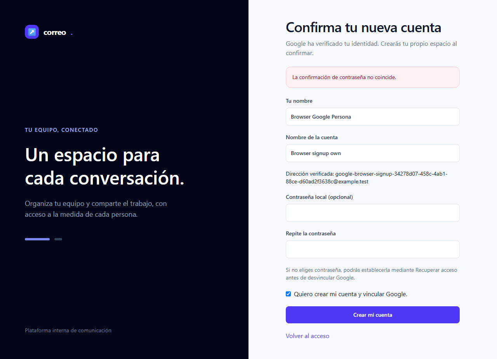
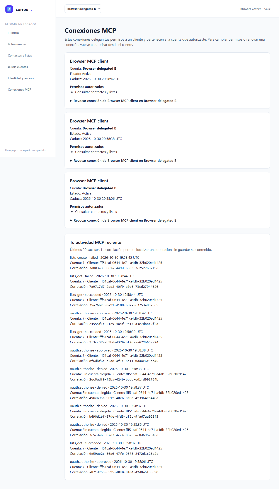
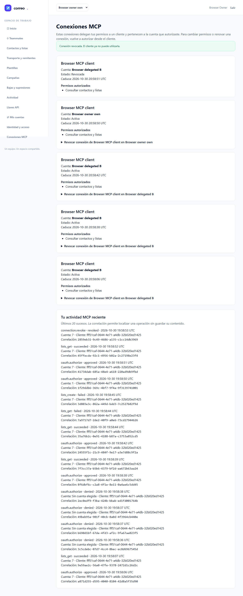
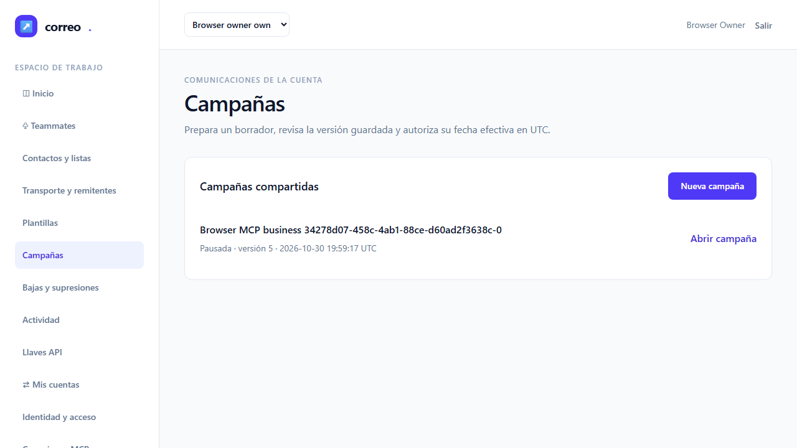
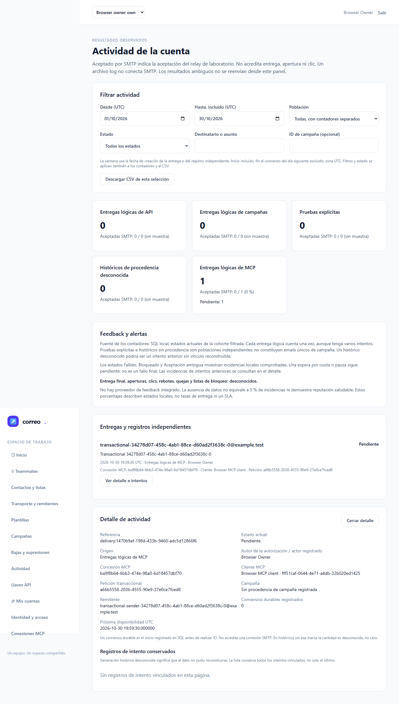

# Informe QA T-11 - perfiles y recuperación

| Dato | Resultado |
| --- | --- |
| Fecha | 30 octubre 2026, UTC |
| Puerta funcional | **VERDE: 9/9 E2E originales** |
| URL auditada | `http://127.0.0.1:18967` |
| Entorno | Windows; Chromium real con sandbox; MySQL exclusivo `emailing_testing` |
| Alcance | QA independiente T-11; la regresión global corresponde a T-12 |
| Estado de entrega | Preparada para admisión del orquestador; QA no cierra el ledger |

## Veredicto determinista

Salida literal del `qa-gate.py` del bundle custom-agents 2.3.0, exit 0:

```json
{
  "verdict": "VERDE",
  "counts": {
    "passed": 9,
    "failed": 0,
    "flaky": 0,
    "skipped": 0,
    "interrupted": 0
  },
  "flaky_sin_justificar": [],
  "flaky_justificados": {},
  "threshold": "verde ⟺ 0 failed, 0 flaky sin justificar, 0 interrumpidos y ≥1 test ejecutado"
}
```

Se ejecutó una tanda de los nueve escenarios originales de `tests/e2e/mcp-google.spec.mjs`, con el reporter JSON nativo de Playwright. Todos pasaron en el primer intento: cero fallos, flaky, omitidos o interrumpidos. No se modificaron aserciones, timeouts, retries, módulos de tests ni configuración. Los 19 PNG originales se conservaron byte a byte.

## Cobertura y puertas de entrada

`ledger-lint.py`: exit 0, cero incoherencias y cinco avisos: tamaño del ledger y Changelog pendiente en T-11 a T-14. `coverage-check.py`: exit 0, cero referencias rotas, cero criterios GWT sin cubrir y cero tests sin referencia. Sus avisos T-01, T-02 y T-13 se trían como contrato/planificación, persistencia backend y revisión consolidada, respectivamente; no añaden una tarea de UI huérfana. T-11 declara E2E-01/04/06 y M-01/03/04; esta tanda ejecuta también los otros seis escenarios como regresión focal del navegador.

Guardrail oficial: exit 0 para loopback. Binds exclusivos previos de 18967, 18968 y 18743 libres. Antes de fixtures o DDL, el bootstrap ejecutó la guarda real `TestingDatabaseGuard`: base y usuario exclusivos `emailing_testing`, `DB_URL` vacío, una tabla de migraciones, transacción 0 y cero conexiones ajenas. El launcher vuelve a ejecutar la guarda antes de migrar y crear fixtures.

Selección de capacidades QA: backend-practices, delivery-practices, stack-practices y unit-tests; sin avisos del selector. Se aplican patrones Laravel existentes. No hay umbral porcentual configurado; no se inventa cobertura de líneas. La consulta dirigida de gotchas no devolvió entradas y no surgió flaky que requiriese memoria.

## Evidencia previa admitida, sin volver a ejecutarla

| Evidencia | Admisión independiente |
| --- | --- |
| Persistencia e invalidación | JUnit original: 8 casos, 61 aserciones, cero fallos/errores/omitidos; recibo exit 0 y fuentes/streams contrastados. |
| Runner Python | 135 pruebas, OK, exit 0; cápsula original verificada. |
| Laragon y Docker | Seis smokes por perfil, dos protocolos en arranque frío, tras reinicio y tras rotación; HTTP 401 tras revocación y ambos restores. Proyecciones cotejadas con admisiones originales enlazadas por los streams. |
| Scheduler final | Cuatro pasadas periódicas reales: dos por perfil; recuperación de mutex antes del segundo arranque; ambos protocolos con Docker activo. Fuentes y admisión original verificadas. |
| Receta de restore | Cuatro casos de stub puro conservados: tres fallos detenidos y un éxito; ninguno reabre automáticamente. No se presenta como ejecución de servicios. |
| Artefacto | Exportación Git repetida y comparada: 448 cuerpos. Sólo `compose.yaml` y `compose.tls.yaml` cambian frente al artefacto del ciclo completo; otros 446 miembros iguales. |

Las cápsulas admitidas conservan sus fuentes ZIP, hashes, streams y recibos terminales; la admisión nueva consta en `input-admission.json`. La comparación del artefacto usa su exportación Git y respeta los finales de línea; no confunde sus bytes con los del checkout Windows. La versión final del scheduler coincide con las 448 fuentes actuales de la cápsula QA. Las pruebas históricas de 485/493 casos no se repitieron ni se suman. Los `T11_accepted: false` históricos mantienen el significado que tenían al emitirse.

## Resultados automáticos

Los escenarios prueban navegador, aplicación, SQL y protocolo reales, con Google simulado en el límite del proveedor. Cada resultado incorpora el assert de frontera: HTTP externo 502, CONNECT HTTPS rechazado y navegación local correcta. Correo sólo de laboratorio, Mailpit/log. El escenario E2E-09 comprueba aceptación pendiente, replay y procedencia; no demuestra entrega SMTP ni confirma feedback del proveedor. La estabilidad x3 histórica de E2E-09 no se presenta como una repetición de esta tanda.

### E2E-01 - PASA

Google E2E-01 stable local user, account isolation and server return boundary. Duración nativa: 8.329 s; retry 0.


Capturas originales conservadas: [E2E-01-google-dashboard](screenshots/E2E-01-google-dashboard.png), [E2E-01-google-login](screenshots/E2E-01-google-login.png), [E2E-01-google-real-consent](screenshots/E2E-01-google-real-consent.png).

### E2E-02 - PASA

Google E2E-02 invalid callback, no email auto-link and explicit profile lifecycle. Duración nativa: 13.708 s; retry 0.



Capturas originales conservadas: [E2E-02-google-profile](screenshots/E2E-02-google-profile.png).

### E2E-03 - PASA

Google E2E-03 explicit signup, Workspace, admission, invitation and local fallback. Duración nativa: 11.253 s; retry 0.



Capturas originales conservadas: [E2E-03-google-confirmation](screenshots/E2E-03-google-confirmation.png), [E2E-03-google-correctable-registration](screenshots/E2E-03-google-correctable-registration.png).

### E2E-04 - PASA

MCP E2E-04 real consent revalidates account scopes and CSRF before automatic client exchange. Duración nativa: 6.460 s; retry 0.


Capturas originales conservadas: [E2E-04-mcp-client-connected](screenshots/E2E-04-mcp-client-connected.png), [E2E-04-mcp-consent-safe-error](screenshots/E2E-04-mcp-consent-safe-error.png), [E2E-04-mcp-denied](screenshots/E2E-04-mcp-denied.png), [E2E-04-mcp-limited-consent](screenshots/E2E-04-mcp-limited-consent.png).

### E2E-05 - PASA

MCP E2E-05 bearer-only client keeps B authority across web account switch and rejects other credentials. Duración nativa: 7.018 s; retry 0.



Capturas originales conservadas: [E2E-05-mcp-connections-and-audit](screenshots/E2E-05-mcp-connections-and-audit.png).

### E2E-06 - PASA

MCP E2E-06 own revocation cuts a live legacy session and membership removal blocks reauthorization. Duración nativa: 14.198 s; retry 0.



Capturas originales conservadas: [E2E-06-mcp-revoked](screenshots/E2E-06-mcp-revoked.png).

### E2E-07 - PASA

MCP E2E-07 consent authorizes data tools, keyset reads and safe template preview. Duración nativa: 8.459 s; retry 0.


Capturas originales conservadas: [E2E-07-mcp-data-audit](screenshots/E2E-07-mcp-data-audit.png), [E2E-07-mcp-data-consent](screenshots/E2E-07-mcp-data-consent.png).

### E2E-08 - PASA

MCP E2E-08 business consent and reviewed campaigns share the web domain. Duración nativa: 15.324 s; retry 0.



Capturas originales conservadas: [E2E-08-mcp-business-audit](screenshots/E2E-08-mcp-business-audit.png), [E2E-08-mcp-business-campaigns](screenshots/E2E-08-mcp-business-campaigns.png), [E2E-08-mcp-business-consent](screenshots/E2E-08-mcp-business-consent.png).

### E2E-09 - PASA

MCP E2E-09 transactional acceptance, replay and activity retain the delegated source. Duración nativa: 16.388 s; retry 0.



Capturas originales conservadas: [E2E-09-mcp-mail-activity-detail](screenshots/E2E-09-mcp-mail-activity-detail.png), [E2E-09-mcp-mail-consent](screenshots/E2E-09-mcp-mail-consent.png).

## Trazabilidad T-11 y límites

| Criterio T-11 | Evidencia y alcance |
| --- | --- |
| Mismos contratos, migraciones y persistencia en ambos perfiles | Cápsulas de ciclos completos, replay del artefacto y delta limitado del scheduler; reinicios y revocación probados en laboratorio. |
| Ejemplos ficticios por producto | Revisión de `docs/aplicacion/mcp-clientes.md` y ejemplos TOML/JSON; Code y Desktop se identifican separadamente. No se instaló configuración nativa. |
| Matriz honesta de versiones, transporte y registro | `testing/client-matrix.md` separa inventario documental de conexión ejecutada y conserva límites de red y callbacks exactos. |
| Backup, rotación y restore antiguo | Ciclos originales admitidos; invalidación con mantenimiento y admisión MCP cerrada; rechazo HTTP posterior. Scheduler y mutex probados en cada perfil. |
| Configuración privada y ausencia de datos personales | Artefactos del informe con datos sintéticos y rutas relativas; sin lectura de secretos por el agente ni publicación de entornos, snapshots o cuerpos de callback. |

## Limpieza acreditada

La sesión nativa 19979 terminó con exit 0; su wrapper conserva recibo y 448 fuentes sin cambios. El callback 18743 emitió recibo cerrado. El teardown oficial emitió recibo exit 0. La sonda posterior ejecutó de nuevo la guarda real y contó cero filas de usuarios, cuentas, claves, clientes, grants, tokens, OAuth, sesiones, auditoría, Google y ventanas de admisión propios, además de cero filas del pipeline por las cuentas del fixture. Transacción 0; cero conexiones ajenas. Los tres binds exclusivos posteriores tuvieron éxito y se cerraron.

`cleanup-admission.json` conserva agregados y hashes. No se leyó el cuerpo de teardown o settlement; tampoco configuración privada, snapshots, request/owner/process JSON ni entornos. No se inventa un recibo de salida natural del launcher ni se deduce ausencia de procesos globales a partir de `live_handles`. No se detuvo infraestructura compartida ni se señaló un PID ajeno.

## Checklist manual pendiente para una persona

- [ ] **M-01**: Google real en Laragon y Docker, identidad, callbacks, política de admisión y retorno OAuth. Pendiente de T-14.
- [ ] **M-02**: claridad del consentimiento, errores, estados vacíos y navegación con teclado. Pendiente de validación humana.
- [ ] **M-03**: Codex, Claude Code y OpenCode reales; producto/versión, OAuth, llamada, denegación, expiración y revocación. Desktop mantiene estado separado. Pendiente de T-14.
- [ ] **M-04**: configuración y recuperación del servidor privado de destino. El ensayo técnico local de T-11 está admitido; no sustituye la aceptación del destino ni el simulacro global T-19.

## Procedencia de artefactos

JSON original: `raw/results.json`, copia exacta del reporter nativo, sin sustitución sintética. Capturas: `report/screenshots/`. Recibos: `functional-admission.json`, `input-admission.json` y `cleanup-admission.json`; gates en `statics/` y `qa-gate.stdout.json`. `evidence.json` enlaza sus hashes con la cápsula original. La selección excluye comandos con rutas privadas. Informe y PDF esperan la revisión allowlist del orquestador. No hay notificaciones externas.

