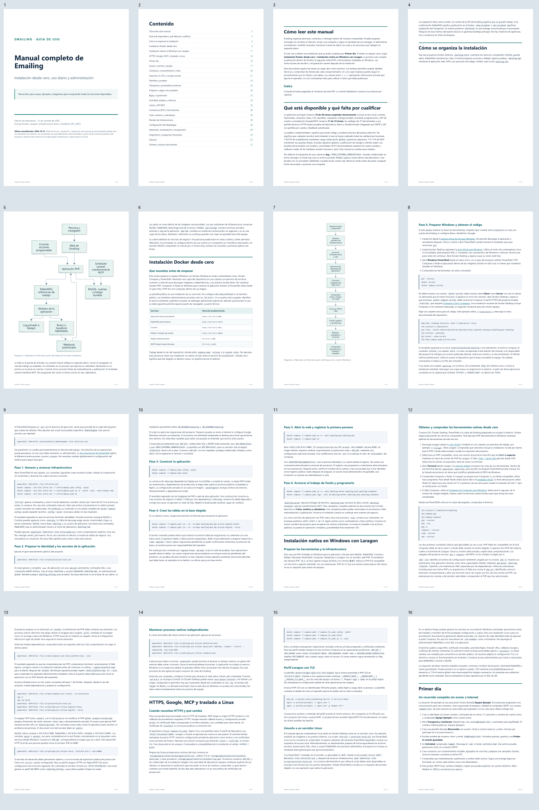
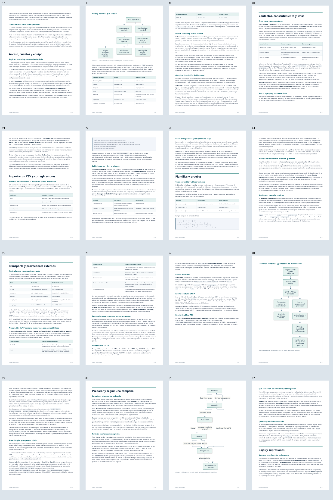
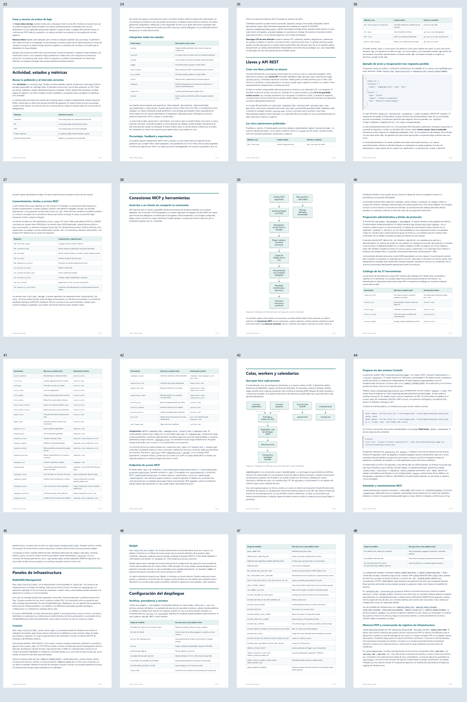
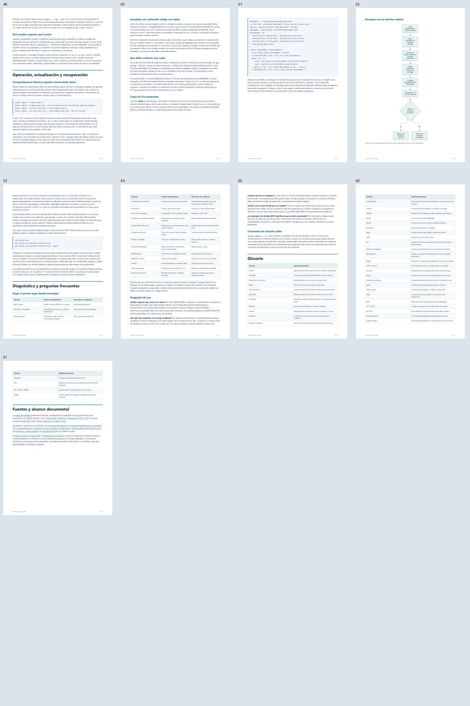

# QA independiente del manual completo — T-07

**Fecha:** 2026-10-31. **Veredicto del artefacto: VERDE.** No se observan defectos pendientes de contenido omitido, enlaces, paginación o maquetación en la edición examinada. Se han inspeccionado las **57 páginas individualmente a resolución completa**, además de las cuatro hojas de contacto. La revisión se aplica a CA-19–CA-22 y no cierra por sí sola la iniciativa.

Revisor de contexto fresco, modelo genérico heredado real: no estaba disponible el agente nativo QA/Sonnet. Se aplicaron el contrato de QA de custom-agents, su selección de capacidades y la guía PDF para validación en lectura. PyMuPDF y Pillow ya estaban instalados; no se instaló software ni se ejecutó el exportador. Esta revisión renderizó el PDF existente, sin modificarlo.

## Identidad y alcance

| Artefacto | SHA-256 |
|---|---|
| [Markdown canónico](../../../../../manual/guia-completa.md) | `0b8d519494af8efecca184a56ed987d671b2a97a4597467f07fa551aad8494fe` |
| [PDF canónico](../../../../../manual/guia-completa.pdf) | `330446b36205f3e63a21f021e44de8b174a7fd5636d7185ffe60ee1b57d39cd7` |

La fuente tiene 18.105 palabras, 24 capítulos y ocho diagramas Mermaid. El PDF tiene 57 páginas A4. Se copió el PDF canónico y los recibos originales de la segunda pasada de exportación a un directorio propio de QA. El comando `python docs/manual/verificar.py --input storage/providers-email-20261030/manual/qa-1 --render` terminó con **exit 0**. Los hashes recalculados coinciden con los recibos y con los archivos canónicos.

## Puertas ejecutadas y evidencia

| Comprobación propia | Resultado | Evidencia |
|---|---|---|
| Verificador del artefacto y render de todas las páginas | PASS, exit 0; 919/919 bloques; ocho diagramas y todas sus etiquetas | [Validación íntegra](validation.json), [salida original](artifact-verifier.stdout.txt) |
| Límites de página y tamaño de cuerpo | Cero textos fuera de página, cero cuerpos inferiores a 7,75 pt, cero páginas vacías detectadas | [Validación](validation.json) |
| Referencias documentales | 26 enlaces estables presentes; cero referencias al servidor temporal | [Recibo original](export-receipt.json), [validación](validation.json) |
| Comprobación independiente de navegación | 24 títulos del índice presentes y situados en las páginas de su esquema; numeración 1/57–57/57 correcta; 35 anotaciones URI, ninguna local ni `file:` | [Cobertura y navegación](independent-coverage-navigation.json) |
| Identidades MCP y configuración pública | 37/37 nombres de herramientas y 71/71 nombres únicos de variables de las dos plantillas públicas presentes tanto en manual como en matriz | [Cobertura independiente](independent-coverage-navigation.json) |
| Enlaces y anclas Markdown | 34 documentos, 1.015 enlaces locales examinados, cero errores; exit 0 | [Resultado independiente](links-independent.json) |
| Coherencia del ledger | Exit 0; cero incoherencias, cero avisos | [Salida original](ledger-lint.stdout.txt) |
| Cobertura del plan | Exit 0; cero referencias rotas, cero tareas sin cobertura y cero criterios GWT sin cubrir | [Salida original](coverage-check.stdout.txt) |
| Gate de browser QA existente | Exit 0; 6/6 pasan, cero fallos, flaky, omisiones o interrupciones | [Salida original del gate](original-browser-gate.stdout.txt), [QA3 original](../../qa-3/report.md) |

Los comandos, códigos de salida y hashes de sus salidas se conservan en [execution-receipts.json](execution-receipts.json). Se normalizan únicamente las rutas locales de ejecutables para no publicar identificadores del equipo; los originales completos permanecen en almacenamiento privado. El comprobador de enlaces aprobado se reutilizó cambiando solo el destino de su JSON a la carpeta propia de QA, sin cambiar el método ni el corpus.

La salida del gate de browser QA se obtuvo otra vez contra el `raw/results.json` **original de QA3**. No se relanzó Playwright ni se convirtió una inspección PDF en escenarios E2E ficticios. El JSON exacto del gate es:

```json
{
  "verdict": "VERDE",
  "counts": {
    "passed": 6,
    "failed": 0,
    "flaky": 0,
    "skipped": 0,
    "interrupted": 0
  },
  "flaky_sin_justificar": [],
  "flaky_justificados": {},
  "threshold": "verde ⟺ 0 failed, 0 flaky sin justificar, 0 interrumpidos y ≥1 test ejecutado"
}
```

La salida original enlazada es la autoridad del gate. El veredicto específico del manual combina la salida del verificador y la inspección visual independiente descrita a continuación.

## Revisión visual completa

Se abrieron individualmente los PNG de **todas las páginas 1–57**, renderizados a escala 1,15 (aproximadamente 685 × 969 píxeles), conservando esa resolución en la herramienta de inspección. También se examinaron las cuatro hojas de contacto. No se afirma una resolución superior a la producida por ese render ni una simulación de impresión física.

| Páginas | Elementos revisados | Resultado |
|---|---|---|
| 1–7 | Portada, índice de 24 capítulos, límites declarados, arquitectura e itinerario Docker | Tipografía y numeración consistentes; diagramas 1 y 2 completos y legibles |
| 8–16 | Instalación desde cero, comandos, requisitos Laragon, TLS y traslado a servidor | Bloques íntegros, sin recortes ni solapes; requisitos y resultados observables visibles |
| 17–24 | Cuentas, Recordarme, roles, permisos, invitaciones, Google, contactos, listas, CSV y plantillas | Tablas, ejemplos y transiciones de página legibles; diagrama 3 correcto |
| 25–29 | Seis modos, formulario SMTP preparatorio, cuatro recetas de proveedor, feedback y rotación | Filas conservadas y cabeceras repetidas; diagrama 4 sin etiquetas truncadas |
| 30–37 | Campañas, autorización, pausa, bajas, actividad, API, ejemplos y errores | Diagrama 5 y tablas legibles; JSON y rutas completos |
| 38–45 | OAuth/MCP, catálogo de 37 herramientas, colas, calendarios y paneles | Diagramas 6 y 7 íntegros; tablas extensas conservan alineación y cabeceras |
| 46–52 | Configuración, memoria y logs, operación, copia y recuperación | Valores y comandos legibles; diagrama 8 íntegro y sin solapes |
| 53–57 | Recuperación, diagnóstico, preguntas, glosario y referencias finales | Tablas completas, enlaces identificables y cierre limpio |

Las páginas reservadas a diagramas dejan espacio libre deliberado: se conserva el gráfico completo y su pie en una página. No se observaron páginas vacías, cuadros negros, glifos ausentes, texto montado, filas cortadas o gráficos fuera de sus márgenes. Los ocho diagramas fueron examinados a la misma resolución completa que el resto.

Las 57 imágenes individuales quedan en almacenamiento privado. Se publican cuatro hojas que permiten localizar todas las páginas y seis muestras representativas; [visual-review.json](visual-review.json) registra el conjunto inspeccionado y los hashes de las imágenes.









Muestras completas: [índice](screenshots/page-002.png), [inicio Docker](screenshots/page-008.png), [herramientas Laragon](screenshots/page-012.png), [diagrama de campaña](screenshots/page-031.png), [catálogo MCP](screenshots/page-041.png) y [diagrama de recuperación](screenshots/page-052.png).

## Límites y pendientes conservados

- [ ] **M-01:** cualificación privada real de Brevo y SendGrid por los cuatro canales y callbacks reales. No se usaron proveedores externos en esta QA.
- [ ] **M-02:** revisión humana y retrospectiva formal. Esta QA no inventa aceptación ni medidas reales.
- [ ] Instalación nueva y traslado al destino del operador. Los pasos se documentan a partir de fuentes públicas del proyecto; no se ejecutaron instalaciones, migraciones operativas ni restauraciones para producir o revisar el manual.
- [ ] Pendientes de otras iniciativas: plataforma 18/20 y MCP/Google 11/14 conservan su alcance. No se declaran resueltos por escribir o leer documentación.

No se ejecutaron pruebas SQL, Docker, builds, servicios web, envíos, instalaciones ni benchmark de workers. No se leyeron entornos privados, claves o volcados. La evidencia browser QA3 y de backend permanece vigente por identidad de fuentes, acreditada por el orquestador; esta auditoría no la atribuye a una ejecución propia nueva.

El informe PDF existente de browser QA3 se conserva. Este informe adicional documenta la QA del manual, sin crear un segundo PDF de testing que pueda confundirse con el entregable de usuario. Se entrega el resultado al orquestador para actualizar metadatos, cerrar documentación y publicar mediante commits/push después de completar estas puertas.
