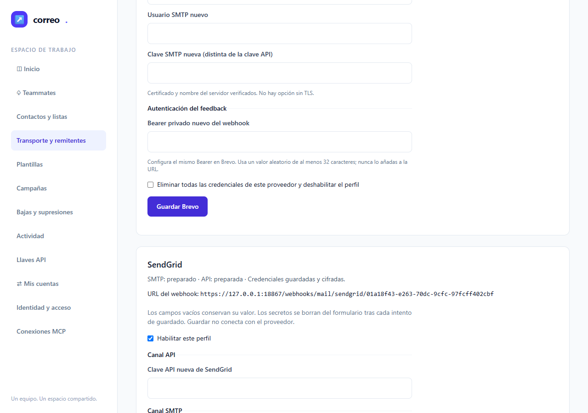
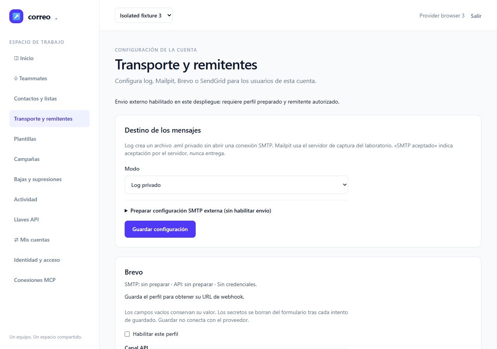
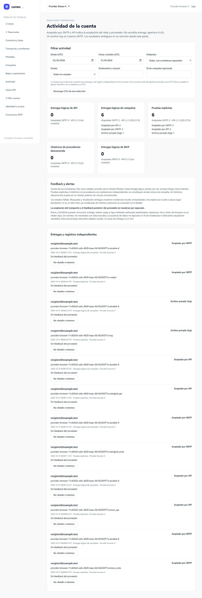
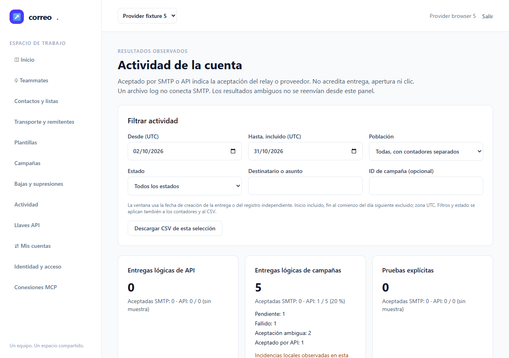

# Informe de QA — Proveedores de correo

| | |
|---|---|
| **Fecha** | 2026-10-31 · ejecución 00:02:35 UTC (01:02:35 Europe/Madrid) |
| **Estado global** | **NO-VERDE — intento 1 de 3** |
| **URL auditada** | `https://127.0.0.1:18867` |
| **Plan** | [improvement-plan.md](../../improvement-plan.md) · [test-plan.md](../../test-plan.md) |
| **Rol efectivo** | QA independiente genérico, modelo heredado; no se acredita el modelo nativo Sonnet del plugin |

## Veredicto (qa-gate)

Ejecutado el `qa-gate.py` del bundle custom-agents2.3.0 sobre el [JSON nativo original](raw/results.json), sin reconstrucción ni justificación de flaky. Exit **1**.

```json
{
  "verdict": "NO-VERDE",
  "counts": {
    "passed": 2,
    "failed": 4,
    "flaky": 0,
    "skipped": 0,
    "interrupted": 0
  },
  "flaky_sin_justificar": [],
  "flaky_justificados": {},
  "threshold": "verde ⟺ 0 failed, 0 flaky sin justificar, 0 interrumpidos y ≥1 test ejecutado"
}
```

## Resumen

- **Automáticos: 2/6 pasan; 4 fallan; 0 flaky, 0 omitidos, 0 interrumpidos.** Cada escenario se ejecutó una vez, con retry 0.
- **Manuales pendientes: M-01 y M-02.** No se acreditan mediante fixtures.
- La limpieza es correcta y las fuentes son idénticas; el resultado funcional global permanece rojo.
- No se modifican producto, tests, ledger o spec. No hay nueva ejecución ni handoff a documenter: root coordina corrección y siguiente intento.

## Puertas de entrada y cobertura declarada

| Puerta | Exit | Resultado |
|---|---:|---|
| ledger-lint | 0 | 0 incoherencias y 0 avisos |
| coverage-check | 0 | Sin referencias rotas, tareas huérfanas ni tests sin referencia; 16 GWT con referencia |
| guardrail | 0 | Origen HTTPS loopback admitido |

La cobertura del mapa comprueba referencias; no demuestra que todas las aserciones de los recorridos fallidos se hayan alcanzado. No hay bloques API-xx/A11Y-xx separados en el test-plan, ni umbral porcentual de cobertura de código configurado. No se inventa un porcentaje unitario.

```json
{"applies": true, "defined": ["E2E-01", "E2E-02", "E2E-03", "E2E-04", "E2E-05", "E2E-06", "M-01", "M-02"], "referenced": ["E2E-01", "E2E-02", "E2E-03", "E2E-04", "E2E-05", "E2E-06", "M-01", "M-02"], "broken_refs": 0, "tasks_sin_cobertura": [], "tests_sin_referencia": [], "gwt_cubiertos": ["CA-01", "CA-02", "CA-03", "CA-04", "CA-05", "CA-06", "CA-07", "CA-08", "CA-09", "CA-10", "CA-11", "CA-12", "CA-13", "CA-14", "CA-15", "CA-16"], "gwt_sin_cubrir": [], "gwt_sin_id": 0, "test_plan_na": false, "marcador_no_canonico": null}
```

## Entorno y evidencia admitida

- Chromium mediante `channel: chrome`; inventario de controles previo con Chrome156.0.8078.79, viewport1280×900, un worker, sin retries, timeout original180000ms. No se descargan paquetes ni navegadores.
- Selectores y opciones inspeccionados antes de esta tanda en `storage/providers-email-20261030/browser-1690de26-ca37-4fd4-8374-f2c72b49de5d/controls.public.json`; ese inspector no cuenta como ejecución QA.
- Harness propio con JobObject/GATE, HTTPS18867, denyProxy18868 y backend privado18869, todos loopback. Service workers bloqueados. No se instala una CA global.
- `ignoreHTTPSErrors` admite únicamente la CA autofirmada de este harness de navegador. No acredita certificados públicos del proveedor ni TLS saliente real; las pruebas wire backend son otra capa, sin segundo conteo E2E.
- Brevo/SendGrid se sustituyen en la frontera de adaptador test-only. Mailpit sí usa SMTP127.0.0.1:11025/API127.0.0.1:18025, con dos mensajes sintéticos del UUID propio. No se contacta SMTP/API del proveedor ni se registran callbacks externos.
- Configuración y usuarios sintéticos cargados privadamente por el harness contra `emailing_testing` guardado por DB/usuario/DB_URL/conexión. QA no abre ni hashea configuración privada, claves o fixtures de credenciales.
- Memoria pertinente consultada: GOT-001 y GOT-012, ambos legado aceptado; se conservan corrección visible de errores y aislamiento de red. No hay flaky ni propuesta de memoria nueva.
- Selector QA: api-contract, backend-practices, frontend-quality, stack-practices, unit-tests; mismos criterios de dominio del ledger, más límites de delivery-practices. PHP/Laravel/Livewire: no se trasladan reglas específicas CI4/React.

## Resultados automáticos (E2E)

| Escenario original | Resultado nativo | Duración | Tareas |
|---|---|---:|---|
| E2E-01 — Guardar y alternar los cuatro modos sin devolver secretos | passed | 6.994s | T-01, T-06 |
| E2E-02 — Limpiar y corregir configuración de un único proveedor | timedOut | 180.191s | T-01, T-06 |
| E2E-03 — Aislar cuentas y revalidar permisos de ajustes/remitentes | failed | 8.669s | T-01, T-06 |
| E2E-04 — Enviar por los cuatro canales y distinguir aceptación de entrega | passed | 31.460s | T-01, T-02, T-03, T-04, T-06 |
| E2E-05 — Mostrar rechazo, rate limit e incertidumbre sin duplicar | failed | 16.404s | T-02, T-04, T-05, T-06 |
| E2E-06 — Consultar feedback autenticado, supresiones y operar por teclado | failed | 13.060s | T-02, T-03, T-04, T-05, T-06 |

### E2E-01 — Guardar y alternar los cuatro modos sin devolver secretos — PASA

**Cubre:** T-01, T-06. Persistencia de los cuatro modos, secretos ausentes de HTML/respuestas Livewire, conservación con campos vacíos y cero IO al guardar.


### E2E-02 — Limpiar y corregir configuración de un único proveedor — FALLA

**Cubre:** T-01, T-06. El rechazo y la corrección de la validación pasan. El recorrido se agota al localizar el checkbox de limpieza de Brevo (línea 94): no se acredita clear selectivo ni el bloqueo de envío posterior. La captura final muestra el checkbox; el uso de una expresión anclada con getByLabel necesita diagnóstico contra su etiqueta real.

**Error observado** (detalle original completo en `raw/results.json`):

```text
Error: locator.check: Test timeout of 180000ms exceeded.
```



Otras capturas: [E2E-02-error.png](screenshots/E2E-02-error.png).


### E2E-03 — Aislar cuentas y revalidar permisos de ajustes/remitentes — FALLA

**Cubre:** T-01, T-06. La vista B aislada se comprueba, pero al solicitar el regreso a A aún aparece Isolated fixture 3 y Brevo sin credenciales (línea 120). No se alcanzan revocación de permiso ni sesión restringida. Hay una navegación inmediata tras selectOption sin esperar la finalización del cambio de cuenta; no se concluye pérdida de datos ni fuga de cuenta.

**Error observado** (detalle original completo en `raw/results.json`):

```text
expect(region Brevo).toContainText('API: preparada') failed; timeout5000ms.
Recibido: SMTP: sin preparar · API: sin preparar · Sin credenciales.
```



Otras capturas: [E2E-03-account-B.png](screenshots/E2E-03-account-B.png).


### E2E-04 — Enviar por los cuatro canales y distinguir aceptación de entrega — PASA

**Cubre:** T-01, T-02, T-03, T-04, T-06. Los cuatro modos externos y log/Mailpit pasan en prueba explícita y trabajo durable. Se comprueban estado/proveedor, redelivery bloqueado, etiqueta API propia y dos capturas Mailpit del UUID.



Otras capturas: [E2E-04-brevo_api.png](screenshots/E2E-04-brevo_api.png), [E2E-04-brevo_smtp.png](screenshots/E2E-04-brevo_smtp.png), [E2E-04-log.png](screenshots/E2E-04-log.png), [E2E-04-mailpit.png](screenshots/E2E-04-mailpit.png), [E2E-04-sendgrid_api.png](screenshots/E2E-04-sendgrid_api.png), [E2E-04-sendgrid_smtp.png](screenshots/E2E-04-sendgrid_smtp.png).


### E2E-05 — Mostrar rechazo, rate limit e incertidumbre sin duplicar — FALLA

**Cubre:** T-02, T-04, T-05, T-06. Pasan los resultados fixture de 429, fallo permanente, incertidumbre, cambio de proveedor y fencing. Falla el localizador visible de Aceptación ambigua (línea 174): selecciona una option oculta, aunque la captura muestra el contador Aceptación ambigua: 2. La recarga y su comprobación posterior de cero IO no llegan a ejecutarse.

**Error observado** (detalle original completo en `raw/results.json`):

```text
Error: expect(locator).toBeVisible() failed

Locator:  getByText('Aceptación ambigua', { exact: true }).first()
Expected: visible
Received: hidden
Timeout:  5000ms
```




### E2E-06 — Consultar feedback autenticado, supresiones y operar por teclado — FALLA

**Cubre:** T-02, T-03, T-04, T-05, T-06. Pasan las respuestas de firma/Bearer válido e inválido, duplicado/alteración, cuatro eventos y una supresión, aceptación API conservada y feedback complained/unsubscribed. Falla la búsqueda exacta de Queja; destinatario suprimido (línea 213). La vista añade fecha UTC al mismo párrafo; el texto exacto requiere diagnóstico. No se alcanzan el envío bloqueado, teclado ni viewport estrecho.

**Error observado** (detalle original completo en `raw/results.json`):

```text
Error: expect(locator).toBeVisible() failed

Locator: getByText('Queja; destinatario suprimido', { exact: true })
Expected: visible
Timeout: 5000ms
Error: element(s) not found
```


## Checklist manual pendiente

- [ ] **M-01 — Cualificar proveedores reales en el destino privado**: cuatro combinaciones con cuenta/dominio/remitente y destinatario autorizados, SPF/DKIM/DMARC, claves SMTP/API independientes, callback HTTPS autenticado, envío y evento privados; rotación/revocación. Cubre T-03/T-04/T-05/T-06. Permanece pendiente y no impide aceptar QA local cuando ésta pase.
- [ ] **M-02 — Revisión humana de operación y cierre**: legibilidad de guías y formularios, aceptación frente a entrega y política de ambiguos; confirmación operativa privada y retro con datos reales. Cubre T-06. Permanece pendiente.

## Trazabilidad de tareas

| Tarea | Evidencia de esta tanda | Estado QA |
|---|---|---|
| T-01 | E2E-01/04 pasan; E2E-02/03 fallan | No aceptada |
| T-02 | E2E-04 pasa; E2E-05/06 fallan | No aceptada |
| T-03 | E2E-04 pasa; E2E-06 falla; M-01 pendiente | No aceptada |
| T-04 | E2E-04 pasa; E2E-05/06 fallan; M-01 pendiente | No aceptada |
| T-05 | E2E-05/06 fallan; M-01 pendiente | No aceptada |
| T-06 | 2/6 pasan; M-01/M-02 pendientes | No aceptada |

## Inmutabilidad y limpieza efectiva

Directorio UUID propio: `storage/providers-email-20261030/browser-11c426c8-ce6c-4628-baac-6b142245f77a`. Launcher exit1 por el resultado QA; settlement exit0. La sesión de exec11479 terminó y no queda una ejecución QA viva.

La comparación antes/después contiene **507/507 fuentes públicas idénticas, cero cambios**. Incluye explícitamente `docs/api/mail-provider-webhooks.openapi.json` con SHA256 `00a4023fdaca08a6c85a65363561205bbecb708784a532ccf57b5fc79e9a97ef`.

El settlement del mismo UUID y `raw/cleanup.json` confirman eliminación SQL propia, PHP propio terminado y listeners/puertos propios cerrados. El cleanup fixture elimina únicamente mensajes Mailpit por prefijo UUID y verifica que ya no existan; el caso E2E-04 había confirmado exactamente dos capturas propias. No hay inventario global ni eliminación de recursos ajenos.

```json
{
  "exit": 0,
  "sql_clean": true,
  "owned_php_exited": true,
  "owned_listeners_closed": true
}
```

```json
{
  "owned_sql_removed": true,
  "owned_php_exited": true,
  "owned_ports_closed": true
}
```

| Artefacto | SHA256 |
|---|---|
| [results.json](raw/results.json) | `00300948bbe4d064420a644e007b04f91811a425556c35204ee48cf67f0573d3` |
| [qa-gate.json](raw/qa-gate.json) | `d6d0409671f8ce154a2f1a740b925eea9daacf8123c75c55de091ebd772d9f62` |
| [cleanup.json](raw/cleanup.json) | `e88fe74224422498b06f23f876832f6a6f7c45d13ed6ec8c4a5d9fba413003ce` |
| [bounded-receipt.public.json](raw/bounded-receipt.public.json) | `e96f65d9c36952967e9353e4f7a941a2baebc75b77ed6340d461ee0c43d7c800` |
| [browser-settlement.public.json](raw/browser-settlement.public.json) | `dfada0ef21ab206cd3a2fd948bc4cdbc20687c781f2a3afcdd37fd00851331ae` |
| [source-manifest-before.json](raw/source-manifest-before.json) | `8f3802e109fbf88dc08fc5e643aec8184a638616b9253fe610d473b4bc9fb2cd` |
| [source-manifest-after.json](raw/source-manifest-after.json) | `8f3802e109fbf88dc08fc5e643aec8184a638616b9253fe610d473b4bc9fb2cd` |

## Evidencias y límites

- [Resultados nativos originales](raw/results.json), [qa-gate](raw/qa-gate.json), [preflight](raw/preflight.json), [paridad de fuentes](raw/source-parity.json), [cleanup](raw/cleanup.json) y [resumen derivado](raw/qa-summary.json). El resumen no sustituye al original para el gate.
- Fuentes exactas del spec, configuración y runner conservadas en `sources/`. Capturas originales explícitas más capturas de fallo copiadas por las rutas del reporter nativo a `screenshots/`.
- Trazas y vídeo desactivados en la configuración original; no se inventan. Las capturas de fallo muestran sólo el viewport nativo; no acreditan el contenido fuera de él.
- Los fallos E2E-02/03/05/06 requieren corregir o aislar selectores/navegación frente al contrato, conservando aserciones y negativos. Esta tanda no decide una causa raíz de producto y no acredita los pasos posteriores no ejecutados.
- El informe es local: no se publica en Confluence/Jira ni se cambian estados. T12–T14 MCP y T19/T20 de la plataforma principal permanecen fuera de este cierre.
- PDF generado con la skill to-pdf (HTML/CSS del tema del bundle, Markdown convertido e imágenes originales embebidas), Puppeteer ya instalado y Chrome existente; sin descarga. La verificación PDF se conserva en `raw/pdf-verification.json`.
