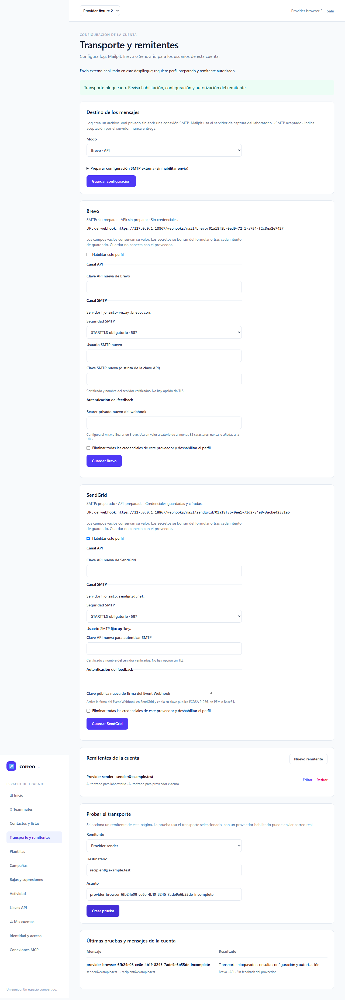
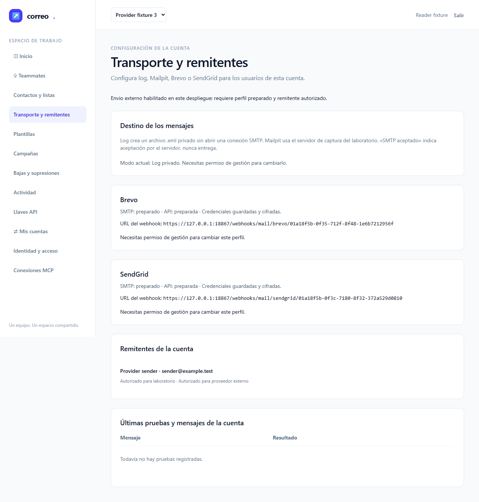
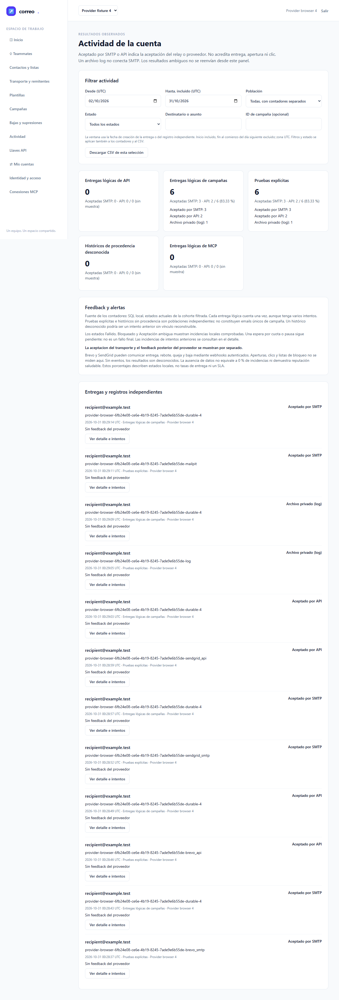
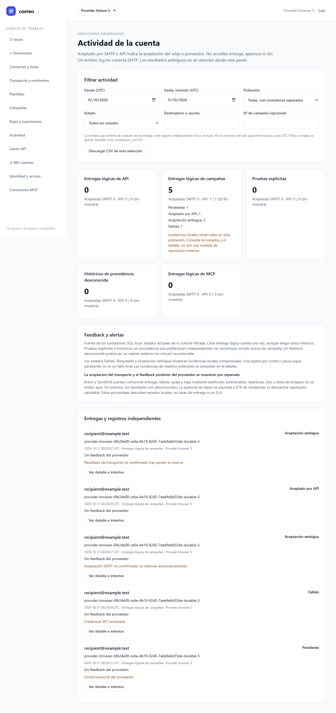
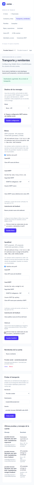

# Informe de QA — Proveedores de correo

| | |
|---|---|
| **Estado global** | **VERDE LOCAL — intento 3 de 3** |
| **Inicio nativo UTC** | 2026-10-31T00:27:53.983Z |
| **Origen local** | `https://127.0.0.1:18867` |
| **Plan** | [improvement-plan.md](../../improvement-plan.md) · [test-plan.md](../../test-plan.md) |
| **Rol efectivo** | QA independiente genérico/modelo heredado; no se acredita Sonnet nativo |

## Veredicto (qa-gate)

`qa-gate.py` del bundle custom-agents2.3.0 ejecutado sobre [results.json original](raw/results.json), exit **0**. Sin reconstrucción del reporter ni justificación de flaky.

```json
{
  "verdict": "VERDE",
  "counts": {
    "passed": 6,
    "failed": 0,
    "flaky": 0,
    "skipped": 0,
    "interrupted": 0
  },
  "flaky_sin_justificar": [],
  "flaky_justificados": {},
  "threshold": "verde ⟺ 0 failed, 0 flaky sin justificar, 0 interrumpidos y ≥1 test ejecutado"
}
```

## Resumen

- **6/6 pasan; 0 fallan; 0 flaky, 0 omitidos y 0 interrumpidos.**
- Se conservan seis escenarios originales y una ejecución por escenario, retries0 y timeout180000ms. QA3 incorpora únicamente tolerancia a espacio final en el localizador de feedback, manteniendo etiqueta, fecha y visibilidad. QA1 y QA2 rojos quedan íntegros y no se suman al conteo.
- M-01 y M-02 permanecen pendientes. Fixtures locales no acreditan proveedores comerciales, entrega real ni aprobación humana.
- Fuentes y auxiliares de informe viven en storage; sólo informe y evidencia necesaria se conservan en este directorio público.

## Puertas de entrada

| Puerta | Exit |
|---|---:|
| ledger-lint | 0 |
| coverage-check | 0 |
| guardrail | 0 |

Cobertura declarada por referencia; no es cobertura porcentual de código ni prueba de que un recorrido fallido alcanzase sus pasos posteriores.

```json
{"applies": true, "defined": ["E2E-01", "E2E-02", "E2E-03", "E2E-04", "E2E-05", "E2E-06", "M-01", "M-02"], "referenced": ["E2E-01", "E2E-02", "E2E-03", "E2E-04", "E2E-05", "E2E-06", "M-01", "M-02"], "broken_refs": 0, "tasks_sin_cobertura": [], "tests_sin_referencia": [], "gwt_cubiertos": ["CA-01", "CA-02", "CA-03", "CA-04", "CA-05", "CA-06", "CA-07", "CA-08", "CA-09", "CA-10", "CA-11", "CA-12", "CA-13", "CA-14", "CA-15", "CA-16"], "gwt_sin_cubrir": [], "gwt_sin_id": 0, "test_plan_na": false, "marcador_no_canonico": null}
```

## Entorno y límites

- Chrome instalado (`channel: chrome`), un worker, viewport1280×900; no se descargan paquetes/navegadores. Controles y sus nombres/opciones se contrastan con el origen local; se conservan selectores accesibles y aserciones web-first.
- Excepción CSS en E2E-05/06: se acotan span/p sin rol interactivo propio al contenedor de actividad identificado por aria-labelledby, evitando la option oculta y comprobando texto/fecha visibles. No se oculta un control inaccesible ni se cambia una aserción visible por existencia en DOM.
- Harness propio JobObject/GATE, HTTPS18867, denyProxy18868, backend privado18869; todos loopback, service workers bloqueados. No se instala CA global. `ignoreHTTPSErrors` admite sólo la CA autofirmada del harness y no acredita TLS público del proveedor.
- Brevo/SendGrid son adaptadores test-only; Mailpit usa SMTP127.0.0.1:11025/API127.0.0.1:18025. SQL se limita a emailing_testing con guarda real de base/usuario/DB_URL/conexión. No se leen manualmente credenciales/configuración privada.
- Pruebas unitarias, wire SMTP/HTTPS, pipeline/contratos y nuevas carreras de feedback son backend separado; no se suman como otros E2E ni sustituyen estos seis recorridos. Sin porcentaje de cobertura de código inventado.
- No hay bloques API-xx/A11Y-xx independientes en el plan. Las comprobaciones de teclado de E2E-06 no equivalen a una auditoría WCAG.
- Reglas QA y mapas pertinentes del bundle2.3.0 aplicados; capacidades compartidas api-contract/backend-practices/delivery-practices/frontend-quality/stack-practices/unit-tests. Laravel/Livewire, sin imponer convenciones CI4/React. Memoria pertinente GOT-001/GOT-012 aceptada; no se escribe memoria.

## Resultados automáticos

| Original | Resultado | Duración | Tareas |
|---|---|---:|---|
| E2E-01 — Guardar y alternar los cuatro modos sin devolver secretos | passed | 9.678s | T-01, T-06 |
| E2E-02 — Limpiar y corregir configuración de un único proveedor | passed | 11.618s | T-01, T-06 |
| E2E-03 — Aislar cuentas y revalidar permisos de ajustes/remitentes | passed | 15.877s | T-01, T-06 |
| E2E-04 — Enviar por los cuatro canales y distinguir aceptación de entrega | passed | 43.989s | T-01, T-02, T-03, T-04, T-06 |
| E2E-05 — Mostrar rechazo, rate limit e incertidumbre sin duplicar | passed | 22.806s | T-02, T-04, T-05, T-06 |
| E2E-06 — Consultar feedback autenticado, supresiones y operar por teclado | passed | 18.012s | T-02, T-03, T-04, T-05, T-06 |

### E2E-01 — Guardar y alternar los cuatro modos sin devolver secretos — PASA

**Tareas:** T-01, T-06. **Contrato comprobado:** Cuatro modos persistidos, separación de perfiles, secretos ausentes del HTML y respuestas Livewire, blank conserva y guardar no inicia IO.


### E2E-02 — Limpiar y corregir configuración de un único proveedor — PASA

**Tareas:** T-01, T-06. **Contrato comprobado:** Rechazo visible, corrección del mismo formulario, clear selectivo Brevo, SendGrid intacto y envío incompleto bloqueado antes de IO.



Otras capturas: [E2E-02-error.png](screenshots/E2E-02-error.png).


### E2E-03 — Aislar cuentas y revalidar permisos de ajustes/remitentes — PASA

**Tareas:** T-01, T-06. **Contrato comprobado:** A/B aisladas, vuelta a A, permiso retirado con sesión abierta, 403 sin escritura y controles restringidos.



Otras capturas: [E2E-03-account-B.png](screenshots/E2E-03-account-B.png).


### E2E-04 — Enviar por los cuatro canales y distinguir aceptación de entrega — PASA

**Tareas:** T-01, T-02, T-03, T-04, T-06. **Contrato comprobado:** Cuatro canales externos fixture y log/Mailpit, estados y proveedor correctos, trabajo durable y redelivery bloqueado, dos mensajes Mailpit propios.



Otras capturas: [E2E-04-brevo_api.png](screenshots/E2E-04-brevo_api.png), [E2E-04-brevo_smtp.png](screenshots/E2E-04-brevo_smtp.png), [E2E-04-log.png](screenshots/E2E-04-log.png), [E2E-04-mailpit.png](screenshots/E2E-04-mailpit.png), [E2E-04-sendgrid_api.png](screenshots/E2E-04-sendgrid_api.png), [E2E-04-sendgrid_smtp.png](screenshots/E2E-04-sendgrid_smtp.png).


### E2E-05 — Mostrar rechazo, rate limit e incertidumbre sin duplicar — PASA

**Tareas:** T-02, T-04, T-05, T-06. **Contrato comprobado:** Negativo permanente, 429 con espera, incertidumbre SMTP, cambio de proveedor, fencing y recarga sin IO adicional.




### E2E-06 — Consultar feedback autenticado, supresiones y operar por teclado — PASA

**Tareas:** T-02, T-03, T-04, T-05, T-06. **Contrato comprobado:** Firma/Bearer, duplicado/alteración, feedback y supresión conservados, nuevo envío bloqueado, teclado y viewport estrecho.



Otras capturas: [E2E-06-feedback.png](screenshots/E2E-06-feedback.png).

## Checklist manual pendiente

- [ ] **M-01 — Cualificar proveedores reales en el destino privado:** cuatro combinaciones, cuenta/dominio/remitentes, SPF/DKIM/DMARC, claves SMTP/API distintas, callback HTTPS autenticado, envío/evento privados y rotación/revocación. T-03/T-04/T-05/T-06. No bloquea aceptar QA local cuando pase; no se marca realizado.
- [ ] **M-02 — Revisión humana de operación y cierre:** legibilidad, aceptación/entrega, política de ambiguos, resultados privados y retro con datos humanos reales. T-06. Sin aprobación simulada.

## Inmutabilidad y limpieza

UUID propio: `storage/providers-email-20261030/browser-6fb24e08-ce6e-4b19-8245-7ade9e6b55de`.

```json
{
  "equal": true,
  "before_count": 507,
  "after_count": 507,
  "changed": [],
  "webhooks_sha256": "00a4023fdaca08a6c85a65363561205bbecb708784a532ccf57b5fc79e9a97ef"
}
```

```json
{
  "expected_ids": [
    "E2E-01",
    "E2E-02",
    "E2E-03",
    "E2E-04",
    "E2E-05",
    "E2E-06"
  ],
  "seen_ids": [
    "E2E-01",
    "E2E-02",
    "E2E-03",
    "E2E-04",
    "E2E-05",
    "E2E-06"
  ],
  "exact_match": true,
  "one_run_each": true
}
```

```json
{
  "exit": 0,
  "sql_clean": true,
  "owned_php_exited": true,
  "owned_listeners_closed": true
}
```

```json
{
  "owned_sql_removed": true,
  "owned_php_exited": true,
  "owned_ports_closed": true
}
```

Los recibos son del UUID emitido por el launcher. Cleanup atribuido a sus fixtures SQL, árbol de procesos y puertos; Mailpit elimina sólo mensajes cuyo asunto empieza por el UUID propio y confirma que no quedan. No se inventarían recursos/procesos globalmente ni se borran recursos compartidos.

| Evidencia | SHA256 |
|---|---|
| [results.json](raw/results.json) | `0e02e104b953162e70f52a4d45d32c369ac89ee2151970ad50f0848d016fe303` |
| [qa-gate.json](raw/qa-gate.json) | `a82153ea1900f2699f478a32eede7d9a52cd9d84f99b2c583c98efc31874d68f` |
| [cleanup.json](raw/cleanup.json) | `e88fe74224422498b06f23f876832f6a6f7c45d13ed6ec8c4a5d9fba413003ce` |
| [bounded-receipt.public.json](raw/bounded-receipt.public.json) | `e97c397bf7ab23356dd12011abfee70d3e5ad767f5d0aee07fad6b22322c9220` |
| [browser-settlement.public.json](raw/browser-settlement.public.json) | `dfada0ef21ab206cd3a2fd948bc4cdbc20687c781f2a3afcdd37fd00851331ae` |
| [source-manifest-before.json](raw/source-manifest-before.json) | `d3dd947db85583a6fbd794b7fa69ec5bf30626d0cf5b0953f9667ddf0a130c40` |
| [source-manifest-after.json](raw/source-manifest-after.json) | `d3dd947db85583a6fbd794b7fa69ec5bf30626d0cf5b0953f9667ddf0a130c40` |

## Bundle servido y límite de procedencia

Los layouts usan @vite y `public/hot` está ausente: la tanda usó el build Vite final compilado por root antes de QA3, sin recompilar durante la tanda. QA captura manifiesto y cada asset antes y después; compara ambos diccionarios completos además del snapshot de 507 fuentes. Paridad del bundle: True.

[Bundle antes](raw/asset-bundle-before.json) y [después](raw/asset-bundle-after.json): manifiesto SHA256 `5360413f27210f025d350c599fe8f951ae85084637b81cc549a801a2ba39facd`; CSS `assets/app-BKQcRcPa.css` y JS `assets/app-DMsN-rLE.js`.

## Trazabilidad y handoff

| Tarea | Escenarios |
|---|---|
| T-01 | E2E-01/02/03/04 |
| T-02 | E2E-04/05/06 |
| T-03 | E2E-04/06, M-01 |
| T-04 | E2E-04/05/06, M-01 |
| T-05 | E2E-05/06, M-01 |
| T-06 | E2E-01–06, M-01/M-02 |

QA local aceptada. Root recibe las puertas y evidencias para documenter y el resto del workflow; QA no cierra ledger/spec ni suplanta retro.

T12–T14 MCP y T19/T20 de la plataforma principal permanecen fuera del alcance. Informe sólo-local, sin publicación Confluence/Jira ni mensajes externos.

PDF conforme a la skill to-pdf: tema HTML/CSS del bundle e imágenes originales embebidas. El renderer Puppeteer instalado se detuvo al quedar sin salida; se usa el Chrome existente mediante Playwright, equivalente Chromium HTML/CSS, offline y con JobObject acotado. No se descargan paquetes/navegadores ni se repiten E2E. HTML/CSS temporales y copias de fuentes viven en `storage/providers-email-20261030/qa-3-report-tools`. Metadatos del motor en `raw/pdf-render.json`, verificación visual en `raw/pdf-verification.json`. Trazas/vídeo desactivados en la configuración E2E original; no se inventan.
